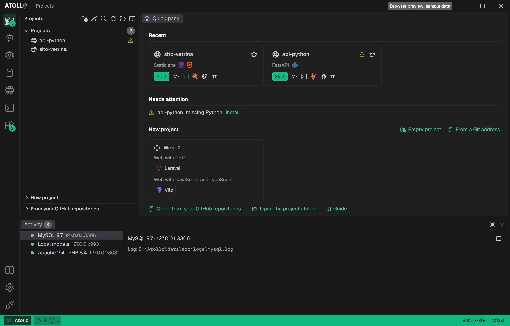

<p align="center">
  <a href="https://nabre.github.io/atollo/">
    <picture>
      <source media="(prefers-color-scheme: dark)" srcset="docs/brand/wordmark-dark.svg">
      
    </picture>
  </a>
</p>

<h1 align="center">Atollo — Universal Portable Dev & AI Workspace</h1>

<p align="center">
  A portable, zero-install development environment for Windows x64, Apple Silicon Macs and Linux x64 and ARM64 (the systems Docker Sandboxes runs on), that runs every project in its own Docker Sandboxes microVM.<br>
  Editor, 20+ languages and runtimes, local databases, local AI models and the Claude Code, Codex, Antigravity and Pi AI agents in one folder you can carry on a USB drive.
</p>

<p align="center">
  <a href="https://github.com/nabre/atollo/releases"></a>
  <a href="https://github.com/nabre/atollo/releases"></a>
  <a href="https://github.com/nabre/atollo/actions/workflows/app.yml"></a>
  <a href="LICENSE"></a>
  
  
  
</p>

<p align="center">
  <a href="https://nabre.github.io/atollo/"><b>Website</b></a> ·
  <a href="https://github.com/nabre/atollo/releases/latest"><b>Download</b></a> ·
  <a href="https://nabre.github.io/atollo/guide/"><b>User guide</b></a> ·
  <a href="https://github.com/nabre/atollo/issues"><b>Issues</b></a> ·
  <a href="docs/PRIVACY.md"><b>Privacy</b></a>
</p>

<p align="center">English · <a href="docs/README.it.md">Italiano</a> · <a href="docs/README.fr.md">Français</a> · <a href="docs/README.de.md">Deutsch</a></p>

**Atollo** is a self-contained *Universal Portable Dev & AI Workspace* (`Atollo.exe`). At its core it is the portable configurator of **Docker Sandboxes** (`sbx`): every project runs in its own microVM, with its terminal, its actions, its site, the editor's terminals and the Claude Code, Codex and Pi agents, and sees only its own folder. Around that core it unifies an **Editor** (integrated VSCodium), a **Toolchain/Runtime Manager** (20+ on-demand languages and tools, also built for the VM's Linux), **Local Servers/Databases** (MySQL, MongoDB, SQLite, Caddy/Apache), and an **AI Agent Orchestrator** (Claude Code, Codex, Antigravity, and Pi with synchronized instructions, skills, and MCP servers, plus local LLMs through llama.cpp) into a single portable folder. Zero install, zero administrator rights, zero system services outside the workspace folder.

Each program lives in one of three boxes:

- **The VM**: everything that runs a project's code. The project's terminal, its actions (`npm run dev`…) and their sites (a container in the VM, its port published on the PC), the sites of the Web Server pools, a project created from a terminal or a framework, the editor's terminals, tasks and agent profiles, and the agents: Claude Code and Codex in `sbx` agent sandboxes, Pi in the project's VM (its Linux build). Inside: the project's folder, writable, and the kit's tools for Linux at the project's versions, read-only. Towards the PC: only the port of the project's database and, if the project allows it, GitHub.
- **The kit on the PC**: the kit's own programs, never an agent: the kit's terminals ("All tools" and your own, in any folder, with the kit's tools but without the agents' CLIs, and a notice that agents run only in the VM), the database servers and their tools (phpMyAdmin, mongo-express, backups), llama.cpp, the editor's window, Git for cloning, `sbx` itself and the app. Antigravity, a desktop editor, stays here for the synced instructions, skills and MCP servers and never starts on a project.
- **No VM**: when the VM is not available, the project's terminal, actions, sites and pools run on the PC with a sealed environment and without the agents' CLIs; the editor's terminals, tasks and agent profiles do not start (the terminal says why and how to fix it; the editor's window still opens) and no agent starts. The status bar says so with a **No VM** warning, the reasons and how to fix each one.

| What | VM available | No VM |
| --- | --- | --- |
| Kit terminals ("All tools" and your own, any folder) | on the PC with the kit's tools, without the agents' CLIs, with a notice that agents run only in the VM | the same |
| Project terminal, actions, their sites, Web Server pools, creating a project from a terminal or a framework | in the project's VM (ports published on the PC, the kit's databases reached by their port) | on the PC with the sealed environment, without the agents' CLIs |
| Editor's terminals, tasks, agent profiles | in the project's VM, with the project's tool versions | do not start: the terminal says why and how to fix it; the editor's window still opens |
| Agents | Claude Code and Codex in their own sandboxes, Pi in the project's VM; Antigravity never starts on a project | no agent starts |

On first start the app downloads the required components by itself: PowerShell 7, GitHub CLI, the editor and Docker Sandboxes (0.49.2 or later, about 470 MB, on the systems where Docker publishes it). Everything else is chosen on the "Tools" page, or arrives when needed: Node.js with an `npm` action, uv with a `uvx` MCP server, and so on.

<picture>
  <source media="(prefers-color-scheme: light)" srcset="site/shots/en/shot-projects-light.png">
  
</picture>

## Features

- **Every project in its own microVM.** With Docker Sandboxes each project gets a microVM of its own (kernel, network behind `sbx`'s proxy with Atollo's `balanced` policy, Docker of its own): the project's terminal (`sbx exec`), its actions, its site (the kit's static, Caddy or Apache server becomes a container in the VM, `httpd:2.4` or `php:<version>-apache`, with the project's own aliases, its port published on the PC's `127.0.0.1`, or on the local network if Settings allow it), the sites of the Web Server pools, the projects created from a terminal or a framework, Claude Code and Codex in `sbx`'s agent sandboxes and Pi in the VM itself. The VM mounts the project's folder writable and the kit's tools for Linux read-only, at the versions the project chose: downloaded once into the kit and verified by SHA-256, they travel with the kit, work offline, start fast and cannot be altered by the VM, which needs no download sites for them; the project's own packages (`node_modules`, `vendor`, `.venv`) are installed by the project inside the VM. Only the kit's `sbx` is used, never one installed on the PC; its sandboxes, disks, images, settings and logs stay in `data`. The VM's window (a click on VM in the status bar) lists the kit's sandboxes, whom each belongs to, its real disk space, and removes them. **Stop** ends an action inside its VM and takes its port back. If the kit moves to another drive letter or folder, a project's sandbox is made again by itself: files, databases, tools and sign-ins are in the kit, only the VM's home and its downloaded images are lost.
- **No VM? A clear warning.** When the PC cannot run the VM (an unsupported system, the hypervisor off, `sbx` not signed in to Docker, another Docker Sandboxes already running, a FAT32 or exFAT disk…), the status bar shows **No VM** beside Activity; a click gives each reason and its fix: **Run** opens `sbx login` in Atollo's terminal, **Install in the kit** (if an installation failed, with its reason; Atollo also tries again by itself every hour), and for the administrator steps (Windows Hypervisor Platform, the `kvm` group, the AppArmor profile) the exact command with a **Copy** button, which you run yourself once (Atollo never launches them nor asks for elevation); **Check again** asks anew. Meanwhile the project's terminal, actions and sites run on the PC with a sealed environment: without the variables that lead to your real profile, your SSH agent and the D-Bus session, without the agents' CLIs, and with the database login of the project's own user, never the kit's root. The editor's terminals and the agents do not start.
- **Kit terminals on the PC.** "All tools" and your own terminals, in any folder, always run on the PC with the kit's tools, VM or not, but without the agents' CLIs (`claude`, `codex`, `agy`, `pi`): a notice in the terminal says that the agents run only in the VM, from the project's page or the editor.
- **Editor.** Built-in VSCodium with the Atollo dark and light themes, in a window measured on VSCodium 1.135's own workbench: the same sizes, colors and codicon icons. Its window runs on the PC. Its terminals (every kit profile), its tasks and its agent profiles (Claude Code, Codex, Pi) run in the project's VM, in the folder they open in, with the project's tool versions; Antigravity never starts on a project. Fail closed: without the VM, or if Atollo has not recorded whether the VM is on, the project's VM was not prepared, or the folder is not a project's, the terminal opens nothing and says why and how to fix it; the editor's window still opens. One declared limit: the editor's debugger adapters start programs on the PC.
- **Languages and tools on demand.** 20+ languages and tools (Node.js, Python, uv, PHP, Rust, Go, Java, .NET, Dart, Julia, Ruby, C/C++, Bun, Deno, Typst, TinyTeX, R, Android SDK…), downloaded when needed and verified by SHA-256 checksum or signature. Side-by-side versions, one per project. With the VM on, the chosen tools are installed for the VM's Linux and the PC gets only the app's components (tools already on the PC stay, for a PC without the VM); the components × systems matrix marks what runs "in the VM".
- **Local databases and web servers.** MySQL with phpMyAdmin, MongoDB with mongo-express, and SQLite, started and stopped with one click, with a database, user and password for each project; several versions side by side, each keeping its own port. The servers stay on the PC, in the kit: a project's VM reaches only its database's port, as the project's user (the password in a file readable by you only, never on a command line); the kit's root login never enters a VM. Caddy and Apache for sites at `<project>.localhost`, on every system, on their own or in a server shared by several projects (a pool): with the VM each project's site runs in its VM, without it on the PC. A port already in use is refused, naming whoever holds it. No system services.
- **GitHub in the VM, per project.** A project's Git section has "GitHub in the VM", off by default: when on, `sbx` asks the kit for the token through a command (`Atollo secret github`) and its proxy adds it to the requests to GitHub; the token is never copied and never enters the VM. Never given to a kit terminal.
- **Four AI agents, one configuration.** Claude Code, Codex, Antigravity and Pi: install, sign in and start. Write instructions, skills and MCP servers once in `data/agents` and `atollo sync` keeps all four aligned. Ready MCP servers are one click away: GitHub, Playwright and Fetch for the whole kit, the project's files and its MySQL or MongoDB database for a project, with no token or password written in the files. Plan limits and usage for today and the last 7 days. Agents run only in the VM: Claude Code and Codex in `sbx`'s agent sandboxes, with the sign-ins `sbx` manages, the project's kit tools on the `PATH` and its database (the port opened for their sandbox), and Pi in the project's VM with its Linux build, from the app's page and from the editor alike; the kit's MCP servers do not reach them yet. Antigravity, a desktop editor, never starts on a project: it stays in the kit for the synced instructions, skills and MCP servers. Without the VM no agent starts, and never on the PC in its place.
- **Local AI models.** Language models that run on the PC, with no network and no account: GGUF models from Atollo's catalog or from any Hugging Face repository, downloads that resume where they stopped (even after closing Atollo) and are verified by SHA-256. The llama.cpp server (CPU, or GPU with Vulkan or Metal) listens on 127.0.0.1 only, with a key; Pi uses it out of the box, and its chat opens in the browser. One copy in `data/models`, shared by Windows, macOS and Linux.
- **One folder for four systems.** The same folder, or the same external SSD, moves from Windows to macOS to Linux with projects, databases and agent settings intact: each machine runs the native programs of its system. "Remove drive" closes everything Atollo opened and lets you eject the disk.

## Documentation

| Document | What it covers |
| --- | --- |
| [User guide](https://nabre.github.io/atollo/guide/) | every page of the app, step by step, with screenshots, on the website (also inside the app) |
| [Component catalog](docs/app/CATALOG.md) | the components, where each one is downloaded from, availability per system |
| [Tools × systems matrix](docs/app/TOOLS-MATRIX.html) | every component on each of the four targets: native or missing |
| [Architecture](docs/app/ARCHITECTURE.md) | how the code is organized and where a change goes |
| [Testing](docs/app/TESTING.md) | automated checks and the manual checklist per system |
| [Decisions](docs/app/DECISIONS.md) and [changelog](docs/app/CHANGELOG.md) | the reasons behind each choice and what changed, in Italian |

Open work is tracked in the [issues](https://github.com/nabre/atollo/issues).

## How to use it

1. Copy Atollo's exe (for example `Atollo-0.7.3-win32-x64.exe`) into an empty folder: a USB stick, an external drive or a folder in your profile (spaces, brackets or `&` in the name are fine).
2. Double-click it: the app creates `projects\` and `data\`. On first start choose agents, languages and tools: the app downloads and verifies them (checksum or signature), Docker Sandboxes included.
3. Sign in to Docker once per PC: with a (free) Docker account, click **No VM** in the status bar and **Run** beside `sbx login`: the command opens in Atollo's terminal with the kit's `sbx`, and the sign-in link appears there (a click opens it in your browser). The other reasons in the same list say what else the PC needs.
4. Create or clone a project on the **Projects** page. A project's editor, terminal and agents always open in its folder; with the VM on, the terminal, actions, the editor's terminals and the agents open in the project's microVM.

### Requirements for the VM

- Windows 11 (x64) with **Windows Hypervisor Platform** on;
- macOS 14 or later on Apple silicon;
- Ubuntu 24.04 or later (x64 or ARM64; not its derivatives) with `/dev/kvm` usable by your user (the `kvm` group) and, on recent Ubuntu, which restricts user namespaces, the AppArmor profile for the kit's microVM shim (again if the kit moves to another folder);
- virtualization on in the firmware (BIOS/UEFI); inside a virtual machine, nested virtualization;
- a free Docker account (`sbx login`, once per PC, no administrator);
- the kit on NTFS, APFS or ext4: the VMs' disks do not fit on FAT32 or exFAT.

Atollo does the rest by itself: it installs Docker Sandboxes in the kit (trying again every hour if it fails), starts the kit's daemon, sets the network policy and the daemon's settings, cleans up the daemon's junction and makes a project's sandbox again after the kit moves. The administrator steps (Windows Hypervisor Platform and a restart, the `kvm` group and a new login, the AppArmor profile) are shown with the exact command and a **Copy** button, for example `Enable-WindowsOptionalFeature -Online -FeatureName HypervisorPlatform -All` in an administrator PowerShell: Atollo never launches them. No software can give the VM to Windows 10, macOS before 14, a Linux other than Ubuntu 24.04 or later, a PC with virtualization off in the firmware, a virtual machine without nested virtualization, or a kit on FAT32 or exFAT: there the **No VM** warning stays. Docker Desktop is not needed.

From the [releases page](https://github.com/nabre/atollo/releases): `Atollo-<version>-win32-x64.exe` for Windows, `Atollo-<version>-darwin-arm64.app.zip` for macOS (Apple Silicon), `Atollo-<version>-linux-x64` or `Atollo-<version>-linux-arm64` (`.AppImage` and `.tar.gz`) for Linux; each file has its `.sha256`. The name tells the version: when the app updates itself, the exe and the AppImage take the new version's name. In the examples below `Atollo.exe` stands for your exe.

**macOS** (12 or later, Apple Silicon). The app only has an ad hoc signature, not notarized by Apple:
1. Unzip it and move `Atollo.app` with the Finder into the kit folder (for example `/Volumes/KIT/Atollo/`).
2. In Terminal, remove the browser's quarantine: `xattr -dr com.apple.quarantine /Volumes/KIT/Atollo/Atollo.app`.
3. Open `Atollo.app` from that folder: `projects/` and `data/` are created next to it, never inside.

Without step 2 macOS starts the app from a temporary copy (App Translocation) and Atollo stops showing the same command, instead of creating the kit in a folder that goes away.

**Linux** (x64 and ARM64, glibc 2.35 or later: Ubuntu 22.04, Debian 12 and newer). Copy `Atollo-<version>-linux-<arch>.AppImage` into the kit folder, `chmod +x Atollo-<version>-linux-<arch>.AppImage` and start it: the kit is the AppImage's folder. Without FUSE (containers, some minimal distributions): run `./Atollo-<version>-linux-<arch>.AppImage --appimage-extract-and-run`, or use `Atollo-<version>-linux-<arch>.tar.gz` with WebKitGTK 4.1 installed (on Ubuntu and Debian `sudo apt install libwebkit2gtk-4.1-0`): extract `Atollo` into the kit folder and run `./Atollo`. The AppImage updates itself; the `tar.gz` says when a new version is there to download.

## Pages

| Page | What it has |
| --- | --- |
| **Projects** | the **quick panel** (what is running, favourite and recent projects with Run, Editor, Terminal and agent, what needs fixing, a grid of the tools to install or update with their state, a click opening each one's page in Tools), the project list with ▶ on every row, Ctrl+P to open one by name, Ctrl+Shift+P for the command palette (start or stop a project, open it, an agent in it, go to a page, stop everything); **New project**, a tab beside the projects: empty, from your GitHub repositories (with clone, rename and delete on GitHub), from a Git URL or from one of 63 grouped bases (Laravel, Next.js, Django, WordPress, Astro, Tauri…); notices about the workspace. Each project has its own page, with Start, Editor, Terminal and agent at the top and seven sections: **Run** (actions, ports and their output), **Website**, **Components** (with the versions), **Databases** (the project's database with user and password, backups, a safety copy before every restore and change of version), **Extensions**, **Editor** (settings and MCP servers), **Git** (with "GitHub in the VM") |
| **AI** | all of the kit's AI in two panes. **Agents**: the installed Claude Code, Codex, Antigravity and Pi: version, sign-in (with Antigravity's Gemini key), plan limits and usage of today and the last 7 days; instructions, skills and MCP servers shared in `data\agents`. **Local models**: the llama.cpp server (start and stop, address, the browser chat and its key), the model Pi uses, Atollo's catalog of GGUF models with "fits / at the limit / too large" for this PC's RAM or video memory, any Hugging Face repository (with an optional token for gated models), downloads you can pause and resume; models in `data\models`, on this PC only |
| **Databases** | Atollo's MySQL (with phpMyAdmin) and MongoDB (with mongo-express) servers: start and stop, administrator password, port, several versions side by side each on its own port, data in `data\db`, on this PC only; SQLite without a server |
| **Web Servers** | the Caddy and Apache servers shared by the projects (pools) and your own profiles, with the `<project>.localhost` sites they serve; on this PC only, or on the local network if Settings allow it; with the VM on, each project's site runs in its VM, without it on the PC |
| **Terminals** | consoles with the kit's tools in any folder: "All tools" and terminals of your own, with the tools and versions you choose; always on the PC, without the agents' CLIs, with a notice that agents run only in the VM |
| **Tools** | languages and tools by kind (system and editor, AI agents, local models, languages, development tools, web servers, databases, database viewers), with their logo, dependencies and disk space; install, update and remove, several versions (with the VM on, for the VM's Linux); the Rust compiler (GNU or MSVC) on Rust's page; the components × systems matrix, with the VM's column; the editor extensions matrix |
| **Guide** | the user guide inside the app, in nine chapters; every page opens its own topic |
| **Settings** | saved as you change them: language, theme, the programs' temporary files, the packages kept to reinstall without the network, network (proxy, certificates, local network), app updates, privacy; Atollo's **GitHub account**, one for everything (app, Git, editor, consoles, agents, GitHub CLI), and who signs the commits; where the workspace folder is; the frameworks' instructions; **The kit**: its folders, its disk, the platform and the versions, with Kit health, Copy of the kit, Export diagnostics and Report a problem |
| **Remove drive** | closes everything Atollo opened, stops the kit's Docker Sandboxes (and with it the microVMs), brings Antigravity's sign-in back into `data\` and lets you eject the drive |

At the bottom of every page, the **Activity** panel: what is running or installing (project actions, every database version, web server pools, components), with output and errors in one place; "Stop all" stops everything after a confirmation. The status bar counts the same things, and beside Activity it shows the VM's pill: green **VM** when the projects run in their microVMs, blue **VM… 40%** while a project's VM is being prepared, orange **No VM** when you can fix why, grey **No VM** when this PC cannot have it, red **VM ⚠** when a preparation failed; a click opens the reasons and their fixes and, once the kit's Docker Sandboxes is installed, the kit's sandboxes with their space and a "Remove" button. Every download, install, update and VM preparation is in sight while it runs: the status bar shows its title, its step and a small bar with the percent («3 jobs running» when there are more), a click opens its steps and errors in Activity; a terminal, an action or an agent waiting for its VM shows «Preparing the VM…» with the same progress. On Tools and on the quick panel each tool shows its own install in its row (queued, its bar, «Retry», «Cancel»): you can ask for others meanwhile, they queue.

Atollo's console is a tab of the app's terminal panel on every system, with the kit's PowerShell 7 (on Windows on Microsoft's ConPTY, the console of Windows Terminal, downloaded with the kit); it never opens the PC's terminal and has only Atollo's environment: programs installed on the host PC do not interfere. With the VM on, a project's terminal is instead a `bash` in its microVM (`sbx exec`), in the same panel; the kit's terminals stay on the PC. If a terminal's saved version has been removed, it says which one it uses instead (for example PHP 8.2 → 8.4).

## Still to do

Atollo is in alpha (version 0.7.3). Windows x64 is the most tested system, real installs in CI included; macOS and Linux are built and tested in CI only. The full checklist is in [docs/app/TESTING.md](docs/app/TESTING.md).

- **The VM, to be finished** ([D-175](docs/app/DECISIONS.md), [D-178](docs/app/DECISIONS.md)). Projects in their microVMs are tried for real only on Windows 11 x64 with Docker Sandboxes 0.49.2; macOS and Ubuntu are untested, and so is "GitHub in the VM" with a real account. Still to do: the kit's MCP servers for the agents in the VM (their commands are programs of the PC), to be brought into `sbx`'s MCP gateway or said missing.
- **The alpha, to be tried.** [The 0.7.3 alpha](https://github.com/nabre/atollo/releases/tag/app-v0.7.3) is on GitHub for Windows x64, macOS on Apple silicon and Linux x64 and ARM64, the four systems Docker Sandboxes runs on ([D-176](docs/app/DECISIONS.md)). The published files are built and tested in CI: now they need downloading and starting on clean machines.
- **Alpha testing.** We need people using Atollo on real projects and different PCs, and reporting what goes wrong: component installs, projects, databases, agents. Settings › The kit › “Report a problem” opens a GitHub issue with the version and the system already filled in; attach the zip of “Export diagnostics” next to it (secrets masked, made on your PC, never sent by the app).
- **macOS on real Macs** ([#5](https://github.com/nabre/atollo/issues/5), [#6](https://github.com/nabre/atollo/issues/6)). The Apple Silicon app is built and started in CI, never on a clean Mac: the zip downloaded with a browser, quarantine and Gatekeeper, App Translocation, a kit on an exFAT stick, the agents' sign-in carried from one Mac to another.
- **Linux on real machines** ([#5](https://github.com/nabre/atollo/issues/5)). x64 and ARM64 on Ubuntu 24.04, Fedora 42 and Debian 13: AppImage with and without FUSE, the `tar.gz` with WebKitGTK 4.1, exFAT sticks or sticks mounted `noexec`, sign-in with GNOME, KeePassXC or KWallet.
- **Updates and the kit's builds outside Windows.** Updating the app from one version to the next on macOS and Linux is not tried yet. The kit's Apache (2.4.69, D-116) is in the catalog but tried only in CI; so is the kit's PHP with `pdo_sqlite` (8.4.26 and 8.5.11, D-133), which the app uses from 0.3.0 on.
- **Code signing.** On macOS only an ad hoc signature, without Apple notarization: `xattr -dr com.apple.quarantine` is needed. On Windows 0.7.3 ships unsigned: the SignPath signature is still to be activated, and until then SmartScreen may warn on first launch.

Have an Apple Silicon Mac or a Linux PC? Try Atollo and tell us how it went: [open an issue on GitHub](https://github.com/nabre/atollo/issues).

## Known limits

- On Windows 10 and 11 (`x64`), macOS on Apple Silicon and Linux (`x64` and `ARM64`): the systems Docker Sandboxes, Atollo's core, runs on ([D-176](docs/app/DECISIONS.md)). On any other system Atollo says so at start and stops. On Linux ARM64 Android is missing. The macOS and Linux releases are tried in CI but not yet on clean machines ([#5](https://github.com/nabre/atollo/issues/5)), and the agents' sign-in still has to be tried on a Mac ([#6](https://github.com/nabre/atollo/issues/6)); components and sources per system in [docs/app/CATALOG.md](docs/app/CATALOG.md), the component × system matrix in [docs/app/TOOLS-MATRIX.html](docs/app/TOOLS-MATRIX.html). Apache on macOS and Linux is the kit's own build (D-116), with PHP through `php-fpm`.
- The VM (Docker Sandboxes) runs only where its [requirements](#requirements-for-the-vm) are met; elsewhere (Windows 10, macOS before 14, other Linux distributions, virtualization off, a kit on FAT32 or exFAT) the projects run on the PC with the **No VM** warning, and the editor's terminals and the agents do not start. Each sandbox's disk can grow up to about 30 GB (sparse files: only what is written takes space). A Docker Sandboxes already running on the PC (installed there, or another kit's) keeps the kit's VM off until you stop it: Atollo never stops it nor uses it.
- Without the VM there is no boundary between a project and your user: its programs can read your files and use the network; Atollo only filters their environment. Open in Atollo only projects you trust.
- On Linux MySQL needs two system libraries, `libaio` and `libnuma`: on Ubuntu 24.04 and Debian 13 `sudo apt install libaio1t64 libnuma1` (on older releases `libaio1`), on Fedora and RHEL `sudo dnf install libaio numactl-libs`. If they are missing, Atollo says so with the command to run.
- On macOS and Linux an Atollo folder on exFAT or FAT (a drive formatted for Windows) works, but those file systems have no links: where a program ships some, Atollo copies the files instead (for instance Git's 142 internal links), taking more space. On a drive used only with a Mac or Linux, APFS or ext4 is better.
- Outside the Atollo folder there are only Windows' own traces, transient temporary files in the system temp folder (automatically removed on exit; with Settings › General › Temporary files of programs, the programs may use it too while they run), GitHub CLI's sign-in in the Credential Manager if you sign in from a console with `gh auth login` (the one made in Settings stays in `data\gh`), Antigravity's while `agy` is open (for the session only), on macOS Claude Code's login in the Keychain (unless you connect with a token) and the web view's data in your Library, and the registry entry rustup writes on Windows, which Atollo removes. For the VM: the hypervisor (turned on once by you as an administrator), the Docker sign-in (`sbx login`, in the system's credential store, once per PC), the command (not the token) of "GitHub in the VM" for each sandbox in the system's credential store, a `sboxd-<id>` junction and a `gvisor` folder in the system temp folder (the daemon's sockets) and, on Ubuntu, the AppArmor profile of the kit's shim; sandboxes, disks, images, settings and logs stay in `data`. The full list is in [PRIVACY §4](docs/PRIVACY.md#4-data-stored-on-your-device).
- A project's folder is trusted by Claude Code, Codex and Pi once you open an agent in it from Atollo (the other folders in `projects\` are not): open an agent only in projects you trust. The agents' tokens (`CLAUDE_CODE_OAUTH_TOKEN`, `GEMINI_API_KEY`, the local models' `LLAMA_API_KEY`) go only to the agents Atollo launches, not to project actions, scripts, terminals or the editor; the local models' key is also written in Pi's `models.json` (`data\home\.pi\agent`, readable by your user only). The editor instead asks the first time it opens each project and opens the ones you don't trust in "Restricted Mode"; its terminals run only in the project's VM.
- The agents' usage limits come from undocumented interfaces of the providers and may stop working after one of their updates.
- "Remove drive" does not see PC programs that keep only a file of the workspace open.

## Layout

```
Atollo\
  Atollo.exe      all the logic
  projects\       your projects
  data\           downloaded programs, settings, sign-ins, cache, temporary files
                  (the settings of each project: data\projects\<project>\dev-settings.json)
```

For a backup, use Settings › The kit › **Copy of the kit**: it exports `projects\` and `data\` to a folder or a zip, without `data\apps\`, `data\cache\` and `data\models\` (downloaded again) and the VMs' images and disks (each sandbox is made again from its kit), with the databases stopped for the copy, and imports such a copy into a kit at its next start. By hand, copy the same folders with Atollo closed. The copy holds the kit's passwords: keep it safe.

## Uninstallation

Atollo does not use an installer, registers no system services or scheduled tasks, and does not modify the Windows registry or `PATH`:

1. Open the **Remove drive** page (or close the application) to stop all processes started by Atollo, the kit's Docker Sandboxes and its microVMs included, and restore any active Antigravity session into `data\`.
2. Delete the folder containing `Atollo.exe`, `data\`, and `projects\` (after backing up any projects you wish to keep): the sandboxes, their disks and Docker Sandboxes' settings go with it.
3. Any transient folders in `%TEMP%` are automatically removed on exit; if you ran `gh auth login` manually in a console (instead of the **Settings** page), you can remove the corresponding entry from the Windows **Credential Manager**.
4. What the VM leaves outside the folder (see [Known limits](#known-limits)) you remove by hand if you wish: the Docker sign-in and the `com.docker.sandboxes` entries in the Credential Manager (or the system's keychain), the `sboxd-<id>` junction and the `gvisor` folder in the system temp folder, the AppArmor profile on Ubuntu; Windows Hypervisor Platform stays on until you turn it off.

## Command line

```
Atollo.exe                           opens the window
Atollo.exe env [--project <name>]    shows the environment Atollo's programs get
                                     (with a project, with its versions)
Atollo.exe components [--target <system>]
                                     lists languages and tools, with the installed ones
Atollo.exe versions [<id>]           the versions on disk; with an id, the ones to download
Atollo.exe check                     checks that the installed programs answer
    --kit                            the kit's health: drive, space, path, permissions, libraries
    --files                          the programs' files: missing or changed since the installation
Atollo.exe prepare [options]         installs and updates the chosen components
                                     and removes the ones not chosen
    --only a,b                       only these (and what they need), removes nothing
    --skip a,b                       not these
    --update-all                     also update the installed ones
    --force                          download again
    --line id=x.y                    adds that version next to the others (can be repeated)
    --target <system>                prepares for another system: win32-x64, darwin-arm64,
                                     linux-x64, linux-arm64
Atollo.exe sync [--project <folder>] [--verbose]
                                     aligns the agents' instructions, skills and MCP servers
Atollo.exe keyring restore|save      Antigravity's sign-in (used by the kit's agy.cmd)
Atollo.exe serve <folder> <port>     file server for a static site
Atollo.exe models                    the local models: the catalog's and the downloaded ones
Atollo.exe models pull <model>       downloads a catalog id or a Hugging Face model
                                     (owner/name:quantization), resumed if interrupted
Atollo.exe models rm <id>            deletes a downloaded model
Atollo.exe llm start|stop|status     the server of the local models (chat and agents)
Atollo.exe diagnostics               makes the zip to attach to a problem report (secrets masked)
Atollo.exe version                   shows the version
Atollo.exe help                      shows the help
```

In the kit's terminals the same commands are `atollo …` (`atollo components`, `atollo check --kit`): a launcher in `data/kit/bin` that runs the exe the kit runs with (`ATOLLO_EXE`).

From PowerShell add `| Out-Host` (for example `.\Atollo.exe check | Out-Host`): `Atollo.exe` is a window program, and without a pipe PowerShell neither waits for it nor reads its output or exit code.

## Building

Prerequisites: stable Rust (at least 1.93) with the MSVC toolchain (Visual Studio Build Tools, C++ workload), Node.js LTS.

```
npm ci
npm run build
```

The JavaScript dependencies live only at the root (`node_modules` and `package-lock.json`): `ui` is an npm workspace.

The exe is in `target\release\Atollo.exe`. No installer is created (`--no-bundle`).

Checks before a change:

```
npm run lint
npm test
npm -w ui run build
```

`npm run lint` runs `cargo fmt --check`, `cargo clippy --all-targets -- -D warnings`, ESLint and Prettier; `npm test` runs `cargo test` and the interface tests; `npm -w ui run build` checks the types and builds the interface. Details in [docs/app/TESTING.md](docs/app/TESTING.md). How the code is organized and where a change goes: [docs/app/ARCHITECTURE.md](docs/app/ARCHITECTURE.md).

Development with live reload: `npm run dev`.

## If Windows blocks the exe

Until code signing is active on the downloaded release, if SmartScreen shows "Windows protected your PC", choose **More info** › **Run anyway**. If the exe was downloaded from the Internet: right-click › **Properties** › **Unblock**. On company PCs with AppLocker you need permission from the IT department.

## Code signing policy

Free code signing on Windows provided by [SignPath.io](https://signpath.io/), certificate by [SignPath Foundation](https://signpath.org/).

- **Project roles (Committer, Reviewer, and Approver):** [nabre](https://github.com/nabre)
- **Binary provenance:** official release binaries are built and signed exclusively by the automated GitHub Actions pipeline ([`.github/workflows/app.yml`](.github/workflows/app.yml)) directly from the public source code in this repository, with no manual intervention on binaries.

## Privacy policy

The full text, with every network connection and every file the app keeps, is in **[Privacy policy and terms of use](docs/PRIVACY.md)**. In short:

- **No telemetry or data collection:** the application does not collect personal data, usage statistics, telemetry, or crash reports, and never contacts any server operated by the project author. It also disables built-in telemetry in managed components (such as PowerShell 7 and the VSCodium server).
- **Local storage:** settings, projects, local databases, logs, credentials and the microVMs' sandboxes and disks are stored locally inside Atollo's `data\` (and `projects\`) folder on the user's device; the few exceptions (temporary files, Antigravity's sign-in while it runs, the Docker sign-in and the other traces of Docker Sandboxes) are listed in the policy.
- **Docker Sandboxes:** the VM needs a Docker account, signed in with `sbx login`. Atollo runs the kit's `sbx` with Docker's telemetry off (`SBX_NO_TELEMETRY=1`), diagnostics upload off, SSH agent forwarding off and the `balanced` network policy; `sbx` itself talks to Docker under [Docker's privacy policy](https://www.docker.com/legal/docker-privacy-policy/).
- **Network connections:** the application itself only connects to GitHub to check for its own updates (Settings › General › Automatic update, or `ATOLLO_NO_UPDATE`), to the official sources of the components it downloads, to the Open VSX registry for editor extensions and, when the user signs in to GitHub (Settings › GitHub account) or opens the AI page, to GitHub and to the agents' providers (**Claude Code**, **Codex**, **Antigravity**, and the cloud provider chosen in **Pi**) under their own privacy policies. Local models come from Hugging Face (`huggingface.co` and its CDN), the llama.cpp and Pi programs from their GitHub releases (`ggml-org/llama.cpp`, `earendil-works/pi`); a local model runs on the PC, and its prompts never leave it.

## License

MIT: provided "as is", without warranty. See [LICENSE](LICENSE) and the [terms of use](docs/PRIVACY.md#8-terms-of-use).
