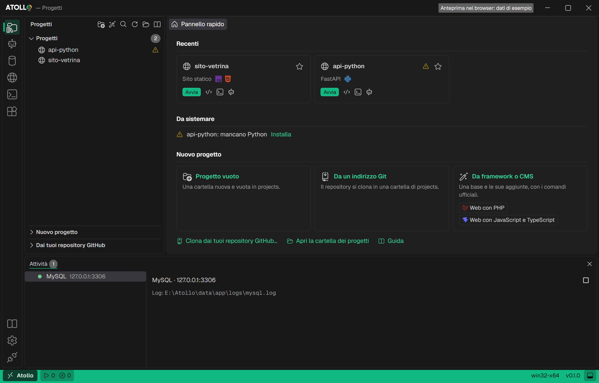

<p align="center">
  <a href="https://nabre.github.io/atollo/de/">
    <picture>
      <source media="(prefers-color-scheme: dark)" srcset="brand/wordmark-dark.svg">
      
    </picture>
  </a>
</p>

<h1 align="center">Atollo — Universal Portable Dev & AI Workspace</h1>

<p align="center">
  Eine portable Entwicklungsumgebung ohne Installation für Windows, macOS und Linux, auf x64 und ARM64.<br>
  Editor, über 20 Sprachen und Runtimes, lokale Datenbanken und die KI-Agenten Claude Code, Codex und Antigravity in einem Ordner, den du auf einem USB-Stick mitnimmst.
</p>

<p align="center">
  <a href="https://github.com/nabre/atollo/releases"></a>
  <a href="https://github.com/nabre/atollo/releases"></a>
  <a href="https://github.com/nabre/atollo/actions/workflows/app.yml"></a>
  <a href="../LICENSE"></a>
  
  
  
</p>

<p align="center">
  <a href="https://nabre.github.io/atollo/de/"><b>Website</b></a> ·
  <a href="https://github.com/nabre/atollo/releases/latest"><b>Download</b></a> ·
  <a href="app/GUIDE.md"><b>Anleitung (auf Englisch)</b></a> ·
  <a href="https://github.com/nabre/atollo/issues"><b>Issues</b></a> ·
  <a href="PRIVACY.de.md"><b>Datenschutz</b></a>
</p>

<p align="center"><a href="../README.md">English</a> · <a href="README.it.md">Italiano</a> · <a href="README.fr.md">Français</a> · Deutsch</p>

**Atollo** ist ein eigenständiger *Universal Portable Dev & AI Workspace* (`Atollo.exe`), der **Editor** (integriertes VSCodium), **Toolchain-/Runtime-Manager** (über 20 bei Bedarf heruntergeladene Sprachen und Werkzeuge), **lokale Server/Datenbanken** (MySQL, MongoDB, SQLite, Caddy/Apache) und **KI-Agenten-Orchestrierung** (Claude Code, Codex und Antigravity mit synchronisierten Anweisungen, Skills und MCP-Servern) in einem einzigen portablen Ordner vereint. Keine Installation, keine Administratorrechte, keine Systemdienste außerhalb des Workspace-Ordners.

Beim ersten Start lädt die App die Systemkomponenten selbst herunter: PowerShell 7, GitHub CLI und den Editor. Alles andere wird auf der Seite „Werkzeuge“ gewählt oder kommt, wenn es gebraucht wird: Node.js mit einer `npm`-Aktion, uv mit einem `uvx`-MCP-Server und so weiter.

<picture>
  <source media="(prefers-color-scheme: light)" srcset="../site/shots/shot-projects-light.png">
  
</picture>

## Funktionen

- **Isolierter Editor und Terminals.** Integriertes VSCodium mit den Atollo-Themes dunkel und hell. Die Terminals sehen nur den `PATH` und die Variablen des Kits: Programme des Gastrechners stören nicht, und der PC bleibt sauber.
- **Sprachen und Werkzeuge bei Bedarf.** Über 20 Sprachen und Werkzeuge (Node.js, Python, uv, PHP, Rust, Go, Java, .NET, Dart, Julia, Ruby, C/C++, Bun, Deno, Typst, TinyTeX, R, Android SDK…), heruntergeladen, wenn sie gebraucht werden, und per SHA-256-Prüfsumme oder Signatur geprüft. Mehrere Versionen nebeneinander, eine pro Projekt.
- **Lokale Datenbanken und Webserver.** MySQL mit phpMyAdmin, MongoDB und SQLite, mit einem Klick gestartet und gestoppt, mit Datenbank, Benutzer und Passwort für jedes Projekt. Caddy und Apache für Websites, auf jedem System. Keine Systemdienste.
- **Drei KI-Agenten, eine Konfiguration.** Claude Code, Codex und Antigravity: Installation, Anmeldung und Start. Anweisungen, Skills und MCP-Server schreibst du einmal in `data/agents`, und `atollo sync` hält alle drei gleich. Planlimits und Verbrauch von heute und den letzten 7 Tagen.
- **Ein Ordner für sechs Systeme.** Derselbe Ordner oder dieselbe externe SSD wechselt von Windows zu macOS zu Linux, Projekte, Datenbanken und Agenten-Einstellungen bleiben erhalten: Jeder Rechner führt die nativen Programme seines Systems aus. „Laufwerk entfernen“ schließt alles, was Atollo geöffnet hat, und lässt das Laufwerk auswerfen.

## Dokumentation

Die ausführliche Dokumentation ist auf Englisch (und Italienisch):

| Dokument | Inhalt |
| --- | --- |
| [Anleitung](app/GUIDE.md) | jede Seite der App, Schritt für Schritt, mit Screenshots |
| [Komponentenkatalog](app/CATALOG.md) | die Komponenten, woher jede geladen wird, Verfügbarkeit pro System |
| [Matrix Werkzeuge × Systeme](app/TOOLS-MATRIX.html) | jede Komponente auf den sechs Zielen: nativ, emuliert oder nicht vorhanden |
| [Architektur](app/ARCHITECTURE.md) | wie der Code aufgebaut ist und wohin eine Änderung gehört |
| [Tests](app/TESTING.md) | automatische Prüfungen und die manuelle Checkliste pro System |
| [Entscheidungen](app/DECISIONS.md) und [Neuigkeiten](app/CHANGELOG.md) | die Gründe jeder Wahl und was sich geändert hat, auf Italienisch |

Offene Arbeit steht in den [Issues](https://github.com/nabre/atollo/issues).

## Verwendung

1. Die exe von Atollo (zum Beispiel `Atollo-0.4.0-win32-x64.exe`) in einen leeren Ordner kopieren: einen USB-Stick, eine externe Festplatte oder einen Ordner im eigenen Profil (Leerzeichen, Klammern oder `&` im Namen sind kein Problem).
2. Doppelklicken: die App legt `projects\` und `data\` an. Beim ersten Start Agenten, Sprachen und Werkzeuge wählen: die App lädt sie herunter und prüft sie (Prüfsumme oder Signatur).
3. Auf der Seite **Projekte** ein Projekt anlegen oder klonen. Editor, Terminal und Agenten öffnen sich immer im Ordner eines Projekts, nie anderswo.

Von der [Release-Seite](https://github.com/nabre/atollo/releases): `Atollo-<Version>-win32-x64.exe` oder `Atollo-<Version>-win32-arm64.exe` für Windows, `Atollo-<Version>-darwin-arm64.app.zip` (Apple Silicon) oder `Atollo-<Version>-darwin-x64.app.zip` (Intel) für macOS, `Atollo-<Version>-linux-x64` oder `Atollo-<Version>-linux-arm64` (`.AppImage` und `.tar.gz`) für Linux; jede Datei hat ihre `.sha256`. Der Name nennt die Version: Wenn sich die App selbst aktualisiert, bekommen die exe und die AppImage den Namen der neuen Version. In den Beispielen unten steht `Atollo.exe` für deine exe.

**macOS** (12 oder neuer). Die App hat nur eine Ad-hoc-Signatur, ohne Notarisierung durch Apple:
1. Das Zip entpacken und `Atollo.app` mit dem Finder in den Ordner des Kits verschieben (zum Beispiel `/Volumes/KIT/Atollo/`).
2. Im Terminal die Quarantäne des Browsers entfernen: `xattr -dr com.apple.quarantine /Volumes/KIT/Atollo/Atollo.app`.
3. `Atollo.app` aus diesem Ordner öffnen: `projects/` und `data/` entstehen daneben, nie darin.

Ohne Schritt 2 startet macOS die App aus einer temporären Kopie (App Translocation), und Atollo hält mit demselben Befehl an, statt das Kit in einem Ordner anzulegen, der wieder verschwindet.

**Linux** (x64 und ARM64, glibc 2.35 oder neuer: Ubuntu 22.04, Debian 12 und neuer). `Atollo-<Version>-linux-<arch>.AppImage` in den Ordner des Kits kopieren, `chmod +x Atollo-<Version>-linux-<arch>.AppImage` und starten: das Kit ist der Ordner der AppImage. Ohne FUSE (Container, manche minimalen Distributionen): `./Atollo-<Version>-linux-<arch>.AppImage --appimage-extract-and-run` ausführen, oder `Atollo-<Version>-linux-<arch>.tar.gz` mit installiertem WebKitGTK 4.1 verwenden (auf Ubuntu und Debian `sudo apt install libwebkit2gtk-4.1-0`): `Atollo` in den Ordner des Kits entpacken und `./Atollo` starten. Die AppImage aktualisiert sich selbst; das `tar.gz` meldet, wenn eine neue Version zum Herunterladen bereitsteht.

## Seiten

| Seite | Inhalt |
| --- | --- |
| **Projekte** | die **Schnellübersicht** (was läuft, Favoriten und zuletzt benutzte Projekte mit Starten, Editor, Terminal und Agent, was zu beheben ist), die Projektliste mit ▶ in jeder Zeile, Strg+P, um eines nach Namen zu öffnen; **Neues Projekt**, ein Tab neben den Projekten: leer, aus deinen GitHub-Repositories (mit Klonen, Umbenennen und Löschen auf GitHub), von einer Git-Adresse oder aus einer von 63 Basen in Gruppen (Laravel, Next.js, Django, WordPress, Astro, Tauri…); Hinweise zum Workspace. Jedes Projekt hat eine eigene Seite: **Übersicht** (die Hauptaktion mit ihrer Ausgabe, Sprachen, Datenbanken, Agent, Git), **Ressourcen** (Komponenten, die Datenbank des Projekts mit Benutzer und Passwort, Editor-Erweiterungen), **Erweitert** (Aktionen, Ports, statische Website, Git, Anweisungen der Agenten) |
| **Agenten** | die installierten Claude Code, Codex und Antigravity: Version, Anmeldung, Tariflimits und Verbrauch von heute und den letzten 7 Tagen; Anweisungen, Skills und MCP-Server gemeinsam in `data\agents` |
| **Datenbanken** | die MySQL- (mit phpMyAdmin) und MongoDB-Server von Atollo: Starten und Stoppen, Administratorpasswort, Port, Daten in `data\db`, nur auf diesem PC; SQLite ohne Server |
| **Werkzeuge** | Sprachen und Werkzeuge mit Logo, Abhängigkeiten und Speicherplatz; installieren, aktualisieren, entfernen; die Matrix der Editor-Erweiterungen |
| **Einstellungen** | Sprache, Terminal, Netzwerk (Proxy, Zertifikate, lokales Netz), Gemini-Schlüssel, Versionen von Python und PHP, Rust-Compiler (GNU oder MSVC), Updates der App; das **GitHub-Konto** von Atollo, eines für alles (App, Git, Editor, Konsolen, Agenten, GitHub CLI); wo der Ordner von Atollo liegt |
| **Laufwerk entfernen** | schließt alles, was Atollo geöffnet hat, holt die Anmeldung von Antigravity nach `data\` zurück und lässt das Laufwerk auswerfen |

Unten auf jeder Seite das Feld **Aktivität**: was läuft oder installiert wird (Projekte, Datenbanken, Komponenten), mit Ausgabe und Fehlern an einem Ort.

Die Konsole von Atollo ist die klassische Windows-Konsole mit integrierter PowerShell 7 und ausschließlich der isolierten Umgebung von Atollo: auf dem Host-PC installierte Programme stören nicht.

## Noch zu tun

Atollo ist in der Alpha (Version 0.4.0). Windows x64 ist das am meisten getestete System, echte Installationen in der CI eingeschlossen; macOS, Linux und Windows ARM64 werden nur in der CI gebaut und getestet. Die vollständige Checkliste steht in [docs/app/TESTING.md](app/TESTING.md) (auf Englisch).

- **Die Alpha, zum Ausprobieren.** [Die 0.4.0 Alpha](https://github.com/nabre/atollo/releases/tag/app-v0.4.0) ist auf GitHub für Windows, macOS und Linux, jeweils auf x64 und ARM64. Die veröffentlichten Dateien werden in der CI gebaut und getestet: Jetzt müssen sie auf sauberen Rechnern heruntergeladen und gestartet werden.
- **Alpha-Tests.** Gesucht sind Menschen, die Atollo in echten Projekten und auf verschiedenen PCs nutzen und melden, was nicht klappt: Installation der Komponenten, Projekte, Datenbanken, Agenten.
- **macOS auf echten Macs** ([#5](https://github.com/nabre/atollo/issues/5), [#6](https://github.com/nabre/atollo/issues/6)). Apple Silicon und Intel werden in der CI gebaut und gestartet, nie auf einem frischen Mac: das im Browser geladene Zip, Quarantäne und Gatekeeper, App Translocation, ein Kit auf einem exFAT-Stick, die Anmeldungen der Agenten von einem Mac zum anderen mitgenommen.
- **Linux auf echten Rechnern** ([#5](https://github.com/nabre/atollo/issues/5)). x64 und ARM64 auf Ubuntu 24.04, Fedora 42 und Debian 13: AppImage mit und ohne FUSE, das `tar.gz` mit WebKitGTK 4.1, exFAT-Sticks oder mit `noexec` eingehängte Sticks, Anmeldung mit GNOME, KeePassXC oder KWallet.
- **Updates und Kit-Builds außerhalb von Windows.** Das Update der App von einer Version zur nächsten ist auf macOS und Linux noch nicht ausprobiert. Das Apache des Kits (2.4.69, D-116) ist im Katalog, aber nur in der CI ausprobiert; ebenso das PHP des Kits mit `pdo_sqlite` (8.4.26 und 8.5.11, D-133), das die App ab 0.3.0 nutzt.
- **Code-Signatur.** Auf macOS nur eine Ad-hoc-Signatur, ohne Notarisierung durch Apple: `xattr -dr com.apple.quarantine` ist nötig. Auf Windows erscheint 0.4.0 ohne Signatur: Die SignPath-Signatur muss noch aktiviert werden, bis dahin kann SmartScreen beim ersten Start warnen.

Du hast einen Mac, einen Linux-PC oder einen PC mit Windows ARM64? Probier Atollo aus und erzähl uns, wie es lief: [Issue auf GitHub öffnen](https://github.com/nabre/atollo/issues).

## Bekannte Grenzen

- Auf Windows 10 und 11 (`x64` und `ARM64`), macOS (Apple Silicon und Intel) und Linux (`x64` und `ARM64`). Auf Windows ARM64 laufen Editor, PHP, Apache, MySQL, MongoDB, Android SDK, Julia, TinyTeX und R in x64-Emulation; auf Linux ARM64 fehlt Android. Die Releases für macOS und Linux sind in der CI getestet, aber noch nicht auf sauberen Rechnern ([#5](https://github.com/nabre/atollo/issues/5)), und die Anmeldung der Agenten muss noch auf einem Mac getestet werden ([#6](https://github.com/nabre/atollo/issues/6)); Komponenten und Quellen pro System in [docs/app/CATALOG.md](app/CATALOG.md) (auf Englisch), die Matrix Komponente × System in [docs/app/TOOLS-MATRIX.html](app/TOOLS-MATRIX.html). Apache auf macOS und Linux ist ein eigener Build des Kits (D-116), mit PHP über `php-fpm`.
- Unter Linux braucht MySQL zwei Systembibliotheken, `libaio` und `libnuma`: auf Ubuntu 24.04 und Debian 13 `sudo apt install libaio1t64 libnuma1` (auf älteren Versionen `libaio1`), auf Fedora und RHEL `sudo dnf install libaio numactl-libs`. Fehlen sie, sagt Atollo es mit dem auszuführenden Befehl.
- Unter macOS und Linux funktioniert ein Atollo-Ordner auf exFAT oder FAT (ein für Windows formatiertes Laufwerk), aber diese Dateisysteme kennen keine Links: Wo ein Programm welche mitbringt, kopiert Atollo die Dateien (etwa die 142 internen Links von Git), was mehr Platz belegt. Auf einem Laufwerk nur für Mac oder Linux ist APFS oder ext4 besser.
- Außerhalb des Atollo-Ordners bleiben nur die Spuren von Windows, temporäre Übergangsdateien im System-Temp-Ordner (werden beim Beenden automatisch gelöscht), die Anmeldung von GitHub CLI in der Anmeldeinformationsverwaltung, wenn du dich in einer Konsole mit `gh auth login` anmeldest (die in den Einstellungen bleibt in `data\gh`), und die von Antigravity, solange `agy` geöffnet ist (nur für die Sitzung).
- Die Ordner in `projects\` gelten für Claude Code und Codex als vertrauenswürdig: nur Projekte öffnen, denen man vertraut. Der Editor fragt dagegen beim ersten Öffnen jedes Projekts und öffnet nicht vertrauenswürdige im „eingeschränkten Modus“.
- Die Nutzungslimits der Agenten stammen aus nicht dokumentierten Schnittstellen der Anbieter und können nach einem ihrer Updates nicht mehr funktionieren.
- „Laufwerk entfernen“ sieht keine PC-Programme, die nur eine Datei im Ordner von Atollo geöffnet halten.

## Aufbau

```
Atollo\
  Atollo.exe      die gesamte Logik
  projects\       deine Projekte
  data\           heruntergeladene Programme, Einstellungen, Anmeldungen, Cache, temporäre Dateien
                  (die Einstellungen jedes Projekts: data\projects\<Projekt>\dev-settings.json)
```

Für eine Sicherung genügt es, `projects\` und `data\` zu kopieren (ohne `data\apps\` und `data\cache\`, die neu heruntergeladen werden).

## Deinstallation

Atollo verwendet keinen Installer, registriert keine Systemdienste oder geplanten Aufgaben und verändert weder die Windows-Registrierung noch den `PATH`:

1. Öffne die Seite **Laufwerk entfernen** (oder schließe die Anwendung), um alle von Atollo gestarteten Prozesse zu beenden und eine aktive Antigravity-Sitzung nach `data\` zurückzuholen.
2. Lösche den Ordner mit `Atollo.exe`, `data\` und `projects\` (nachdem du die Projekte gesichert hast, die du behalten möchtest).
3. Temporäre Ordner unter `%TEMP%` werden beim Schließen automatisch entfernt; falls du `gh auth login` manuell in einer Konsole ausgeführt hast (statt über die Seite **Einstellungen**), kannst du den entsprechenden Eintrag in der Windows-**Anmeldeinformationsverwaltung** löschen.

## Befehlszeile

```
Atollo.exe                           öffnet das Fenster
Atollo.exe env                       zeigt die Umgebung der Programme von Atollo
Atollo.exe components                listet Sprachen und Werkzeuge, mit den installierten
Atollo.exe check                     prüft, ob die installierten Programme antworten
Atollo.exe prepare [Optionen]        installiert, aktualisiert und entfernt die gewählten Komponenten
    --only a,b                       nur diese (und was sie brauchen)
    --skip a,b                       diese nicht
    --update-all                     auch die bereits installierten aktualisieren
    --force                          neu herunterladen
Atollo.exe sync [--project <Ordner>] [--verbose]
                                     gleicht Anweisungen, Skills und MCP der drei Agenten ab
Atollo.exe keyring restore|save      Anmeldung von Antigravity (von agy.cmd benutzt)
Atollo.exe serve <Ordner> <Port>     Dateiserver für eine statische Website
Atollo.exe version                   zeigt die Version
Atollo.exe help                      zeigt die Hilfe
```

In PowerShell `| Out-Host` anhängen (zum Beispiel `.\Atollo.exe check | Out-Host`): `Atollo.exe` ist ein Fensterprogramm, und ohne Pipe wartet PowerShell nicht darauf und liest weder seine Ausgabe noch seinen Exit-Code.

## Bauen

Voraussetzungen: stabiles Rust (mindestens 1.93) mit der MSVC-Toolchain (Visual Studio Build Tools, Workload C++), Node.js LTS.

```
npm ci
npm run build
```

Die JavaScript-Abhängigkeiten liegen nur im Stammordner (`node_modules` und `package-lock.json`): `ui` ist ein npm-Workspace.

Die exe liegt in `target\release\Atollo.exe`. Es wird kein Installer erzeugt (`--no-bundle`).

Prüfungen vor einer Änderung:

```
npm run lint
npm test
npm -w ui run build
```

`npm run lint` führt `cargo fmt --check`, `cargo clippy --all-targets -- -D warnings`, ESLint und Prettier aus; `npm test` führt `cargo test` und die Tests der Oberfläche aus; `npm -w ui run build` prüft die Typen und baut die Oberfläche. Einzelheiten (auf Englisch) in [docs/app/TESTING.md](app/TESTING.md). Wie der Code aufgebaut ist und wohin eine Änderung gehört (auf Englisch): [docs/app/ARCHITECTURE.md](app/ARCHITECTURE.md).

Entwicklung mit automatischem Neuladen: `npm run dev`.

## Wenn Windows die exe blockiert

Solange die Codesignierung für die heruntergeladene Version noch nicht aktiv ist: Zeigt SmartScreen „Der Computer wurde durch Windows geschützt“, **Weitere Informationen** › **Trotzdem ausführen** wählen. Wurde die exe aus dem Internet geladen: Rechtsklick › **Eigenschaften** › **Zulassen**. Auf Firmen-PCs mit AppLocker ist die Erlaubnis der IT-Abteilung nötig.

## Code signing policy

Free code signing on Windows provided by [SignPath.io](https://signpath.io/), certificate by [SignPath Foundation](https://signpath.org/).

- **Projektrollen (Committer, Reviewer und Approver):** [nabre](https://github.com/nabre)
- **Herkunft der Binärdateien:** Die ausführbaren Dateien der offiziellen Releases werden ausschließlich durch die automatisierte GitHub-Actions-Pipeline ([`.github/workflows/app.yml`](../.github/workflows/app.yml)) direkt aus dem öffentlichen Quellcode dieses Repositories gebaut und signiert, ohne manuelle Eingriffe an den Binärdateien.

## Privacy policy

Der vollständige Text, mit jeder Netzwerkverbindung und jeder Datei, die die App aufbewahrt, steht in **[Datenschutzerklärung und Nutzungsbedingungen](PRIVACY.de.md)**. Kurz gesagt:

- **Keine Telemetrie oder Datenerhebung:** Die Anwendung erhebt keine personenbezogenen Daten, Nutzungsstatistiken, Telemetriedaten oder Absturzberichte und kontaktiert keinerlei Server des Projektautors. Zudem deaktiviert sie die standardmäßige Telemetrie verwalteter Komponenten (wie PowerShell 7 und des VSCodium-Servers).
- **Lokale Speicherung:** Einstellungen, Projekte, lokale Datenbanken, Protokolle und Anmeldeinformationen werden lokal im Ordner `data\` (und `projects\`) von Atollo auf dem Gerät des Nutzers gespeichert; die wenigen Ausnahmen (temporäre Dateien, Antigravitys Anmeldung während es läuft) stehen in der Erklärung.
- **Netzwerkverbindungen:** Die Anwendung verbindet sich nur mit GitHub, um nach eigenen Updates zu suchen (Einstellungen › Allgemein › Automatisches Update, oder `ATOLLO_NO_UPDATE`), mit den offiziellen Quellen der Komponenten, die sie herunterlädt, mit der Open-VSX-Registry für Editor-Erweiterungen und – wenn der Nutzer die GitHub-Seite oder die Seite Agenten verwendet – mit GitHub und den Anbietern der Agenten (**Claude Code**, **Codex**, **Antigravity**) gemäß deren eigenen Datenschutzrichtlinien.

## Lizenz

MIT: bereitgestellt „wie besehen", ohne Gewährleistung. Siehe [LICENSE](../LICENSE) und die [Nutzungsbedingungen](PRIVACY.de.md#8-nutzungsbedingungen).
