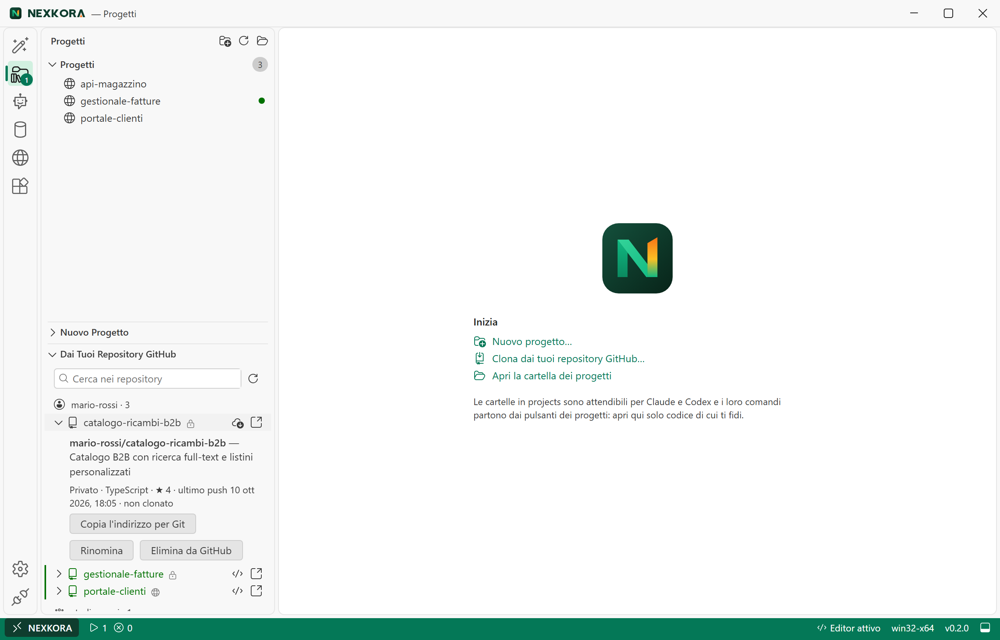
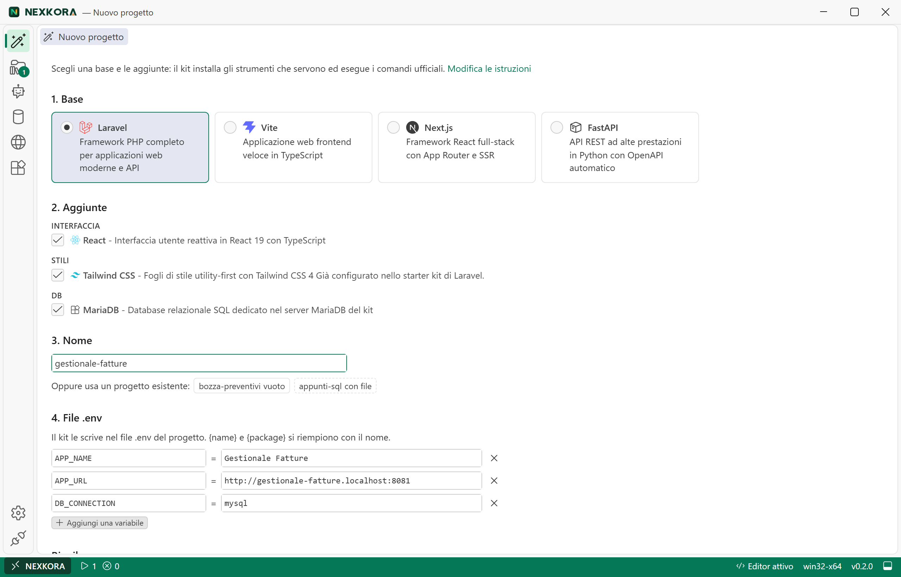
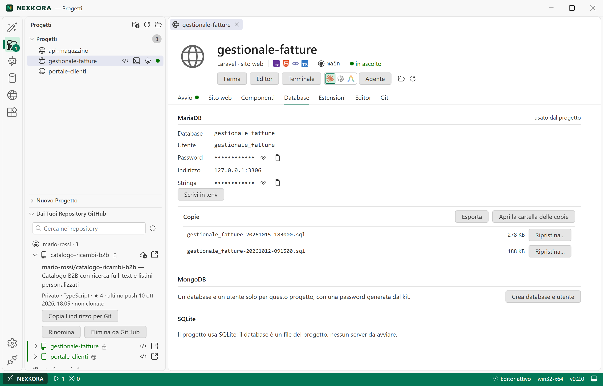
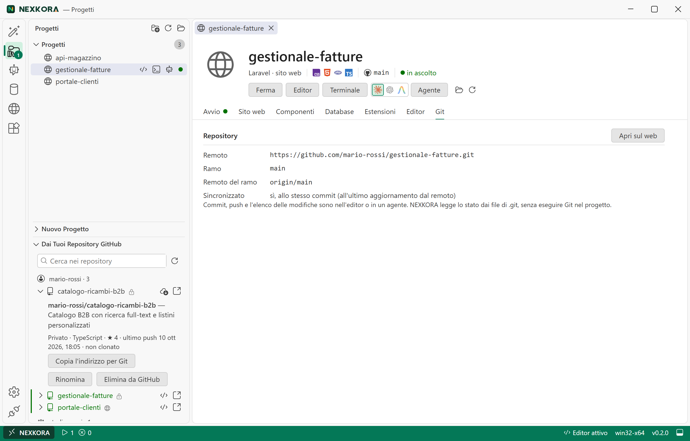
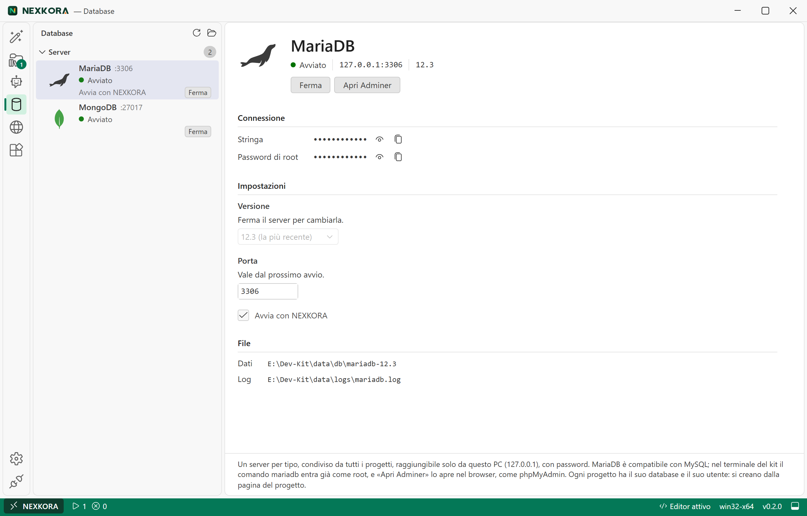
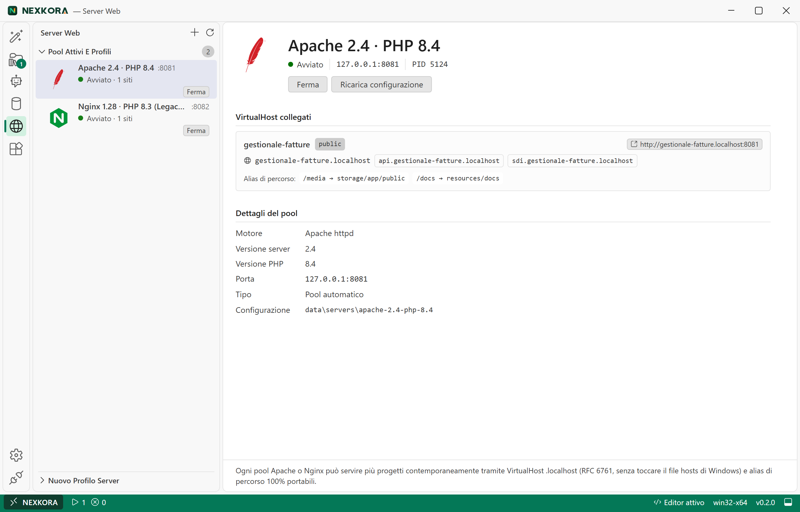
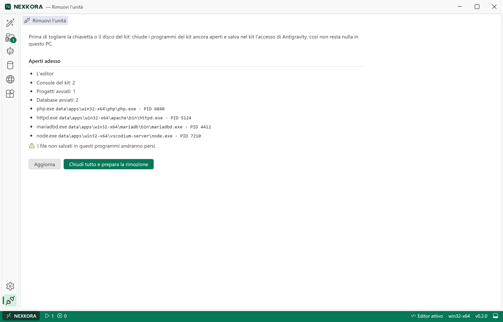

# Guida Completa di Atollo (Atollo): Struttura, Funzionalità, Fonti, Configurazione ed Esempi Illustrati

Questo documento definisce la **struttura editoriale**, i **contenuti minuziosi**, le **schermate reali dell'interfaccia** (`images/*.png`) e gli **esempi pratici guidati** della guida ufficiale di **Atollo** (`Atollo.exe`, brand **Atollo**). Esplora nel dettaglio l'architettura portabile, il funzionamento di tutte le viste dell'applicazione, l'organizzazione completa dei link e delle fonti da cui il kit attinge gli strumenti, il ruolo centrale dell'account GitHub e le procedure passo-passo per configurare ogni singolo elemento con la spiegazione dello scopo tecnico e pratico di ciascuna operazione.

> [!NOTE]
> **Scenario reale usato negli esempi e nelle immagini della guida:**
> Tutte le schermate di questa guida mostrano un ambiente di lavoro reale su unità portabile (`D:\Atollo`) collegato all'account GitHub **`@mario-rossi`** (con l'organizzazione **`studio-rossi`**) e popolato da tre progetti concreti:
> - **`gestionale-fatture`**: applicazione full-stack **Laravel 13 + React + Tailwind CSS 4 + MariaDB 12.3** (servita sia col comando di sviluppo `composer run dev` sia tramite pool condiviso **Apache 2.4 · PHP 8.4** su `http://gestionale-fatture.localhost:8081` con dominio aggiuntivo `fatture.studio.localhost` e alias `/allegati`).
> - **`portale-clienti`**: applicazione frontend **Vite + React + TypeScript** (con database documentale **MongoDB 8.0** `portale_clienti` esplorato direttamente dall'interfaccia).
> - **`api-magazzino`**: microservizio **Python 3.13 + FastAPI** con database relazionale e documentale.

---

## Indice Generale

1. [Struttura della Guida e Filosofia dell'Applicazione](#1-struttura-della-guida-e-filosofia-dellapplicazione)
   - [1.1 Principi Fondamentali: Portabilità Assoluta e Isolamento](#11-principi-fondamentali-portabilità-assoluta-e-isolamento)
   - [1.2 Organizzazione su Disco (`Atollo.exe`, `projects\`, `data\`)](#12-organizzazione-su-disco-atolloexe-projects-data)
   - [1.3 Ciclo di Vita dei Processi (Job Object) e Rilocazione Automatica](#13-ciclo-di-vita-dei-processi-job-object-e-rilocazione-automatica)
2. [Organizzazione dei Link e delle Fonti degli Strumenti](#2-organizzazione-dei-link-e-delle-fonti-degli-strumenti)
   - [2.1 Architettura di Approvvigionamento e Verifica Crittografica](#21-architettura-di-approvvigionamento-e-verifica-crittografica)
   - [2.2 Tabella Completa delle Fonti per Componenti, Linguaggi e Database](#22-tabella-completa-delle-fonti-per-componenti-linguaggi-e-database)
   - [2.3 Fonti per Estensioni dell'Editor, Quote Agenti e Aggiornamenti App](#23-fonti-per-estensioni-delleditor-quote-agenti-e-aggiornamenti-app)
   - [2.4 Meccanismo di Fallback Senza API e Download Manuale («By Hand»)](#24-meccanismo-di-fallback-senza-api-e-download-manuale-by-hand)
3. [La Necessità dell'Account GitHub e il Suo Ruolo Centrale](#3-la-necessità-dellaccount-github-e-il-suo-ruolo-centrale)
   - [3.1 Perché l'Account GitHub è Fondamentale nel Kit](#31-perché-laccount-github-è-fondamentale-nel-kit)
   - [3.2 Come Funziona l'Autenticazione Unificata (`data\gh` e `.gitconfig`)](#32-come-funziona-lautenticazione-unificata-datagh-e-gitconfig)
   - [3.3 Passaggi per Configurare l'Account GitHub e i Permessi (`workflow`, `delete_repo`)](#33-passaggi-per-configurare-laccount-github-e-i-permessi-workflow-delete_repo)
4. [Esplorazione Minuziosa delle Funzionalità dell'Applicazione (con Immagini ed Esempi)](#4-esplorazione-minuziosa-delle-funzionalità-dellapplicazione-con-immagini-ed-esempi)
   - [4.1 Finestra Principale, Barra di Stato e Pannello Attività](#41-finestra-principale-barra-di-stato-e-pannello-attività)
   - [4.2 Pagina «Nuovo progetto» (Wizard Framework e Combinazioni)](#42-pagina-nuovo-progetto-wizard-framework-e-combinazioni)
   - [4.3 Pagina «Progetti» e Scheda Dettaglio del Singolo Progetto](#43-pagina-progetti-e-scheda-dettaglio-del-singolo-progetto)
   - [4.4 Editor Integrato (VSCodium Web) e Terminale Esclusivo del Kit](#44-editor-integrato-vscodium-web-e-terminale-esclusivo-del-kit)
   - [4.5 Pagina «Agenti» (Claude Code, Codex, Antigravity e Sincronizzazione)](#45-pagina-agenti-claude-code-codex-antigravity-e-sincronizzazione)
   - [4.6 Pagina «Database» (MariaDB, MongoDB, Adminer ed Esploratore Dati)](#46-pagina-database-mariadb-mongodb-adminer-ed-esploratore-dati)
   - [4.7 Pagina «Server Web» (Pool Condivisi Apache/Nginx e VirtualHost `.localhost`)](#47-pagina-server-web-pool-condivisi-apachenginx-e-virtualhost-localhost)
   - [4.8 Pagina «Strumenti» (Multi-Versione, Matrice delle Relazioni ed Estensioni)](#48-pagina-strumenti-multi-versione-matrice-delle-relazioni-ed-estensioni)
   - [4.9 Pagina «Impostazioni» e Albero di Personalizzazione dei Framework](#49-pagina-impostazioni-e-albero-di-personalizzazione-dei-framework)
   - [4.10 Pagina «Rimuovi l'unità» ed Espulsione Sicura](#410-pagina-rimuovi-lunità-ed-espulsione-sicura)
   - [4.11 Interfaccia a Riga di Comando (CLI di `Atollo.exe`)](#411-interfaccia-a-riga-di-comando-cli-di-atolloexe)
5. [Guida Passo-Passo alla Configurazione di Ogni Elemento e Relativi Scopi](#5-guida-passo-passo-alla-configurazione-di-ogni-elemento-e-relativi-scopi)
   - [5.1 Preparazione Iniziale del Kit e Scelta del Disco](#51-preparazione-iniziale-del-kit-e-scelta-del-disco)
   - [5.2 Configurazione Generale: Lingua, Terminale, Temporanei e Aggiornamenti](#52-configurazione-generale-lingua-terminale-temporanei-e-aggiornamenti)
   - [5.3 Configurazione di Rete: Proxy Aziendali, Certificati CA (SSL Inspection) e LAN](#53-configurazione-di-rete-proxy-aziendali-certificati-ca-ssl-inspection-e-lan)
   - [5.4 Configurazione dei Compilatori e delle Linee Predefinite (Python, PHP, Rust)](#54-configurazione-dei-compilatori-e-delle-linee-predefinite-python-php-rust)
   - [5.5 Configurazione delle Versioni per Singolo Progetto e Risoluzione Conflitti](#55-configurazione-delle-versioni-per-singolo-progetto-e-risoluzione-conflitti)
   - [5.6 Configurazione degli Agenti AI, Chiave Gemini, Skill, Istruzioni e Server MCP](#56-configurazione-degli-agenti-ai-chiave-gemini-skill-istruzioni-e-server-mcp)
   - [5.7 Configurazione dei Server Database, Utenti di Progetto, `.env` e Backup](#57-configurazione-dei-server-database-utenti-di-progetto-env-e-backup)
   - [5.8 Configurazione di Siti Web, Pool Apache/Nginx, Domini `.localhost` e Alias](#58-configurazione-di-siti-web-pool-apachenginx-domini-localhost-e-alias)
   - [5.9 Configurazione delle Azioni Personalizzate (`panel.json`) e Porte](#59-configurazione-delle-azioni-personalizzate-paneljson-e-porte)
   - [5.10 Configurazione delle Estensioni e Impostazioni dell'Editor per Progetto](#510-configurazione-delle-estensioni-e-impostazioni-delleditor-per-progetto)
   - [5.11 Configurazione e Modifica delle Ricette del Wizard Framework](#511-configurazione-e-modifica-delle-ricette-del-wizard-framework)
   - [5.12 Gestione dei «Dati senza progetto» (Adozione o Pulizia degli Orfani)](#512-gestione-dei-dati-senza-progetto-adozione-o-pulizia-degli-orfani)

---

## 1. Struttura della Guida e Filosofia dell'Applicazione

### 1.1 Principi Fondamentali: Portabilità Assoluta e Isolamento

**Atollo** nasce per offrire un ambiente di sviluppo completo per Windows 10 e 11 (architetture `x64` e `ARM64`) racchiuso in un unico eseguibile (`Atollo.exe`), progettato attorno a cinque regole architetturali inderogabili:

1. **Zero installazione e nessun privilegio di amministratore (`asInvoker`)**: l'applicazione incorpora un manifesto Windows con `requestedExecutionLevel level="asInvoker"`. Non installa servizi di sistema, non crea attività pianificate e non modifica il registro di Windows (persino la chiave temporanea `HKCU\Software\Microsoft\Windows\CurrentVersion\Uninstall\Rustup` creata forzosamente da `rustup-init` viene fotografata prima dell'installazione di Rust e ripristinata o rimossa subito dopo).
2. **Isolamento totale dal PC ospite (`env_clear`)**: i programmi avviati dal kit (editor, terminale, agenti AI, server web, database, azioni dei progetti) non ereditano mai il `PATH` né le variabili di sviluppo del computer ospite (come `JAVA_HOME`, `CARGO_HOME`, `PYTHONPATH` o i moduli PowerShell in `Documenti`). Il motore Rust (`tauri/src/env.rs`) costruisce un ambiente pulito (~90 variabili) che punta esclusivamente a `data\`, aggiungendo al `PATH` soltanto le cartelle strettamente necessarie di Windows (`System32`, `System32\Wbem`, `System32\WindowsPowerShell\v1.0`).
3. **Separazione netta tra Progetto e Kit**:
   - Tutto ciò che appartiene al codice sorgente e può essere condiviso in un repository Git risiede in `projects\<progetto>\` (inclusi eventuali file dichiarativi come `panel.json`, `.vscode\settings.json`, `.mcp.json`).
   - Tutto ciò che riguarda lo stato locale, le scelte della macchina, le porte bloccate, le credenziali dei database e i backup risiede in `data\projects\<progetto>\`. In questo modo la cartella del progetto non viene mai "sporcata" da file di servizio locali.
4. **Regola aurea dell'interfaccia**: *ciò che riguarda un singolo progetto si configura nella pagina di quel progetto; ciò che riguarda l'intero kit si configura nelle pagine del kit*.
5. **Contesto di lavoro blindato sul progetto**: l'editor integrato, il terminale e gli agenti AI possono essere aperti **esclusivamente** all'interno della cartella di un progetto, mai nella radice del kit o in cartelle arbitrarie del PC.

---

### 1.2 Organizzazione su Disco (`Atollo.exe`, `projects\`, `data\`)

Quando `Atollo.exe` viene copiato in una cartella vuota (su chiavetta USB, SSD esterno o disco interno, anche con spazi, parentesi `( )` o `&` nel percorso) e avviato, genera e mantiene la seguente gerarchia:

```text
<Radice-del-Kit>\
├── Atollo.exe                             # Unico binario (GUI Tauri 2 + CLI + cataloghi incorporati)
├── projects\                               # Cartella che ospita tutti i progetti dell'utente
│   └── <nome-progetto>\                    # Codice sorgente del singolo progetto
│       ├── panel.json                      # (Opzionale) Azioni, sito web, domini e alias del progetto
│       ├── .mcp.json                       # (Opzionale) Server MCP specifici del progetto (Claude Code)
│       ├── .codex\config.toml              # (Opzionale) Blocco MCP del progetto per Codex
│       └── .vscode\settings.json           # (Opzionale) Formattazione, tabulazione ed esclusioni editor
└── data\                                   # Tutto lo stato, i programmi, le configurazioni e i dati
    ├── apps\win32-<x64|arm64>\             # Eseguibili e linguaggi scaricati
    │   ├── pwsh\<major.minor>\             # PowerShell 7 portabile (obbligatorio)
    │   ├── terminal\<major.minor>\         # Windows Terminal portabile (con file .portable)
    │   ├── vscodium-server\                # Server web dell'editor VSCodium (versione fissata al rilascio)
    │   ├── claude\  codex\  antigravity\   # I tre agenti AI, ognuno in <major.minor>\
    │   ├── git\  gh\  uv\  cmake\ ...      # Sempre all'ultima versione: una sola cartella <major.minor>\
    │   ├── rust\  android\  tinytex\  cc\  # Senza cartella di versione (pacchetti aggiunti dentro, versioni a data)
    │   ├── tools\                          # Utilità singole (ninja.exe, vcruntime\...)
    │   └── <linguaggio>\<major.minor>\     # Linguaggi e DB versionati, più versioni affiancate (es. node\22.11\, php\8.4\)
    ├── app\                                # Stato e configurazione globale dell'applicazione
    │   ├── settings.json                   # Impostazioni utente (lingua, rete, proxy, versioni, temp)
    │   ├── components.txt                  # Scelta dei componenti installati (id=1|0)
    │   ├── versions\<id>.txt               # Versione predefinita installata per ciascun componente
    │   ├── version-lines.json              # Cache (valida 24h) delle linee major.minor offerte dalle fonti
    │   ├── relations.json                  # Cache con impronta della matrice di compatibilità (D-81)
    │   ├── frameworks.json                 # Personalizzazioni utente alle ricette del wizard "Nuovo progetto"
    │   ├── services.json                   # Porte e avvio automatico dei server database (MariaDB, MongoDB)
    │   ├── servers.json                    # Profili manuali e porte assegnate ai pool Apache e Nginx
    │   ├── extensions.txt                  # Estensioni aggiuntive globali dell'utente
    │   ├── extensions-offered.txt          # Registro delle estensioni già proposte (installate una sola volta)
    │   ├── root.txt / old-root.txt         # Tracciamento del percorso per la rilocazione automatica
    │   ├── layout.txt                      # Versione dello schema dati su disco (2 = dati per progetto)
    │   ├── db\                             # Cartella protetta da DACL (solo proprietario su NTFS)
    │   │   ├── secrets.json                # Password degli amministratori DB (root per MariaDB, admin per MongoDB)
    │   │   └── my.ini                      # Credenziali client root e porta per l'accesso diretto da terminale
    │   ├── logs\                           # Log dell'app (app.log con segreti mascherati) e dei servizi DB
    │   └── update\                         # Eseguibile scaricato per l'auto-aggiornamento (update.json)
    ├── projects\<nome-progetto>\           # Stato locale tenuto dal kit per ciascun progetto (D-89)
    │   ├── dev-settings.json               # Agente preferito, estensioni scelte/escluse, versioni linguaggi
    │   ├── versions.json                   # Riscritture d'ambiente per i terminali dell'editor nel progetto
    │   ├── ports.json                      # Porte ricordate (7100-7999) e porte bloccate per le azioni
    │   ├── apache\  nginx\                 # Configurazioni generate e conf.d\ per siti dedicati al progetto
    │   └── private\                        # Cartella protetta da DACL ereditabile (solo proprietario)
    │       ├── db.json                     # Nomi dei DB e password generate per l'utente del progetto
    │       └── backups\                    # Esportazioni .sql (MariaDB) e .archive.gz (MongoDB) del progetto
    ├── servers\<id-pool>\                  # Configurazioni generate e vhosts\*.conf dei pool Apache e Nginx
    ├── db\                                 # File fisici dei database, separati per motore e versione
    │   ├── mariadb\<linea>\                # Dati MariaDB per linea LTS (es. 12.3\)
    │   └── mongodb\<linea>\                # Dati MongoDB per linea major di produzione (es. 9.0\)
    ├── agents\                             # Risorse sincronizzate tra Claude Code, Codex e Antigravity
    │   ├── AGENTS.md                       # Istruzioni globali comuni ai tre agenti
    │   ├── skills\                         # Skill condivise (collegate via junction NTFS o copia)
    │   └── mcp.json                        # Definizione unica dei server MCP globali
    ├── gh\                                 # Credenziali portabili di GitHub CLI (hosts.yml)
    ├── antigravity\                        # Credenziali di Antigravity salvate nel kit (keyring.json)
    ├── home\                               # Profilo utente portabile (.claude, .codex, .gemini, .gitconfig, .ssh, AppData)
    ├── kit\                                # Script e helper estratti dall'exe (profile.ps1, console.ps1, loopback.js, adminer.php, bin\agy.cmd, bin\gradle.cmd)
    ├── vscodium-server\                    # Dati del server VSCodium, estensioni installate e Machine\settings.json
    ├── webview2\                           # Profilo browser isolato delle finestre dell'app e dell'editor
    └── tmp\                                # File temporanei di fallback quando non si usa il TEMP di sistema
```

> [!TIP]
> **Come eseguire il backup del kit:** per salvare l'intero lavoro basta copiare `projects\` e `data\` escludendo `data\apps\` e `data\cache\` (che contengono solo binari e pacchetti riscaricabili automaticamente).

---

### 1.3 Ciclo di Vita dei Processi (Job Object) e Rilocazione Automatica

- **Job Object di Windows (`tauri/src/os/jobs.rs`)**: all'avvio, `Atollo.exe` crea un Job Object di Windows configurato con `JOB_OBJECT_LIMIT_KILL_ON_JOB_CLOSE | JOB_OBJECT_LIMIT_BREAKAWAY_OK` e vi assegna se stesso. Qualsiasi processo figlio (server VSCodium, database, server web, console, azioni dei progetti) nasce dentro questo Job (o in un sotto-job dedicato per singola azione/server). Se l'applicazione viene chiusa o termina in modo imprevisto, Windows arresta istantaneamente tutti i processi figli senza lasciare demoni orfani in background. Soltanto il browser di sistema ed Esplora risorse vengono aperti fuori dal job (`CREATE_BREAKAWAY_FROM_JOB`).
- **Istanza singola per percorso (`tauri/src/os/instance.rs`)**: il mutex di istanza singola è calcolato sull'hash SHA-256 del percorso della radice (`Local\Atollo-App-<hash>`). Due chiavette diverse collegate allo stesso PC possono quindi coesistere, e un banner nella finestra principale avvisa se sono attivi processi di un'altra copia del kit.
- **Rilocazione automatica (`tauri/src/agents/relocate.rs`)**: a ogni avvio il kit confronta il percorso attuale con `data\app\root.txt`. Se la cartella è stata spostata o la chiavetta USB ha cambiato lettera di unità (es. da `E:\` a `F:\`), l'applicazione scrive `old-root.txt` e riscrive automaticamente i percorsi assoluti nei file di configurazione degli agenti (`.claude.json`, `config.toml`), del server dell'editor e rigenera le giunzioni NTFS delle skill.

---

## 2. Organizzazione dei Link e delle Fonti degli Strumenti

### 2.1 Architettura di Approvvigionamento e Verifica Crittografica

Il motore di installazione (`tauri/src/net/` e `tauri/src/install/`) non esegue mai script esterni per scaricare i componenti e non accetta **mai** un pacchetto privo di verifica crittografica.
- **Stack TLS nativo di Windows**: i download utilizzano `ureq` con `native-tls` (SChannel) e `RootCerts::PlatformVerifier`. In questo modo il kit rispetta automaticamente i certificati radice dell'archivio di Windows (fondamentale nelle reti aziendali o scolastiche con ispezione HTTPS).
- **Download atomico con tentativi multipli**: ogni file viene scaricato con estensione `.part` nella cartella di lavoro temporanea (`<TEMP>\Atollo\<id>\setup\<componente>\`, oppure `data\tmp\setup\` se il disco di sistema ha meno di 4 GiB liberi), con **3 tentativi automatici** (attesa di 5 s e 10 s).
- **5 metodi di verifica (`tauri/src/net/verify.rs` e `signature.rs`)**:
  1. **SHA-256** (da GitHub Release `asset.digest`, da file `.sha256`/`.sha256sum`/`SHASUMS256.txt` o da API JSON ufficiali).
  2. **SHA-512** (da file `.sha512` per Apache Maven, JSON di .NET SDK, manifesto di Antigravity).
  3. **SHA3-256** (pubblicato nella pagina di download ufficiale di SQLite).
  4. **Integrità npm (`sha512-<base64>`)** (dal registro npm per Claude Code e Codex).
  5. **Firma digitale Authenticode (`WinVerifyTrust`)** (verifica crittografica del certificato del firmatario: obbligatoria per il runtime Visual C++ `O=Microsoft Corporation` sia sull'installer sia su `vcruntime140.dll`, e applicata a `claude.exe` per `Anthropic`).

---

### 2.2 Tabella Completa delle Fonti per Componenti, Linguaggi e Database

La tabella seguente dichiara l'organizzazione esatta di tutti gli indirizzi da cui `Atollo.exe` attinge i metadati delle versioni, gli archivi binari e i checksum:

| ID Componente | Gruppo | Sito Ufficiale (`home`) | Fonte Metadati / Ricerca Versioni | URL di Download dei Binari | Metodo di Verifica | Destinazione in `data\apps\win32-<arch>\` |
| :--- | :--- | :--- | :--- | :--- | :--- | :--- |
| **`pwsh`** (PowerShell 7) | Obbligatori (`required`) | `https://github.com/PowerShell/PowerShell` | GitHub API: `https://api.github.com/repos/PowerShell/PowerShell/releases/latest` | Asset `PowerShell-<v>-win-(x64\|arm64).zip` da `github.com/PowerShell/PowerShell/releases/download/...` | SHA-256 da `asset.digest` GitHub | `pwsh\<linea>\pwsh.exe` |
| **`gh`** (GitHub CLI) | Obbligatori (`required`) | `https://cli.github.com` | GitHub API: `https://api.github.com/repos/cli/cli/releases/latest` | Asset `gh_<v>_windows_(amd64\|arm64).zip` | SHA-256 da `asset.digest` GitHub | `gh\<linea>\bin\gh.exe` |
| **`vscodium-server`** (Editor) | App (`app`) | `https://vscodium.com` | Versione fissata nel catalogo (`1.135.06055`, D-58) | `https://github.com/VSCodium/vscodium/releases/download/<v>/vscodium-reh-web-win32-x64-<v>.tar.gz` | SHA-256 cablato nel catalogo (`components.json`) | `vscodium-server\` |
| **`terminal`** (Windows Terminal) | Sistema (`os`) | `https://github.com/microsoft/terminal` | GitHub API: `https://api.github.com/repos/microsoft/terminal/releases/latest` | Asset `Microsoft.WindowsTerminal_<v>_(x64\|arm64).zip` | SHA-256 da `asset.digest` GitHub | `terminal\<linea>\WindowsTerminal.exe` (+ file `.portable`) |
| **`claude`** (Claude Code) | Agenti (`agents`) | `https://claude.com/product/claude-code` | Registro npm: `https://registry.npmjs.org/@anthropic-ai/claude-code-win32-<arch>/latest` | Campo `dist.tarball` del JSON npm | Integrità npm `sha512-...` + firma Authenticode `Anthropic` | `claude\<linea>\claude.exe` |
| **`codex`** (Codex) | Agenti (`agents`) | `https://github.com/openai/codex` | Registro npm: `https://registry.npmjs.org/@openai/codex/latest` → poi `/<ver>-win32-<arch>` | Campo `dist.tarball` del pacchetto specifico per architettura | Integrità npm `sha512-...` | `codex\<linea>\bin\codex.exe` |
| **`antigravity`** (Antigravity) | Agenti (`agents`) | `https://antigravity.google` | Manifesto Google Cloud Run: `https://antigravity-cli-auto-updater-974169037036.us-central1.run.app/manifests/windows_(amd64\|arm64).json` | Campo `url` del manifesto JSON | SHA-512 (128 hex) dal campo `sha512` del manifesto | `antigravity\<linea>\agy.exe` (invocato tramite `data\kit\bin\agy.cmd`) |
| **`git`** (Git + Git Bash) | Strumenti | `https://git-scm.com` | GitHub API: `https://api.github.com/repos/git-for-windows/git/releases/latest` | Asset `PortableGit-<v>-(64-bit\|arm64).7z.exe` (estratto in Rust senza finestra 7z) | SHA-256 da `asset.digest` GitHub | `git\<linea>\cmd\git.exe` e `git\<linea>\bin\bash.exe` |
| **`python`** (Python + pip) | Linguaggi (versionato) | `https://www.python.org` | `https://raw.githubusercontent.com/astral-sh/python-build-standalone/latest-release/latest-release.json` → `<asset_url_prefix>/SHA256SUMS` | `<asset_url_prefix>/cpython-3.<minor>.<patch>+<date>-<triple>-install_only_stripped.tar.gz` | SHA-256 dall'elenco `SHA256SUMS` | `python\<linea>\python.exe` (più copia `python3.exe` e `pip` da wheel interna) |
| **`node`** (Node.js + npm) | Linguaggi (versionato) | `https://nodejs.org` | `https://nodejs.org/dist/index.json` (linee LTS pari >= 18 e ultima major) | `https://nodejs.org/dist/<v>/node-<v>-win-<arch>.zip` | SHA-256 da `https://nodejs.org/dist/<v>/SHASUMS256.txt` | `node\<linea>\node.exe` |
| **`uv`** (`uv`, `uvx`, `uvw`) | Strumenti | `https://docs.astral.sh/uv/` | GitHub API: `https://api.github.com/repos/astral-sh/uv/releases/latest` | Asset `uv-<triple>.zip` | SHA-256 da `asset.digest` GitHub | `uv\<linea>\uv.exe`, `uvx.exe`, `uvw.exe` |
| **`php`** (PHP + Composer + CA + VC++) | Linguaggi (versionato) | `https://www.php.net` | `https://windows.php.net/downloads/releases/releases.json` + archivi EOL cablati (`8.1`, `8.0`, `7.4`..`5.6`) | `https://windows.php.net/downloads/releases/<path>` (build Thread Safe `ts-vs*-x64` / `ts-vc*-x64`) | SHA-256 da `releases.json` (o tabella EOL verificata) | `php\<linea>\php.exe` |
| ↳ *Parte: Composer* | *(dentro PHP)* | `https://getcomposer.org` | `https://getcomposer.org/versions` (canale `stable` o `2.2` LTS in base a `min-php`) | `https://getcomposer.org<path>` (`composer.phar`) | SHA-256 da `<url>.sha256sum` | `php\<linea>\composer.phar` (+ `composer.cmd` e `composer`) |
| ↳ *Parte: Bundle CA SSL* | *(dentro PHP)* | `https://curl.se` | — | `https://curl.se/ca/cacert.pem` | SHA-256 da `https://curl.se/ca/cacert.pem.sha256` | `php\<linea>\extras\ssl\cacert.pem` |
| ↳ *Parte: VC++ Runtime* | *(per PHP, Apache, MongoDB)* | `https://learn.microsoft.com` | Estratto una sola volta se assente | `https://aka.ms/vc14/vc_redist.x64.exe` (estrazione CAB `vcRuntimeMinimum_amd64\cab1.cab`) | Firma Authenticode `O=Microsoft Corporation` su exe e `vcruntime140.dll` | `tools\vcruntime\` (copiato accanto a `php.exe`, `httpd.exe`, `mongod.exe`) |
| **`apache`** (Apache httpd) | Linguaggi (versionato) | `https://httpd.apache.org` | Pagina HTML: `https://www.apachelounge.com/download/` | `https://www.apachelounge.com/download/VS<nn>/binaries/httpd-<v>-Win64-VS<nn>.zip` | SHA-256 da `<url>.txt` (`SHA256-Checksum for:`) | `apache\<linea>\bin\httpd.exe` |
| **`nginx`** (Nginx) | Linguaggi (versionato) | `https://nginx.org` | GitHub API: `https://api.github.com/repos/nginx/nginx/releases?per_page=100` | Asset `nginx-<v>.zip` dalla release GitHub | SHA-256 da `asset.digest` GitHub | `nginx\<linea>\nginx.exe` |
| **`rust`** (Rustup, Cargo, Clippy) | Strumenti | `https://www.rust-lang.org` | `https://static.rust-lang.org/dist/channel-rust-stable.toml` (`[pkg.rustc]`) | `https://static.rust-lang.org/rustup/dist/<triple>/rustup-init.exe` | SHA-256 da `<url>.sha256` | `rust\cargo\bin\rustc.exe` e `rustup.exe` |
| **`go`** (Go SDK) | Linguaggi (versionato) | `https://go.dev` | `https://go.dev/dl/?mode=json` (e `&include=all` per l'elenco linee) | `https://go.dev/dl/go<v>.windows-(amd64\|arm64).zip` | SHA-256 dal campo `sha256` del JSON | `go\<linea>\bin\go.exe` |
| **`java`** (JDK Temurin + Maven + Gradle) | Linguaggi (versionato) | `https://adoptium.net` | `https://api.adoptium.net/v3/info/available_releases` + `/v3/assets/latest/<major>/hotspot?architecture=...` | URL del pacchetto `.zip` restituito dall'API Adoptium | SHA-256 da `binary.package.checksum` | `java\<linea>\bin\java.exe` |
| ↳ *Parte: Apache Maven* | *(dentro Java)* | `https://maven.apache.org` | `https://repo.maven.apache.org/maven2/org/apache/maven/apache-maven/maven-metadata.xml` (3.x) | `https://repo.maven.apache.org/.../apache-maven-<v>-bin.zip` | SHA-512 da `<url>.sha512` | `maven\bin\mvn.cmd` |
| ↳ *Parte: Gradle* | *(dentro Java)* | `https://gradle.org` | `https://services.gradle.org/versions/current` | Campo `downloadUrl` del JSON | SHA-256 da `checksumUrl` del JSON | `gradle\bin\gradle.bat` (avviato da `data\kit\bin\gradle.cmd`) |
| **`kotlin`** (Kotlin Compiler) | Linguaggi (versionato) | `https://kotlinlang.org` | GitHub API: `https://api.github.com/repos/JetBrains/kotlin/releases?per_page=100` | Asset `kotlin-compiler-<v>.zip` | SHA-256 da `asset.digest` o da `<asset>.sha256` | `kotlin\<linea>\bin\kotlinc.bat` |
| **`android`** (Android SDK) | Strumenti | `https://developer.android.com/studio` | Pagina HTML: `https://developer.android.com/studio` (`commandlinetools-win-<build>_latest.zip`) | `https://dl.google.com/android/repository/commandlinetools-win-<build>_latest.zip` + pacchetti via `sdkmanager` | SHA-256 letto dalla tabella della pagina ufficiale | `android\cmdline-tools\latest\bin\sdkmanager.bat` e `android\platform-tools\adb.exe` |
| **`dotnet`** (.NET SDK) | Linguaggi (versionato) | `https://dotnet.microsoft.com` | `https://builds.dotnet.microsoft.com/dotnet/release-metadata/releases-index.json` → `releases.json` | URL `.zip` per `rid=win-x64\|win-arm64` | SHA-512 dal campo `hash` di `releases.json` | `dotnet\<linea>\dotnet.exe` (con junction SDK/runtime affiancate) |
| **`dart`** (Dart SDK) | Linguaggi (versionato) | `https://dart.dev` | `https://storage.googleapis.com/dart-archive/channels/stable/release/latest/VERSION` (e bucket GCS per le linee) | `https://storage.googleapis.com/dart-archive/channels/stable/release/<v>/sdk/dartsdk-windows-<arch>-release.zip` | SHA-256 da `<url>.sha256sum` | `dart\<linea>\bin\dart.exe` |
| **`zig`** (Zig) | Linguaggi (versionato) | `https://ziglang.org` | `https://ziglang.org/download/index.json` | Campo `tarball` per `(x86_64\|aarch64)-windows` | SHA-256 dal campo `shasum` del JSON | `zig\<linea>\zig.exe` |
| **`julia`** (Julia) | Linguaggi (versionato) | `https://julialang.org` | `https://julialang-s3.julialang.org/bin/versions.json` | File `.zip` per `os=winnt`, `arch=x86_64` | SHA-256 dal campo `sha256` di `versions.json` | `julia\<linea>\bin\julia.exe` |
| **`bun`** (Bun) | Linguaggi (versionato) | `https://bun.sh` | GitHub API: `https://api.github.com/repos/oven-sh/bun/releases` | Asset `bun-windows-(x64\|aarch64).zip` | SHA-256 da `asset.digest` o da `SHASUMS256.txt` | `bun\<linea>\bun.exe` |
| **`deno`** (Deno) | Linguaggi (versionato) | `https://deno.com` | GitHub API: `https://api.github.com/repos/denoland/deno/releases` | Asset `deno-(x86_64\|aarch64)-pc-windows-msvc.zip` | SHA-256 da `asset.digest` o da `<asset>.sha256sum` | `deno\<linea>\deno.exe` |
| **`typst`** (Typst) | Linguaggi (versionato) | `https://typst.app` | GitHub API: `https://api.github.com/repos/typst/typst/releases` | Asset `typst-(x86_64\|aarch64)-pc-windows-msvc.zip` | SHA-256 da `asset.digest` GitHub | `typst\<linea>\typst.exe` |
| **`tinytex`** (TinyTeX / LaTeX) | Strumenti | `https://yihui.org/tinytex/` | GitHub API: `https://api.github.com/repos/rstudio/tinytex-releases/releases/latest` | Asset `TinyTeX-1-windows-v*.exe` (7z SFX estratto in Rust) | SHA-256 da `asset.digest` GitHub | `tinytex\bin\windows\tlmgr.bat` e `pdftex.exe` |
| **`pnpm`** (pnpm + yarn/corepack) | Strumenti | `https://pnpm.io` | Registro npm: `https://registry.npmjs.org/pnpm/latest` e `/corepack/latest` | Installazione globale tramite `npm-cli.js` del Node.js del kit | Integrità del registro npm | `data\npm-global\pnpm.cmd` e `yarn.cmd` |
| **`cmake`** (CMake + Ninja) | Strumenti | `https://cmake.org` | GitHub API: `Kitware/CMake` e `ninja-build/ninja` (`releases/latest`) | Asset `cmake-*-windows-(x86_64\|arm64).zip` e `ninja-win(arm64).zip` | SHA-256 da `asset.digest` GitHub | `cmake\<linea>\bin\cmake.exe` e `tools\ninja.exe` |
| **`cc`** (C/C++ llvm-mingw) | Strumenti | `https://github.com/mstorsjo/llvm-mingw` | GitHub API: `https://api.github.com/repos/mstorsjo/llvm-mingw/releases/latest` | Asset `llvm-mingw-*-ucrt-(x86_64\|aarch64).zip` | SHA-256 da `asset.digest` GitHub | `cc\bin\clang.exe` (+ `make.cmd` generato) |
| **`ruby`** (Ruby + Bundler) | Linguaggi (versionato) | `https://www.ruby-lang.org` | GitHub API: `https://api.github.com/repos/oneclick/rubyinstaller2/releases?per_page=100` | Asset `rubyinstaller-<v>-(x64\|arm).7z` | SHA-256 da `asset.digest` GitHub | `ruby\<linea>\bin\ruby.exe` |
| **`r`** (R da conda-forge) | Linguaggi (versionato) | `https://www.r-project.org` | `https://api.anaconda.org/package/conda-forge/r-base` (`subdir=win-64`) + GitHub `mamba-org/micromamba-releases` | `micromamba-win-64` + pacchetti `r-base` e `libblas=*=*openblas` da `conda-forge` | SHA-256 di `micromamba-win-64.sha256` + SHA-256 pacchetti conda | `r\<linea>\bin\R.cmd` e `Rscript.cmd` (+ `tools\micromamba.exe`) |
| **`mariadb`** (MariaDB Server) | Database (versionato) | `https://mariadb.org` | REST API ufficiale: `https://downloads.mariadb.org/rest-api/mariadb/` (linee Stable LTS) → `/<major>/latest/` | `https://downloads.mariadb.org/rest-api/mariadb/<version>/mariadb-<v>-winx64.zip` | SHA-256 dal campo `checksum.sha256sum` dell'API | `mariadb\<linea>\bin\mariadbd.exe` e `mariadb.exe` |
| **`mongodb`** (MongoDB + mongosh + Tools) | Database (versionato) | `https://www.mongodb.com` | `https://downloads.mongodb.org/current.json` (produzione `x.0.y`), GitHub `mongodb-js/mongosh`, `https://downloads.mongodb.org/tools/db/release.json` | Zip Windows x64 di `mongod`, `mongosh` e `mongodb-database-tools` | SHA-256 dai JSON MongoDB + `asset.digest` GitHub per `mongosh` | `mongodb\<linea>\bin\mongod.exe`, `mongosh\bin\mongosh.exe`, `mongodb-tools\bin\mongodump.exe` |
| **`adminer`** (Adminer per MariaDB) | Database | `https://www.adminer.org` | GitHub API: `https://api.github.com/repos/vrana/adminer/releases/latest` | Asset `adminer-<v>-mysql.php` | SHA-256 da `asset.digest` GitHub + lint `php -l` | `adminer\<linea>\adminer.php` |
| **`sqlite`** (SQLite CLI) | Database | `https://sqlite.org` | Pagina ufficiale: `https://sqlite.org/download.html` (righe CSV `PRODUCT,...`) | `https://sqlite.org/<anno>/sqlite-tools-win-(x64\|arm64)-<v>.zip` | **SHA3-256** pubblicato nella riga `PRODUCT` | `sqlite\<linea>\sqlite3.exe` |

---

### 2.3 Fonti per Estensioni dell'Editor, Quote Agenti e Aggiornamenti App

Oltre ai componenti principali, l'applicazione comunica con i seguenti indirizzi per funzioni specifiche:

1. **Estensioni dell'Editor (`tauri/catalog/extensions.json` e `tauri/src/editor/ext.rs`)**:
   - **Open VSX Registry** (tramite `vscodium-server --install-extension <editore.nome>`): tutte le estensioni della matrice linguaggio-estensione (Python, ESLint, Prettier, Volar, Intelephense, rust-analyzer, Tinymist, SQLTools, ecc.) vengono scaricate dal registro open-source Open VSX preconfigurato in VSCodium.
   - **CodeLLDB (`vadimcn.vscode-lldb`)**: scaricato direttamente da GitHub Releases (`https://api.github.com/repos/vadimcn/codelldb/releases/latest`, asset `codelldb-win32-x64.vsix`, verificato tramite SHA-256 `digest`) e installato dal file `.vsix` locale quando un progetto usa Rust, Zig, C o C++.
2. **Quote e Limiti del Piano degli Agenti AI (`tauri/src/agents/stats/`)**:
   - **Claude Code**: `https://api.anthropic.com/api/oauth/usage` (autenticato col token OAuth presente in `data\home\.claude\.credentials.json`).
   - **Codex**: `https://chatgpt.com/backend-api/wham/usage` (autenticato con `data\home\.codex\auth.json`, con fallback sulla lettura locale degli eventi `token_count` nei file di sessione).
   - **Antigravity**: `https://cloudcode-pa.googleapis.com/v1internal:fetchAvailableModels` (autenticato con `data\antigravity\keyring.json`).
   - *Nota di sicurezza*: i token vengono solo letti e inviati esclusivamente al rispettivo fornitore (con parsimonia: cache minima di 2 minuti e rispetto di `Retry-After` in caso di HTTP 429).
3. **Auto-aggiornamento di `Atollo.exe` (`tauri/src/setup/self_update.rs`)**:
   - Interroga le release con tag `app-vX.Y.Z` del repository `https://api.github.com/repos/nabre/atollo/releases` cercando l'asset `Atollo-x64.exe` o `Atollo-arm64.exe`, verificato con SHA-256.
4. **Template Android e Pacchetti dei Framework (`tauri/catalog/frameworks.json`)**:
   - I comandi del wizard scaricano pacchetti dai registri ufficiali tramite gli strumenti del kit: **Packagist** (`composer`), **npm Registry** (`npm`/`npx`), **Google Android Repository** (`sdkmanager` per `ndk;30.0.16248370`) e clonano il template ufficiale Android da `https://github.com/android/architecture-templates.git`.

---

### 2.4 Meccanismo di Fallback Senza API e Download Manuale («By Hand»)

1. **Superamento del limite di 60 chiamate/ora dell'API di GitHub (`tauri/src/net/mod.rs`)**:
   - Se l'utente non ha ancora collegato un account GitHub e l'indirizzo IP esaurisce la quota anonima di `api.github.com`, il kit passa automaticamente alla lettura diretta delle pagine web di GitHub (che non consumano quota API):
     - segue il redirect di `https://github.com/<owner>/<repo>/releases/latest` per scoprire il tag della versione più recente;
     - scarica `https://github.com/<owner>/<repo>/releases/expanded_assets/<tag>` per estrarre i link degli asset e i relativi hash `sha256:` pubblicati da GitHub.
2. **Download Manuale Assistito («By Hand», `tauri/src/setup/downloads.rs` e `ui/src/byhand.tsx`)**:
   - Se un download fallisce per blocchi firewall o problemi di rete (ma i metadati con l'impronta SHA sono noti), la riga del componente nella pagina **Strumenti** mostra un riquadro tratteggiato con il link diretto al file.
   - Cliccando sul nome del file si apre il browser del PC per scaricarlo; l'utente può poi **trascinare il file (Drag & Drop)** nel riquadro o cliccare su **«sfoglia…»** (che apre la cartella `Download` di Windows).
   - Il file viene copiato in `<TEMP>\Atollo\<id>\downloads\` (o `data\downloads\`), **verificato contro l'hash SHA ufficiale** (anche se il browser ha aggiunto ` (1)` al nome) e l'installazione riparte da sola. I file non utilizzati vengono puliti dopo 30 giorni.

---

## 3. La Necessità dell'Account GitHub e il Suo Ruolo Centrale

### 3.1 Perché l'Account GitHub è Fondamentale nel Kit

In Atollo l'account GitHub non è un semplice accessorio per un singolo programma, ma è progettato come **identità unica e centralizzata dell'intero ambiente portabile** (`tauri/src/github/mod.rs`, decisione D-70). Configurare l'account GitHub nelle **Impostazioni** risolve contemporaneamente cinque esigenze critiche:

1. **Un solo accesso per tutti gli strumenti ("Single Sign-On" del Kit)**:
   - Effettuando l'accesso una sola volta nella sezione **Impostazioni › Account GitHub**, l'autenticazione diventa immediatamente attiva per:
     - l'**interfaccia dell'app** (esplorazione, clonazione, rinomina ed eliminazione dei tuoi repository in «Progetti»);
     - il **Git del kit** (usato dai pulsanti Push/Pull/Sync dell'**Editor VSCodium**, dal **Terminale** e dagli script);
     - **GitHub CLI (`gh`)** nelle console del kit (`gh pr`, `gh issue`, `gh repo`, `gh run`);
     - i **tre Agenti AI** (Claude Code, Codex e Antigravity), che possono così creare branch, aprire Pull Request o clonare repository privati su tua richiesta senza chiederti token o credenziali.
2. **Portabilità totale sulla chiavetta (Zero tracce nel PC ospite)**:
   - Se eseguissi `gh auth login` manualmente in un terminale senza parametri, GitHub CLI salverebbe il token nella *Gestione credenziali di Windows* del PC ospite (lasciando il tuo accesso su quel computer e perdendolo quando sposti la chiavetta su un altro PC).
   - L'accesso avviato dall'app usa invece `--insecure-storage` con `GH_CONFIG_DIR` puntato a `data\gh\`: il token viene salvato in `data\gh\hosts.yml` dentro il kit, viaggia con te sulla chiavetta e non tocca mai la Gestione credenziali di Windows.
3. **Eliminazione dei limiti di rete (Rate Limit di GitHub API)**:
   - Moltissimi strumenti del catalogo (`pwsh`, `gh`, `git`, `uv`, `kotlin`, `bun`, `deno`, `typst`, `tinytex`, `cmake`, `ninja`, `cc`, `ruby`, `nginx`, `adminer`, `mongosh`, `codelldb`) risiedono su GitHub Releases. Senza autenticazione, GitHub limita le interrogazioni API a 60 all'ora per indirizzo IP (spesso condiviso in uffici, scuole o università). Con l'account collegato la soglia sale a **5.000 richieste all'ora**.
4. **Clonazione sicura dei repository privati senza esporre il token**:
   - Quando cloni un repository dall'app, il token non viene mai passato sulla riga di comando (dove sarebbe visibile agli altri processi del PC) né scritto in `.git\config` (dove resterebbe in chiaro nel progetto), ma viene iniettato per la sola durata del comando tramite variabili d'ambiente `GIT_CONFIG_*` come intestazione HTTP verso `https://github.com`.
5. **Sopravvivenza allo spostamento del kit**:
   - A differenza del comando standard `gh auth setup-git` (che scrive il percorso assoluto `C:\...\gh.exe` nel `.gitconfig`, rompendosi non appena la chiavetta cambia lettera d'unità), Atollo configura nel `.gitconfig` portabile (`data\home\.gitconfig`) la direttiva `helper = !gh auth git-credential` senza percorso fisso, sfruttando il `PATH` isolato del kit.

---

### 3.2 Come Funziona l'Autenticazione Unificata (`data\gh` e `.gitconfig`)

1. **Avvio del flusso Device (`gh auth login --web`)**:
   - L'app avvia in background `gh auth login --hostname github.com --git-protocol https --web --insecure-storage --scopes workflow`.
   - Oltre agli scope predefiniti di `gh` (`repo`, `read:org`, `gist`), il kit richiede subito lo scope **`workflow`** per consentire il push di file `.github/workflows/*.yml` (GitHub Actions) dall'editor o dagli agenti.
2. **Sincronizzazione automatica del Credential Helper di Git (`sync_git`)**:
   - Appena l'accesso va a buon fine (e a ogni avvio dell'app), Atollo aggiorna `data\home\.gitconfig` per i due domini `https://github.com` e `https://gist.github.com` impostando:
     1. un valore vuoto `helper =` (che azzera eventuali helper di sistema come Git Credential Manager solo per GitHub);
     2. `helper = !gh auth git-credential` (che delega a `gh` del kit la fornitura del token).
   - Se l'utente esce dall'account («Esci»), l'app rimuove automaticamente queste righe dal `.gitconfig`. Se invece l'utente aveva configurato a mano un proprio helper personalizzato, il kit non lo sovrascrive.

---

### 3.3 Passaggi per Configurare l'Account GitHub e i Permessi (`workflow`, `delete_repo`)

#### Procedura di Accesso (Sign-In)
1. Apri la pagina **Impostazioni** (icona dell'ingranaggio in basso nella barra delle attività a sinistra).
2. Nella barra laterale di Impostazioni clicca su **Account GitHub** (oppure accedi direttamente dal pannello **Clona o crea** nella pagina **Progetti**).
3. Clicca sul pulsante **«Accedi a GitHub»**.
4. L'applicazione genera un **codice monouso di 8 caratteri** nel formato `XXXX-XXXX` (es. `1A2B-3C4D`), lo mostra nella pagina con il pulsante **«Copia il codice»** e apre automaticamente il browser predefinito del PC all'indirizzo `https://github.com/login/device`.
5. Nel browser, accedi al tuo account GitHub (se non sei già autenticato), incolla il codice `XXXX-XXXX` e autorizza **GitHub CLI**.
6. La pagina dell'app rileva automaticamente il completamento, mostra il tuo nome utente GitHub e configura il Git del kit.


> [!TIP]
> **Esempio pratico — Accesso unificato come `@mario-rossi`:**
> Nella schermata sopra, l'utente ha effettuato l'accesso in **Impostazioni › Account GitHub** con l'account **`@mario-rossi`**. Da questo istante:
> - `data\gh\hosts.yml` conserva il token OAuth sulla chiavetta (`D:\Atollo`);
> - `data\home\.gitconfig` usa `!gh auth git-credential` per autenticare automaticamente `git push`, `git pull`, l'Editor VSCodium e i tre agenti AI (Claude Code, Codex, Antigravity);
> - il limite delle API GitHub per scaricare strumenti e aggiornamenti sale da 60 a **5.000 richieste/ora**.

#### Gestione dei Repository e Permesso `delete_repo` su Richiesta
- Per ragioni di sicurezza (principio del privilegio minimo), al primo accesso il kit **non** chiede il permesso di eliminare repository (`delete_repo`).
- Quando nella pagina **Progetti** selezioni un tuo repository GitHub e clicchi su **«Elimina da GitHub»**, se il token attuale non possiede lo scope `delete_repo`, l'app mostra il pulsante **«Concedi il permesso»** che avvia un rapido riaccesso con `--scopes workflow,delete_repo`.
- *Nota*: eliminare un repository su GitHub tramite l'app non cancella mai l'eventuale cartella già clonata in `projects\`.



> **Esempio pratico — Clonazione da `@mario-rossi` e `studio-rossi`:**
> Aprendo il riquadro **Clona o crea** nella barra laterale di **Progetti**, l'app elenca automaticamente sia i repository personali (`mario-rossi/gestionale-fatture`, `portale-clienti`, `api-magazzino`, `preventivi-pdf`) sia quelli dell'organizzazione (`studio-rossi/design-system`). Per i repository già presenti in `projects\` compare il badge **«Clonato»** con il pulsante rapido **«Apri»**, mentre per quelli remoti basta un clic su **«Clona»** per scaricarli in `projects\<nome>` e auto-configurarne le versioni dei linguaggi.

---

## 4. Esplorazione Minuziosa delle Funzionalità dell'Applicazione (con Immagini ed Esempi)

### 4.1 Finestra Principale, Barra di Stato e Pannello Attività

L'interfaccia di Atollo utilizza i componenti ufficiali e il sistema di design di VSCodium (`@vscode-elements/elements`) con il tema unificato **Atollo Dark / Light** (sincronizzato automaticamente col tema chiaro/scuro di Windows):

- **Barra del titolo personalizzata (`ui/src/titlebar.tsx`)**: priva della cornice standard di Windows, integra il logo Atollo, il titolo della vista corrente e i controlli finestra.
- **Banner degli avvisi globali (`Banner` in `ui/src/App.tsx`)**: compare in alto solo quando necessario per segnalare:
  - che il kit è stato **spostato** da un percorso precedente (`movedFrom` → `root`) e che la rilocazione è avvenuta;
  - che sullo stesso PC sono in esecuzione programmi di **un'altra copia del kit** (ricordando che le due copie sono completamente separate);
  - che una cartella nel percorso del kit inizia con una **cifra (`0-9`), `x` o `u` minuscole** (`watcherUnsafeFolder`, limite noto di `@parcel/watcher` in VSCodium che impedisce all'editor di rilevare modifiche esterne ai file).
- **Barra delle Attività (Activity Bar a sinistra)**: contiene le 8 viste principali con navigazione anche da tastiera (`Freccia Su/Giù`, `Home`, `End`):
  - In alto: **Nuovo progetto** (bacchetta magica), **Progetti** (con badge numerico dei progetti avviati), **Agenti**, **Database**, **Server Web**, **Strumenti**.
  - In basso: **Impostazioni**, **Rimuovi l'unità**.
- **Barra di Stato (in basso)**:
  - A sinistra: badge **Atollo** (con percorso della radice al passaggio del mouse), contatore dei **progetti avviati** e degli **errori** (cliccabile per aprire il pannello Attività) e indicatore animato delle **installazioni in corso**.
  - A destra: indicatore **«Editor attivo»** (con la porta `127.0.0.1:70xx` del server VSCodium), architettura (`win32-x64` o `win32-arm64`), versione dell'app (`vX.Y.Z`) e pulsante per mostrare/nascondere il pannello **Attività**.
- **Pannello Attività (`ui/src/activity.tsx`)**: pannello ridimensionabile in basso (trascinando il divisore o facendo doppio clic per riportarlo a `240px`) presente su tutte le pagine. Raccoglie in un unico posto l'output in tempo reale delle azioni dei progetti (con pulsanti *Apri nel browser*, *Ferma*, *Dimentica*), lo stato e i log dei database e l'avanzamento dettagliato delle installazioni dei componenti.


---

### 4.2 Pagina «Nuovo progetto» (Wizard Framework e Combinazioni)

La pagina **Nuovo progetto** (`ui/src/wizard.tsx` e `tauri/src/projects/frameworks/`) permette di generare l'armatura completa di un'applicazione moderna combinando blocchi ufficiali:

1. **Scelta della Base (`kind: "base"`)**:
   - **Laravel** (PHP 8.x + Node.js, Laravel 13, azioni *Avvia* `composer run dev` e *Prove* `php artisan test`).
   - **Symfony** (PHP, Symfony 8.1 skeleton + `webapp`, azione *Avvia* `php -S 127.0.0.1:8000 -t public`).
   - **Vite** (Node.js, `npm create vite@9` template `vanilla-ts`, azioni *Avvia* e *Build*).
   - **Next.js** (Node.js, `create-next-app@16` con TypeScript, Tailwind CSS, ESLint, App Router).
   - **Electron** (Node.js, `create-electron-app@8` Electron Forge con Vite e TypeScript).
   - **Tauri** (Rust + Node.js, `npm create tauri-app@4`, identificatore `{package}`).
   - **Android** (Git + Java + Android SDK, clona `android/architecture-templates` branch `base`, esegue `customizer.sh {package} Item {name}` e inizializza Git).
2. **Scelta delle Aggiunte compatibili (`kind: "addon"`, divise per `slot` mutualmente esclusivi)**:
   - *Slot `frontend`*: **React**, **Vue**, **Svelte**, **Livewire** (su Laravel usano gli starter kit ufficiali `laravel/react-starter-kit`, `vue-starter-kit`, `livewire-starter-kit`; su Electron passano a `@quick-start/electron@1` con `electron-vite`).
   - *Slot `bundler`*: **Vite** per Symfony (`pentatrion/vite-bundle`).
   - *Slot `css`*: **Tailwind CSS 4** (`@tailwindcss/vite` o `symfonycasts/tailwind-bundle`), **Bootstrap 5**, **Bulma 1**.
   - *Slot `database`* (per Laravel): **SQLite**, **MySQL (MariaDB)** (avvia MariaDB del kit, crea DB e utente del progetto, scrive il `.env` ed esegue `php artisan migrate --force`), **MongoDB** (avvia MongoDB del kit, crea DB e utente, scrive il `.env` e installa `mongodb/laravel-mongodb`).
   - *Slot `desktop`* (per Laravel): **Electron (NativePHP)** (`nativephp/desktop`, aggiunge le azioni *App desktop* e *Pacchetto*).
   - *Slot `mobile`*: **Android (NativePHP Mobile)** per Laravel; **Android (Capacitor 8)** per Vite (`@capacitor/core`, `@capacitor/android`); **Android (Tauri Mobile)** per Tauri (installa automaticamente l'NDK di Android via `sdkmanager`, aggiunge i target Rust Android ed esegue `tauri android init`).
   - *Slot `admin`*: **Filament 5** per Laravel (`filament:install --panels`).
   - *Slot `tests`*: **Pest 5** per Laravel, **Vitest 5** per Vite e Tauri.
   - *Slot `format`*: **Prettier 3** (aggiunge lo script `npm run format`).
3. **Destinazione (Nome del progetto)**:
   - Può essere una **nuova cartella** in `projects\`, oppure un **progetto già esistente** purché sia vuoto o contenga file **senza essere già un repository Git** (in quest'ultimo caso il framework viene generato in `<TEMP>\Atollo\<id>\frameworks\` e i file vengono uniti senza sovrascrivere i file già presenti dell'utente).
4. **Variabili `.env` e Riepilogo**:
   - Mostra le variabili predefinite (es. `APP_NAME={name}`, `NATIVEPHP_APP_ID={package}` dove `{package}` diventa `com.example.<nome>`) permettendo di modificarle o aggiungerne di nuove, elenca gli strumenti del kit che verranno installati automaticamente e mostra tutti i comandi PowerShell che verranno eseguiti con output in tempo reale.



> [!TIP]
> **Esempio pratico — Creazione di `gestionale-fatture` con un solo clic:**
> Nella schermata sopra, lo sviluppatore seleziona la base **Laravel** e abbina le aggiunte **React** (interfaccia), **Tailwind CSS** (stile) e **MySQL (MariaDB)** (database), indicando come destinazione `projects\gestionale-fatture`.
> Il riepilogo in basso mostra esattamente cosa farà Atollo quando si preme **«Crea il progetto»**:
> 1. verifica che **PHP (con Composer)**, **Node.js** e **MariaDB** siano installati nel kit;
> 2. avvia MariaDB, crea il database `gestionale_fatture` e l'utente dedicato con password casuale a 32 cifre;
> 3. esegue `composer create-project laravel/react-starter-kit . --no-interaction`, `npm install`, installa `@tailwindcss/vite`, popola il file `.env` con `APP_NAME="Gestionale Fatture Studio Rossi"` e le credenziali MariaDB, ed esegue `php artisan migrate --force`.

---

### 4.3 Pagina «Progetti» e Scheda Dettaglio del Singolo Progetto

La pagina **Progetti** (`ui/src/projects/`) è divisa in:
- **Barra laterale a tre riquadri**:
  1. **Progetti**: elenco di tutte le cartelle valide in `projects\` con ricerca rapida, stato di esecuzione (pallino verde), e pulsanti rapidi in riga per **Avvia/Ferma**, **Editor**, **Terminale** e **Agente**.
  2. **Clona o crea**: permette di creare un progetto vuoto, clonare da un URL Git `https://` o `owner/repo`, oppure sfogliare l'elenco completo dei **tuoi repository GitHub** (raggruppati per proprietario/organizzazione, con barra di ricerca, pulsante *Clona*, *Apri nell'Editor* se già clonato, *Rinomina* ed *Elimina da GitHub*).
  3. **Dati senza progetto** (visibile solo se esistono cartelle orfane in `data\projects\` prive della corrispondente cartella in `projects\`): consente di **collegare (adottare)** i dati, le password e i backup a un progetto esistente oppure di **eliminarli** definitivamente (inclusi i database nei server).

Cliccando su un progetto si apre nella parte centrale la **Scheda del Progetto** (`ui/src/projects/page.tsx`), dotata di un'intestazione con tipo rilevato, icone dei linguaggi, ramo Git, pulsanti principali (*Avvia/Ferma*, *Editor*, *Terminale*, selettore *Agente*, *Apri la cartella*, *Aggiorna*) e **7 sezioni di navigazione**:

1. **Avvio (`run`)**: mostra il dettaglio dell'azione selezionata (stato, porta assegnata nell'intervallo `7100-7999`, casella per bloccare/cambiare la porta, pulsante *Apri nel browser*, output della console in tempo reale) e la tabella di tutte le azioni del progetto (rilevate automaticamente da `package.json`, `composer.json`, `Cargo.toml`, `pyproject.toml`, ecc., o definite in `panel.json`) con possibilità di aggiungere, modificare o rimuovere azioni e variabili d'ambiente. Se la cartella del progetto è vuota, offre anche il pulsante per eliminarla.


> **Esempio pratico — Esecuzione di `gestionale-fatture` e controllo dal pannello Attività:**
> Nella schermata sopra, l'azione predefinita **Avvia** (`composer run dev`) di `gestionale-fatture` è in esecuzione sulla porta bloccata `8000` (`http://127.0.0.1:8000/`). La console mostra l'output combinato di Laravel Server, Queue listener e Vite v6.2.1, mentre in basso il pannello **Attività** permette di controllare contemporaneamente tutti i progetti attivi (`gestionale-fatture :8000` e `portale-clienti :5173`), i database (`MariaDB :3306`, `MongoDB :27017`) e le installazioni.

2. **Sito web (`site`)**: permette di servire qualsiasi sottocartella del progetto (`.` o `public`, `dist`, ecc.) scegliendo tra 4 modalità:
   - *file statici* (server interno `Atollo.exe serve` senza bisogno di Node o PHP);
   - *PHP (server integrato)* (`php -S`);
   - *Apache dedicato* (istanza Apache esclusiva del progetto sulla sua porta, oppure associata a un pool condiviso);
   - *Nginx* (servito tramite PHP-CGI e VirtualHost `.localhost` nel pool condiviso o in un profilo manuale).
   Permette inoltre di dichiarare **domini `.localhost` aggiuntivi** e **alias di percorso portabili** (anche verso altri progetti con `@altro-progetto/cartella`).


3. **Componenti (`components`)**: elenca gli strumenti del kit richiesti dal progetto (con il pulsante **«Installa ciò che manca»** se qualche dipendenza non è installata) e permette di fissare la **versione specifica di ciascun linguaggio** (es. Python, Node.js, PHP, Java, .NET, Go, Ruby, ecc.) per questo singolo progetto, mostrando eventuali avvisi di compatibilità rilevati dai file del progetto (`package.json`, `composer.json`, `.nvmrc`, `pyproject.toml`, ecc.).


4. **Database (`databases`)**: gestisce i database dedicati al progetto su **MariaDB** e **MongoDB** (e mostra i file SQLite rilevati). Con un clic su **«Crea database e utente»**, il kit avvia il server, genera un database e un utente dedicati con password casuale a 32 cifre esadecimali (salvata in `data\projects\<progetto>\private\db.json`), mostra l'anteprima delle righe `.env` e permette di **scriverle nel file `.env`** del progetto con un clic, oltre a gestire **Esportazione (backup)** e **Ripristino** in `private\backups\`.



5. **Estensioni (`extensions`)**: mostra le estensioni di VSCodium attive per questo progetto (predefinite in base ai linguaggi rilevati + aggiunte manualmente) e permette di disattivarne alcune o aggiungerne di nuove dalla matrice o da Open VSX.
6. **Editor (`editor`)**: modifica visualmente `.vscode\settings.json` del progetto (formattazione al salvataggio, misura del rientro a 2 o 4 spazi o tabulazione, cartelle nascoste in `files.exclude`).
7. **Git (`git`)**: mostra in modo sicuro (leggendo `.git/HEAD` e `.git/config` senza eseguire hook Git) il ramo locale, il ramo remoto, lo stato di sincronizzazione e l'URL del repository remoto con pulsante per aprirlo nel browser.



---

### 4.4 Editor Integrato (VSCodium Web) e Terminale Esclusivo del Kit

- **Editor VSCodium integrato (`tauri/src/editor/`)**:
  - Avviato su `127.0.0.1` (porte `7000-7099`) con token di sicurezza privato e senza telemetria.
  - Si apre in finestre dedicate di Atollo (`editor-<n>`) senza barra del titolo di Windows: utilizza direttamente la barra del titolo di VSCodium con i menu (`File`, `Edit`, ecc.) e i pulsanti di controllo finestra iniettati nativamente (D-69).
  - **Sicurezza delle finestre Editor**: le finestre dell'editor non hanno alcun accesso ai comandi IPC di Tauri (D-14), possono navigare solo verso l'URL del proprio progetto (`folder=`), chiedono conferma di fiducia (*Workspace Trust*) alla prima apertura di un progetto sconosciuto (D-67) e attivano nell'area di lavoro solo le estensioni pertinenti a quel progetto (D-71).
  - **Rilevamento live dei linguaggi (ogni 15 secondi)**: se mentre lavori nell'editor crei il primo file `.py` o `.rb` in un progetto, entro 15 secondi il kit se ne accorge, installa in background le estensioni per quel linguaggio e mostra nella finestra dell'editor un banner per riavviare le estensioni.
- **Terminale esclusivo del kit (`tauri/src/editor/terminal.rs` e `wterm.rs`)**:
  - **Dentro l'editor**: i profili di sistema di Windows sono nascosti; il profilo predefinito è **Atollo** (PowerShell 7 del kit con `profile.ps1`, che applica anche le versioni dei linguaggi scelte per quel progetto), affiancato da *Atollo - Git Bash*, *Atollo - cmd* e dai profili dei tre agenti AI installati.
  - **Fuori dall'editor (pulsante «Terminale» o avvio di un Agente)**: apre **Windows Terminal portabile del kit** (o la console classica `conhost.exe` se scelta nelle Impostazioni). Poiché Windows Terminal riunisce tutte le finestre in un unico processo, Atollo inietta l'ambiente esatto del progetto in ogni nuova scheda attraverso una **named pipe crittograficamente casuale protetta da DACL del solo proprietario** (`Atollo-Console-<64-hex>`).

---

### 4.5 Pagina «Agenti» (Claude Code, Codex, Antigravity e Sincronizzazione)

La pagina **Agenti** (`ui/src/agents.tsx` e `tauri/src/agents/`) gestisce i tre assistenti di codifica AI:
- **Claude Code** (Anthropic), **Codex** (OpenAI) e **Antigravity** (Google).
- **Monitoraggio Limiti e Consumi (`ui/src/stats.tsx`)**: per ciascun agente installato mostra le barre di utilizzo delle quote del piano (con orario di azzeramento e avvisi visivi al 70% e 90%), eventuali crediti extra e il riepilogo dettagliato dei token consumati **oggi** e negli **ultimi 7 giorni** (nuovi token, letti dalla cache, token in uscita, numero di sessioni e grafico giornaliero).
- **Gestione Accesso e Keyring portabile**: mostra se l'accesso è attivo (OAuth o chiave API) e permette di disconnettersi (**«Esci»**) quando l'agente è chiuso. Per **Antigravity**, il wrapper `data\kit\bin\agy.cmd` e il sorvegliante dell'app spostano temporaneamente la credenziale nella Gestione credenziali di Windows con persistenza di *sola sessione* all'avvio di `agy`, la cifrano con **DPAPI** (`CryptProtectData`) e la riportano in `data\antigravity\keyring.json` appena `agy` termina, cancellandola da Windows.
- **Sincronizzazione automatica a tre vie (`tauri/src/agents/sync/`)**: a ogni avvio dell'app, prima di lanciare un agente e ogni volta che un agente termina (controllato dal sorvegliante ogni 3 secondi), il kit allinea automaticamente:
  - le **istruzioni globali** tra `data\agents\AGENTS.md`, `CLAUDE.md` (Claude), `AGENTS.md` (Codex) e `GEMINI.md` (Antigravity);
  - le **skill** in `data\agents\skills\` (collegate con giunzioni NTFS o copiate su FAT32/exFAT nelle cartelle dei tre agenti, in doppio passaggio così una skill creata in un agente compare subito negli altri due);
  - i **server MCP** definiti in `data\agents\mcp.json` verso le configurazioni di Claude, Codex e Antigravity;
  - le **cartelle attendibili** (`projects\`).


> **Esempio pratico — Controllo delle quote di Claude Code, Codex e Antigravity:**
> Nella schermata sopra, tutti e tre gli agenti risultano installati e con **Accesso attivo**. Per **Claude Code** la finestra di 5 ore è al **38%** mentre la quota settimanale ha raggiunto il **74%** (evidenziata in ambra perché supera la soglia di attenzione del 70%), con **138,4k token** usati oggi in 3 sessioni e **804,6k token** negli ultimi 7 giorni. In alto a destra il riquadro **Cartella condivisa (`data\agents\`)** permette di aprire con un clic la cartella dove risiedono `AGENTS.md`, `skills\` e `mcp.json` condivisi tra tutti e tre gli assistenti.

---

### 4.6 Pagina «Database» (MariaDB, MongoDB, Adminer ed Esploratore Dati)

La pagina **Database** (`ui/src/databases.tsx` e `tauri/src/db/`) gestisce i server database condivisi del kit, in ascolto esclusivamente su `127.0.0.1`:
- **MariaDB** (porta predefinita `3306`, pienamente compatibile con MySQL) e **MongoDB** (porta predefinita `27017`).
- **Sicurezza automatica (`D-74`)**: al primo avvio di ciascun server, il kit genera una password casuale di 32 cifre esadecimali per l'amministratore (`root` su MariaDB, `admin` su MongoDB) e la salva in `data\app\db\secrets.json` (protetto da DACL proprietario). Inoltre genera `data\app\db\my.ini` (puntato da `MYSQL_HOME`), così digitando `mariadb` nel terminale del kit si entra già autenticati come `root` senza dover digitare la password.
- **Adminer integrato per MariaDB (`D-85`)**: cliccando su **«Apri Adminer»**, il kit installa Adminer e PHP se mancano, avvia MariaDB se è fermo, lancia un server PHP locale con il router di sicurezza `data\kit\adminer.php` e apre Adminer nel browser effettuando il **login automatico come `root` tramite un token monouso** e un cookie `HttpOnly` + `SameSite=Strict` (senza mai esporre la password di `root` nell'URL o nel browser).
- **Esploratore Contenuto per MongoDB (`D-79`, `ui/src/dbbrowser.tsx`)**: quando MongoDB è avviato, la scheda **Contenuto** permette di sfogliare in sola lettura tutti i database e le collezioni (inclusi i database di sistema raggruppati a parte) visualizzando i documenti impaginati a 100 righe per volta.
- **Dati multi-versione (`D-81`)**: a server fermo è possibile cambiare la versione del motore (es. MariaDB `12.3` o `11.8`; MongoDB `9.0` o `8.0`). Ogni versione mantiene la propria cartella dati in `data\db\<motore>\<linea>\` e, al primo avvio di una versione più recente, copia automaticamente in avanti i dati dalla versione precedente più vicina.

````carousel

<!-- slide -->

````

> **Esempio pratico — Gestione relazionale (MariaDB + Adminer) e documentale (MongoDB Contenuto):**
> - Nella **prima schermata** (`MariaDB 12.3`), il server è attivo su `127.0.0.1:3306` con avvio automatico insieme a Atollo; cliccando su **«Apri Adminer»** si accede subito a tutti i database senza copiare la password di `root`.
> - Nella **seconda schermata** (`MongoDB 8.0`), la scheda **Contenuto** mostra i database `api_magazzino` e `portale_clienti` (con le collezioni `utenti (19)` e `ticket_supporto (73)`) permettendo di ispezionare i documenti JSON direttamente dentro l'app.

---

### 4.7 Pagina «Server Web» (Pool Condivisi Apache/Nginx e VirtualHost `.localhost`)

La pagina **Server Web** (`ui/src/servers.tsx` e `tauri/src/servers/mod.rs`) permette di servire contemporaneamente decine di progetti web senza conflitti di porta e senza toccare il file `C:\Windows\System32\drivers\etc\hosts` (che richiederebbe diritti di amministratore):
- **Pool automatici per versione**: il kit raggruppa automaticamente tutti i progetti configurati con Apache o Nginx in base alla combinazione `(motore, versione server, versione PHP)` (es. `apache-2.4-php-8.4` sulla porta `8081`).
- **Profili server manuali**: dalla barra laterale puoi creare profili personalizzati (es. *"Apache Legacy PHP 7.4"* su una porta specifica da `8081` a `8999`) e assegnarvi i progetti dalla scheda *Sito web* del progetto.
- **VirtualHost `.localhost` (RFC 6761)**: ogni progetto associato a un pool riceve automaticamente un proprio file `data\servers\<pool>\vhosts\<progetto>.conf` con `ServerName <progetto>.localhost` (più eventuali domini `.localhost` aggiuntivi) e risponde all'indirizzo `http://<progetto>.localhost:<porta>`.
- **Ricarica a caldo**: il pulsante **«Ricarica configurazione»** rigenera tutti i file dei VirtualHost e ricarica Nginx (`nginx -s reload`) o riavvia pulitamente Apache.



> **Esempio pratico — Pool condiviso `Apache 2.4 · PHP 8.4` sulla porta `8081`:**
> Nella schermata sopra, il pool automatico `apache-2.4-php-8.4` serve il progetto `gestionale-fatture` (cartella `public`) sia sul dominio primario `http://gestionale-fatture.localhost:8081` sia sul dominio aggiuntivo `http://fatture.studio.localhost:8081`, mappando inoltre l'alias `/allegati` verso `storage/app/public/allegati`. Accanto, nella barra laterale, è pronto anche un secondo pool `Nginx 1.28 · PHP 8.3` sulla porta `8082`.

---

### 4.8 Pagina «Strumenti» (Multi-Versione, Matrice delle Relazioni ed Estensioni)

La pagina **Strumenti** (`ui/src/components/page.tsx`) è il centro di controllo di tutti i pacchetti del kit:
1. **Elenco Componenti diviso per categorie**: *Obbligatori e di sistema* (con stato dei runtime di sistema: Visual C++, WebView2, Emulazione x64 su ARM64), *Agenti*, *Linguaggi* (multi-versione), *Strumenti* (versione singola) e *Database*.
2. **Gestione Multi-Versione in riga (`ui/src/versions/kit.tsx`)**: sotto ogni linguaggio o database versionato installato compaiono tutte le linee `major.minor` presenti su disco:
   - le versioni attualmente scelte da almeno un progetto mostrano il badge **«locked»** con il lucchetto (cliccabile per vedere quali progetti la usano) e non possono essere rimosse per errore;
   - le versioni libere possono essere rimosse singolarmente con l'icona del cestino;
   - il menu **«Scarica un'altra versione…»** mostra tutte le linee offerte dalla fonte ufficiale (raggruppate per versione maggiore) e avvia subito il download della linea scelta.
3. **Sezione «Relazioni» (`ui/src/relations.tsx`)**: espone la matrice calcolata da `tauri/src/versions/relations/`:
   - verifica i **legami tra strumenti** (es. Composer rispetto a PHP, Apache/Nginx rispetto a PHP, Gradle/Maven/Kotlin rispetto alla JDK, Corepack/Yarn rispetto a Node.js);
   - legge i **vincoli di versione dichiarati nei file dei progetti** (`package.json`, `.nvmrc`, `pyproject.toml`, `composer.json`, `compose.yaml`, `go.mod`, `pom.xml`, `build.gradle`, `global.json`, `Gemfile`, `pubspec.yaml`, `Project.toml`, `build.zig.zon`, `renv.lock`, `Cargo.toml`, `CMakeLists.txt`, `typst.toml`) e offre un pulsante diretto (**«Usa X.Y»** o **«Scarica e usa X.Y»**) per allineare il progetto con un clic.
4. **Sezione «Matrice delle estensioni» (`ui/src/extensions.tsx`)**: mostra in sola lettura la tabella completa degli abbinamenti tra linguaggi/strumenti ed estensioni di VSCodium.


---

### 4.9 Pagina «Impostazioni» e Albero di Personalizzazione dei Framework

La pagina **Impostazioni** (`ui/src/settings/page.tsx`) è organizzata come l'editor di VSCodium, con una barra di ricerca istantanea in alto nella barra laterale e due riquadri:
1. **Riquadro Impostazioni (7 sezioni apribili a schede)**:
   - **Generale**: Lingua dell'interfaccia, Terminale predefinito, Posizione dei file temporanei dei programmi, Aggiornamento automatico dell'app.
   - **Rete**: Proxy HTTPS, Proxy HTTP, Esclusioni proxy (`NO_PROXY`), Certificati CA aggiuntivi (`.pem`), Accesso dalla rete locale (LAN) ai server dei progetti.
   - **Agenti**: Chiave API di Gemini (per usare Antigravity senza account Google).
   - **Versioni**: Linea predefinita di Python, ramo predefinito di PHP, compilatore predefinito di Rust (`GNU` o `MSVC`).
   - **Aggiornamenti**: Controllo immediato e stato degli aggiornamenti di `Atollo.exe`.
   - **Account GitHub**: Collegamento e disconnessione dell'account GitHub del kit.
   - **Il kit**: Informazioni dettagliate sul percorso della radice, architettura, tipo di volume e file system rilevato (`NTFS`, `exFAT`, `FAT32`, disco fisso o rimovibile) e pulsanti per aprire le cartelle del kit o dei log.
2. **Riquadro Framework (`ui/src/frameworks/`)**:
   - Mostra l'albero di tutte le **Basi** e le **Aggiunte** del wizard «Nuovo progetto», permette di **modificare i comandi ufficiali** di creazione, i passi successivi, le variabili `.env`, i componenti richiesti e le azioni generate (salvando solo le differenze in `data\app\frameworks.json`, con pulsante *Ripristina* per tornare ai valori ufficiali), di **creare nuove basi o aggiunte** personalizzate e di testare qualsiasi combinazione nella scheda **«Prova una combinazione»**.

---

### 4.10 Pagina «Rimuovi l'unità» ed Espulsione Sicura

La pagina **Rimuovi l'unità** (`ui/src/eject.tsx` e `tauri/src/os/sessions.rs`) prepara la chiavetta USB o il disco esterno per la rimozione fisica:
- Elenca in tempo reale tutto ciò che è aperto dal kit: finestre dell'editor, console, progetti avviati, database in esecuzione, installazioni in corso ed eventuali processi esterni avviati da `data\apps\`.
- Cliccando su **«Chiudi tutto e prepara la rimozione»**, l'app:
  1. annulla eventuali installazioni in corso;
  2. ferma tutte le azioni dei progetti;
  3. esegue lo shutdown pulito e autenticato di MariaDB e MongoDB;
  4. ferma i pool Apache e Nginx;
  5. chiude le finestre dell'editor, il server VSCodium, le console e tutti i processi con eseguibile dentro il kit;
  6. salva nel kit (`data\antigravity\keyring.json`) le credenziali di Antigravity rimuovendole dalla Gestione credenziali di Windows;
  7. invita infine a chiudere la finestra di `Atollo.exe` stessa per rilasciare l'ultimo file sul disco ed espellere l'unità da Windows.



> [!IMPORTANT]
> **Esempio pratico — Rimozione sicura della chiavetta a fine giornata:**
> Nella schermata sopra, prima di sfilare l'unità `D:\Atollo`, la pagina **Rimuovi l'unità** rileva automaticamente **1 finestra dell'editor**, **2 console**, **2 progetti avviati** (`gestionale-fatture` e `portale-clienti`), **2 database attivi** (`MariaDB` e `MongoDB`) e **4 processi** ancora in esecuzione da `data\apps\` (`php.exe`, `httpd.exe`, `mariadbd.exe`, `node.exe`). Un singolo clic su **«Chiudi tutto e prepara la rimozione»** arresta ordinatamente i database (evitando corruzioni delle tabelle InnoDB/WiredTiger), riporta le credenziali di Antigravity nel kit e libera ogni handle sul file system.

---

### 4.11 Interfaccia a Riga di Comando (CLI di `Atollo.exe`)

Lo stesso eseguibile `Atollo.exe` offre una CLI completa (`tauri/src/cli.rs`). Poiché `Atollo.exe` è compilato come applicazione grafica Windows (`windows_subsystem = "windows"`), quando lo si invoca da PowerShell occorre aggiungere `| Out-Host` per attendere la fine del comando e leggerne l'output:

```powershell
.\Atollo.exe env | Out-Host                                 # Stampa tutte le variabili d'ambiente calcolate per il kit
.\Atollo.exe components | Out-Host                          # Elenca i componenti del catalogo, se sono scelti e la versione installata
.\Atollo.exe versions <id> | Out-Host                       # Scarica e mostra le linee major.minor disponibili per un componente versionato
.\Atollo.exe check | Out-Host                               # Esegue il comando di verifica finale su tutti i componenti installati
.\Atollo.exe prepare [--only a,b] [--skip c] [--update-all] [--force] | Out-Host
                                                             # Installa, aggiorna o rimuove i componenti scelti
.\Atollo.exe sync [--project <cartella>] [--verbose] | Out-Host
                                                             # Allinea istruzioni, skill, regole e MCP fra Claude, Codex e Antigravity
.\Atollo.exe keyring restore|save | Out-Host                # Ripristina o salva l'accesso di Antigravity (usato da agy.cmd)
.\Atollo.exe serve <cartella> <porta> | Out-Host            # Avvia il server HTTP statico integrato
.\Atollo.exe version | Out-Host                             # Mostra la versione dell'app
.\Atollo.exe help | Out-Host                                # Mostra il riepilogo dei comandi
```

---

## 5. Guida Passo-Passo alla Configurazione di Ogni Elemento e Relativi Scopi

Questa sezione documenta nel dettaglio **come configurare ogni singolo elemento** dell'applicazione, **dove vengono salvate le modifiche** e **per quale scopo preciso** va effettuata ciascuna configurazione.

---

### 5.1 Preparazione Iniziale del Kit e Scelta del Disco

- **Dove si configura**: nel file system di Windows prima del primo avvio, poi nella procedura guidata di **Primo Avvio**.
- **Passaggi**:
  1. Crea una cartella per il kit (es. `D:\Atollo` su disco interno o `E:\Atollo` su chiavetta USB). **Importante**: assicurati che nessun segmento del percorso inizi con una cifra (`0-9`) o con le lettere minuscole `x` o `u` (es. evita `D:\2026\kit` o `D:\utils\kit`, usa piuttosto `D:\Anno2026\kit` o `D:\Tools\kit`).
  2. Copia `Atollo.exe` dentro la cartella e avvialo con doppio clic.
  3. Nella schermata di **Primo Avvio**, verifica i componenti preselezionati (di default: *PowerShell 7*, *GitHub CLI*, *Editor*, i tre *Agenti*, *Python*, *PHP*, *Apache*, *Windows Terminal* — circa 1,9 GB) oppure spunta subito altri linguaggi o database che usi abitualmente, quindi clicca su **«Installa»**.


- **Scopo**:
  - Evitare cartelle che iniziano con cifre, `x` o `u` impedisce il bug delle espressioni regolari di `@parcel/watcher` in VSCodium (D-33), garantendo che l'editor aggiorni istantaneamente l'albero dei file quando gli agenti AI o il terminale creano o modificano file nel progetto.
  - Se usi una chiavetta USB, formattarla in **NTFS** (invece di FAT32 o exFAT) offre tre vantaggi: supporta file singoli oltre 4 GiB, permette i collegamenti fisici (*hard links*) nativi per Rust e consente a Windows di applicare i permessi di sicurezza **DACL** sulle cartelle riservate `data\app\db\` e `data\projects\<p>\private\`.

---

### 5.2 Configurazione Generale: Lingua, Terminale, Temporanei e Aggiornamenti

- **Dove si configura**: **Impostazioni › Generale** (salvato in `data\app\settings.json`).
- **Passaggi e Scopi per ogni voce**:
  1. **Lingua (`lang`)**:
     - *Passaggi*: scegli tra *Lingua di Windows*, *Italiano*, *English*, *Français*, *Deutsch* e clicca su **«Salva»** in alto a destra nella barra delle schede.
     - *Scopo*: cambia istantaneamente (senza riavvio) la lingua dell'interfaccia, dei messaggi d'errore del motore Rust e imposta la variabile `ATOLLO_LANG` per gli strumenti del kit.
  2. **Terminale (`terminal`)**:
     - *Passaggi*: scegli tra *Windows Terminal del kit (predefinito)* e *Console classica di Windows (`conhost.exe`)*, poi clicca su **«Salva»**.
     - *Scopo*: Windows Terminal offre schede moderne, temi cromatici identici a VSCodium e resa tipografica avanzata; la *Console classica di Windows* è utile su macchine più datate (es. Windows 10 pre-2004), in sessioni desktop remoto leggere o se si preferisce una finestra separata minimale per ogni console.
  3. **Temporanei dei programmi (`programTemp`: `Automatico` / `Nel kit` / `Nel sistema`)**:
     - *Passaggi*: seleziona la modalità desiderata nel menu a tendina *Temporanei dei programmi* e salva.
     - *Scopo*: controlla dove puntano le variabili `TEMP`, `TMP` e `CLAUDE_CODE_TMPDIR` viste dai compilatori, da `npm`, `pip` e dagli agenti AI:
       - **Automatico (consigliato)**: se il kit si trova su un disco interno fisso **NTFS/ReFS**, usa `data\tmp\system` dentro il kit (zero tracce sul PC e cartella protetta da DACL); se invece il kit si trova su una **chiavetta USB rimovibile**, su un **disco di rete** o su file system **FAT32/exFAT**, sposta automaticamente i temporanei in `<TEMP di Windows>\Atollo\<id>\system` (e `\claude`). Questo **moltiplica la velocità di compilazione**, evita l'usura della memoria flash USB e impedisce che frammenti temporanei restino leggibili senza permessi su una chiavetta FAT32/exFAT (vengono poi cancellati automaticamente dal PC alla chiusura dell'app).
       - **Nel kit**: forza l'uso esclusivo di `data\tmp` anche su chiavetta (massima riservatezza rispetto al PC ospite, ma più lento su USB).
       - **Nel sistema**: forza l'uso del disco del PC ospite anche quando il kit è su disco fisso (utile per risparmiare spazio o scritture sull'unità del kit).
  4. **Aggiornamento automatico (`autoUpdate`)**:
     - *Passaggi*: lascia attiva o deseleziona la casella *«Scarica da solo le nuove versioni di Atollo»*.
     - *Scopo*: quando è attiva, 20 secondi dopo l'avvio l'app controlla silenziosamente se esiste una nuova release `app-v*` su GitHub, la scarica e ne verifica lo SHA-256 in `data\app\update\`, sostituendo `Atollo.exe` alla chiusura senza mai interrompere il lavoro. Disattivala se lavori su connessioni a consumo stretto o vuoi bloccare la versione dell'ambiente.

---

### 5.3 Configurazione di Rete: Proxy Aziendali, Certificati CA (SSL Inspection) e LAN

- **Dove si configura**: **Impostazioni › Rete** (salvato in `data\app\settings.json`, applicato a `env.rs`).
- **Passaggi e Scopi per ogni voce**:
  1. **Proxy HTTPS (`httpsProxy`), Proxy HTTP (`httpProxy`) e Senza proxy per (`noProxy`)**:
     - *Passaggi*: inserisci l'URL completo del proxy (es. `http://proxy.azienda.it:8080`) e gli host esclusi (es. `localhost,127.0.0.1,.azienda.it`), poi clicca su **«Salva»** (e su **«Riavvia l'editor»** se l'editor era già aperto).
     - *Scopo*: propaga automaticamente `HTTPS_PROXY`, `HTTP_PROXY` e `NO_PROXY` sia al motore di download di Atollo sia a tutti i sottoprocessi (`npm`, `pip`, `composer`, `cargo`, `rustup`, `git`, `gh` e i tre agenti AI). Necessario anche quando la rete aziendale usa file PAC (non letti automaticamente).
  2. **Certificati aggiuntivi — file PEM (`extraCaCerts`)**:
     - *Passaggi*: indica il percorso di un file `.pem` esistente contenente il certificato radice dell'azienda (consigliato: copialo dentro `data\` per averlo sempre con te) e salva.
     - *Scopo*: mentre i programmi che usano SChannel di Windows leggono l'archivio certificati del sistema, **Node.js** (e quindi anche il server dell'editor, `npm`, Claude Code e Codex) usa un proprio archivio CA statico e fallirebbe dietro un firewall aziendale con *SSL Inspection*. Questa impostazione valorizza automaticamente `NODE_EXTRA_CA_CERTS` per tutti i processi del kit.
  3. **Rete locale (`allowLan` / `ATOLLO_ALLOW_LAN=1`)**:
     - *Passaggi*: spunta *«Permetti ai server dei progetti di farsi raggiungere dagli altri PC della rete»* e salva.
     - *Scopo*: per sicurezza predefinita, un file incorporato (`data\kit\loopback.js`, caricato via `NODE_OPTIONS=--require`) e i generatori di comandi costringono tutti i server di sviluppo dei progetti (Vite, Next.js, PHP, Apache, Nginx, `Atollo.exe serve`) ad ascoltare **solo su `127.0.0.1`**, evitando avvisi del Firewall di Windows ed esposizioni su reti Wi-Fi pubbliche. Attivando questa opzione, i server web dei progetti ascoltano su `0.0.0.0` così puoi provare il sito o l'app da uno smartphone o da un altro PC collegato alla stessa rete locale (i database MariaDB e MongoDB restano comunque blindati su `127.0.0.1`).

---

### 5.4 Configurazione dei Compilatori e delle Linee Predefinite (Python, PHP, Rust)

- **Dove si configura**: **Impostazioni › Versioni** (salvato in `data\app\settings.json`).
- **Passaggi e Scopi**:
  1. **Python (`pythonVersion`, es. `3.13`) e PHP (`phpVersion`, es. `8.4`)**:
     - *Passaggi*: lascia vuoto per scaricare sempre l'ultima linea stabile, oppure scrivi una linea `major.minor` specifica (es. `3.12` o `8.3`), salva e avvia l'installazione/aggiornamento in **Strumenti**.
     - *Scopo*: definisce quale linea principale viene installata o aggiornata di default quando si installa Python o PHP per la prima volta.
  2. **Compilatore di Rust (`rustToolchain`: `GNU` predefinito o `MSVC`)**:
     - *Passaggi*: su PC `x64`, scegli tra *GNU (predefinito, tutto nel kit)* e *MSVC (richiede Visual Studio Build Tools nel PC)*, salva ed esegui l'installazione/aggiornamento di Rust in **Strumenti**. (Su `ARM64` viene sempre usato `MSVC`).
     - *Scopo*:
       - **GNU (`x86_64-pc-windows-gnu`)** è predefinito perché include il proprio linker dentro il kit: ti permette di compilare programmi Rust su qualsiasi PC Windows "nudo" senza dover installare nulla sul computer ospite.
       - **MSVC (`x86_64-pc-windows-msvc`)** va scelto se sviluppi applicazioni che dipendono da librerie C++/COM di Windows o crate che richiedono esplicitamente il linker `link.exe` di Microsoft (come alcune configurazioni di Tauri), a patto che sul PC ospite siano installati i *Visual Studio C++ Build Tools*.

---

### 5.5 Configurazione delle Versioni per Singolo Progetto e Risoluzione Conflitti

- **Dove si configura**:
  - Per un singolo progetto: **Progetti › `<tuo-progetto>` › scheda Componenti** (salvato in `data\projects\<progetto>\dev-settings.json` sotto `versions` e in `versions.json`).
  - Per l'intero parco progetti: **Strumenti › sezione Relazioni**.
- **Passaggi**:
  1. Apri la scheda **Componenti** del progetto (oppure la sezione **Relazioni** in **Strumenti**).
  2. Accanto a ciascun linguaggio versionato (Node.js, Python, PHP, Java, .NET, Go, Kotlin, Dart, Zig, Julia, Bun, Deno, Ruby, R, Typst), apri il menu a tendina della versione.
  3. Scegli **«La più recente (X.Y)»**, oppure una **versione già presente su disco**, oppure seleziona direttamente una **versione offerta dalla fonte** sotto il gruppo *«Scarica…»* (il kit avvierà automaticamente il download e fisserà la versione sul progetto).
- **Esempio del file `data\projects\gestionale-fatture\dev-settings.json` generato**:
  ```json
  {
    "agent": "claude",
    "versions": {
      "node": "22.21",
      "php": "8.4"
    },
    "extensions": {
      "added": ["bmewburn.vscode-intelephense-client"],
      "removed": []
    }
  }
  ```
- **Scopo**:
  - **Protezione dall'invecchiamento del codice (`pin_newest`, D-81)**: quando crei un nuovo progetto, il kit fissa automaticamente nei suoi `dev-settings.json` le versioni attuali dei linguaggi installati; quando cloni un progetto, legge i suoi file di configurazione (`package.json`, `composer.json`, `.python-version`, `pom.xml`, ecc.) e scarica/imposta la versione compatibile. In questo modo, se tra sei mesi aggiorni Node.js o PHP nel kit per i nuovi progetti, i progetti precedenti continueranno a girare esattamente con la versione per cui sono stati scritti (che risulterà protetta col lucchetto **«locked»** nella pagina Strumenti).
  - **Coesistenza trasparente (Side-by-Side)**:
    - Per **PHP**, cambiando la versione del progetto cambia anche il `composer` nel `PATH` (ogni versione di PHP ha il proprio `composer.phar` compatibile) e le estensioni caricate da `php.ini` (`${CP_PHP}\ext`).
    - Per **Java**, Gradle 9 viene avviato dal wrapper del kit (`data\kit\bin\gradle.cmd`) con la JDK più recente (>= 17) affinché il demone Gradle possa partire, ma compila il codice del progetto con la JDK scelta dal progetto (es. Java 8 o 11) grazie a `data\gradle\gradle.properties` e `data\home\.m2\toolchains.xml` generati automaticamente da `side_by_side.rs`.
    - Per **.NET**, tutte le versioni installate condividono runtime e SDK tramite giunzioni NTFS, permettendo a `global.json` di trovare qualsiasi SDK installato.

---

### 5.6 Configurazione degli Agenti AI, Chiave Gemini, Skill, Istruzioni e Server MCP

#### A. Chiave API di Gemini (Antigravity senza account Google)
- **Dove si configura**: **Impostazioni › Agenti**.
- **Passaggi**: incolla la tua chiave nel campo *Chiave API di Gemini*, clicca su **«Salva»**. (La chiave non viene mai riletta dall'interfaccia; per rimuoverla clicca su *«Togli la chiave»* e poi *«Salva»*).
- **Scopo**: imposta la variabile `GEMINI_API_KEY` nell'ambiente del kit, permettendo di usare Antigravity e gli strumenti basati su Gemini anche su macchine dove non vuoi effettuare il login OAuth con un account Google personale.

#### B. Istruzioni Globali, Skill Condivise e Server MCP Globali
- **Dove si configura**: nella cartella `data\agents\` (apribile dalla pagina **Agenti** cliccando su **«Apri la cartella condivisa»**).
- **Passaggi**:
  1. **Istruzioni comuni**: modifica `data\agents\AGENTS.md` (oppure il file specifico di uno dei tre agenti: al termine della sessione il motore di sincronizzazione a 3 vie unirà le modifiche).
  2. **Skill comuni**: aggiungi una sottocartella con il tuo `SKILL.md` in `data\agents\skills\<nome-skill>\`.
  3. **Server MCP globali**: aggiungi il server in `data\agents\mcp.json` (usando `npx`, `uvx`, `node` o `python`).
- **Esempio di `data\agents\mcp.json` condiviso fra Claude Code, Codex e Antigravity**:
  ```json
  {
    "mcpServers": {
      "playwright": {
        "command": "npx",
        "args": ["-y", "@playwright/mcp@latest"]
      },
      "fetch": {
        "command": "uvx",
        "args": ["mcp-server-fetch"]
      }
    }
  }
  ```
- **Scopo**: evitare di dover configurare tre volte le stesse regole, skill e strumenti MCP per Claude Code, Codex e Antigravity. Inoltre, quando avvii un agente, il kit analizza `data\agents\mcp.json` (`needs.rs`) e **installa automaticamente Node.js (se un server MCP usa `npx`/`node`), uv (se usa `uvx`/`uv`) o Python** prima di aprire l'agente.

#### C. Server MCP Specifici di un Progetto
- **Dove si configura**: file `.mcp.json` e `.codex\config.toml` nella cartella del progetto (gestiti da `tauri/src/projects/mcp.rs`).
- **Scopo**: permette di versionare nel repository Git del progetto i server MCP dedicati solo a quel progetto, rendendoli disponibili sia a Claude Code sia a Codex.

---

### 5.7 Configurazione dei Server Database, Utenti di Progetto, `.env` e Backup

#### A. Configurazione dei Server MariaDB e MongoDB del Kit
- **Dove si configura**: pagina **Database** (salvato in `data\app\services.json`).
- **Passaggi**:
  1. Seleziona **MariaDB** o **MongoDB** nella barra laterale.
  2. Nella sezione **Impostazioni** (scheda *Dettagli*), a server fermo puoi scegliere la **Versione** del motore, modificare la **Porta** (predefinite `3306` e `27017`, valide da `1024` a `65535`) e spuntare **«Avvia con Atollo»**.
  3. Clicca su **«Avvia»** per far partire il server (se il componente non è ancora installato, viene scaricato e inizializzato automaticamente al primo avvio).
- **Scopo**: avere un'unica istanza leggera per motore condivisa da tutti i progetti, protetta da password amministrativa (`root`/`admin`) e accessibile via **Adminer** (per MariaDB) o tramite l'esploratore **Contenuto** (per MongoDB).

#### B. Creazione Database/Utente di un Progetto, Scrittura `.env` e Backup
- **Dove si configura**: **Progetti › `<tuo-progetto>` › scheda Database** (credenziali e backup salvati in `data\projects\<progetto>\private\`).
- **Passaggi**:
  1. Sotto MariaDB o MongoDB, clicca su **«Crea database e utente»**: il kit avvia il server se è fermo, crea il database `<progetto>` e l'utente `<progetto>` con una password casuale di 32 cifre esadecimali e permessi limitati esclusivamente a quel database.
  2. Clicca su **«Scrivi in .env»**: l'app mostra l'**anteprima esatta delle righe che cambieranno** (riconoscendo automaticamente lo stile Laravel `DB_CONNECTION`/`DB_PORT`/`DB_DATABASE`/`DB_USERNAME`/`DB_PASSWORD` oppure lo standard `DATABASE_URL` / `MONGODB_URI`, e creando `.env` da `.env.example` se manca). Conferma per applicare. (Se `.env` non è elencato in `.gitignore`, la scheda mostra un avviso di sicurezza).
  3. Nella sottosezione **Copie (Backup)**, clicca su **«Esporta»** per creare un dump `.sql` (`mariadb-dump --single-transaction --routines --triggers`) o `.archive.gz` (`mongodump --archive --gzip`) in `data\projects\<progetto>\private\backups\`, oppure su **«Ripristina…»** per importare un backup esistente.
- **Esempio delle righe `.env` generate automaticamente per `gestionale-fatture` (stile Laravel)**:
  ```dotenv
  DB_CONNECTION=mysql
  DB_HOST=127.0.0.1
  DB_PORT=3306
  DB_DATABASE=gestionale_fatture
  DB_USERNAME=gestionale_fatture
  DB_PASSWORD=9f4e2c8a71b30d5e6f12a98c4d3e7b10
  ```
- **Scopo**:
  - **Isolamento di sicurezza tra progetti (`D-74`, `D-89`)**: ogni progetto ha le proprie credenziali e non può leggere né alterare i database degli altri progetti. Anche il ripristino di un file `.sql` esterno viene eseguito usando l'utente ristretto del progetto (mai come `root`), impedendo che un dump SQL malevolo possa modificare `mysql.*` o altri database.

---

### 5.8 Configurazione di Siti Web, Pool Apache/Nginx, Domini `.localhost` e Alias

- **Dove si configura**: **Progetti › `<tuo-progetto>` › scheda Sito web** (salvato in `projects\<progetto>\panel.json`) e pagina **Server Web** (`data\app\servers.json`).
- **Passaggi**:
  1. Apri la scheda **Sito web** del progetto.
  2. Nel campo *«Servi come sito web la cartella»*, indica la document root relativa al progetto (es. `.` oppure `public` per Laravel/Symfony, `dist` per build frontend).
  3. Nel menu *«con»*, scegli il motore:
     - **file statici**: usa il server integrato nell'exe (ideale per HTML/CSS/JS puri);
     - **PHP (server integrato)**: usa `php -S` per sviluppo rapido singolo;
     - **Apache dedicato** o **Nginx**: attiva le opzioni avanzate di VirtualHost.
  4. Se hai scelto Apache o Nginx:
     - Scegli il **Profilo server**: *Automatico (pool per versione)* (consigliato: raggruppa automaticamente il sito nel pool della pagina **Server Web** corrispondente alle versioni del server e di PHP scelte dal progetto) oppure un profilo manuale creato nella pagina **Server Web**.
     - *(Opzionale)* Inserisci **Domini `.localhost` aggiuntivi** separati da virgola (es. `api.mio-sito.localhost, admin.mio-sito.localhost`).
     - *(Opzionale)* Clicca su **«Aggiungi alias»** per mappare un percorso URL (es. `/media`) a una cartella interna al progetto (`storage/uploads`) o a una cartella di un altro progetto del kit (`@altro-progetto/public`).
  5. Clicca su **«Salva»**. Poi avvia il progetto (o avvia il pool corrispondente nella pagina **Server Web**) e apri `http://<progetto>.localhost:<porta>`.
     - Con *Automatico* «Avvia» apre un'istanza dedicata del progetto sulla sua porta; con un **profilo manuale** «Avvia» avvia (se è fermo) il pool di quel profilo e mostra l'indirizzo del sito nel pool. «Ferma» su un sito servito da un pool lo segna soltanto come fermo: il pool, condiviso con altri progetti, si ferma dalla pagina **Server Web**.
- **Scopo**:
  - Permettere architetture multi-sito e multi-dominio (`.htaccess` su Apache, FastCGI `php-cgi.exe` su Nginx) e condivisione di asset tra progetti diversi (`@altro-progetto/...`) mantenendo il 100% della portabilità: i file `httpd.conf`/`nginx.conf` vengono rigenerati a ogni avvio in `data\servers\<pool>\` usando le variabili del kit (`${CP_PROJECTS_FWD}`) e validando ogni alias con `safe_path` (nessuna giunzione malevola verso server esterni viene mai seguita, D-77).

---

### 5.9 Configurazione delle Azioni Personalizzate (`panel.json`) e Porte

- **Dove si configura**: **Progetti › `<tuo-progetto>` › scheda Avvio** (le azioni vengono salvate in `projects\<progetto>\panel.json`, le porte in `data\projects\<progetto>\ports.json`).
- **Passaggi**:
  1. Nella scheda **Avvio**, clicca su **«Nuova azione»** (oppure seleziona un'azione esistente e clicca su **«Modifica»**).
  2. Compila:
     - **Nome** (es. `Avvia Worker` o `Dev Server`);
     - **Tipo**: *Sito o server web* (`web`, attende che la porta risponda e abilita *Apri nel browser*), *Applicazione desktop* (`desktop`), o *Comando* (`command`);
     - **Comando**: la riga di comando da eseguire (es. `npm run dev -- --port {porta}`: il segnaposto `{porta}` viene sostituito con la porta assegnata dal kit);
     - **Cartella** (opzionale, es. `frontend` per un monorepo);
     - **Variabili d'ambiente** (una per riga nel formato `CHIAVE=valore`).
  3. Clicca su **«Salva»**. Puoi inoltre cliccare su **«Predefinita»** per rendere l'azione quella associata al pulsante principale **«Avvia»** del progetto.
  4. Per fissare una porta specifica (tra `1024` e `65535`, escluse `7000-7099` riservate all'editor), scrivila nel campo **Porta** del dettaglio azione: il kit la blocca (`locked` in `ports.json`) così cookie, localStorage e redirect OAuth locali usano sempre lo stesso indirizzo.
- **Esempio completo di `projects\gestionale-fatture\panel.json` (Azioni + Sito Web Apache)**:
  ```json
  {
    "default": "dev",
    "site": {
      "root": "public",
      "engine": "apache",
      "domains": ["fatture.studio.localhost"],
      "aliases": [
        { "url": "/allegati", "target": "storage/app/public/allegati" }
      ]
    },
    "actions": [
      {
        "id": "dev",
        "label": "Avvia",
        "kind": "web",
        "cmd": "composer run dev"
      },
      {
        "id": "test",
        "label": "Prove (Pest)",
        "kind": "command",
        "cmd": "php artisan test"
      }
    ]
  }
  ```
- **Scopo**: automatizzare l'avvio di qualsiasi stack (anche multi-processo, avviando più azioni in parallelo e monitorandole tutte dal pannello **Attività**) e condividere i comandi di avvio nel repository Git tramite `panel.json` senza vincolare gli altri sviluppatori alle porte locali della tua macchina.

---

### 5.10 Configurazione delle Estensioni e Impostazioni dell'Editor per Progetto

- **Dove si configura**:
  - **Progetti › `<tuo-progetto>` › scheda Estensioni** (salvato in `data\projects\<progetto>\dev-settings.json` sotto `extensions.added` e `extensions.removed`).
  - **Progetti › `<tuo-progetto>` › scheda Editor** (salvato in `projects\<progetto>\.vscode\settings.json`).
- **Passaggi**:
  1. Nella scheda **Estensioni**, deseleziona eventuali estensioni predefinite che non vuoi in questo progetto, oppure scrivi l'identificativo `editore.nome` nel campo di aggiunta (aiutandoti coi suggerimenti della matrice, come `eamodio.gitlens`, `humao.rest-client`, `dart-code.flutter`, o qualsiasi estensione presente su Open VSX) e clicca su **«Aggiungi»**.
  2. Nella scheda **Editor**, imposta *Formatta al salvataggio*, la *Misura del rientro* (2 spazi, 4 spazi, tabulazione) e le *Cartelle nascoste* (`files.exclude`), poi clicca su **«Salva»**.
- **Scopo**:
  - **Isolamento delle estensioni per area di lavoro (`D-71`)**: anche se tutte le estensioni sono installate in un'unica cartella di `vscodium-server`, ogni finestra dell'editor attiva nella propria IndexedDB **soltanto** le estensioni generali e quelle richieste dai linguaggi/impostazioni di *quel* singolo progetto. In questo modo un progetto Python non viene rallentato dalle estensioni Java o PHP installate per altri progetti, mantenendo l'editor leggero e reattivo.

---

### 5.11 Configurazione e Modifica delle Ricette del Wizard Framework

- **Dove si configura**: **Impostazioni › riquadro laterale Framework** (le differenze rispetto al catalogo integrato vengono salvate in `data\app\frameworks.json`).
- **Passaggi**:
  1. Nella barra laterale di **Impostazioni**, espandi il riquadro **Framework**.
  2. Clicca su una **Base** (es. *Laravel*, *Vite*, *Tauri*) o su un'**Aggiunta** (es. *React*, *Tailwind CSS*, *Pest*) per aprirla in una scheda, oppure clicca sui pulsanti **`+`** nell'intestazione del riquadro per creare una nuova base o una nuova aggiunta.
  3. Modifica gli strumenti richiesti dal kit (tag con logo), i comandi di creazione (`create`), i passi di configurazione (`steps`), il database richiesto (`mariadb` / `mongodb`), le variabili `.env` predefinite o le azioni salvate nel progetto.
  4. Clicca su **«Prova una combinazione»** in cima all'albero per verificare in anteprima il piano completo generato dall'incrocio tra una base e più aggiunte.
  5. Clicca su **«Salva»** nella barra delle schede (in qualsiasi momento il pulsante **«Ripristina»** sulla singola voce riporta quella ricetta ai comandi ufficiali del catalogo).
- **Scopo**: permettere a sviluppatori, team o docenti di adattare i template di creazione progetti alle proprie convenzioni (aggiungendo librerie aziendali, configurazioni di linting o versioni specifiche dei pacchetti) mantenendo sempre la possibilità di tornare con un clic alla configurazione ufficiale.

---

### 5.12 Gestione dei «Dati senza progetto» (Adozione o Pulizia degli Orfani)

- **Dove si configura**: **Progetti › barra laterale › riquadro Dati senza progetto** (`ui/src/projects/orphans.tsx` e `tauri/src/projects/state.rs`).
- **Quando compare**: se rinomini o sposti una cartella dentro `projects\` usando Esplora risorse di Windows mentre l'app è chiusa (o se cancelli a mano la cartella del codice), i dati corrispondenti in `data\projects\<vecchio-nome>\` (password dei database, backup `.sql`/`.archive.gz`, porte, estensioni) **non vengono mai cancellati da soli** dal kit per evitare perdite accidentali di database o backup.
- **Passaggi**:
  1. Nella barra laterale della pagina **Progetti**, individua la voce sotto **Dati senza progetto**.
  2. **Se avevi rinominato la cartella del progetto**: seleziona il nuovo nome del progetto nel menu **«Collega a…»** e conferma. Il kit sposta tutti i file di stato, i backup e le password sul nuovo progetto, **mantenendo invariato il nome fisico del database e dell'utente** salvato in `private\db.json` così che il file `.env` del progetto continui a funzionare senza alcuna modifica.
  3. **Se invece avevi eliminato volontariamente il progetto**: clicca sul pulsante del cestino (**«Elimina»**). Si aprirà la finestra di conferma che elenca i database e i backup presenti e ti permetterà di eliminare in modo pulito sia i database e l'utente dentro MariaDB/MongoDB sia la cartella in `data\projects\`.
- **Scopo**: garantire che nessuna operazione esterna in Esplora file possa causare la perdita silenziosa di database o copie di sicurezza, offrendo al contempo uno strumento guidato per ricollegare i dati a un progetto rinominato o per ripulire completamente i server database.
