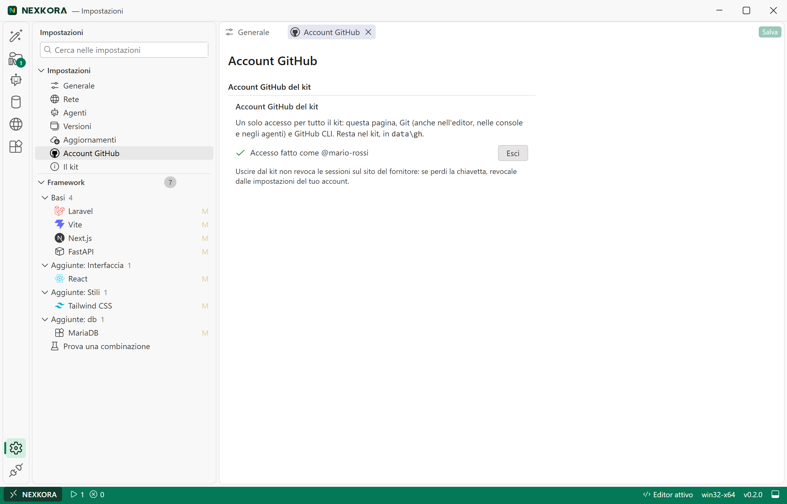
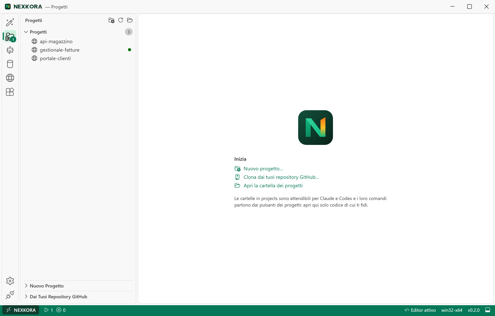
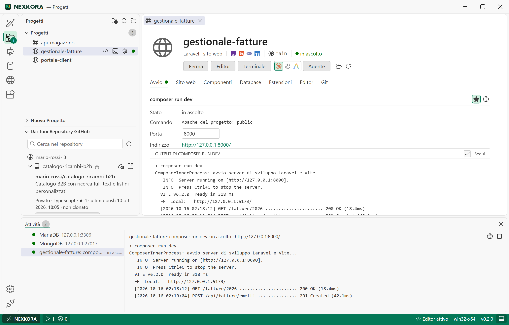
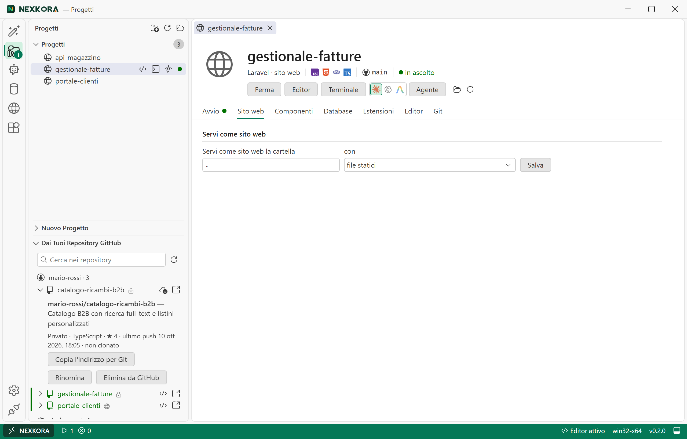
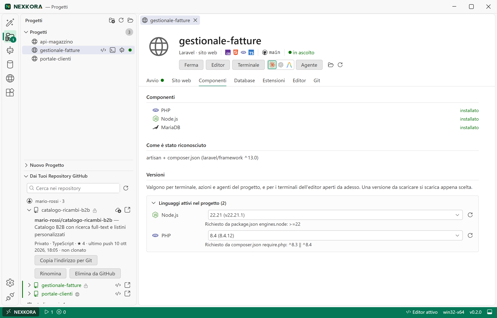
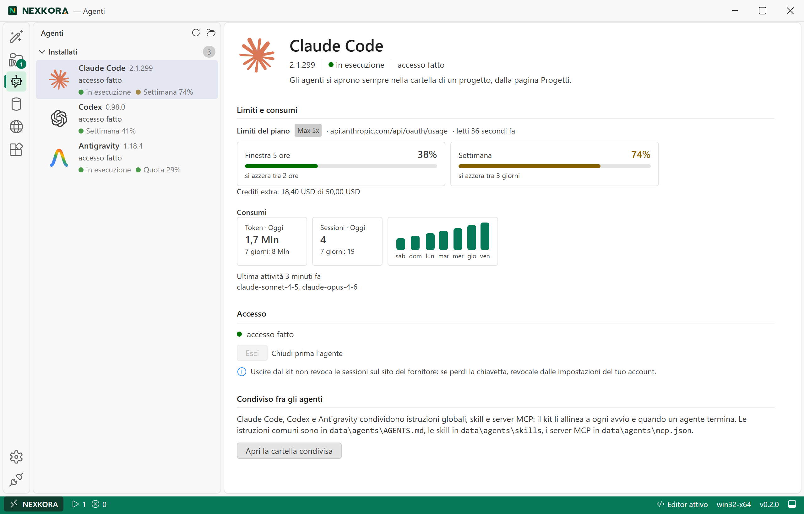
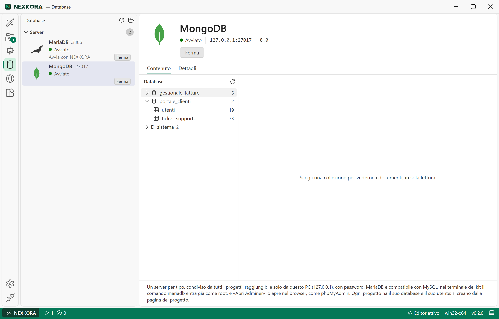
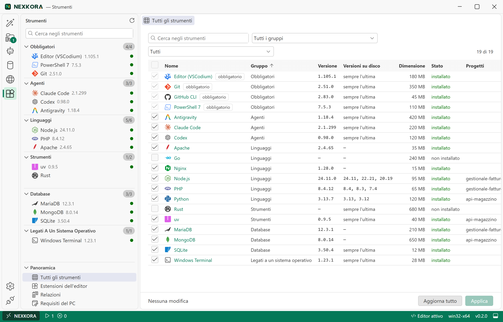
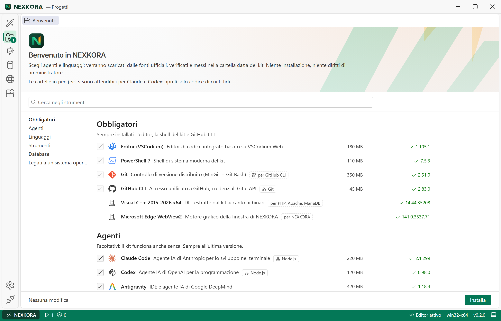

# Atollo Complete Guide: Structure, Features, Sources, Configuration and Illustrated Examples

English · [Italiano](GUIDE.it.md)

This document sets out the **editorial structure**, the **detailed content**, the **real screenshots of the interface** (`images/*.png`) and the **guided practical examples** of the official guide to **Atollo** (`Atollo.exe`, brand **Atollo**). It covers in detail the portable architecture, how every view of the application works, the full organization of the links and sources the kit draws its tools from, the central role of the GitHub account, and the step-by-step procedures to configure each element, with an explanation of the technical and practical purpose of each operation.

> [!NOTE]
> **Real scenario used in the examples and images of this guide:**
> All the screenshots in this guide show a real work environment on a portable drive (`D:\Atollo`) connected to the GitHub account **`@mario-rossi`** (with the organization **`studio-rossi`**) and populated with three concrete projects:
> - **`gestionale-fatture`**: a full-stack **Laravel 13 + React + Tailwind CSS 4 + MySQL 9.7** application (served both with the development command `composer run dev` and through the shared **Apache 2.4 · PHP 8.4** pool at `http://gestionale-fatture.localhost:8081`, with the extra domain `fatture.studio.localhost` and the alias `/allegati`).
> - **`portale-clienti`**: a **Vite + React + TypeScript** frontend application (with the **MongoDB 8.0** document database `portale_clienti` explored directly from the interface).
> - **`api-magazzino`**: a **Python 3.13 + FastAPI** microservice with a relational and a document database.

---

## Table of Contents

1. [Guide Structure and Application Philosophy](#1-guide-structure-and-application-philosophy)
   - [1.1 Core Principles: Full Portability and Isolation](#11-core-principles-full-portability-and-isolation)
   - [1.2 Layout on Disk (`Atollo.exe`, `projects\`, `data\`)](#12-layout-on-disk-atolloexe-projects-data)
   - [1.3 Process Lifecycle (Job Object) and Automatic Relocation](#13-process-lifecycle-job-object-and-automatic-relocation)
2. [Organization of Tool Links and Sources](#2-organization-of-tool-links-and-sources)
   - [2.1 Sourcing Architecture and Cryptographic Verification](#21-sourcing-architecture-and-cryptographic-verification)
   - [2.2 Complete Table of Sources for Components, Languages and Databases](#22-complete-table-of-sources-for-components-languages-and-databases)
   - [2.3 Sources for Editor Extensions, Agent Limits and App Updates](#23-sources-for-editor-extensions-agent-limits-and-app-updates)
   - [2.4 Fallback Without the API and Manual Download ("By Hand")](#24-fallback-without-the-api-and-manual-download-by-hand)
3. [Why a GitHub Account Is Needed and Its Central Role](#3-why-a-github-account-is-needed-and-its-central-role)
   - [3.1 Why the GitHub Account Is Essential in the Kit](#31-why-the-github-account-is-essential-in-the-kit)
   - [3.2 How Unified Authentication Works (`data\gh` and `.gitconfig`)](#32-how-unified-authentication-works-datagh-and-gitconfig)
   - [3.3 Steps to Set Up the GitHub Account and Permissions (`workflow`, `delete_repo`)](#33-steps-to-set-up-the-github-account-and-permissions-workflow-delete_repo)
4. [Detailed Tour of the Application's Features (with Images and Examples)](#4-detailed-tour-of-the-applications-features-with-images-and-examples)
   - [4.1 Main Window, Status Bar and Activity Panel](#41-main-window-status-bar-and-activity-panel)
   - [4.2 The "New project" Tab (Framework Wizard and Combinations)](#42-the-new-project-tab-framework-wizard-and-combinations)
   - [4.3 The "Projects" Page and the Project Detail Tab](#43-the-projects-page-and-the-project-detail-tab)
   - [4.4 Integrated Editor (VSCodium Web) and the Kit's Own Terminal](#44-integrated-editor-vscodium-web-and-the-kits-own-terminal)
   - [4.5 The "Agents" Page (Claude Code, Codex, Antigravity and Synchronization)](#45-the-agents-page-claude-code-codex-antigravity-and-synchronization)
   - [4.6 The "Databases" Page (MySQL, MongoDB, phpMyAdmin and Data Explorer)](#46-the-databases-page-mysql-mongodb-phpmyadmin-and-data-explorer)
   - [4.7 The "Web Servers" Page (Shared Caddy/Apache Pools and `.localhost` VirtualHosts)](#47-the-web-servers-page-shared-caddyapache-pools-and-localhost-virtualhosts)
   - [4.8 The "Tools" Page (Multiple Versions, Relations Matrix and Extensions)](#48-the-tools-page-multiple-versions-relations-matrix-and-extensions)
   - [4.9 The "Settings" Page and the Framework Customization Tree](#49-the-settings-page-and-the-framework-customization-tree)
   - [4.10 The "Remove drive" Page and Safe Ejection](#410-the-remove-drive-page-and-safe-ejection)
   - [4.11 Command-Line Interface (`Atollo.exe` CLI)](#411-command-line-interface-atolloexe-cli)
5. [Step-by-Step Guide to Configuring Each Element and Its Purpose](#5-step-by-step-guide-to-configuring-each-element-and-its-purpose)
   - [5.1 Initial Kit Setup and Choice of Drive](#51-initial-kit-setup-and-choice-of-drive)
   - [5.2 General Configuration: Language, Temporary Files and Updates](#52-general-configuration-language-temporary-files-and-updates)
   - [5.3 Network Configuration: Corporate Proxies, CA Certificates (SSL Inspection) and LAN](#53-network-configuration-corporate-proxies-ca-certificates-ssl-inspection-and-lan)
   - [5.4 Configuring Compilers and Default Lines (Python, PHP, Rust)](#54-configuring-compilers-and-default-lines-python-php-rust)
   - [5.5 Configuring Versions per Project and Resolving Conflicts](#55-configuring-versions-per-project-and-resolving-conflicts)
   - [5.6 Configuring AI Agents, Gemini Key, Skills, Instructions and MCP Servers](#56-configuring-ai-agents-gemini-key-skills-instructions-and-mcp-servers)
   - [5.7 Configuring Database Servers, Project Users, `.env` and Backups](#57-configuring-database-servers-project-users-env-and-backups)
   - [5.8 Configuring Websites, Caddy/Apache Pools, `.localhost` Domains and Aliases](#58-configuring-websites-caddyapache-pools-localhost-domains-and-aliases)
   - [5.9 Configuring Custom Actions (`panel.json`) and Ports](#59-configuring-custom-actions-paneljson-and-ports)
   - [5.10 Configuring Extensions and Editor Settings per Project](#510-configuring-extensions-and-editor-settings-per-project)
   - [5.11 Configuring and Editing the Framework Wizard Recipes](#511-configuring-and-editing-the-framework-wizard-recipes)
   - [5.12 Managing "Data without a project" (Adopting or Cleaning Up Orphans)](#512-managing-data-without-a-project-adopting-or-cleaning-up-orphans)

---

## 1. Guide Structure and Application Philosophy

### 1.1 Core Principles: Full Portability and Isolation

**Atollo** was created to provide a complete development environment for Windows 10 and 11 (`x64` and `ARM64` architectures), macOS (Apple Silicon and Intel) and Linux (`x64` and `ARM64`), packed into a single executable (`Atollo.exe`; on macOS the `.app` bundle, on Linux an AppImage or a `tar.gz`). The same kit on a USB stick opens on all three systems. This guide describes Windows; on macOS and Linux the kit's terminal and the agents open in a tab of the app and Apache is a build made by the kit, with PHP through `php-fpm` (D-116), with the limits listed in the [open issues](https://github.com/nabre/atollo/issues). The project follows five strict architectural rules:

1. **Zero installation and no administrator rights (`asInvoker`)**: the application embeds a Windows manifest with `requestedExecutionLevel level="asInvoker"`. It installs no system services, creates no scheduled tasks and does not modify the Windows registry (even the temporary key `HKCU\Software\Microsoft\Windows\CurrentVersion\Uninstall\Rustup`, which `rustup-init` forces into place, is snapshotted before Rust is installed and restored or removed right after).
2. **Full isolation from the host PC (`env_clear`)**: the programs started by the kit (editor, terminal, AI agents, web servers, databases, project actions) never inherit the host computer's `PATH` or development variables (such as `JAVA_HOME`, `CARGO_HOME`, `PYTHONPATH` or the PowerShell modules in `Documents`). The Rust engine (`tauri/src/env.rs`) builds a clean environment (~90 variables) that points only to `data/`, adding to the `PATH` only the system folders that are strictly needed: on Windows `System32`, `System32\Wbem` and `System32\WindowsPowerShell\v1.0`; on macOS `/opt/homebrew/bin` and `/usr/local/bin` (Homebrew, after the kit's programs), `/usr/bin`, `/bin`, `/usr/sbin` and `/sbin`; on Linux `/usr/local/bin`, `/usr/bin`, `/bin`, `/usr/sbin` and `/sbin`. Of the conda environments on macOS and Linux (Ruby, R and the MongoDB server on Linux), only the component's own programs enter the `PATH`, through the `kit-bin` launchers, not those of their dependencies (D-125).
3. **Clear separation between Project and Kit**:
   - Everything that belongs to the source code and can be shared in a Git repository lives in `projects\<project>\` (including any declarative files such as `panel.json`, `.vscode\settings.json`, `.mcp.json`).
   - Everything related to local state, machine-specific choices, locked ports, database credentials and backups lives in `data\projects\<project>\`. This way the project folder is never "polluted" by local service files.
4. **Golden rule of the interface**: *what concerns a single project is configured on that project's page; what concerns the whole kit is configured on the kit's pages*.
5. **Work context locked to the project**: the integrated editor, the terminal and the AI agents can be opened **only** inside a project's folder, never in the kit's root or in arbitrary folders on the PC.

---

### 1.2 Layout on Disk (`Atollo.exe`, `projects\`, `data\`)

When `Atollo.exe` is copied into an empty folder (on a USB stick, an external SSD or an internal disk, even with spaces, brackets `( )` or `&` in the path) and started, it creates and maintains the following hierarchy:

```text
<Kit-Root>\
├── Atollo.exe                             # Single binary (Tauri 2 GUI + CLI + embedded catalogs)
├── projects\                               # Folder that holds all the user's projects
│   └── <project-name>\                     # Source code of a single project
│       ├── panel.json                      # (Optional) Project actions, website, domains and aliases
│       ├── .mcp.json                       # (Optional) Project-specific MCP servers (Claude Code)
│       ├── .codex\config.toml              # (Optional) Project MCP block for Codex
│       └── .vscode\settings.json           # (Optional) Editor formatting, indentation and exclusions
└── data\                                   # All state, programs, configuration and data
    ├── apps\win32-<x64|arm64>\             # Downloaded executables and languages
    │   ├── pwsh\<major.minor>\             # Portable PowerShell 7 (required)
    │   ├── vscodium-server\                # VSCodium editor web server (version pinned at release)
    │   ├── claude\  codex\  antigravity\   # The three AI agents, each in <major.minor>\
    │   ├── git\  gh\  uv\  cmake\ ...      # Always at the latest version: a single <major.minor>\ folder
    │   ├── rust\  android\  tinytex\  cc\  # No version folder (packages added inside, date-based versions)
    │   ├── tools\                          # Single utilities (ninja.exe, vcruntime\...)
    │   └── <language>\<major.minor>\       # Versioned languages and DBs, several versions side by side (e.g. node\22.11\, php\8.4\)
    ├── app\                                # Global application state and configuration
    │   ├── settings.json                   # User settings (language, network, proxy, versions, temp)
    │   ├── components.txt                  # Choice of installed components (id=1|0)
    │   ├── versions\<id>.txt               # Default installed version of each component
    │   ├── version-lines.json              # Cache (valid 24h) of the major.minor lines offered by the sources
    │   ├── relations.json                  # Fingerprinted cache of the compatibility matrix (D-81)
    │   ├── frameworks.json                 # User customizations to the "New project" wizard recipes
    │   ├── services.json                   # Ports and autostart of the database servers (MySQL, MongoDB)
    │   ├── servers.json                    # Manual profiles and ports assigned to the Caddy and Apache pools
    │   ├── extensions.txt                  # The user's additional global extensions
    │   ├── extensions-offered.txt          # Record of extensions already offered (installed only once)
    │   ├── root.txt / old-root.txt         # Path tracking for automatic relocation
    │   ├── layout.txt                      # Version of the on-disk data schema (2 = per-project data)
    │   ├── db\                             # Folder protected by a DACL (owner only on NTFS)
    │   │   ├── secrets.json                # DB administrator passwords (root for MySQL, admin for MongoDB)
    │   │   └── my.ini                      # Root client credentials and port for direct access from the terminal
    │   ├── logs\                           # App logs (app.log with masked secrets) and DB service logs
    │   └── update\                         # Executable downloaded for self-update (update.json)
    ├── projects\<project-name>\            # Local state kept by the kit for each project (D-89)
    │   ├── dev-settings.json               # Preferred agent, chosen/excluded extensions, language versions
    │   ├── versions.json                   # Environment overrides for the editor terminals in the project
    │   ├── ports.json                      # Remembered ports (7100-7999) and locked ports for the actions
    │   ├── apache\  caddy\                 # Generated configurations for the project's dedicated sites
    │   └── private\                        # Folder protected by an inheritable DACL (owner only)
    │       ├── db.json                     # DB names and generated passwords for the project user
    │       └── backups\                    # The project's .sql (MySQL) and .archive.gz (MongoDB) exports
    ├── servers\<pool-id>\                  # Generated configurations and vhosts\*.conf of the Caddy and Apache pools
    ├── db\                                 # Physical database files, separated by engine and version
    │   ├── mysql\<line>\                   # MySQL data per LTS line (e.g. 9.7\)
    │   └── mongodb\<line>\                 # MongoDB data per production major line (e.g. 9.0\)
    ├── agents\                             # Resources synchronized between Claude Code, Codex and Antigravity
    │   ├── AGENTS.md                       # Global instructions shared by the three agents
    │   ├── skills\                         # Shared skills (linked via NTFS junction or copy)
    │   └── mcp.json                        # Single definition of the global MCP servers
    ├── gh\                                 # Portable GitHub CLI credentials (hosts.yml)
    ├── antigravity\                        # Antigravity credentials saved in the kit (keyring.json)
    ├── home\                               # Portable user profile (.claude, .codex, .gemini, .gitconfig, .ssh, AppData)
    ├── kit\                                # Scripts and helpers extracted from the exe (profile.ps1, loopback.js, phpmyadmin.php, bin\agy.cmd, bin\gradle.cmd)
    ├── vscodium-server\                    # VSCodium server data, installed extensions and Machine\settings.json
    ├── webview2\                           # Isolated browser profile for the app and editor windows
    └── tmp\                                # Fallback temporary files when the system TEMP is not used
```

> [!TIP]
> **How to back up the kit:** to save all your work, just copy `projects\` and `data\`, excluding `data\apps\` and `data\cache\` (which only contain binaries and packages that are downloaded again automatically).

---

### 1.3 Process Lifecycle (Job Object) and Automatic Relocation

- **Windows Job Object (`tauri/src/os/jobs.rs`)**: at startup, `Atollo.exe` creates a Windows Job Object configured with `JOB_OBJECT_LIMIT_KILL_ON_JOB_CLOSE | JOB_OBJECT_LIMIT_BREAKAWAY_OK` and assigns itself to it. Every child process (VSCodium server, databases, web servers, consoles, project actions) starts inside this Job (or in a dedicated sub-job for a single action/server). If the application is closed or ends unexpectedly, Windows instantly stops all child processes without leaving orphaned daemons in the background. Only the system browser and File Explorer are opened outside the job (`CREATE_BREAKAWAY_FROM_JOB`).
- **Single instance per path (`tauri/src/os/instance.rs`)**: the single-instance mutex is computed from the SHA-256 hash of the root path (`Local\Atollo-App-<hash>`). Two different USB sticks connected to the same PC can therefore coexist, and a banner in the main window warns if processes from another copy of the kit are running.
- **Automatic relocation (`tauri/src/agents/relocate.rs`)**: at every startup the kit compares the current path with `data\app\root.txt`. If the folder has been moved or the USB stick has changed drive letter (e.g. from `E:\` to `F:\`), the application writes `old-root.txt`, automatically rewrites the absolute paths in the configuration files of the agents (`.claude.json`, `config.toml`) and of the editor server, and regenerates the NTFS junctions of the skills.

---

## 2. Organization of Tool Links and Sources

### 2.1 Sourcing Architecture and Cryptographic Verification

The installation engine (`tauri/src/net/` and `tauri/src/install/`) never runs external scripts to download components and **never** accepts a package without cryptographic verification.
- **Native Windows TLS stack**: downloads use `ureq` with `native-tls` (SChannel) and `RootCerts::PlatformVerifier`. This way the kit automatically honors the root certificates in the Windows store (essential on corporate or school networks with HTTPS inspection).
- **Atomic download with multiple attempts**: each file is downloaded with a `.part` extension into the temporary work folder (`<TEMP>\Atollo\<id>\setup\<component>\`, or `data\tmp\setup\` if the system disk has less than 4 GiB free), with **3 automatic attempts** (waiting 5 s and 10 s).
- **5 verification methods (`tauri/src/net/verify.rs` and `signature.rs`)**:
  1. **SHA-256** (from the GitHub Release `asset.digest`, from `.sha256`/`.sha256sum`/`SHASUMS256.txt` files or from official JSON APIs).
  2. **SHA-512** (from `.sha512` files for Apache Maven, the .NET SDK JSON, the Antigravity manifest).
  3. **SHA3-256** (published on SQLite's official download page).
  4. **npm integrity (`sha512-<base64>`)** (from the npm registry for Claude Code and Codex).
  5. **Authenticode digital signature (`WinVerifyTrust`)** (cryptographic verification of the signer's certificate: required for the Visual C++ runtime `O=Microsoft Corporation` on both the installer and `vcruntime140.dll`, and applied to `claude.exe` for `Anthropic`).

---

### 2.2 Complete Table of Sources for Components, Languages and Databases

The following table sets out exactly how all the addresses are organized from which `Atollo.exe` takes version metadata, binary archives and checksums:

| Component ID | Group | Official Site (`home`) | Metadata Source / Version Lookup | Binary Download URL | Verification Method | Destination in `data\apps\win32-<arch>\` |
| :--- | :--- | :--- | :--- | :--- | :--- | :--- |
| **`pwsh`** (PowerShell 7) | Required (`required`) | `https://github.com/PowerShell/PowerShell` | GitHub API: `https://api.github.com/repos/PowerShell/PowerShell/releases/latest` | Asset `PowerShell-<v>-win-(x64\|arm64).zip` from `github.com/PowerShell/PowerShell/releases/download/...` | SHA-256 from GitHub `asset.digest` | `pwsh\<line>\pwsh.exe` |
| **`gh`** (GitHub CLI) | Required (`required`) | `https://cli.github.com` | GitHub API: `https://api.github.com/repos/cli/cli/releases/latest` | Asset `gh_<v>_windows_(amd64\|arm64).zip` | SHA-256 from GitHub `asset.digest` | `gh\<line>\bin\gh.exe` |
| **`vscodium-server`** (Editor) | App (`app`) | `https://vscodium.com` | Version pinned in the catalog (`1.135.06055`, D-58) | `https://github.com/VSCodium/vscodium/releases/download/<v>/vscodium-reh-web-win32-x64-<v>.tar.gz` | SHA-256 hardcoded in the catalog (`components.json`) | `vscodium-server\` |
| **`claude`** (Claude Code) | Agents (`agents`) | `https://claude.com/product/claude-code` | npm registry: `https://registry.npmjs.org/@anthropic-ai/claude-code-win32-<arch>/latest` | `dist.tarball` field of the npm JSON | npm integrity `sha512-...` + Authenticode signature `Anthropic` | `claude\<line>\claude.exe` |
| **`codex`** (Codex) | Agents (`agents`) | `https://github.com/openai/codex` | npm registry: `https://registry.npmjs.org/@openai/codex/latest` → then `/<ver>-win32-<arch>` | `dist.tarball` field of the architecture-specific package | npm integrity `sha512-...` | `codex\<line>\bin\codex.exe` |
| **`antigravity`** (Antigravity) | Agents (`agents`) | `https://antigravity.google` | Google Cloud Run manifest: `https://antigravity-cli-auto-updater-974169037036.us-central1.run.app/manifests/windows_(amd64\|arm64).json` | `url` field of the JSON manifest | SHA-512 (128 hex) from the manifest's `sha512` field | `antigravity\<line>\agy.exe` (invoked through `data\kit\bin\agy.cmd`) |
| **`git`** (Git + Git Bash) | Tools | `https://git-scm.com` | GitHub API: `https://api.github.com/repos/git-for-windows/git/releases/latest` | Asset `PortableGit-<v>-(64-bit\|arm64).7z.exe` (extracted in Rust without a 7z window) | SHA-256 from GitHub `asset.digest` | `git\<line>\cmd\git.exe` and `git\<line>\bin\bash.exe` |
| **`python`** (Python + pip) | Languages (versioned) | `https://www.python.org` | `https://raw.githubusercontent.com/astral-sh/python-build-standalone/latest-release/latest-release.json` → `<asset_url_prefix>/SHA256SUMS` | `<asset_url_prefix>/cpython-3.<minor>.<patch>+<date>-<triple>-install_only_stripped.tar.gz` | SHA-256 from the `SHA256SUMS` list | `python\<line>\python.exe` (plus a `python3.exe` copy and `pip` from the internal wheel) |
| **`node`** (Node.js + npm) | Languages (versioned) | `https://nodejs.org` | `https://nodejs.org/dist/index.json` (even LTS lines >= 18 and the latest major) | `https://nodejs.org/dist/<v>/node-<v>-win-<arch>.zip` | SHA-256 from `https://nodejs.org/dist/<v>/SHASUMS256.txt` | `node\<line>\node.exe` |
| **`uv`** (`uv`, `uvx`, `uvw`) | Tools | `https://docs.astral.sh/uv/` | GitHub API: `https://api.github.com/repos/astral-sh/uv/releases/latest` | Asset `uv-<triple>.zip` | SHA-256 from GitHub `asset.digest` | `uv\<line>\uv.exe`, `uvx.exe`, `uvw.exe` |
| **`php`** (PHP + Composer + CA + VC++) | Languages (versioned) | `https://www.php.net` | `https://windows.php.net/downloads/releases/releases.json` + hardcoded EOL archives (`8.1`, `8.0`, `7.4`..`5.6`) | `https://windows.php.net/downloads/releases/<path>` (Thread Safe build `ts-vs*-x64` / `ts-vc*-x64`) | SHA-256 from `releases.json` (or verified EOL table) | `php\<line>\php.exe` |
| ↳ *Part: Composer* | *(inside PHP)* | `https://getcomposer.org` | `https://getcomposer.org/versions` (`stable` channel or `2.2` LTS depending on `min-php`) | `https://getcomposer.org<path>` (`composer.phar`) | SHA-256 from `<url>.sha256sum` | `php\<line>\composer.phar` (+ `composer.cmd` and `composer`) |
| ↳ *Part: SSL CA bundle* | *(inside PHP)* | `https://curl.se` | — | `https://curl.se/ca/cacert.pem` | SHA-256 from `https://curl.se/ca/cacert.pem.sha256` | `php\<line>\extras\ssl\cacert.pem` |
| ↳ *Part: VC++ Runtime* | *(for PHP, Apache, MongoDB)* | `https://learn.microsoft.com` | Extracted only once if missing | `https://aka.ms/vc14/vc_redist.x64.exe` (CAB extraction `vcRuntimeMinimum_amd64\cab1.cab`) | Authenticode signature `O=Microsoft Corporation` on the exe and `vcruntime140.dll` | `tools\vcruntime\` (copied next to `php.exe`, `httpd.exe`, `mongod.exe`) |
| **`apache`** (Apache httpd) | Languages (versioned) | `https://httpd.apache.org` | Windows: HTML page `https://www.apachelounge.com/download/`; macOS and Linux: versions pinned in the catalog (kit build, D-116) | Windows: `https://www.apachelounge.com/download/VS<nn>/binaries/httpd-<v>-Win64-VS<nn>.zip`; macOS and Linux: `https://github.com/nabre/atollo/releases/download/httpd-v<v>/httpd-<v>-<target>.tar.gz` | SHA-256 from `<url>.txt` (`SHA256-Checksum for:`); macOS and Linux: SHA-256 pinned in the catalog | `apache\<line>\bin\httpd.exe` (macOS and Linux: `apache/<line>/bin/httpd`, PHP with `php-fpm`) |
| **`caddy`** (Caddy) | Languages (versioned) | `https://caddyserver.com` | GitHub API: `https://api.github.com/repos/caddyserver/caddy/releases` | Asset `caddy_<v>_<system>_<arch>` from the GitHub release | SHA-256 from GitHub `asset.digest` (from 2.10.1), before that SHA-512 from `caddy_<v>_checksums.txt` | `caddy\<line>\caddy.exe` |
| **`rust`** (Rustup, Cargo, Clippy) | Tools | `https://www.rust-lang.org` | `https://static.rust-lang.org/dist/channel-rust-stable.toml` (`[pkg.rustc]`) | `https://static.rust-lang.org/rustup/dist/<triple>/rustup-init.exe` | SHA-256 from `<url>.sha256` | `rust\cargo\bin\rustc.exe` and `rustup.exe` |
| **`go`** (Go SDK) | Languages (versioned) | `https://go.dev` | `https://go.dev/dl/?mode=json` (and `&include=all` for the list of lines) | `https://go.dev/dl/go<v>.windows-(amd64\|arm64).zip` | SHA-256 from the `sha256` field of the JSON | `go\<line>\bin\go.exe` |
| **`java`** (Temurin JDK + Maven + Gradle) | Languages (versioned) | `https://adoptium.net` | `https://api.adoptium.net/v3/info/available_releases` + `/v3/assets/latest/<major>/hotspot?architecture=...` | URL of the `.zip` package returned by the Adoptium API | SHA-256 from `binary.package.checksum` | `java\<line>\bin\java.exe` |
| ↳ *Part: Apache Maven* | *(inside Java)* | `https://maven.apache.org` | `https://repo.maven.apache.org/maven2/org/apache/maven/apache-maven/maven-metadata.xml` (3.x) | `https://repo.maven.apache.org/.../apache-maven-<v>-bin.zip` | SHA-512 from `<url>.sha512` | `maven\bin\mvn.cmd` |
| ↳ *Part: Gradle* | *(inside Java)* | `https://gradle.org` | `https://services.gradle.org/versions/current` | `downloadUrl` field of the JSON | SHA-256 from the JSON's `checksumUrl` | `gradle\bin\gradle.bat` (started by `data\kit\bin\gradle.cmd`) |
| **`kotlin`** (Kotlin Compiler) | Languages (versioned) | `https://kotlinlang.org` | GitHub API: `https://api.github.com/repos/JetBrains/kotlin/releases?per_page=100` | Asset `kotlin-compiler-<v>.zip` | SHA-256 from `asset.digest` or from `<asset>.sha256` | `kotlin\<line>\bin\kotlinc.bat` |
| **`android`** (Android SDK) | Tools | `https://developer.android.com/studio` | HTML page: `https://developer.android.com/studio` (`commandlinetools-win-<build>_latest.zip`) | `https://dl.google.com/android/repository/commandlinetools-win-<build>_latest.zip` + packages via `sdkmanager` | SHA-256 read from the table on the official page | `android\cmdline-tools\latest\bin\sdkmanager.bat` and `android\platform-tools\adb.exe` |
| **`dotnet`** (.NET SDK) | Languages (versioned) | `https://dotnet.microsoft.com` | `https://builds.dotnet.microsoft.com/dotnet/release-metadata/releases-index.json` → `releases.json` | `.zip` URL for `rid=win-x64\|win-arm64` | SHA-512 from the `hash` field of `releases.json` | `dotnet\<line>\dotnet.exe` (with side-by-side SDK/runtime junctions) |
| **`dart`** (Dart SDK) | Languages (versioned) | `https://dart.dev` | `https://storage.googleapis.com/dart-archive/channels/stable/release/latest/VERSION` (and GCS bucket for the lines) | `https://storage.googleapis.com/dart-archive/channels/stable/release/<v>/sdk/dartsdk-windows-<arch>-release.zip` | SHA-256 from `<url>.sha256sum` | `dart\<line>\bin\dart.exe` |
| **`zig`** (Zig) | Languages (versioned) | `https://ziglang.org` | `https://ziglang.org/download/index.json` | `tarball` field for `(x86_64\|aarch64)-windows` | SHA-256 from the `shasum` field of the JSON | `zig\<line>\zig.exe` |
| **`julia`** (Julia) | Languages (versioned) | `https://julialang.org` | `https://julialang-s3.julialang.org/bin/versions.json` | `.zip` file for `os=winnt`, `arch=x86_64` | SHA-256 from the `sha256` field of `versions.json` | `julia\<line>\bin\julia.exe` |
| **`bun`** (Bun) | Languages (versioned) | `https://bun.sh` | GitHub API: `https://api.github.com/repos/oven-sh/bun/releases` | Asset `bun-windows-(x64\|aarch64).zip` | SHA-256 from `asset.digest` or from `SHASUMS256.txt` | `bun\<line>\bun.exe` |
| **`deno`** (Deno) | Languages (versioned) | `https://deno.com` | GitHub API: `https://api.github.com/repos/denoland/deno/releases` | Asset `deno-(x86_64\|aarch64)-pc-windows-msvc.zip` | SHA-256 from `asset.digest` or from `<asset>.sha256sum` | `deno\<line>\deno.exe` |
| **`typst`** (Typst) | Languages (versioned) | `https://typst.app` | GitHub API: `https://api.github.com/repos/typst/typst/releases` | Asset `typst-(x86_64\|aarch64)-pc-windows-msvc.zip` | SHA-256 from GitHub `asset.digest` | `typst\<line>\typst.exe` |
| **`tinytex`** (TinyTeX / LaTeX) | Tools | `https://yihui.org/tinytex/` | GitHub API: `https://api.github.com/repos/rstudio/tinytex-releases/releases/latest` | Asset `TinyTeX-1-windows-v*.exe` (7z SFX extracted in Rust) | SHA-256 from GitHub `asset.digest` | `tinytex\bin\windows\tlmgr.bat` and `pdftex.exe` |
| **`pnpm`** (pnpm + yarn/corepack) | Tools | `https://pnpm.io` | npm registry: `https://registry.npmjs.org/pnpm/latest` and `/corepack/latest` | Global installation through the kit's Node.js `npm-cli.js` | npm registry integrity | `data\npm-global\pnpm.cmd` and `yarn.cmd` |
| **`cmake`** (CMake + Ninja) | Tools | `https://cmake.org` | GitHub API: `Kitware/CMake` and `ninja-build/ninja` (`releases/latest`) | Asset `cmake-*-windows-(x86_64\|arm64).zip` and `ninja-win(arm64).zip` | SHA-256 from GitHub `asset.digest` | `cmake\<line>\bin\cmake.exe` and `tools\ninja.exe` |
| **`cc`** (C/C++ llvm-mingw) | Tools | `https://github.com/mstorsjo/llvm-mingw` | GitHub API: `https://api.github.com/repos/mstorsjo/llvm-mingw/releases/latest` | Asset `llvm-mingw-*-ucrt-(x86_64\|aarch64).zip` | SHA-256 from GitHub `asset.digest` | `cc\bin\clang.exe` (+ generated `make.cmd`) |
| **`ruby`** (Ruby + Bundler) | Languages (versioned) | `https://www.ruby-lang.org` | GitHub API: `https://api.github.com/repos/oneclick/rubyinstaller2/releases?per_page=30` | Asset `rubyinstaller-<v>-(x64\|arm).7z` | SHA-256 from GitHub `asset.digest` | `ruby\<line>\bin\ruby.exe` |
| **`r`** (R from conda-forge) | Languages (versioned) | `https://www.r-project.org` | `https://api.anaconda.org/package/conda-forge/r-base` (`subdir=win-64`) + GitHub `mamba-org/micromamba-releases` | `micromamba-win-64` + `r-base` and `libblas=*=*openblas` packages from `conda-forge` | SHA-256 of `micromamba-win-64.sha256` + SHA-256 of the conda packages | `r\<line>\bin\R.cmd` and `Rscript.cmd` (+ `tools\micromamba.exe`) |
| **`mysql`** (MySQL Community Server) | Databases (versioned) | `https://www.mysql.com` | 8.4 and 9.7 LTS lines pinned in the catalog | `https://cdn.mysql.com/Downloads/MySQL-<line>/mysql-<v>-winx64.zip` | SHA-256 pinned after checking Oracle's GPG signature | `mysql\<line>\bin\mysqld.exe` and `mysql.exe` |
| **`mongodb`** (MongoDB + mongosh + Tools) | Databases (versioned) | `https://www.mongodb.com` | `https://downloads.mongodb.org/current.json` (production `x.0.y`), GitHub `mongodb-js/mongosh`, `https://downloads.mongodb.org/tools/db/release.json` | Windows x64 zips of `mongod`, `mongosh` and `mongodb-database-tools` | SHA-256 from the MongoDB JSON files + GitHub `asset.digest` for `mongosh` | `mongodb\<line>\bin\mongod.exe`, `mongosh\bin\mongosh.exe`, `mongodb-tools\bin\mongodump.exe` |
| **`phpmyadmin`** (phpMyAdmin for MySQL) | Databases | `https://www.phpmyadmin.net` | `https://www.phpmyadmin.net/home_page/version.json` | `files.phpmyadmin.net/phpMyAdmin/<v>/phpMyAdmin-<v>-all-languages.zip` | SHA-256 from the official `.sha256` file + `php -l` lint | `phpmyadmin\<line>\index.php` |
| **`sqlite`** (SQLite CLI) | Databases | `https://sqlite.org` | Official page: `https://sqlite.org/download.html` (CSV rows `PRODUCT,...`) | `https://sqlite.org/<year>/sqlite-tools-win-(x64\|arm64)-<v>.zip` | **SHA3-256** published in the `PRODUCT` row | `sqlite\<line>\sqlite3.exe` |

---

### 2.3 Sources for Editor Extensions, Agent Limits and App Updates

Besides the main components, the application contacts the following addresses for specific functions:

1. **Editor extensions (`tauri/catalog/extensions.json` and `tauri/src/editor/ext.rs`)**:
   - **Open VSX Registry** (through `vscodium-server --install-extension <publisher.name>`): all the extensions in the language-extension matrix (Python, ESLint, Prettier, Volar, Intelephense, rust-analyzer, Tinymist, SQLTools, etc.) are downloaded from the open-source Open VSX registry preconfigured in VSCodium.
   - **CodeLLDB (`vadimcn.vscode-lldb`)**: downloaded directly from GitHub Releases (`https://api.github.com/repos/vadimcn/codelldb/releases/latest`, asset `codelldb-win32-x64.vsix`, verified through the SHA-256 `digest`) and installed from the local `.vsix` file when a project uses Rust, Zig, C or C++.
2. **AI agents' plan limits and usage (`tauri/src/agents/stats/`)**:
   - **Claude Code**: `https://api.anthropic.com/api/oauth/usage` (authenticated with the OAuth token in `data\home\.claude\.credentials.json`).
   - **Codex**: `https://chatgpt.com/backend-api/wham/usage` (authenticated with `data\home\.codex\auth.json`, falling back to reading the `token_count` events locally from the session files).
   - **Antigravity**: `https://cloudcode-pa.googleapis.com/v1internal:fetchAvailableModels` (authenticated with `data\antigravity\keyring.json`).
   - *Security note*: the tokens are only read and are sent exclusively to their own provider (sparingly: a minimum cache of 2 minutes and honoring `Retry-After` on HTTP 429).
3. **Self-update of `Atollo.exe` (`tauri/src/setup/self_update.rs`)**:
   - Queries the releases tagged `app-vX.Y.Z` of the repository `https://api.github.com/repos/nabre/atollo/releases`, looking for the system's asset with the version in its name (`Atollo-X.Y.Z-win32-x64.exe`, `-win32-arm64.exe`, `-darwin-<arch>.app.zip`, `-linux-<arch>.AppImage`), verified with SHA-256.
4. **Android template and framework packages (`tauri/catalog/frameworks.json`)**:
   - The wizard commands download packages from the official registries through the kit's tools: **Packagist** (`composer`), **npm Registry** (`npm`/`npx`), **Google Android Repository** (`sdkmanager` for `ndk;30.0.16248370`), and clone the official Android template from `https://github.com/android/architecture-templates.git`.

---

### 2.4 Fallback Without the API and Manual Download ("By Hand")

1. **Getting past GitHub's API limit of 60 calls/hour (`tauri/src/net/mod.rs`)**:
   - If the user has not yet connected a GitHub account and the IP address runs out of the anonymous `api.github.com` quota, the kit automatically switches to reading GitHub's web pages directly (which do not use API quota):
     - it follows the redirect of `https://github.com/<owner>/<repo>/releases/latest` to find the tag of the latest version;
     - it downloads `https://github.com/<owner>/<repo>/releases/expanded_assets/<tag>` to extract the asset links and the `sha256:` hashes published by GitHub.
2. **Assisted manual download ("By Hand", `tauri/src/setup/downloads.rs` and `ui/src/byhand.tsx`)**:
   - If a download fails because of firewall blocks or network problems (but the metadata with the SHA fingerprint are known), the component's row on the **Tools** page shows a dashed box with the direct link to the file.
   - Clicking the file name opens the PC's browser to download it; the user can then **drag the file (Drag & Drop)** into the box or click **"browse…"** (which opens the Windows `Downloads` folder).
   - The file is copied to `<TEMP>\Atollo\<id>\downloads\` (or `data\downloads\`), **verified against the official SHA hash** (even if the browser added ` (1)` to the name), and the installation resumes by itself. Unused files are cleaned up after 30 days.

---

## 3. Why a GitHub Account Is Needed and Its Central Role

### 3.1 Why the GitHub Account Is Essential in the Kit

In Atollo the GitHub account is not a mere accessory for a single program: it is designed as the **single, centralized identity of the whole portable environment** (`tauri/src/github/mod.rs`, decision D-70). Setting up the GitHub account in **Settings** meets five critical needs at once:

1. **One sign-in for all tools (the kit's "Single Sign-On")**:
   - By signing in only once in the **Settings › GitHub account** section, authentication becomes immediately active for:
     - the **app's interface** (browsing, cloning, renaming and deleting your repositories in "Projects");
     - the **kit's Git** (used by the Push/Pull/Sync buttons of the **VSCodium Editor**, by the **Terminal** and by scripts);
     - **GitHub CLI (`gh`)** in the kit's consoles (`gh pr`, `gh issue`, `gh repo`, `gh run`);
     - the **three AI agents** (Claude Code, Codex and Antigravity), which can then create branches, open Pull Requests or clone private repositories at your request without asking you for tokens or credentials.
2. **Full portability on the USB stick (zero traces on the host PC)**:
   - If you ran `gh auth login` manually in a terminal without parameters, GitHub CLI would save the token in the host PC's *Windows Credential Manager* (leaving your sign-in on that computer and losing it when you move the USB stick to another PC).
   - The sign-in started from the app instead uses `--insecure-storage` with `GH_CONFIG_DIR` pointed at `data\gh\`: the token is saved in `data\gh\hosts.yml` inside the kit, travels with you on the USB stick and never touches the Windows Credential Manager.
3. **Removing network limits (GitHub API rate limit)**:
   - Many tools in the catalog (`pwsh`, `gh`, `git`, `uv`, `kotlin`, `bun`, `deno`, `typst`, `tinytex`, `cmake`, `ninja`, `cc`, `ruby`, `caddy`, `mongosh`, `codelldb`) are hosted on GitHub Releases. Without authentication, GitHub limits API queries to 60 per hour per IP address (often shared in offices, schools or universities). With the account connected the limit rises to **5,000 requests per hour**.
4. **Secure cloning of private repositories without exposing the token**:
   - When you clone a repository from the app, the token is never passed on the command line (where it would be visible to the PC's other processes) nor written into `.git\config` (where it would remain in plain text in the project); instead it is injected only for the duration of the command through `GIT_CONFIG_*` environment variables as an HTTP header toward `https://github.com`.
5. **Surviving a move of the kit**:
   - Unlike the standard `gh auth setup-git` command (which writes the absolute path `C:\...\gh.exe` into `.gitconfig` and breaks as soon as the USB stick changes drive letter), Atollo configures in the portable `.gitconfig` (`data\home\.gitconfig`) the directive `helper = !gh auth git-credential` without a fixed path, relying on the kit's isolated `PATH`.

---

### 3.2 How Unified Authentication Works (`data\gh` and `.gitconfig`)

1. **Starting the Device flow (`gh auth login --web`)**:
   - The app runs `gh auth login --hostname github.com --git-protocol https --web --insecure-storage --scopes workflow` in the background.
   - In addition to `gh`'s default scopes (`repo`, `read:org`, `gist`), the kit immediately requests the **`workflow`** scope to allow pushing `.github/workflows/*.yml` files (GitHub Actions) from the editor or the agents.
2. **Automatic synchronization of Git's credential helper (`sync_git`)**:
   - As soon as the sign-in succeeds (and at every app startup), Atollo updates `data\home\.gitconfig` for the two domains `https://github.com` and `https://gist.github.com`, setting:
     1. an empty value `helper =` (which clears any system helpers such as Git Credential Manager, for GitHub only);
     2. `helper = !gh auth git-credential` (which delegates supplying the token to the kit's `gh`).
   - If the user signs out of the account ("Sign out"), the app automatically removes these lines from `.gitconfig`. If instead the user had manually configured a custom helper of their own, the kit does not overwrite it.

---

### 3.3 Steps to Set Up the GitHub Account and Permissions (`workflow`, `delete_repo`)

#### Sign-In Procedure
1. Open the **Settings** page (gear icon at the bottom of the activity bar on the left).
2. In the Settings side bar click **GitHub account** (or go there directly from the **Clone or create** panel on the **Projects** page).
3. Click the **"Sign in to GitHub"** button.
4. The application generates an **8-character one-time code** in the format `XXXX-XXXX` (e.g. `1A2B-3C4D`), shows it on the page with the **"Copy the code"** button and automatically opens the PC's default browser at `https://github.com/login/device`.
5. In the browser, sign in to your GitHub account (if you are not already signed in), paste the `XXXX-XXXX` code and authorize **GitHub CLI**.
6. The app's page detects the completion automatically, shows your GitHub user name and configures the kit's Git.



> [!TIP]
> **Practical example — Unified sign-in as `@mario-rossi`:**
> In the screenshot above, the user has signed in under **Settings › GitHub account** with the account **`@mario-rossi`**. From this moment:
> - `data\gh\hosts.yml` keeps the OAuth token on the USB stick (`D:\Atollo`);
> - `data\home\.gitconfig` uses `!gh auth git-credential` to authenticate `git push`, `git pull`, the VSCodium Editor and the three AI agents (Claude Code, Codex, Antigravity) automatically;
> - the GitHub API limit for downloading tools and updates rises from 60 to **5,000 requests/hour**.

#### Repository Management and the `delete_repo` Permission on Request
- For security reasons (principle of least privilege), at the first sign-in the kit does **not** ask for permission to delete repositories (`delete_repo`).
- When on the **Projects** page you select one of your GitHub repositories and click **"Delete from GitHub"**, if the current token does not have the `delete_repo` scope, the app shows the **"Grant the permission"** button, which starts a quick new sign-in with `--scopes workflow,delete_repo`.
- *Note*: deleting a repository on GitHub through the app never deletes any folder already cloned in `projects\`.


> **Practical example — Cloning from `@mario-rossi` and `studio-rossi`:**
> When you open the **Clone or create** panel in the **Projects** side bar, the app automatically lists both the personal repositories (`mario-rossi/gestionale-fatture`, `portale-clienti`, `api-magazzino`, `preventivi-pdf`) and those of the organization (`studio-rossi/design-system`). Repositories already present in `projects\` show the **"cloned"** badge with the quick **"Open"** button, while for remote ones a click on **"Clone"** is enough to download them into `projects\<name>` and configure their language versions automatically.

---

## 4. Detailed Tour of the Application's Features (with Images and Examples)

### 4.1 Main Window, Status Bar and Activity Panel

Atollo's interface uses VSCodium's official components and design system (`@vscode-elements/elements`) with the unified **Atollo Dark / Light** theme (synchronized automatically with Windows' light/dark theme):

- **Custom title bar (`ui/src/titlebar.tsx`)**: without the standard Windows frame, it includes the Atollo logo, the title of the current view and the window controls.
- **Global alerts banner (`Banner` in `ui/src/App.tsx`)**: appears at the top only when needed, to report:
  - that the kit has been **moved** from a previous path (`movedFrom` → `root`) and that the relocation has taken place;
  - that programs from **another copy of the kit** are running on the same PC (recalling that the two copies are completely separate);
  - that a folder in the kit's path starts with a **digit (`0-9`), lowercase `x` or `u`** (`watcherUnsafeFolder`, a known limit of `@parcel/watcher` in VSCodium that prevents the editor from detecting external changes to files).
- **Activity Bar (on the left)**: holds the 8 main views, with keyboard navigation too (`Up/Down Arrow`, `Home`, `End`):
  - At the top: **Projects** (with a numeric badge for the running projects), **Agents**, **Databases**, **Web Servers**, **Tools**.
  - At the bottom: **Settings**, **Remove drive**.
- **Status Bar (at the bottom)**:
  - On the left: the **Atollo** badge (with the root path on mouse hover), the counter of **running projects** and of **errors** (clickable to open the Activity panel) and an animated indicator of **installations in progress**.
  - On the right: the **"Editor running"** indicator (with the port `127.0.0.1:70xx` of the VSCodium server), the architecture (`win32-x64` or `win32-arm64`), the app version (`vX.Y.Z`) and a button to show/hide the **Activity** panel.
- **Activity panel (`ui/src/activity.tsx`)**: a resizable panel at the bottom (drag the divider, or double-click to bring it back to `240px`) present on every page. It gathers in one place the real-time output of the project actions (with the buttons *Open in the browser*, *Stop*, *Forget*), the state and logs of the databases and the detailed progress of component installations.



---

### 4.1.1 Projects Quick Panel

The first tab of the Projects editor (`ui/src/projects/home.tsx`, D-130) is always present: **Running** (address, output, *Stop*), **Favorites** and **Recent** (Start/Stop, Editor, Terminal, agent, favorites star), **Needs attention** (failed starts, missing components) and **New project**. Every row of the side bar has ▶ for the default action. **Ctrl+P** (⌘P on macOS) opens a project by name from any page: *Enter* opens the page, *Shift+Enter* starts it.

### 4.2 The "New project" Tab (Framework Wizard and Combinations)

The **New project** tab of the Projects page (`ui/src/projects/wizard.tsx` and `tauri/src/projects/frameworks/`) opens from the "New project" tree in the side bar (Empty project, From a Git address, From a framework or CMS and its bases) or from the magic wand at the top; it generates the complete scaffolding of a modern application by combining official building blocks. The bases are divided into groups (D-131): Web with PHP, Web with JavaScript and TypeScript, Web with Python, Web with other languages, CMS, Static sites and documentation, Desktop app, Mobile app, Data and documents, Command line and libraries; the chips above the bases choose the group. Besides those listed below there are, among others, Nuxt, SvelteKit, Astro, Angular, Django, FastAPI, ASP.NET Core, Spring Boot, Craft CMS, Joomla, Strapi, Docusaurus, Avalonia, Streamlit, JupyterLab, Typst and LaTeX. The building blocks:

1. **Choosing the Base (`kind: "base"`)**:
   - **Laravel** (PHP 8.x + Node.js, Laravel 13, actions *Start* `composer run dev` and *Tests* `php artisan test`).
   - **Symfony** (PHP, Symfony 8.1 skeleton + `webapp`, action *Start* `php -S 127.0.0.1:8000 -t public`).
   - **Vite** (Node.js, `npm create vite@9` template `vanilla-ts`, actions *Start* and *Build*).
   - **Next.js** (Node.js, `create-next-app@16` with TypeScript, Tailwind CSS, ESLint, App Router).
   - **Electron** (Node.js, `create-electron-app@8` Electron Forge with Vite and TypeScript).
   - **Tauri** (Rust + Node.js, `npm create tauri-app@4`, identifier `{package}`).
   - **Android** (Git + Java + Android SDK, clones `android/architecture-templates` branch `base`, runs `customizer.sh {package} Item {name}` and initializes Git).
2. **Choosing compatible Additions (`kind: "addon"`, divided into mutually exclusive `slot`s)**:
   - *`frontend` slot*: **React**, **Vue**, **Svelte**, **Livewire** (on Laravel they use the official starter kits `laravel/react-starter-kit`, `vue-starter-kit`, `livewire-starter-kit`; on Electron they switch to `@quick-start/electron@1` with `electron-vite`).
   - *`bundler` slot*: **Vite** for Symfony (`pentatrion/vite-bundle`).
   - *`css` slot*: **Tailwind CSS 4** (`@tailwindcss/vite` or `symfonycasts/tailwind-bundle`), **Bootstrap 5**, **Bulma 1**.
   - *`database` slot* (for Laravel): **SQLite**, **MySQL** (starts the kit's MySQL, creates the project's DB and user, writes the `.env` and runs `php artisan migrate --force`), **MongoDB** (starts the kit's MongoDB, creates the DB and user, writes the `.env` and installs `mongodb/laravel-mongodb`).
   - *`desktop` slot* (for Laravel): **Electron (NativePHP)** (`nativephp/desktop`, adds the *Desktop app* and *Package* actions).
   - *`mobile` slot*: **Android (NativePHP Mobile)** for Laravel; **Android (Capacitor 8)** for Vite (`@capacitor/core`, `@capacitor/android`); **Android (Tauri Mobile)** for Tauri (automatically installs the Android NDK via `sdkmanager`, adds the Android Rust targets and runs `tauri android init`).
   - *`admin` slot*: **Filament 5** for Laravel (`filament:install --panels`).
   - *`tests` slot*: **Pest 5** for Laravel, **Vitest 5** for Vite and Tauri.
   - *`format` slot*: **Prettier 3** (adds the `npm run format` script).
3. **Destination (Project name)**:
   - It can be a **new folder** in `projects\`, or an **existing project** as long as it is empty or contains files **without already being a Git repository** (in the latter case the framework is generated in `<TEMP>\Atollo\<id>\frameworks\` and the files are merged without overwriting the user's existing files).
4. **`.env` variables and Summary**:
   - Shows the default variables (e.g. `APP_NAME={name}`, `NATIVEPHP_APP_ID={package}` where `{package}` becomes `com.example.<name>`), letting you edit them or add new ones, lists the kit tools that will be installed automatically and shows all the PowerShell commands that will be run, with real-time output.


> [!TIP]
> **Practical example — Creating `gestionale-fatture` with a single click:**
> In the screenshot above, the developer selects the **Laravel** base and combines it with the additions **React** (interface), **Tailwind CSS** (styling) and **MySQL** (database), choosing `projects\gestionale-fatture` as the destination.
> The summary at the bottom shows exactly what Atollo will do when **"Create the project"** is pressed:
> 1. checks that **PHP (with Composer)**, **Node.js** and **MySQL** are installed in the kit;
> 2. starts MySQL, creates the `gestionale_fatture` database and the dedicated user with a random 32-digit password;
> 3. runs `composer create-project laravel/react-starter-kit . --no-interaction`, `npm install`, installs `@tailwindcss/vite`, fills the `.env` file with `APP_NAME="Gestionale Fatture Studio Rossi"` and the MySQL credentials, and runs `php artisan migrate --force`.

---

### 4.3 The "Projects" Page and the Project Detail Tab

The **Projects** page (`ui/src/projects/`) is divided into:
- **A side bar with three panels**:
  1. **Projects**: list of all the valid folders in `projects\` with quick search, run state (green dot), and quick inline buttons for **Start/Stop**, **Editor**, **Terminal** and **Agent**.
  2. **Clone or create**: lets you create an empty project, clone from an `https://` Git URL or `owner/repo`, or browse the full list of **your GitHub repositories** (grouped by owner/organization, with a search bar, a *Clone* button, *Open in the Editor* if already cloned, *Rename* and *Delete from GitHub*).
  3. **Data without a project** (visible only if there are orphaned folders in `data\projects\` without a matching folder in `projects\`): lets you **link (adopt)** the data, passwords and backups to an existing project or **delete them** permanently (including the databases in the servers).

Clicking a project opens the **Project tab** (`ui/src/projects/page.tsx`) in the central area, with a header showing the detected type, language icons, Git branch, main buttons (*Start/Stop*, *Editor*, *Terminal*, *Agent* selector, *Open folder*, *Refresh*) and **7 navigation sections**:

1. **Run (`run`)**: shows the details of the selected action (state, port assigned in the `7100-7999` range, a box to lock/change the port, an *Open in the browser* button, real-time console output) and the table of all the project's actions (detected automatically from `package.json`, `composer.json`, `Cargo.toml`, `pyproject.toml`, etc., or defined in `panel.json`), with the option to add, edit or remove actions and environment variables. If the project folder is empty, it also offers a button to delete it.



> **Practical example — Running `gestionale-fatture` and controlling it from the Activity panel:**
> In the screenshot above, the default **Start** action (`composer run dev`) of `gestionale-fatture` is running on the locked port `8000` (`http://127.0.0.1:8000/`). The console shows the combined output of Laravel Server, Queue listener and Vite v6.2.1, while the **Activity** panel at the bottom lets you control at the same time all the active projects (`gestionale-fatture :8000` and `portale-clienti :5173`), the databases (`MySQL :3306`, `MongoDB :27017`) and the installations.

2. **Website (`site`)**: lets you serve any subfolder of the project (`.` or `public`, `dist`, etc.) choosing among 4 modes:
   - *static files* (the built-in server `Atollo.exe serve`, with no need for Node or PHP);
   - *PHP (built-in server)* (`php -S`);
   - *Caddy* (the default web server: an instance of the project on its own port, or a shared pool or a manual profile; it does not read `.htaccess`, the rewrite rules are generated from the project type);
   - *Dedicated Apache* (for projects with their own rules in `.htaccess`: an Apache instance exclusive to the project on its own port, or attached to a shared pool).
   It also lets you declare **extra `.localhost` domains** and **portable path aliases** (also toward other projects with `@other-project/folder`).



3. **Components (`components`)**: lists the kit tools the project requires (with the **"Install what is missing"** button if any dependency is not installed) and lets you pin the **specific version of each language** (e.g. Python, Node.js, PHP, Java, .NET, Go, Ruby, etc.) for this project only, showing any compatibility warnings detected from the project's files (`package.json`, `composer.json`, `.nvmrc`, `pyproject.toml`, etc.).



4. **Databases (`databases`)**: manages the project's dedicated databases on **MySQL** and **MongoDB** (and shows the detected SQLite files). With one click on **"Create database and user"**, the kit starts the server, generates a dedicated database and user with a random password of 32 hexadecimal digits (saved in `data\projects\<project>\private\db.json`), shows a preview of the `.env` lines and lets you **write them to the project's `.env` file** with one click, as well as managing **Export (backup)** and **Restore** in `private\backups\`.


5. **Extensions (`extensions`)**: shows the VSCodium extensions active for this project (defaults based on the detected languages + those added manually) and lets you disable some of them or add new ones from the matrix or from Open VSX.
6. **Editor (`editor`)**: visually edits the project's `.vscode\settings.json` (format on save, indentation size of 2 or 4 spaces or tab, folders hidden in `files.exclude`).
7. **Git (`git`)**: shows safely (by reading `.git/HEAD` and `.git/config` without running Git hooks) the local branch, the remote branch, the synchronization state and the URL of the remote repository, with a button to open it in the browser.


---

### 4.4 Integrated Editor (VSCodium Web) and the Kit's Own Terminal

- **Integrated VSCodium editor (`tauri/src/editor/`)**:
  - Started on `127.0.0.1` (ports `7000-7099`) with a private security token and without telemetry.
  - Opens in dedicated Atollo windows (`editor-<n>`) without the Windows title bar: it uses VSCodium's own title bar directly, with the menus (`File`, `Edit`, etc.) and the window control buttons injected natively (D-69).
  - **Security of the Editor windows**: the editor windows have no access to Tauri's IPC commands (D-14), can only navigate to their own project's URL (`folder=`), ask for trust confirmation (*Workspace Trust*) the first time an unknown project is opened (D-67), and enable in the workspace only the extensions relevant to that project (D-71).
  - **Live language detection (every 15 seconds)**: if while working in the editor you create the first `.py` or `.rb` file in a project, within 15 seconds the kit notices it, installs the extensions for that language in the background and shows a banner in the editor window to restart the extensions.
- **The kit's own terminal (`tauri/src/editor/terminal.rs`)**:
  - **Inside the editor**: the Windows system profiles are hidden; the default profile is **Atollo** (the kit's PowerShell 7 with `profile.ps1`, which also applies the language versions chosen for that project), alongside *Atollo - Git Bash*, *Atollo - cmd* and the profiles of the three installed AI agents.
  - **Outside the editor ("Terminal" button or starting an Agent)**: opens the **classic Windows console** (`conhost.exe` from System32, started directly: Windows does not hand it over to the PC's default terminal) with the kit's PowerShell 7 and the project's exact environment, inside the app's job (D-57, D-95).
  - **On macOS and Linux** the kit's terminal and the agents open in a terminal tab inside the app window (D-109), with the kit's PowerShell or Bash and the same project environment; the programs stay in the kit's process group.

---

### 4.5 The "Agents" Page (Claude Code, Codex, Antigravity and Synchronization)

The **Agents** page (`ui/src/agents.tsx` and `tauri/src/agents/`) manages the three AI coding assistants:
- **Claude Code** (Anthropic), **Codex** (OpenAI) and **Antigravity** (Google).
- **Limits and usage monitoring (`ui/src/stats.tsx`)**: for each installed agent it shows the usage bars of the plan limits (with reset time and visual warnings at 70% and 90%), any extra credits, and a detailed summary of the tokens used **today** and in the **last 7 days** (new tokens, read from cache, output tokens, number of sessions and a daily chart).
- **Sign-in management and portable keyring**: shows whether the sign-in is active (OAuth or API key) and lets you sign out (**"Sign out"**) when the agent is closed. For **Antigravity**, the wrapper `data\kit\bin\agy.cmd` and the app's watcher temporarily move the credential into the Windows Credential Manager with *session-only* persistence when `agy` starts, encrypt it with **DPAPI** (`CryptProtectData`) and bring it back to `data\antigravity\keyring.json` as soon as `agy` ends, deleting it from Windows.
- **Automatic three-way synchronization (`tauri/src/agents/sync/`)**: at every app startup, before launching an agent and every time an agent ends (checked by the watcher every 3 seconds), the kit automatically aligns:
  - the **global instructions** between `data\agents\AGENTS.md`, `CLAUDE.md` (Claude), `AGENTS.md` (Codex) and `GEMINI.md` (Antigravity);
  - the **skills** in `data\agents\skills\` (linked with NTFS junctions, or copied on FAT32/exFAT, into the three agents' folders, in a double pass so that a skill created in one agent appears right away in the other two);
  - the **MCP servers** defined in `data\agents\mcp.json` into the configurations of Claude, Codex and Antigravity;
  - the **trusted folders** (`projects\`).



> **Practical example — Checking the limits of Claude Code, Codex and Antigravity:**
> In the screenshot above, all three agents are installed with an **active sign-in**. For **Claude Code** the 5-hour window is at **38%** while the weekly limit has reached **74%** (highlighted in amber because it exceeds the 70% warning threshold), with **138.4k tokens** used today in 3 sessions and **804.6k tokens** in the last 7 days. At the top right, the **Shared folder (`data\agents\`)** box opens with one click the folder holding `AGENTS.md`, `skills\` and `mcp.json`, shared by all three assistants.

---

### 4.6 The "Databases" Page (MySQL, MongoDB, phpMyAdmin and Data Explorer)

The **Databases** page (`ui/src/databases.tsx` and `tauri/src/db/`) manages the kit's shared database servers, listening only on `127.0.0.1`:
- **MySQL** (8.4 and 9.7 LTS lines, default port `3306`) and **MongoDB** (default port `27017`).
- **MySQL only (`D-117`)**: MySQL is the kit's only SQL server; every project, framework or component that asks for an SQL database uses MySQL.
- **Automatic security (`D-74`)**: the first time each server starts, the kit generates a random password of 32 hexadecimal digits for the administrator (`root` on MySQL, `admin` on MongoDB) and saves it in `data\app\db\secrets.json` (protected by an owner DACL). It also generates `data\app\db\mysql.cnf`, read by the kit's launchers, so that typing `mysql` in the kit's terminal logs you in as `root` already, without having to type the password.
- **Integrated phpMyAdmin for MySQL (`D-107`)**: when you click **"Open phpMyAdmin"**, the kit installs phpMyAdmin and PHP if they are missing, starts MySQL if it is stopped, launches a local PHP server with the security router `data\kit\phpmyadmin.php` and opens phpMyAdmin in the browser, performing an **automatic login as `root` through a one-time token** and an `HttpOnly` + `SameSite=Strict` cookie (without ever exposing the `root` password in the URL or in the browser).
- **Content explorer for MongoDB (`D-79`, `ui/src/dbbrowser.tsx`)**: when MongoDB is running, the **Content** tab lets you browse all the databases and collections read-only (including the system databases, grouped separately), showing the documents paginated 100 rows at a time.
- **Multi-version data (`D-81`)**: with the server stopped you can change the engine version (e.g. MySQL `9.7` or `8.4`; MongoDB `9.0` or `8.0`). Each version keeps its own data folder in `data\db\<engine>\<line>\` and, the first time a newer version starts, it automatically copies the data forward from the nearest previous version.

````carousel

<!-- slide -->

````

> **Practical example — Relational (MySQL + phpMyAdmin) and document (MongoDB Content) management:**
> - In the **first screenshot** (the SQL server), the server is running on `127.0.0.1:3306` and starts automatically together with Atollo; clicking **"Open phpMyAdmin"** gives immediate access to all the databases without copying the `root` password.
> - In the **second screenshot** (`MongoDB 8.0`), the **Content** tab shows the `api_magazzino` and `portale_clienti` databases (with the collections `utenti (19)` and `ticket_supporto (73)`), letting you inspect the JSON documents directly inside the app.

---

### 4.7 The "Web Servers" Page (Shared Caddy/Apache Pools and `.localhost` VirtualHosts)

The **Web Servers** page (`ui/src/servers.tsx` and `tauri/src/servers/mod.rs`) lets you serve dozens of web projects at the same time without port conflicts and without touching the system's `hosts` file (`C:\Windows\System32\drivers\etc\hosts` on Windows, `/etc/hosts` on macOS and Linux, which would require administrator rights):
- **Automatic pools by version**: the kit automatically groups all the projects configured with Caddy or Apache by the combination `(engine, server version, PHP version)` (e.g. `apache-2.4-php-8.4` on port `8081`).
- **Manual server profiles**: from the side bar you can create custom profiles (e.g. *"Apache Legacy PHP 7.4"* on a specific port from `8081` to `8999`) and assign projects to them from the project's *Website* tab.
- **`.localhost` VirtualHosts (RFC 6761)**: every project attached to a pool automatically gets its own file `data\servers\<pool>\vhosts\<project>.conf` with `ServerName <project>.localhost` (plus any extra `.localhost` domains) and answers at the address `http://<project>.localhost:<port>`.
- **Hot reload**: the **"Reload configuration"** button regenerates all the VirtualHost files and reloads Caddy (`caddy reload`, on the pool's private socket) or cleanly restarts Apache. Nginx is no longer there (D-120): its pools and sites move to Caddy at startup, with a copy of the files in `data\app\pre-caddy\`.


> **Practical example — Shared `Apache 2.4 · PHP 8.4` pool on port `8081`:**
> In the screenshot above, the automatic pool `apache-2.4-php-8.4` serves the `gestionale-fatture` project (`public` folder) both on the primary domain `http://gestionale-fatture.localhost:8081` and on the extra domain `http://fatture.studio.localhost:8081`, and also maps the alias `/allegati` to `storage/app/public/allegati`. Next to it, in the side bar, a second pool `Caddy 2.10 · PHP 8.3` on port `8082` is also ready.

---

### 4.8 The "Tools" Page (Multiple Versions, Relations Matrix and Extensions)

The **Tools** page (`ui/src/components/page.tsx`) is the control center for all the kit's packages:
1. **Component list divided by category**: *Required and system* (with the state of the system runtimes: Visual C++, WebView2, x64 emulation on ARM64), *Agents*, *Languages* (multi-version), *Tools* (single version) and *Databases*.
2. **Inline multi-version management (`ui/src/versions/kit.tsx`)**: under each installed versioned language or database, all the `major.minor` lines present on disk are listed:
   - the versions currently chosen by at least one project show the **"locked"** badge with the padlock (clickable to see which projects use it) and cannot be removed by mistake;
   - free versions can be removed one by one with the trash icon;
   - the **"Download another version…"** menu shows all the lines offered by the official source (grouped by major version) and immediately starts downloading the chosen line.
3. **"Relations" section (`ui/src/relations.tsx`)**: shows the matrix computed by `tauri/src/versions/relations/`:
   - checks the **links between tools** (e.g. Composer against PHP, Apache/Caddy against PHP, Gradle/Maven/Kotlin against the JDK, Corepack/Yarn against Node.js);
   - reads the **version constraints declared in the projects' files** (`package.json`, `.nvmrc`, `pyproject.toml`, `composer.json`, `compose.yaml`, `go.mod`, `pom.xml`, `build.gradle`, `global.json`, `Gemfile`, `pubspec.yaml`, `Project.toml`, `build.zig.zon`, `renv.lock`, `Cargo.toml`, `CMakeLists.txt`, `typst.toml`) and offers a direct button (**"Use X.Y"** or **"Download and use X.Y"**) to align the project with one click.
4. **"Extension matrix" section (`ui/src/extensions.tsx`)**: shows, read-only, the full table of pairings between languages/tools and VSCodium extensions.
5. **"Grid" view (`ui/src/components/matrix.tsx`, D-121)**: one row per component and one column for each of the six systems (Windows x64 and ARM64, macOS Apple Silicon and Intel, Linux x64 and ARM64), with "this PC", "in emulation" or "cannot run here". Each cell says whether the component is available, in emulation, pre-downloaded, whether it completes on first start on that system or whether it is not available, with the reason; a click opens the details and "Show this system". The system chosen with "Platform" is kept across sessions, and relations and extensions follow it.



---

### 4.9 The "Settings" Page and the Framework Customization Tree

The **Settings** page (`ui/src/settings/page.tsx`) is organized like the VSCodium editor, with an instant search bar at the top of the side bar and two panels:
1. **Settings panel (7 sections that open as tabs)**:
   - **General**: Interface language, Default terminal, Location of the programs' temporary files, Automatic update of the app.
   - **Network**: HTTPS proxy, HTTP proxy, Proxy exclusions (`NO_PROXY`), Additional CA certificates (`.pem`), Access from the local network (LAN) to the project servers.
   - **Agents**: Gemini API key (to use Antigravity without a Google account).
   - **Versions**: Default Python line, default PHP branch, default Rust compiler (`GNU` or `MSVC`).
   - **Updates**: Immediate check and state of the `Atollo.exe` updates.
   - **GitHub account**: Connecting and disconnecting the kit's GitHub account.
   - **The kit**: Detailed information on the root path, architecture, volume type and detected file system (`NTFS`, `exFAT`, `FAT32`, fixed or removable disk), and buttons to open the kit or log folders.
2. **Frameworks panel (`ui/src/frameworks/`)**:
   - Shows the tree of all the **Bases** and **Additions** of the "New project" wizard, lets you **edit the official creation commands**, the subsequent steps, the `.env` variables, the required components and the generated actions (saving only the differences in `data\app\frameworks.json`, with a *Restore* button to go back to the official values), **create new custom bases or additions**, and test any combination in the **"Try a combination"** tab.

---

### 4.10 The "Remove drive" Page and Safe Ejection

The **Remove drive** page (`ui/src/eject.tsx` and `tauri/src/os/sessions.rs`) prepares the USB stick or external drive for physical removal:
- It lists in real time everything the kit has open: editor windows, consoles, running projects, running databases, installations in progress and any external processes started from `data\apps\`.
- When you click **"Close everything and prepare for removal"**, the app:
  1. cancels any installations in progress;
  2. stops all the project actions;
  3. performs a clean, authenticated shutdown of MySQL and MongoDB;
  4. stops the Caddy and Apache pools;
  5. closes the editor windows, the VSCodium server, the consoles and all the processes whose executable is inside the kit;
  6. saves the Antigravity credentials in the kit (`data\antigravity\keyring.json`), removing them from the Windows Credential Manager;
  7. finally asks you to close the `Atollo.exe` window itself to release the last file on the drive and eject the drive from Windows.


> [!IMPORTANT]
> **Practical example — Safely removing the USB stick at the end of the day:**
> In the screenshot above, before unplugging the drive `D:\Atollo`, the **Remove drive** page automatically detects **1 editor window**, **2 consoles**, **2 running projects** (`gestionale-fatture` and `portale-clienti`), **2 active databases** (`MySQL` and `MongoDB`) and **4 processes** still running from `data\apps\` (`php.exe`, `httpd.exe`, `mysqld.exe`, `node.exe`). A single click on **"Close everything and prepare for removal"** shuts down the databases in an orderly way (avoiding corruption of the InnoDB/WiredTiger tables), brings the Antigravity credentials back into the kit and releases every handle on the file system.

---

### 4.11 Command-Line Interface (`Atollo.exe` CLI)

The same `Atollo.exe` executable offers a complete CLI (`tauri/src/cli.rs`). Since `Atollo.exe` is built as a Windows GUI application (`windows_subsystem = "windows"`), when you invoke it from PowerShell you need to add `| Out-Host` to wait for the command to finish and read its output:

```powershell
.\Atollo.exe env | Out-Host                                 # Prints all the environment variables computed for the kit
.\Atollo.exe components | Out-Host                          # Lists the catalog components, whether they are chosen and the installed version
.\Atollo.exe versions <id> | Out-Host                       # Downloads and shows the major.minor lines available for a versioned component
.\Atollo.exe check | Out-Host                               # Runs the final check command on all installed components
.\Atollo.exe prepare [--only a,b] [--skip c] [--update-all] [--force] | Out-Host
                                                             # Installs, updates or removes the chosen components
.\Atollo.exe sync [--project <folder>] [--verbose] | Out-Host
                                                             # Aligns instructions, skills, rules and MCP between Claude, Codex and Antigravity
.\Atollo.exe keyring restore|save | Out-Host                # Restores or saves the Antigravity sign-in (used by agy.cmd)
.\Atollo.exe serve <folder> <port> | Out-Host               # Starts the built-in static HTTP server
.\Atollo.exe version | Out-Host                             # Shows the app version
.\Atollo.exe help | Out-Host                                # Shows the command summary
```

---

## 5. Step-by-Step Guide to Configuring Each Element and Its Purpose

This section documents in detail **how to configure each element** of the application, **where the changes are saved** and **for what exact purpose** each configuration should be made.

---

### 5.1 Initial Kit Setup and Choice of Drive

- **Where to configure it**: in the Windows file system before the first start, then in the **First start** wizard.
- **Steps**:
  1. Create a folder for the kit (e.g. `D:\Atollo` on an internal disk or `E:\Atollo` on a USB stick). **Important**: make sure that no segment of the path starts with a digit (`0-9`) or with the lowercase letters `x` or `u` (e.g. avoid `D:\2026\kit` or `D:\utils\kit`; use `D:\Anno2026\kit` or `D:\Tools\kit` instead).
  2. Copy `Atollo.exe` into the folder and start it with a double-click.
  3. On the **First start** screen, check the preselected components (by default: *PowerShell 7*, *GitHub CLI*, *Editor*, the three *Agents*, *Python*, *PHP*, *Apache*, plus *Git*, which comes with GitHub CLI — about 1.8 GB) or tick right away other languages or databases you use regularly, then click **"Install"**.



- **Purpose**:
  - Avoiding folders that start with digits, `x` or `u` prevents the regular expression bug of `@parcel/watcher` in VSCodium (D-33), ensuring that the editor updates the file tree instantly when the AI agents or the terminal create or modify files in the project.
  - If you use a USB stick, formatting it as **NTFS** (instead of FAT32 or exFAT) gives three advantages: it supports single files larger than 4 GiB, it allows native hard links for Rust, and it lets Windows apply **DACL** security permissions to the reserved folders `data\app\db\` and `data\projects\<p>\private\`.

---

### 5.2 General Configuration: Language, Temporary Files and Updates

- **Where to configure it**: **Settings › General** (saved in `data\app\settings.json`).
- **Steps and purpose of each item**:
  1. **Language (`lang`)**:
     - *Steps*: choose among *Windows language*, *Italiano*, *English*, *Français*, *Deutsch* and click **"Save"** at the top right of the tab bar.
     - *Purpose*: instantly changes (without restarting) the language of the interface and of the Rust engine's error messages, and sets the `ATOLLO_LANG` variable for the kit's tools.
  2. **Temporary files of programs (`programTemp`: `Automatic` / `In the kit` / `In the system`)**:
     - *Steps*: select the desired mode in the *Temporary files of programs* drop-down menu and save.
     - *Purpose*: controls where the `TEMP`, `TMP` and `CLAUDE_CODE_TMPDIR` variables seen by the compilers, `npm`, `pip` and the AI agents point to:
       - **Automatic (recommended)**: if the kit is on a fixed internal **NTFS/ReFS** disk, it uses `data\tmp\system` inside the kit (zero traces on the PC and a folder protected by a DACL); if instead the kit is on a **removable USB stick**, on a **network drive** or on a **FAT32/exFAT** file system, it automatically moves the temporary files to `<Windows TEMP>\Atollo\<id>\system` (and `\claude`). This **greatly increases build speed**, avoids wear on the USB flash memory and prevents temporary fragments from remaining readable without permissions on a FAT32/exFAT USB stick (they are then deleted from the PC automatically when the app closes).
       - **In the kit**: forces the exclusive use of `data\tmp` even on a USB stick (maximum privacy toward the host PC, but slower on USB).
       - **In the system**: forces the use of the host PC's disk even when the kit is on a fixed disk (useful to save space or writes on the kit's drive).
  3. **Automatic update (`autoUpdate`)**:
     - *Steps*: leave the *"Download new versions of Atollo automatically"* box ticked or untick it.
     - *Purpose*: when it is on, 20 seconds after startup the app silently checks whether a new `app-v*` release exists on GitHub, downloads it and verifies its SHA-256 in `data\app\update\`, replacing `Atollo.exe` on close without ever interrupting your work. Turn it off if you work on tightly metered connections or want to freeze the environment's version.

---

### 5.3 Network Configuration: Corporate Proxies, CA Certificates (SSL Inspection) and LAN

- **Where to configure it**: **Settings › Network** (saved in `data\app\settings.json`, applied in `env.rs`).
- **Steps and purpose of each item**:
  1. **HTTPS proxy (`httpsProxy`), HTTP proxy (`httpProxy`) and No proxy for (`noProxy`)**:
     - *Steps*: enter the full proxy URL (e.g. `http://proxy.azienda.it:8080`) and the excluded hosts (e.g. `localhost,127.0.0.1,.azienda.it`), then click **"Save"** (and **"Restart the editor"** if the editor was already open).
     - *Purpose*: automatically propagates `HTTPS_PROXY`, `HTTP_PROXY` and `NO_PROXY` both to Atollo's download engine and to all subprocesses (`npm`, `pip`, `composer`, `cargo`, `rustup`, `git`, `gh` and the three AI agents). Also needed when the corporate network uses PAC files (which are not read automatically).
  2. **Additional certificates — PEM file (`extraCaCerts`)**:
     - *Steps*: enter the path of an existing `.pem` file containing the company's root certificate (recommended: copy it inside `data\` so you always have it with you) and save.
     - *Purpose*: while programs that use Windows SChannel read the system certificate store, **Node.js** (and therefore also the editor server, `npm`, Claude Code and Codex) uses its own static CA store and would fail behind a corporate firewall with *SSL Inspection*. This setting automatically sets `NODE_EXTRA_CA_CERTS` for all the kit's processes.
  3. **Local network (`allowLan` / `ATOLLO_ALLOW_LAN=1`)**:
     - *Steps*: tick *"Let other PCs on the network reach the project servers"* and save.
     - *Purpose*: as a security default, an embedded file (`data\kit\loopback.js`, loaded via `NODE_OPTIONS=--require`) and the command generators force all the projects' development servers (Vite, Next.js, PHP, Apache, Caddy, `Atollo.exe serve`) to listen **only on `127.0.0.1`**, avoiding Windows Firewall prompts and exposure on public Wi-Fi networks. When this option is on, the projects' web servers listen on `0.0.0.0`, so you can try the site or app from a smartphone or from another PC connected to the same local network (the MySQL and MongoDB databases still stay locked to `127.0.0.1`).

---

### 5.4 Configuring Compilers and Default Lines (Python, PHP, Rust)

- **Where to configure it**: **Settings › Versions** (saved in `data\app\settings.json`).
- **Steps and purpose**:
  1. **Python (`pythonVersion`, e.g. `3.13`) and PHP (`phpVersion`, e.g. `8.4`)**:
     - *Steps*: leave it empty to always download the latest stable line, or write a specific `major.minor` line (e.g. `3.12` or `8.3`), save and start the installation/update in **Tools**.
     - *Purpose*: defines which main line is installed or updated by default when Python or PHP is installed for the first time.
  2. **Rust compiler (`rustToolchain`: `GNU` by default, or `MSVC`)**:
     - *Steps*: on an `x64` PC, choose between *GNU (default, all in the kit)* and *MSVC (requires Visual Studio Build Tools on the PC)*, save and run the Rust installation/update in **Tools**. (On `ARM64`, GNU means the `aarch64-pc-windows-gnullvm` host, linked by the llvm-mingw clang of the C/C++ component, which is installed together with Rust; MSVC remains an option. On macOS and Linux Rust always uses the native host.)
     - *Purpose*:
       - **GNU (`x86_64-pc-windows-gnu`)** is the default because it includes its own linker inside the kit: it lets you build Rust programs on any "bare" Windows PC without having to install anything on the host computer.
       - **MSVC (`x86_64-pc-windows-msvc`)** should be chosen if you develop applications that depend on Windows C++/COM libraries or crates that explicitly require Microsoft's `link.exe` linker (such as some Tauri configurations), provided that the *Visual Studio C++ Build Tools* are installed on the host PC.

---

### 5.5 Configuring Versions per Project and Resolving Conflicts

- **Where to configure it**:
  - For a single project: **Projects › `<your-project>` › Components tab** (saved in `data\projects\<project>\dev-settings.json` under `versions` and in `versions.json`).
  - For all projects at once: **Tools › Relations section**.
- **Steps**:
  1. Open the project's **Components** tab (or the **Relations** section in **Tools**).
  2. Next to each versioned language (Node.js, Python, PHP, Java, .NET, Go, Kotlin, Dart, Zig, Julia, Bun, Deno, Ruby, R, Typst), open the version drop-down menu.
  3. Choose **"The newest (X.Y)"**, or a **version already on disk**, or directly select a **version offered by the source** under the *"Download…"* group (the kit will automatically start the download and pin the version on the project).
- **Example of the generated `data\projects\gestionale-fatture\dev-settings.json` file**:
  ```json
  {
    "agent": "claude",
    "versions": {
      "node": "22.21",
      "php": "8.4"
    },
    "extensions": {
      "added": ["bmewburn.vscode-intelephense-client"],
      "removed": []
    }
  }
  ```
- **Purpose**:
  - **Protection against code aging (`pin_newest`, D-81)**: when you create a new project, the kit automatically pins in its `dev-settings.json` the current versions of the installed languages; when you clone a project, it reads its configuration files (`package.json`, `composer.json`, `.python-version`, `pom.xml`, etc.) and downloads/sets the compatible version. This way, if six months from now you update Node.js or PHP in the kit for new projects, the earlier projects will keep running with exactly the version they were written for (which will be protected by the **"locked"** padlock on the Tools page).
  - **Transparent coexistence (side by side)**:
    - For **PHP**, changing the project's version also changes the `composer` in the `PATH` (each PHP version has its own compatible `composer.phar`) and the extensions loaded by `php.ini` (`${CP_PHP}\ext`).
    - For **Java**, Gradle 9 is started by the kit's wrapper (`data\kit\bin\gradle.cmd`) with the most recent JDK (>= 17) so that the Gradle daemon can start, but it compiles the project's code with the JDK chosen by the project (e.g. Java 8 or 11) thanks to `data\gradle\gradle.properties` and `data\home\.m2\toolchains.xml`, generated automatically by `side_by_side.rs`.
    - For **.NET**, all installed versions share runtimes and SDKs through NTFS junctions, allowing `global.json` to find any installed SDK.

---

### 5.6 Configuring AI Agents, Gemini Key, Skills, Instructions and MCP Servers

#### A. Gemini API Key (Antigravity Without a Google Account)
- **Where to configure it**: **Settings › Agents**.
- **Steps**: paste your key into the *Gemini API key* field and click **"Save"**. (The key is never read back by the interface; to remove it click *"Remove the key"* and then *"Save"*.)
- **Purpose**: sets the `GEMINI_API_KEY` variable in the kit's environment, letting you use Antigravity and Gemini-based tools even on machines where you do not want to sign in via OAuth with a personal Google account.

#### B. Global Instructions, Shared Skills and Global MCP Servers
- **Where to configure it**: in the `data\agents\` folder (which you can open from the **Agents** page by clicking **"Open shared folder"**).
- **Steps**:
  1. **Common instructions**: edit `data\agents\AGENTS.md` (or the specific file of one of the three agents: at the end of the session the 3-way synchronization engine will merge the changes).
  2. **Common skills**: add a subfolder with your `SKILL.md` in `data\agents\skills\<skill-name>\`.
  3. **Global MCP servers**: add the server in `data\agents\mcp.json` (using `npx`, `uvx`, `node` or `python`).
- **Example of `data\agents\mcp.json` shared between Claude Code, Codex and Antigravity**:
  ```json
  {
    "mcpServers": {
      "playwright": {
        "command": "npx",
        "args": ["-y", "@playwright/mcp@latest"]
      },
      "fetch": {
        "command": "uvx",
        "args": ["mcp-server-fetch"]
      }
    }
  }
  ```
- **Purpose**: avoid having to configure the same rules, skills and MCP tools three times for Claude Code, Codex and Antigravity. In addition, when you start an agent, the kit analyzes `data\agents\mcp.json` (`needs.rs`) and **automatically installs Node.js (if an MCP server uses `npx`/`node`), uv (if it uses `uvx`/`uv`) or Python** before opening the agent.

#### C. Project-Specific MCP Servers
- **Where to configure it**: the `.mcp.json` and `.codex\config.toml` files in the project folder (managed by `tauri/src/projects/mcp.rs`).
- **Purpose**: lets you version, in the project's Git repository, the MCP servers dedicated to that project only, making them available to both Claude Code and Codex.

---

### 5.7 Configuring Database Servers, Project Users, `.env` and Backups

#### A. Configuring the Kit's MySQL and MongoDB Servers
- **Where to configure it**: the **Databases** page (saved in `data\app\services.json`).
- **Steps**:
  1. Select **MySQL** or **MongoDB** in the side bar.
  2. In the **Settings** section (*Details* tab), with the server stopped you can choose the engine **Version**, change the **Port** (defaults `3306` and `27017`, valid from `1024` to `65535`) and tick **"Start with Atollo"**.
  3. Click **"Start"** to start the server (if the component is not installed yet, it is downloaded and initialized automatically on first start).
- **Purpose**: have a single lightweight instance per engine shared by all projects, protected by an administrative password (`root`/`admin`) and accessible via **phpMyAdmin** (for MySQL) or through the **Content** explorer (for MongoDB).

#### B. Creating a Project's Database/User, Writing `.env` and Backups
- **Where to configure it**: **Projects › `<your-project>` › Databases tab** (credentials and backups saved in `data\projects\<project>\private\`).
- **Steps**:
  1. Under MySQL or MongoDB, click **"Create database and user"**: the kit starts the server if it is stopped, creates the `<project>` database and the `<project>` user with a random password of 32 hexadecimal digits and permissions limited exclusively to that database.
  2. Click **"Write to .env"**: the app shows the **exact preview of the lines that will change** (automatically recognizing the Laravel style `DB_CONNECTION`/`DB_PORT`/`DB_DATABASE`/`DB_USERNAME`/`DB_PASSWORD` or the standard `DATABASE_URL` / `MONGODB_URI`, and creating `.env` from `.env.example` if it is missing). Confirm to apply. (If `.env` is not listed in `.gitignore`, the tab shows a security warning.)
  3. In the **Copies (Backup)** subsection, click **"Export"** to create a `.sql` dump (`mysqldump --single-transaction --routines --events --triggers`) or `.archive.gz` dump (`mongodump --archive --gzip`) in `data\projects\<project>\private\backups\`, or **"Restore…"** to import an existing backup.
- **Example of the `.env` lines generated automatically for `gestionale-fatture` (Laravel style)**:
  ```dotenv
  DB_CONNECTION=mysql
  DB_HOST=127.0.0.1
  DB_PORT=3306
  DB_DATABASE=gestionale_fatture
  DB_USERNAME=gestionale_fatture
  DB_PASSWORD=9f4e2c8a71b30d5e6f12a98c4d3e7b10
  ```
- **Purpose**:
  - **Security isolation between projects (`D-74`, `D-89`)**: each project has its own credentials and cannot read or alter the databases of other projects. Even restoring an external `.sql` file is done with the project's restricted user (never as `root`), preventing a malicious SQL dump from modifying `mysql.*` or other databases.

---

### 5.8 Configuring Websites, Caddy/Apache Pools, `.localhost` Domains and Aliases

- **Where to configure it**: **Projects › `<your-project>` › Website tab** (saved in `projects\<project>\panel.json`) and the **Web Servers** page (`data\app\servers.json`).
- **Steps**:
  1. Open the project's **Website** tab.
  2. In the *"Folder to serve as a website"* field, enter the document root relative to the project (e.g. `.` or `public` for Laravel/Symfony, `dist` for frontend builds).
  3. In the *"with"* menu, choose the engine:
     - **static files**: uses the server built into the exe (ideal for plain HTML/CSS/JS);
     - **PHP (built-in server)**: uses `php -S` for quick single-site development;
     - **Caddy** (default) or **Dedicated Apache** (for your own rules in `.htaccess`): enables the advanced VirtualHost options.
  4. If you chose Caddy or Apache:
     - Choose the **Server profile**: *Automatic (pool by version)* (recommended: it automatically groups the site into the pool on the **Web Servers** page that matches the server and PHP versions chosen by the project) or a manual profile created on the **Web Servers** page.
     - *(Optional)* Enter **Extra .localhost domains** separated by commas (e.g. `api.mio-sito.localhost, admin.mio-sito.localhost`).
     - *(Optional)* Click **"Add alias"** to map a URL path (e.g. `/media`) to a folder inside the project (`storage/uploads`) or to a folder of another project in the kit (`@other-project/public`). Alias folders serve static files only: a PHP script in them is refused, and an `.htaccess` there can only change the file listings (SEC-V4-01, D-116).
  5. Click **"Save"**. Then start the project (or start the corresponding pool on the **Web Servers** page) and open `http://<project>.localhost:<port>`.
     - With *Automatic*, "Start" opens a dedicated instance of the project on its own port; with a **manual profile**, "Start" starts that profile's pool (if it is stopped) and shows the site's address in the pool. "Stop" on a site served by a pool only marks it as stopped: the pool, shared with other projects, is stopped from the **Web Servers** page.
- **Purpose**:
  - Allow multi-site and multi-domain architectures (`.htaccess` on Apache, FastCGI `php-cgi.exe` or `php-fpm` on Caddy) and sharing of assets between different projects (`@other-project/...`) while keeping 100% portability: the `httpd.conf`/`Caddyfile` files are regenerated at every start in `data\servers\<pool>\` using the kit's variables (`${CP_PROJECTS_FWD}`) and validating every alias with `safe_path` (no malicious junction toward external servers is ever followed, D-77).

---

### 5.9 Configuring Custom Actions (`panel.json`) and Ports

- **Where to configure it**: **Projects › `<your-project>` › Run tab** (the actions are saved in `projects\<project>\panel.json`, the ports in `data\projects\<project>\ports.json`).
- **Steps**:
  1. In the **Run** tab, click **"New action"** (or select an existing action and click **"Edit"**).
  2. Fill in:
     - **Name** (e.g. `Start Worker` or `Dev Server`);
     - **Type**: *Website or web server* (`web`, waits for the port to respond and enables *Open in the browser*), *Desktop application* (`desktop`), or *Command* (`command`);
     - **Command**: the command line to run (e.g. `npm run dev -- --port {port}`: the `{port}` placeholder is replaced with the port assigned by the kit);
     - **Folder** (optional, e.g. `frontend` for a monorepo);
     - **Environment variables** (one per line in the format `KEY=value`).
  3. Click **"Save"**. You can also click **"Default"** to make the action the one bound to the project's main **"Start"** button.
  4. To pin a specific port (between `1024` and `65535`, excluding `7000-7099`, reserved for the editor), write it in the **Port** field of the action details: the kit locks it (`locked` in `ports.json`) so that cookies, localStorage and local OAuth redirects always use the same address.
- **Complete example of `projects\gestionale-fatture\panel.json` (Actions + Apache Website)**:
  ```json
  {
    "default": "dev",
    "site": {
      "root": "public",
      "engine": "apache",
      "domains": ["fatture.studio.localhost"],
      "aliases": [
        { "url": "/allegati", "target": "storage/app/public/allegati" }
      ]
    },
    "actions": [
      {
        "id": "dev",
        "label": "Avvia",
        "kind": "web",
        "cmd": "composer run dev"
      },
      {
        "id": "test",
        "label": "Prove (Pest)",
        "kind": "command",
        "cmd": "php artisan test"
      }
    ]
  }
  ```
- **Purpose**: automate starting any stack (even multi-process ones, by starting several actions in parallel and monitoring them all from the **Activity** panel) and share the start commands in the Git repository through `panel.json`, without tying other developers to the local ports of your machine.

---

### 5.10 Configuring Extensions and Editor Settings per Project

- **Where to configure it**:
  - **Projects › `<your-project>` › Extensions tab** (saved in `data\projects\<project>\dev-settings.json` under `extensions.added` and `extensions.removed`).
  - **Projects › `<your-project>` › Editor tab** (saved in `projects\<project>\.vscode\settings.json`).
- **Steps**:
  1. In the **Extensions** tab, untick any default extensions you do not want in this project, or write the `publisher.name` identifier in the add field (with help from the matrix suggestions, such as `eamodio.gitlens`, `humao.rest-client`, `dart-code.flutter`, or any extension available on Open VSX) and click **"Add"**.
  2. In the **Editor** tab, set *Format on save*, the *Indentation* size (2 spaces, 4 spaces, tab) and the *Hidden folders* (`files.exclude`), then click **"Save"**.
- **Purpose**:
  - **Extension isolation per workspace (`D-71`)**: even though all extensions are installed in a single `vscodium-server` folder, each editor window enables in its own IndexedDB **only** the general extensions and those required by the languages/settings of *that* single project. This way a Python project is not slowed down by the Java or PHP extensions installed for other projects, keeping the editor light and responsive.

---

### 5.11 Configuring and Editing the Framework Wizard Recipes

- **Where to configure it**: **Settings › Frameworks side panel** (the differences from the built-in catalog are saved in `data\app\frameworks.json`).
- **Steps**:
  1. In the **Settings** side bar, expand the **Frameworks** panel.
  2. Click a **Base** (e.g. *Laravel*, *Vite*, *Tauri*) or an **Addition** (e.g. *React*, *Tailwind CSS*, *Pest*) to open it in a tab, or click the **`+`** buttons in the panel header to create a new base or a new addition.
  3. Edit the kit tools required (tags with logo), the creation commands (`create`), the configuration steps (`steps`), the required database (`mysql` / `mongodb`), the default `.env` variables or the actions saved in the project.
  4. Click **"Try a combination"** at the top of the tree to preview the complete plan generated by combining one base with several additions.
  5. Click **"Save"** in the tab bar (at any time the **"Restore"** button on a single item brings that recipe back to the catalog's official commands).
- **Purpose**: let developers, teams or teachers adapt the project creation templates to their own conventions (adding company libraries, linting configurations or specific package versions) while always keeping the option to return to the official configuration with one click.

---

### 5.12 Managing "Data without a project" (Adopting or Cleaning Up Orphans)

- **Where to configure it**: **Projects › side bar › Data without a project panel** (`ui/src/projects/orphans.tsx` and `tauri/src/projects/state.rs`).
- **When it appears**: if you rename or move a folder inside `projects\` using Windows File Explorer while the app is closed (or if you delete the code folder by hand), the corresponding data in `data\projects\<old-name>\` (database passwords, `.sql`/`.archive.gz` backups, ports, extensions) **is never deleted on its own** by the kit, to avoid accidental loss of databases or backups.
- **Steps**:
  1. In the side bar of the **Projects** page, find the entry under **Data without a project**.
  2. **If you had renamed the project folder**: select the new project name in the **"Link to…"** menu and confirm. The kit moves all the state files, backups and passwords to the new project, **keeping the physical name of the database and user** saved in `private\db.json` unchanged, so that the project's `.env` file keeps working without any change.
  3. **If instead you had deleted the project on purpose**: click the trash button (**"Delete"**). A confirmation dialog opens that lists the existing databases and backups and lets you cleanly delete both the databases and the user inside MySQL/MongoDB and the folder in `data\projects\`.
- **Purpose**: ensure that no external operation in File Explorer can cause the silent loss of databases or backup copies, while offering a guided tool to relink the data to a renamed project or to completely clean up the database servers.
