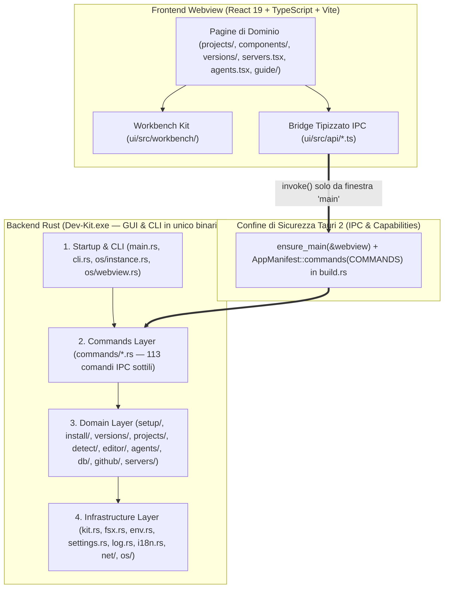
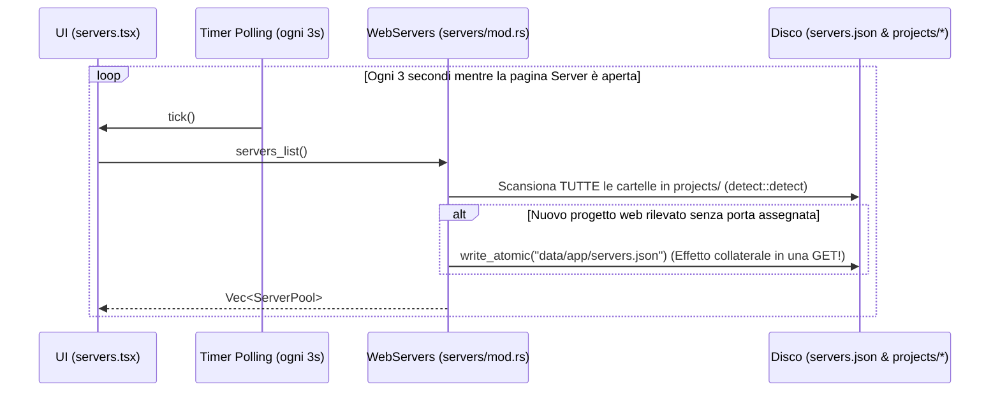

# 01 — Verifica di Architettura e Logica del Software

> [!NOTE]
> Questo documento analizza le **Dimensioni 1 (Architettura)** e **2 (Logica)** di NEXKORA (Dev-Kit), esaminando la struttura stratificata del backend Rust/Tauri 2, l'architettura del frontend React 19, il modello di sicurezza IPC, la gestione del ciclo di vita dei processi e la coerenza logica dei domini applicativi.

---

## 1. Valutazione dell'Architettura (Punteggio: 92 / 100)

### 1.1 Architettura Stratificata e Confini dei Moduli

Il progetto adotta un'architettura a **4 livelli strettamente gerarchici** documentata in [`docs/app/ARCHITECTURE.md`](file:///c:/Users/nabre/Projects/dev-kit2/docs/app/ARCHITECTURE.md) e rispecchiata fedelmente nel codice sorgente di [`tauri/src/`](file:///c:/Users/nabre/Projects/dev-kit2/tauri/src/main.rs):

#### Punti di Eccellenza Architetturale
1. **Binario Singolo Dual-Mode (GUI + CLI) senza Flash di Console**:
   - [`tauri/src/main.rs:5`](file:///c:/Users/nabre/Projects/dev-kit2/tauri/src/main.rs#L5) dichiara `#![cfg_attr(not(debug_assertions), windows_subsystem = "windows")]` per non aprire mai una finestra console quando viene lanciato con doppio clic.
   - Quando viene invocato con argomenti CLI (`env`, `components`, `versions`, `check`, `prepare`, `sync`, `keyring`, `serve`), [`tauri/src/cli.rs:28-40`](file:///c:/Users/nabre/Projects/dev-kit2/tauri/src/cli.rs#L28-L40) esegue `AttachConsole(ATTACH_PARENT_PROCESS)` per agganciarsi al terminale chiamante, garantendo zero duplicazione tra logica GUI e logica da riga di comando.
2. **Divieto Statico di `unwrap()` ed `expect()` in Produzione**:
   - [`tauri/src/main.rs:7`](file:///c:/Users/nabre/Projects/dev-kit2/tauri/src/main.rs#L7) impone `#![cfg_attr(not(test), deny(clippy::unwrap_used, clippy::expect_used))]`. Tutte le operazioni fallibili restituiscono `anyhow::Result<T>` convertito al confine IPC tramite [`commands::err`](file:///c:/Users/nabre/Projects/dev-kit2/tauri/src/commands/mod.rs#L71-L73).
   - I `Mutex` della `std::sync` vengono sempre acquisiti tramite `.unwrap_or_else(|e| e.into_inner())`, evitando panici a cascata in caso di *poisoning*.
3. **Modello di Sicurezza IPC a Privilegio Minimo (`D-06`, `D-10`, `D-14`)**:
   - [`tauri/build.rs:15-134`](file:///c:/Users/nabre/Projects/dev-kit2/tauri/build.rs#L15-L134) registra esplicitamente la lista bianca `COMMANDS` nel manifesto Tauri e concede i permessi solo alla capability `"main"` (`windows: ["main"]`, nessun plugin esterno abilitato).
   - Ogni comando in [`tauri/src/commands/*.rs`](file:///c:/Users/nabre/Projects/dev-kit2/tauri/src/commands/mod.rs#L63-L68) invoca come prima istruzione `ensure_main(&webview)?`, verificando a runtime che `webview.label() == "main"`.
   - Le finestre dell'editor VSCodium (`editor-1`, `editor-2`, … create in [`tauri/src/editor/window.rs:550-639`](file:///c:/Users/nabre/Projects/dev-kit2/tauri/src/editor/window.rs#L550-L639)) navigano sull'origine HTTP locale del server VSCodium e **non hanno alcun accesso all'IPC Tauri**. Perfino i pulsanti della titlebar custom (`minimize`, `maximize`, `close`) comunicano senza IPC tramite intercettazione di `window.open("http://127.0.0.1:<port>/__devkit/window/<action>")` in `on_new_window` ([`window.rs:47-57, 609-614`](file:///c:/Users/nabre/Projects/dev-kit2/tauri/src/editor/window.rs#L47-L57)).
4. **Isolamento del Ciclo di Vita dei Processi tramite Win32 Job Objects**:
   - [`tauri/src/os/jobs.rs:38-115`](file:///c:/Users/nabre/Projects/dev-kit2/tauri/src/os/jobs.rs#L38-L115) crea un Job Object principale con `JOB_OBJECT_LIMIT_KILL_ON_JOB_CLOSE | JOB_OBJECT_LIMIT_BREAKAWAY_OK`.
   - I processi vengono creati sospesi (`CREATE_SUSPENDED`), assegnati al Job Object prima di eseguire una singola istruzione (`AssignProcessToJobObject`) e poi ripresi (`ResumeThread`), prevenendo la fuga di processi figli durante lo startup.
5. **Architettura dei Dati `D-89` e dei File Temporanei `D-90` ([`PLAN-DATA.md`](file:///c:/Users/nabre/Projects/dev-kit2/docs/app/PLAN-DATA.md))**:
   - Separazione cristallina tra **codice del progetto** (`projects\<name>\`, sempre pronto per `git push` o zip senza file del kit) e **dati del kit per-progetto** (`data\projects\<name>\` con `dev-settings.json`, `ports.json`, `apache\`, `nginx\`, `private\db.json`, `private\backups\`).
   - Migrazione automatica e idempotente dal vecchio layout (`D-89` in [`tauri/src/projects/migrate.rs`](file:///c:/Users/nabre/Projects/dev-kit2/tauri/src/projects/migrate.rs)) con rilevamento delle cartelle dati orfane ([`tauri/src/projects/state.rs`](file:///c:/Users/nabre/Projects/dev-kit2/tauri/src/projects/state.rs), [`ui/src/projects/orphans.tsx`](file:///c:/Users/nabre/Projects/dev-kit2/ui/src/projects/orphans.tsx)).
   - Spostamento dei download e delle estrazioni transitorie in `<TEMP di sistema>\Dev-Kit\<kit.id()>\` ([`tauri/src/os/temp.rs`](file:///c:/Users/nabre/Projects/dev-kit2/tauri/src/os/temp.rs)), proteggendo le unità USB/FAT32 dall'usura di scrittura e dal limite di 4 GiB sugli archivi compressi, con staging finale atomico in `data\apps\<platform>\.staging\` ([`tauri/src/net/archive.rs:285-332`](file:///c:/Users/nabre/Projects/dev-kit2/tauri/src/net/archive.rs#L285-L332)).

### 1.2 Criticità Architetturali Rilevate

1. **Accoppiamento Diretto alle API Win32 nel Layer di Dominio**:
   - Sebbene esista il modulo [`tauri/src/os/`](file:///c:/Users/nabre/Projects/dev-kit2/tauri/src/os/mod.rs), diversi moduli di dominio importano direttamente `windows::Win32::*` o eseguono utility Windows (`icacls.exe`, `where.exe`, `cmd.exe`, `.cmd` wrappers):
     - [`tauri/src/agents/keyring.rs:27-36`](file:///c:/Users/nabre/Projects/dev-kit2/tauri/src/agents/keyring.rs#L27-L36) usa direttamente `CredEnumerateW`, `CredWriteW`, `CryptProtectData` e `CreateMutexW`.
     - [`tauri/src/editor/wterm.rs:24-40`](file:///c:/Users/nabre/Projects/dev-kit2/tauri/src/editor/wterm.rs#L24-L40) usa direttamente Named Pipes Win32, SDDL DACLs e `RegGetValueW`.
     - [`tauri/src/editor/window.rs:26,644-667`](file:///c:/Users/nabre/Projects/dev-kit2/tauri/src/editor/window.rs#L644-L667) usa direttamente `webview2_com::Microsoft::Web::WebView2::Win32::ICoreWebView2Settings3`.
     - [`tauri/src/editor/mod.rs:365`](file:///c:/Users/nabre/Projects/dev-kit2/tauri/src/editor/mod.rs#L365), [`tauri/src/db/auth.rs:124`](file:///c:/Users/nabre/Projects/dev-kit2/tauri/src/db/auth.rs#L124) e [`tauri/src/projects/state.rs:148`](file:///c:/Users/nabre/Projects/dev-kit2/tauri/src/projects/state.rs#L148) invocano `icacls.exe` direttamente invece di passare per una funzione astratta `os::permissions::restrict_to_owner(path)`.
2. **Stato Monolitico in [`ui/src/App.tsx`](file:///c:/Users/nabre/Projects/dev-kit2/ui/src/App.tsx) e Bundle Non Code-Splittato**:
   - `App.tsx` mantiene lo stato globale di tutti i domini e importa staticamente tutte le viste, inclusa l'intera guida in [`ui/src/guide/sections.tsx`](file:///c:/Users/nabre/Projects/dev-kit2/ui/src/guide/sections.tsx) (~87 KB di sorgente) e [`ui/src/guide/model.ts`](file:///c:/Users/nabre/Projects/dev-kit2/ui/src/guide/model.ts) (~68 KB di sorgente), più la registrazione eager di tutti i Web Components in [`ui/src/workbench/elements.ts`](file:///c:/Users/nabre/Projects/dev-kit2/ui/src/workbench/elements.ts), portando il bundle principale oltre i 500 kB.
3. **Dualismo Incompiuto tra Runner per-Progetto (`projects/run.rs`) e Pool Server (`servers/mod.rs`)**:
   - L'architettura prevede che i progetti web (PHP/Apache/Nginx/Static) vengano serviti dai Pool Server Condivisi ([`tauri/src/servers/mod.rs`](file:///c:/Users/nabre/Projects/dev-kit2/tauri/src/servers/mod.rs)), ma [`tauri/src/projects/run.rs`](file:///c:/Users/nabre/Projects/dev-kit2/tauri/src/projects/run.rs) continua ad avviare istanze dedicate di `httpd.exe` e `nginx.exe` per singolo progetto quando si preme "Avvia" nella scheda Progetto. Coesistono quindi due motori di esecuzione Apache/Nginx separati che generano configurazioni diverse (`projects/apache.rs` vs `servers/mod.rs::apache_pool_conf`).

---

## 2. Valutazione della Logica di Dominio (Punteggio: 84 / 100)

### 2.1 Sottosistemi con Logica Eccellente

| Sottosistema | File Principali | Analisi della Logica |
| :--- | :--- | :--- |
| **Costruzione Ambiente & Rilocazione (`env.rs`, `relocate.rs`)** | [`tauri/src/env.rs`](file:///c:/Users/nabre/Projects/dev-kit2/tauri/src/env.rs), [`tauri/src/agents/relocate.rs`](file:///c:/Users/nabre/Projects/dev-kit2/tauri/src/agents/relocate.rs) | Costruisce un `KitEnv` deterministico con 18+ directory nel `PATH` (in ordine di priorità dalle versioni scelte dal progetto alle linee di default del kit), isolando `NPM_CONFIG_CACHE`, `PIP_CACHE_DIR`, `CARGO_HOME`, `RUSTUP_HOME`, `COMPOSER_HOME`, `GRADLE_USER_HOME`, `GOPATH` dentro `data\`. La logica di `relocate.rs` riscrive automaticamente i vecchi percorsi assoluti del kit quando la chiavetta/cartella cambia lettera d'unità o percorso. |
| **Risoluzione SemVer e Matrice di Compatibilità** | [`tauri/src/versions/ranges.rs`](file:///c:/Users/nabre/Projects/dev-kit2/tauri/src/versions/ranges.rs), [`tauri/src/versions/relations/mod.rs`](file:///c:/Users/nabre/Projects/dev-kit2/tauri/src/versions/relations/mod.rs) | Parser di vincoli di versione (`^`, `~`, `>=`, `<`, `||`, `-`, `.x`, `*`) pulito e privo di regex pesanti, combinato con l'ispezione reale dei file di progetto (`composer.json`, `package.json`, `.nvmrc`, `pyproject.toml`, `.python-version`, `pom.xml`, `build.gradle`, `go.mod`, `rust-toolchain.toml`, `.ruby-version`) per segnalare incompatibilità tra codice, runtime e framework. |
| **Protezione contro Symlink/NTLM Leak (`safe_path.rs`)** | [`tauri/src/os/safe_path.rs`](file:///c:/Users/nabre/Projects/dev-kit2/tauri/src/os/safe_path.rs) | Risolve lessicalmente `.` e `..` e verifica con `symlink_metadata` e `FILE_ATTRIBUTE_REPARSE_POINT` ogni singolo segmento dal root del progetto in giù senza mai seguire symlink o junction che potrebbero puntare a `\\attacker\share` ed esporre gli hash NTLM dell'utente. |
| **Sincronizzazione Multi-Agente IA (`agents/sync/`)** | [`tauri/src/agents/sync/mod.rs`](file:///c:/Users/nabre/Projects/dev-kit2/tauri/src/agents/sync/mod.rs) | Modello hub-and-spoke elegante: legge istruzioni, skills e server MCP dall'agente sorgente e li converte nei formati specifici degli altri 3 agenti (JSON per Claude/Gemini/Antigravity, TOML per Codex), preservando le chiavi non correlate nei file di configurazione di destinazione. |
| **Isolamento Keyring Antigravity (`agents/keyring.rs`)** | [`tauri/src/agents/keyring.rs`](file:///c:/Users/nabre/Projects/dev-kit2/tauri/src/agents/keyring.rs) | Prima di lanciare `agy`, salva eventuali credenziali preesistenti del PC cifrandole con **DPAPI** (`CryptProtectData`), inietta il login del kit con persistenza `CRED_PERSIST_SESSION`, e alla chiusura di `agy` riporta le modifiche in `data\antigravity\keyring.json` e ripristina lo stato originale del Credential Manager di Windows. |

### 2.2 Flussi Logici Difettosi o Fragili (Sintesi; dettagli completi nel Report 03)

1. **Effetti Collaterali e Costo Computazionale in `WebServers::list()` ([`tauri/src/servers/mod.rs:337-512`](file:///c:/Users/nabre/Projects/dev-kit2/tauri/src/servers/mod.rs#L337-L512))**:
   - Una funzione di sola lettura chiamata ogni 3 secondi dalla UI esegue `detect::detect` (che cammina fino a 3.000 file per progetto) su tutti i progetti della cartella `projects\` e, se assegna una porta automatica, scrive su disco `servers.json`.
2. **Falso Positivo di Avvio nei Pool Server ([`tauri/src/servers/mod.rs:715-740`](file:///c:/Users/nabre/Projects/dev-kit2/tauri/src/servers/mod.rs#L715-L740))**:
   - Dopo aver lanciato `httpd.exe` o `nginx.exe` con `stdout`/`stderr` rediretto a `Stdio::null()`, il loop di 60 iterazioni (`100ms` ciascuna) attende che `127.0.0.1:<port>` risponda. Tuttavia:
     - Non controlla mai `child.try_wait()` per accorgersi subito se il processo è crashato per un errore di sintassi nella configurazione;
     - Se dopo 6 secondi la porta **non** risponde, il codice esce dal loop, inserisce comunque il processo (anche se morto) in `self.running` e restituisce `Ok(())`!
3. **Conflitto `default_server` / `localhost` nei Pool Nginx ([`tauri/src/servers/mod.rs:293,633`](file:///c:/Users/nabre/Projects/dev-kit2/tauri/src/servers/mod.rs#L293))**:
   - Sia il primo VirtualHost generato (`idx == 0` alla riga 293, che riceve `default_server` e `server_name <slug>.localhost localhost;`) sia il blocco di fallback finale alla riga 633 (`listen 127.0.0.1:<port>; server_name localhost;`) dichiarano `server_name localhost` sulla stessa porta.
4. **Gestione Orfana di `php-cgi.exe` in Nginx ([`tauri/src/projects/nginx.rs:213-228`](file:///c:/Users/nabre/Projects/dev-kit2/tauri/src/projects/nginx.rs#L213-L228))**:
   - `spawn_php_cgi_if_present` sceglie una porta effimera aprendo e chiudendo un `TcpListener` (race TOCTOU prima che `php-cgi.exe -b` faccia il bind) e scarta immediatamente l'handle `Child` del processo `php-cgi.exe`. Se `php-cgi.exe` termina o crasha dopo 500 richieste (`PHP_FCGI_MAX_REQUESTS`), Nginx resta vivo ma risponde `502 Bad Gateway` finché l'utente non ferma e riavvia manualmente il server.
