# 02 — Verifica di UX, UI, Esperienza di Utilizzo e Facilitazione Utente

> [!NOTE]
> Questo documento copre le **Dimensioni 3 (UX)**, **4 (UI)**, **5 (Esperienza di utilizzo)** e **9 (Qualità dell'esperienza e interazione: quanto l'utente è facilitato nell'impiegare lo strumento)** analizzando l'intero frontend [`ui/src/**`](../../../ui/src/App.tsx) e la suite di test UI [`test/ui/**`](../../../test/ui/App.test.tsx).

---

## 1. User Interface (UI) e Design System (Punteggio: 90 / 100)

### 1.1 Architettura del Workbench e Coerenza Visiva

L'interfaccia di Atollo non appare come un sito web generico incapsulato in una finestra, ma come un **IDE desktop nativo** modellato sul Workbench di VSCodium ([`ui/src/workbench/layout.tsx`](../../../ui/src/workbench/layout.tsx)):

- **Struttura Canonica a 5 Aree**:
  1. [`TitleBar`](../../../ui/src/titlebar.tsx) (`30px`, frameless con `-webkit-app-region: drag`, selettore rapido tema e pulsanti nativi finestra);
  2. [`ActivityBar`](../../../ui/src/activity.tsx) (`48px`, navigazione verticale a 9 viste con indicatore attivo di `2px` sul bordo sinistro, badge numerici e navigazione da tastiera `ArrowUp`/`ArrowDown`/`Home`/`End`);
  3. [`SideBar`](../../../ui/src/workbench/layout.tsx#L120-L157) (ridimensionabile con `Sash` tra `180px` e `520px`, chiudibile con `Ctrl+B`, dotata di `ViewPane` espandibili per Progetti, GitHub, Orfani e Componenti);
  4. [`EditorGroup`](../../../ui/src/workbench/layout.tsx#L254-L480) (con `EditorTabs`, `Breadcrumbs`, `EditorActions` e `SettingsSection` a card);
  5. [`Panel`](../../../ui/src/workbench/layout.tsx#L492-L561) inferiore (attivabile con `Ctrl+J`, ridimensionabile per i log di installazione/setup) e [`StatusBar`](../../../ui/src/workbench/layout.tsx#L563-L610) (`22px`, con indicatori cliccabili per Console, Editor, Progetti in esecuzione, Spazio disco e Rimozione unità).

- **Sistema di Temi Deterministico e Verificato da Test WCAG**:
  - 4 temi completi (**Scuro**, **Chiaro**, **Contrasto elevato**, **Chiaro a contrasto elevato**) definiti in [`ui/src/theme-vscode.css`](../../../ui/src/theme-vscode.css) e mappati su variabili semantiche in [`ui/src/theme-colors.css`](../../../ui/src/theme-colors.css) e [`ui/src/theme.css`](../../../ui/src/theme.css).
  - [`test/ui/theme.test.ts`](../../../test/ui/theme.test.ts) verifica matematicamente i rapporti di contrasto tra testo e sfondo per ciascuno dei 4 temi.
  - Il tema scelto nella finestra principale sincronizza automaticamente anche il tema di VSCodium (`Machine\settings.json` in [`tauri/src/editor/cfg.rs`](../../../tauri/src/editor/cfg.rs)) e lo schema colori del terminale portabile ([`tauri/src/editor/wterm.rs:99-120`](../../../tauri/src/editor/wterm.rs#L99-L120)).

### 1.2 Difetti UI e Micro-frizioni Tipografiche Individuate

| Aspetto | File & Righe | Descrizione Tecnica del Problema | Correzione Consigliata |
| :--- | :--- | :--- | :--- |
| **`capitalize` CSS su lingue romanze** | [`ui/src/workbench/layout.tsx:165,218,535`](../../../ui/src/workbench/layout.tsx#L165) | La classe Tailwind `capitalize` (`text-transform: capitalize`) forza l'iniziale maiuscola su **ogni singola parola** dei titoli di `SideBarTitle`, `ViewPane` e `Panel` (es. *"Dai Tuoi Repository GitHub"*, *"Dati Senza Progetto"*, *"Pool Attivi E Profili"*), violando le regole ortografiche di italiano e francese. | Rimuovere la classe `capitalize` da `SideBarTitle`, `ViewPane` e `Panel`, lasciando il casing naturale delle stringhe localizzate. |
| **Micro-tipografia sotto i 12px** | [`ui/src/App.tsx:310`](../../../ui/src/App.tsx#L310) (`text-[9px]`), [`ui/src/guide/widgets.tsx:321`](../../../ui/src/guide/widgets.tsx#L321) (`text-[10px]`), [`ui/src/projects/run.tsx:272`](../../../ui/src/projects/run.tsx#L272) (`text-[11px]`) | Alcuni badge e indicatori secondari scendono a `9px–10px`, risultando difficili da leggere su monitor standard 1080p a scaling 100%. | Impostare una soglia minima tipografica di `11px` per i badge compatti e `12px` per le etichette leggibili. |
| **Badge hardcoded in inglese** | [`ui/src/versions/kit.tsx:69,184,275`](../../../ui/src/versions/kit.tsx#L69) | I badge `"latest"` e `"locked"` nella gestione delle linee di versione non passano per `t()`. | Localizzare `"latest"` e `"locked"` nei file `locales/*.json`. |

---

## 2. User Experience (UX) ed Esperienza di Utilizzo (Punteggi: UX 86/100 — Utilizzo 88/100)

### 2.1 Percorso dell'Utente (Dal Primo Avvio all'Operatività Quotidiana)

```mermaid
flowchart LR
    A["1. Primo Avvio (wizard.tsx)"] -->|"Scelta: Per linguaggi / Per progetto / A mano"| B["2. Installazione Atomica (setup.tsx)"]
    B -->|"Download + SHA256 + Staging"| C["3. Progetti & Framework (projects/new.tsx)"]
    C -->|"18 Framework con anteprima albero e comandi"| D["4. Sviluppo Attivo (projects/page.tsx)"]
    D -->|"1-Click: VSCodium + Console + DB + HTTPS"| E["5. Rimozione Sicura (eject.tsx)"]
```

1. **Onboarding Triforcato Intelligente ([`ui/src/wizard.tsx`](../../../ui/src/wizard.tsx))**:
   - Al primo avvio, invece di presentare una lista intimidatoria di 26 pacchetti tecnici, il wizard offre 3 ingressi graduati per competenza:
     - **"Per linguaggi e strumenti"**: griglia visuale semplice per chi sa su cosa vuole lavorare;
     - **"Da quello che vuoi creare"**: orientato all'obiettivo (es. *"Sito web o e-commerce"*, *"App mobile"*, *"Intelligenza artificiale"*), ideale per chi muove i primi passi;
     - **"Scegli a mano dalla tabella"**: vista tabellare completa con dimensioni e dipendenze per sviluppatori esperti.
2. **Trasparenza Totale prima dell'Esecuzione (`Framework Wizard` in [`ui/src/projects/new.tsx`](../../../ui/src/projects/new.tsx))**:
   - Nella creazione di un nuovo progetto (Laravel, Symfony, WordPress, Next.js, Astro, FastAPI, Django, Spring Boot, Flutter, Tauri, ecc.), il componente [`PlanPreview`](../../../ui/src/frameworks/plan.tsx) mostra **in tempo reale prima di cliccare "Crea"**:
     - L'albero esatto dei file che verranno generati ([`TreePreview`](../../../ui/src/frameworks/tree.tsx));
     - Gli esatti comandi CLI che verranno lanciati (`composer create-project`, `npx create-next-app`, ecc.) con un pulsante per copiarli;
     - I componenti eventualmente mancanti nel kit, offrendo di **installarli al volo e creare subito dopo il progetto** in un'unica sequenza automatica!
3. **Gestione del Fallback Manuale (`byhand.tsx`)**:
   - Se una rete aziendale o scolastica blocca il download automatico di un componente, [`ui/src/byhand.tsx`](../../../ui/src/byhand.tsx) non mostra un errore criptico: elenca l'URL esatto da scaricare via browser, il nome del file atteso e un pulsante per aprire la cartella `downloads`, riprendendo l'installazione appena il file viene depositato.
4. **Rimozione Sicura dell'Unità USB ([`ui/src/eject.tsx`](../../../ui/src/eject.tsx))**:
   - Mostra tutti i processi aperti che bloccano la chiavetta/cartella (divisi tra processi avviati dall'app, processi esterni del kit come un terminale rimasto aperto, e altri kit attivi) e permette di chiuderli ordinatamente con un solo clic (`Chiudi tutto e prepara la rimozione`).

### 2.2 Punti di Attrito UX Rilevati

1. **Scollegamento tra "Avvia" nella Pagina Progetto e la Pagina "Server Web"**:
   - L'utente vede una voce dedicata **Server** nell'Activity Bar ([`ui/src/servers.tsx`](../../../ui/src/servers.tsx)) che elenca i pool Apache/Nginx e mostra i siti agganciati (`*.localhost`). Tuttavia, quando apre la scheda di un progetto PHP/WordPress e clicca **Avvia** in [`ui/src/projects/run.tsx`](../../../ui/src/projects/run.tsx), il progetto avvia un server separato su una porta effimera anziché avviare/usare il pool mostrato nella pagina Server! Questo crea disorientamento mentale tra i due modelli.
2. **Stati Vuoti Silenziosi in Caso di Errore di Caricamento**:
   - In [`ui/src/editorsettings.tsx:21-43`](../../../ui/src/editorsettings.tsx#L21-L43), se la lettura delle impostazioni editor fallisce, l'errore viene inghiottito (`() => undefined`) e il componente restituisce `null`, lasciando la scheda **Editor** completamente bianca senza né spinner né messaggio d'errore. Lo stesso accade in [`ui/src/extensions.tsx:36`](../../../ui/src/extensions.tsx#L36) per `ExtensionsMatrixSection`.
3. **Errori "Sticky" (Appiccicosi) Non Cancellati al Successo Successivo**:
   - In [`ui/src/App.tsx`](../../../ui/src/App.tsx), [`ui/src/databases.tsx`](../../../ui/src/databases.tsx), [`ui/src/eject.tsx`](../../../ui/src/eject.tsx) e [`ui/src/settings/page.tsx`](../../../ui/src/settings/page.tsx), gli errori di lettura salvati nello stato locale non vengono azzerati quando un polling o un reload successivo va a buon fine, lasciando banner di errore obsoleti visibili all'utente.
4. **Accessibilità dei Dialoghi Modali e Menu Contestuali**:
   - [`ConfirmDialog`](../../../ui/src/workbench/dialog.tsx#L37-L60) e il lightbox delle immagini nella Guida ([`GuideShot` in `ui/src/guide/widgets.tsx:100-135`](../../../ui/src/guide/widgets.tsx#L100-L135)) non implementano un **focus trap**: premendo `Tab` il focus esce dal dialogo modale e naviga nei pulsanti sottostanti della pagina.
   - I menu a tendina `role="menu"` in [`ui/src/versions/kit.tsx:156-287`](../../../ui/src/versions/kit.tsx#L156-L287) non spostano il focus all'apertura e non gestiscono i tasti freccia.

---

## 3. Qualità dell'Esperienza e Facilitazione Utente (Punteggio: 91 / 100)

> [!TIP]
> **Domanda chiave del Verificatore**: *"L'utente si trova realmente facilitato ad impiegare questo tipo di strumento?"*
> **Risposta**: **Altamente facilitato.** Atollo abbatte le barriere di ingresso tecniche senza mai nascondere i file reali o rinchiudere lo sviluppatore in una "scatola nera" proprietaria.

### 3.1 Analisi Comparativa del *Time-to-Code* e del Carico Cognitivo per Profilo Utente

| Profilo Utente | Scenario Tipico | Approccio Tradizionale (Senza Atollo) | Approccio con Atollo | Risparmio Cognitivo & Temporale |
| :--- | :--- | :--- | :--- | :--- |
| **1. Studente / Sviluppatore Junior** | Creare il primo progetto Laravel o WordPress con database MySQL, HTTPS locale ed editor configurato. | Scaricare PHP, Composer, Node, MySQL, Apache; modificare il `PATH` di sistema; editare `php.ini` per abilitare estensioni (`pdo_mysql`, `mbstring`, `intl`, `gd`); creare VirtualHost; generare certificato `mkcert`; creare utente DB; installare estensioni VS Code (~90–120 min, altissimo rischio di errori). | 1. Selezionare stack nel Wizard; 2. Cliccare *Nuovo progetto → Laravel/WordPress*; 3. Cliccare *Crea Database* e *Avvia*. Certificato HTTPS, `php.ini`, `.env` DB ed estensioni VSCodium sono già pronti e collegati (~4 min). | **-95% tempo di setup** Zero conflitti col sistema operativo ospite. |
| **2. Full-Stack / Agenzia Multi-Progetto** | Manutenere 5 progetti clienti con requisiti incompatibili (es. PHP 8.1 + Node 18 vs PHP 8.4 + Node 24). | Usare `nvm-windows`, switch manuali di `PATH` per PHP/Composer, o container Docker pesanti (GB di RAM per WSL2) che rallentano il filesystem su Windows. | Ogni progetto ha il proprio selettore di linea nella scheda **Ambiente** (`dev-settings.json`); aprendo il terminale o VSCodium da quel progetto, `PATH` punta già alle versioni esatte di quel progetto; la vista **Relazioni** segnala subito eventuali incompatibilità. | **Cambio contesto istantaneo (0 sec)** Nessun overhead di virtualizzazione WSL2/Docker. |
| **3. Sviluppatore AI-First** | Usare contemporaneamente Claude Code, Codex, Gemini CLI e Antigravity mantenendo allineati prompt, Skills e server MCP. | Copiare manualmente file tra `~/.claude`, `~/.codex`, `~/.gemini`, convertire configurazioni MCP da JSON a TOML a mano, lasciare token sparsi nel PC. | Pagina **Agenti IA** ([`ui/src/agents.tsx`](../../../ui/src/agents.tsx)): sincronizzazione 1-click bidirezionale (JSON ↔ TOML automatico), catalogo MCP 1-click, statistiche token/costi in [`ui/src/stats.tsx`](../../../ui/src/stats.tsx) e login Google custodito con DPAPI. | **Unico punto di controllo IA** Conversione automatica dei formati tra i 4 agenti. |
| **4. Docente / Sviluppatore Nomade (USB/SSD)** | Lavorare tra PC fisso, portatile o laboratorio didattico su unità esterna senza diritti di amministratore. | Quasi impossibile: gli installer standard richiedono UAC/Admin, scrivono nel registro di Windows e in `C:\Users\<user>\AppData`, e rompono i path assoluti cambiando lettera di unità. | Zero UAC richiesto; rilocazione automatica dei path all'avvio ([`relocate.rs`](../../../tauri/src/agents/relocate.rs)); file temporanei scaricati sul disco veloce del PC ospite (`D-90`); verifica di espulsione sicura USB ([`eject.tsx`](../../../ui/src/eject.tsx)). | **Portabilità 100% reale** Funziona senza diritti Admin su qualsiasi PC Windows. |

### 3.2 Pedagogia Integrata (L'App Insegna Mentre Lavora)

Un tratto distintivo di Atollo è la sua **trasparenza educativa**:
- Ogni azione automatica dichiara **dove** scrive (es. mostra il percorso del file di configurazione Apache/Nginx o di `.vscode/settings.json` e permette di aprirlo).
- La **Guida Integrata** ([`ui/src/guide/`](../../../ui/src/guide/page.tsx)) non è un manuale statico: include widget interattivi ([`ui/src/guide/widgets.tsx`](../../../ui/src/guide/widgets.tsx)) che leggono lo stato reale del kit dell'utente (mostrando quali componenti della guida sono già installati sul suo disco e permettendo di saltare direttamente alla sezione operativa corrispondente).
