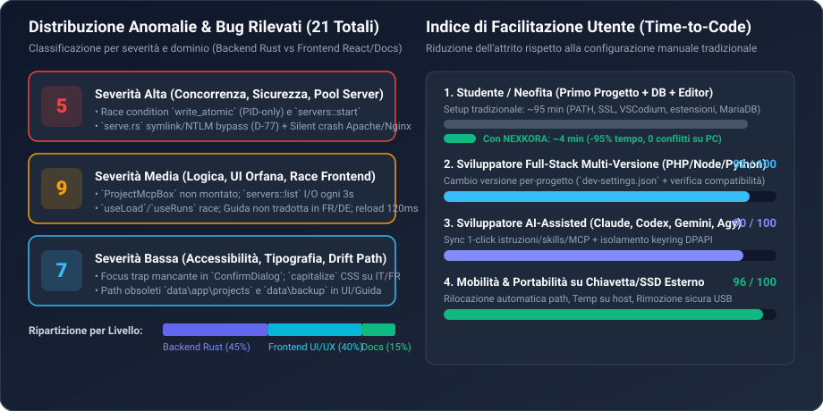

# 03 — Identificazione dei Bug, Sicurezza e Funzionalità Mancanti

> [!WARNING]
> Questo documento raccoglie i risultati delle **Dimensioni 6 (Funzionalità mancanti)** e **7 (Identificazione dei bug e sicurezza)**. Tutti i **21 bug/anomalie** e le **5 macro-funzionalità mancanti o incomplete** sono corredati da riferimento esatto `file:linea`, analisi della causa radice (*root cause*) e proposta di correzione.



---

## 1. Catalogo Completo dei Bug Rilevati (21 Totali)

### 1.1 Bug di Severità ALTA (5) — Sicurezza, Concorrenza e Fallimenti Silenziosi

#### BUG-01 [ALTA / SICUREZZA] — Bypass della protezione `safe_path` (`D-77`) e potenziale NTLM Leak / DoS nel Server HTTP Statico
- **Posizione**: [`tauri/src/projects/serve.rs:215`](file:///c:/Users/nabre/Projects/atollo/tauri/src/projects/serve.rs#L215) e [`tauri/src/projects/serve.rs:234-246`](file:///c:/Users/nabre/Projects/atollo/tauri/src/projects/serve.rs#L234-L246)
- **Analisi Tecnica**:
  1. La decisione architetturale `D-77` ([`tauri/src/os/safe_path.rs:1-8`](file:///c:/Users/nabre/Projects/atollo/tauri/src/os/safe_path.rs#L1-L8)) stabilisce che nessun file dentro `projects\` debba mai essere risolto seguendo symlink o junction NTFS, perché un progetto clonato da terzi potrebbe contenere una junction verso `\\attacker\share`, causando l'invio automatico delle credenziali NTLM di Windows. Tuttavia, [`serve.rs:215`](file:///c:/Users/nabre/Projects/atollo/tauri/src/projects/serve.rs#L215) usa `fs::canonicalize(&candidate).ok()?` (che segue symlink e junction a livello kernel) anziché `crate::os::safe_path`.
  2. Inoltre, alle righe [`234-246`](file:///c:/Users/nabre/Projects/atollo/tauri/src/projects/serve.rs#L234-L246), il server statico esegue `std::thread::spawn` per ogni connessione TCP in ingresso senza alcun limite di concorrenza, senza `read_timeout` sul socket prima di `reader.read_line(&mut line)` e senza limite di lunghezza su `line` (usando `BufReader::read_line` che alloca fino a `EOF` o `\n`), esponendo il processo a esaurimento di memoria/thread (specialmente se `ATOLLO_ALLOW_LAN=1`).
- **Soluzione**:
  - Sostituire `fs::canonicalize` in `resolve()` con `crate::os::safe_path::is_file(root, &candidate)` / `is_dir(root, &candidate)`.
  - Impostare `stream.set_read_timeout(Some(Duration::from_secs(5)))`, usare `reader.take(8192).read_line(&mut line)` e limitare i worker concorrenti tramite un semaforo o contatore `AtomicUsize` (es. max 64 connessioni simultanee).

#### BUG-02 [ALTA / CONCORRENZA] — Race Condition Intra-Processo in `fsx::write_atomic`
- **Posizione**: [`tauri/src/fsx.rs:67-73`](file:///c:/Users/nabre/Projects/atollo/tauri/src/fsx.rs#L67-L73)
- **Analisi Tecnica**:
  ```rust
  let tmp = path.with_extension(format!("tmp-{}", std::process::id()));
  fs::write(&tmp, bytes)?;
  if let Err( err ) = fs::rename(&tmp, path) { ... }
  ```
  Il nome del file temporaneo dipende **esclusivamente dal PID del processo** (`std::process::id()`). Poiché `Atollo.exe` è un'applicazione multi-thread (thread dei comandi Tauri, thread di polling UI ogni 3s, thread di watch estensioni ogni 15s), due thread che scrivono contemporaneamente sullo stesso file JSON (es. `servers.json`, `settings.json`, `dev-settings.json`) generano **lo stesso identico percorso `tmp-<pid>`**! Il secondo thread tronca o sovrascrive il file temporaneo del primo, oppure il primo esegue `fs::rename` facendo fallire il secondo con `NotFound`. Inoltre `with_extension` sostituisce l'estensione finale: `foo.json` e `foo.toml` nella stessa cartella condividono entrambi `foo.tmp-<pid>`!
- **Soluzione**:
  - Aggiungere un contatore atomico globale `static TMP_SEQ: AtomicU64 = AtomicU64::new(0);` e costruire il nome temporaneo preservando il nome completo del file: `path.with_file_name(format!("{}.tmp-{}-{}", file_name, std::process::id(), TMP_SEQ.fetch_add(1, Ordering::Relaxed)))`.

#### BUG-03 [ALTA / SERVER POOL] — Falso Positivo di Avvio e Crash Silenzioso di Apache/Nginx in `WebServers::start`
- **Posizione**: [`tauri/src/servers/mod.rs:715-740`](file:///c:/Users/nabre/Projects/atollo/tauri/src/servers/mod.rs#L715-L740)
- **Analisi Tecnica**:
  Quando un pool Apache o Nginx viene avviato:
  1. `stdout` e `stderr` vengono rediretti a `Stdio::null()` ([`righe 715-716`](file:///c:/Users/nabre/Projects/atollo/tauri/src/servers/mod.rs#L715-L716));
  2. Il ciclo `for _ in 0..60` ([`righe 720-726`](file:///c:/Users/nabre/Projects/atollo/tauri/src/servers/mod.rs#L720-L726)) controlla solo `TcpStream::connect_timeout`, senza mai chiamare `child.try_wait()` per verificare se `httpd.exe` o `nginx.exe` sono già terminati con errore;
  3. **Anche se dopo 6 secondi la porta non ha mai risposto**, il codice esce dal `for`, inserisce il processo (morto o bloccato) in `self.running` e **restituisce `Ok(())`**!
- **Soluzione**:
  - Nel loop di readiness, controllare `if let Some(status) = child.try_wait()? { bail!("server exited with {status}"); }`.
  - Se al termine dei 60 tentativi la connessione TCP non è riuscita, terminare il job, leggere le ultime righe di `error.log` del pool e restituire `bail!(...)` con il dettaglio dell'errore.

#### BUG-04 [ALTA / CONCORRENZA] — Race Condition su Avvio Concorrente e Reload (120ms) nei Pool Server
- **Posizione**: [`tauri/src/servers/mod.rs:648-740`](file:///c:/Users/nabre/Projects/atollo/tauri/src/servers/mod.rs#L648-L740) e [`tauri/src/servers/mod.rs:789-791`](file:///c:/Users/nabre/Projects/atollo/tauri/src/servers/mod.rs#L789-L791)
- **Analisi Tecnica**:
  1. In `WebServers::start`, il controllo `if pool.running { return Ok(()); }` ([`riga 655`](file:///c:/Users/nabre/Projects/atollo/tauri/src/servers/mod.rs#L655)) avviene **fuori** dal lock `self.running`. Se due chiamate `start(id)` partono quasi simultaneamente, entrambe superano il controllo, entrambe avviano `httpd.exe`/`nginx.exe` e la seconda sovrascrive l'entry in `self.running` alla riga 731.
  2. In `WebServers::reload` ([`righe 789-791`](file:///c:/Users/nabre/Projects/atollo/tauri/src/servers/mod.rs#L789-L791)), il reload di Apache esegue `self.stop(id)?; sleep(120ms); self.start(kit, id, lang)`. Su Windows, quando un Job Object termina `httpd.exe` e i suoi worker thread, il rilascio del socket TCP può richiedere `250–600ms`, facendo fallire `self.start` per porta occupata.
- **Soluzione**:
  - Proteggere la transizione di stato (`starting`/`stopping`) per-pool con un mutex di operazione e, dopo `stop(id)`, attendere attivamente (con backoff fino a 2s) che la porta TCP risulti libera prima di richiamare `start()`.

#### BUG-05 [ALTA / AFFIDABILITÀ] — `php-cgi.exe` Non Monitorato, TOCTOU sulla Porta FastCGI e Avvio Inutile in Pool Nginx senza PHP
- **Posizione**: [`tauri/src/projects/nginx.rs:213-228`](file:///c:/Users/nabre/Projects/atollo/tauri/src/projects/nginx.rs#L213-L228) e [`tauri/src/servers/mod.rs:701`](file:///c:/Users/nabre/Projects/atollo/tauri/src/servers/mod.rs#L701)
- **Analisi Tecnica**:
  1. `spawn_php_cgi_if_present` esegue `TcpListener::bind("127.0.0.1:0")` e fa `drop(l)` alla riga 216 prima di passare `127.0.0.1:{fcgi_port}` a `php-cgi.exe` (finestra TOCTOU).
  2. L'handle `Child` restituito da `jobs::spawn_in(&mut fcgi, job)` viene immediatamente scartato (`.ok()?` alla riga 226): se `php-cgi.exe` muore (ad es. dopo `PHP_FCGI_MAX_REQUESTS=500` richieste! Si noti che `projects/nginx.rs:224` imposta proprio `PHP_FCGI_MAX_REQUESTS=500`!), `php-cgi.exe` **termina autonomamente dopo 500 richieste HTTP** e nessuno lo riavvia, lasciando Nginx a rispondere `502 Bad Gateway`!
  3. Inoltre, in [`servers/mod.rs:701`](file:///c:/Users/nabre/Projects/atollo/tauri/src/servers/mod.rs#L701), `spawn_php_cgi_if_present` viene chiamato anche quando il pool Nginx ha `pool.php_line == None` (usando la linea PHP di default del kit anche per un pool Nginx statico/puro).
- **Soluzione**:
  - Impostare `PHP_FCGI_MAX_REQUESTS=0` (nessuna terminazione automatica dopo 500 richieste) oppure mantenere un thread supervisore nel Job che riavvia `php-cgi.exe` se termina finché il Job è attivo; chiamare `spawn_php_cgi_if_present` in `servers/mod.rs` solo se `pool.php_line.is_some()`.

---

### 1.2 Bug di Severità MEDIA (9) — Logica, Funzionalità Scollegate, Performance e i18n

| ID | Posizione (`file:linea`) | Descrizione Tecnica del Bug | Correzione Consigliata |
| :--- | :--- | :--- | :--- |
| **BUG-06** | [`ui/src/projectmcp.tsx:99-172`](file:///c:/Users/nabre/Projects/atollo/ui/src/projectmcp.tsx#L99-L172) & [`ui/src/projects/page.tsx`](file:///c:/Users/nabre/Projects/atollo/ui/src/projects/page.tsx) | **Componente `ProjectMcpBox` completamente orfano**: Il componente React per gestire i server MCP per-progetto (`.mcp.json` e `.codex/config.toml`) e i relativi comandi backend `project_mcp` / `project_mcp_set` sono completi e testati, e la Guida ([`guide/model.ts:436`](file:///c:/Users/nabre/Projects/atollo/ui/src/guide/model.ts#L436)) più [`README.md:22`](file:///c:/Users/nabre/Projects/atollo/README.md#L22) affermano che la funzione è nella scheda Progetto, ma `ProjectMcpBox` **non è mai importato né renderizzato** in `projects/page.tsx`! | Importare e montare `<ProjectMcpBox project={project.name} />` nella scheda `environment` o `editor` di [`ui/src/projects/page.tsx`](file:///c:/Users/nabre/Projects/atollo/ui/src/projects/page.tsx). |
| **BUG-07** | [`tauri/src/servers/mod.rs:337-512`](file:///c:/Users/nabre/Projects/atollo/tauri/src/servers/mod.rs#L337-L512) & [`ui/src/servers.tsx`](file:///c:/Users/nabre/Projects/atollo/ui/src/servers.tsx) | **`WebServers::list()` esegue scansioni pesanti e scritture su disco durante il polling UI (ogni 3s)**: Ogni chiamata a `servers_list` scansiona tutte le cartelle in `projects\`, esegue `detect::detect` (fino a 3.000 file per progetto) e chiama `save_file(&self.file(&kit), &cfg)` se assegna porte automatiche. | Separare il calcolo/persistenza dei pool (da eseguire su evento di modifica progetto o creazione pool) dalla lettura leggera dello stato `running`, oppure mettere in cache `detect::detect` per `(project, mtime)`. |
| **BUG-08** | [`tauri/src/servers/mod.rs:293,633`](file:///c:/Users/nabre/Projects/atollo/tauri/src/servers/mod.rs#L293) | **Conflitto `server_name localhost` in `nginx_pool_conf`**: In un pool Nginx con almeno un sito, sia il primo vhost (`idx == 0` alla riga 293: `listen ... default_server; server_name <slug>.localhost localhost;`) sia il blocco di fallback finale alla riga 633 (`listen ...; server_name localhost;`) dichiarano `server_name localhost` sulla stessa porta, generando warning di `conflicting server name "localhost"` e rendendo irraggiungibile il fallback. | Rimuovere `default_server` e `localhost` dal vhost `idx == 0` quando è presente il blocco di indice/fallback del pool alla riga 633 (così `<slug>.localhost` serve il progetto e `http://localhost:<port>/` serve la dashboard del pool). |
| **BUG-09** | [`ui/src/hooks.ts:92-107`](file:///c:/Users/nabre/Projects/atollo/ui/src/hooks.ts#L92-L107) & [`ui/src/projects/runs.ts:17-27`](file:///c:/Users/nabre/Projects/atollo/ui/src/projects/runs.ts#L17-L27) | **Race condition nelle chiamate asincrone `useLoad` e `useRuns`**: `useLoad` non usa un contatore di richiesta (`reqId`): se `key` cambia rapidamente (es. cliccando tra due progetti), una promise più vecchia e lenta può risolvere dopo quella nuova, sovrascrivendo i dati del progetto selezionato. In `useRuns`, se un evento live `onRun` arriva prima che `runList()` iniziale risolva, `runList()` sovrascrive lo stato più recente. | Aggiungere un contatore incrementale `const id = ++seq.current` in `useLoad` (ignorando il risultato se `id !== seq.current`) e unire gli stati in `useRuns` preservando gli eventi già ricevuti. |
| **BUG-10** | [`ui/src/hooks.ts:120-141`](file:///c:/Users/nabre/Projects/atollo/ui/src/hooks.ts#L120-L141) | **Concorrenza non protetta in `useAction`**: Se un utente avvia due azioni sul medesimo hook `useAction`, la prima che termina esegue `setBusy(null)` nel `finally`, azzerando l'indicatore di caricamento mentre la seconda azione è ancora in corso. | Contare le azioni attive o ignorare invocazioni concorrenti quando `busy !== null`, oppure verificare che il token dell'azione coincida nel blocco `finally`. |
| **BUG-11** | [`ui/src/workbench/layout.tsx:57-72,99-104,143-145`](file:///c:/Users/nabre/Projects/atollo/ui/src/workbench/layout.tsx#L57-L104) & [`ui/src/App.tsx:195-197`](file:///c:/Users/nabre/Projects/atollo/ui/src/App.tsx#L195-L197) | **Chiusura stale e scrittura sincrona `localStorage` a 60–240Hz durante il drag di `Sash`**: `onDrag={(d) => setWidth(width + d)}` cattura `width` dalla closure del render e `useStoredSize` chiama `localStorage.setItem` ad ogni pixel di `pointermove`. Se arrivano più eventi `pointermove` nello stesso frame, i delta intermedi vanno persi. | Supportare l'updater funzionale `setWidth((w) => w + d)` in `useStoredSize` e salvare in `localStorage` solo su `pointerup` (o con debounce). |
| **BUG-12** | [`ui/src/guide/sections.tsx`](file:///c:/Users/nabre/Projects/atollo/ui/src/guide/sections.tsx), [`ui/src/guide/model.ts`](file:///c:/Users/nabre/Projects/atollo/ui/src/guide/model.ts), [`ui/src/guide/widgets.tsx`](file:///c:/Users/nabre/Projects/atollo/ui/src/guide/widgets.tsx) | **Guida non localizzata in Francese (`fr`) e Tedesco (`de`)**: Sebbene l'helper `tr(it, en, fr, de)` in [`guide/model.ts:34-40`](file:///c:/Users/nabre/Projects/atollo/ui/src/guide/model.ts#L34-L40) accetti 4 lingue, quasi tutte le chiamate in `sections.tsx`, `model.ts` e `widgets.tsx` passano solo `(it, en)`. Di conseguenza, selezionando Francese o Tedesco nelle Impostazioni, l'intera Guida viene mostrata in Inglese (e alcuni campi di `TOOL_SOURCES` in `model.ts:606-798` restano addirittura in Italiano fisso). | Estendere le chiamate `tr()` della Guida con le traduzioni `fr` e `de` (o migrare le stringhe della guida nel catalogo i18n standard). |
| **BUG-13** | [`tauri/src/db/adminer.rs:137-139`](file:///c:/Users/nabre/Projects/atollo/tauri/src/db/adminer.rs#L137-L139) | **Incongruenza di assegnazione Job Object in Adminer**: `adminer.rs` usa `jobs::spawn(&mut cmd)` (che avvia subito il processo nel Job globale `APP_JOB`) seguito da `let job = Job::new()?; job.assign(&child)?;` invece di usare `jobs::spawn_in(&mut cmd, &job)` (che crea il processo sospeso e lo assegna al job dedicato prima del resume). | Sostituire `jobs::spawn` + `job.assign` con `let job = Job::new()?; let child = jobs::spawn_in(&mut cmd, &job)?;` come già fatto correttamente in `db/mod.rs` e `servers/mod.rs`. |
| **BUG-14** | [`tauri/src/detect/php.rs:44-47`](file:///c:/Users/nabre/Projects/atollo/tauri/src/detect/php.rs#L44-L47) | **Rilevamento WordPress non aggiunge `mariadb` a `requires` e mostra un avviso obsoleto**: Quando viene rilevato WordPress (`wp-config.php` / `wp-includes`), il rilevatore non aggiunge `"mariadb"` a `requires` (a differenza di quanto ci si aspetta per uno stack WordPress) e genera un warning statico che invita a verificare MySQL/MariaDB esternamente. | Aggiungere `"mariadb"` ai componenti richiesti/suggeriti per WordPress e aggiornare il messaggio di avviso in `detect/php.rs` e `catalog.json`. |

---

### 1.3 Bug di Severità BASSA (7) — Path Obsoleti post-`D-89`, Accessibilità e Polish

| ID | Posizione (`file:linea`) | Descrizione Tecnica del Bug | Correzione Consigliata |
| :--- | :--- | :--- | :--- |
| **BUG-15** | [`ui/src/projects/site.tsx:191`](file:///c:/Users/nabre/Projects/atollo/ui/src/projects/site.tsx#L191) | **Percorso obsoleto mostrato nella scheda Sito Web del progetto**: Mostra ancora `"La configurazione è in data\app\projects\{0}\apache"` (e analogo per Nginx) invece del nuovo percorso `data\projects\{0}\apache` introdotto dalla decisione `D-89`. | Aggiornare la chiave di traduzione e il testo in `data\projects\{0}\apache` / `nginx` in `site.tsx` e `locales/*.json`. |
| **BUG-16** | [`ui/src/guide/widgets.tsx:304`](file:///c:/Users/nabre/Projects/atollo/ui/src/guide/widgets.tsx#L304) & [`ui/src/guide/sections.tsx:236,535,576`](file:///c:/Users/nabre/Projects/atollo/ui/src/guide/sections.tsx#L236) | **Percorsi e nomi pulsanti obsoleti nella Guida**: `KitFoldersBar` mostra il pulsante `data\backup\` (ora `data\projects\<p>\private\backups\`); `sections.tsx:236` cita `.atollo.json` (ora `data\projects\<p>\dev-settings.json`); `sections.tsx:576` cita il pulsante `«Arresta e rimuovi in sicurezza»` mentre `eject.tsx:111` lo chiama `«Chiudi tutto e prepara la rimozione»`. | Allineare `widgets.tsx` e `sections.tsx` alla struttura `D-89` e alle etichette attuali dei pulsanti. |
| **BUG-17** | [`tauri/src/cli.rs:353`](file:///c:/Users/nabre/Projects/atollo/tauri/src/cli.rs#L353) | **Messaggio CLI di fallback manuale punta a `data\downloads`**: In caso di errore di download da CLI, il messaggio suggerisce ancora `kit.data().join("downloads")` anziché `os::temp::downloads_dir(kit)` introdotto con `D-90` (sebbene `byhand.rs` migri i file se messi nella vecchia cartella). | Stampare `crate::os::temp::downloads_dir(kit).display()` nel suggerimento CLI di `cli.rs:353`. |
| **BUG-18** | [`ui/src/editorsettings.tsx:21-43`](file:///c:/Users/nabre/Projects/atollo/ui/src/editorsettings.tsx#L21-L43) & [`ui/src/extensions.tsx:36`](file:///c:/Users/nabre/Projects/atollo/ui/src/extensions.tsx#L36) | **Errori di caricamento inghiottiti con resa bianca (`return null`)**: Se `projectEditorSettings` o `extensionsMatrix` falliscono, il catch silenzioso lascia `view`/`matrix` a `null` e l'intera sezione scompare senza spiegazione. | Mostrare uno stato di caricamento/errore esplicito con pulsante "Riprova". |
| **BUG-19** | [`ui/src/App.tsx`](file:///c:/Users/nabre/Projects/atollo/ui/src/App.tsx), [`ui/src/databases.tsx`](file:///c:/Users/nabre/Projects/atollo/ui/src/databases.tsx), [`ui/src/eject.tsx`](file:///c:/Users/nabre/Projects/atollo/ui/src/eject.tsx) | **Errori di lettura "sticky"**: Gli errori di lettura salvati nello stato non vengono puliti quando una lettura successiva ha successo. | Azzerare `setErr(null)` nel ramo `.then()` di ogni lettura completata con successo. |
| **BUG-20** | [`ui/src/workbench/dialog.tsx:37-60`](file:///c:/Users/nabre/Projects/atollo/ui/src/workbench/dialog.tsx#L37-L60) & [`ui/src/versions/kit.tsx:156-287`](file:///c:/Users/nabre/Projects/atollo/ui/src/versions/kit.tsx#L156-L287) | **Mancanza di Focus Trap nei dialoghi modali e navigazione tastiera nei menu `versions/kit.tsx`**: `Tab` esce da `ConfirmDialog`; `Locked` usa `<li role="menuitem">` su elementi non interattivi. | Implementare un focus trap ciclico in `ConfirmDialog` e usare `role="presentation"` o `<button role="menuitem">` con gestione frecce in `versions/kit.tsx`. |
| **BUG-21** | [`ui/src/workbench/layout.tsx:165,218,535,281`](file:///c:/Users/nabre/Projects/atollo/ui/src/workbench/layout.tsx#L165) | **`capitalize` CSS improprio e `aria-label="Editor"` hardcoded**: Title-case forzato su ogni parola in italiano/francese e attributo `aria-label` non localizzato. | Rimuovere `capitalize` e usare `t("Editor")` per l'`aria-label`. |

---

## 2. Funzionalità Mancanti o Incompiute (Dimensione 6 — Punteggio: 78 / 100)

Confrontando il codice attuale con i documenti di specifica ([`docs/app/PLAN.md`](file:///c:/Users/nabre/Projects/atollo/docs/app/PLAN.md), [`docs/app/PLAN-DATA.md`](file:///c:/Users/nabre/Projects/atollo/docs/app/PLAN-DATA.md), [`docs/app/ARCHITECTURE.md`](file:///c:/Users/nabre/Projects/atollo/docs/app/ARCHITECTURE.md)) e con le aspettative di uno sviluppatore moderno, emergono **5 funzionalità mancanti o parzialmente cablate**:

### 2.1 Integrazione Completa dei Pool Server Condivisi (`WEB-1..8` in `PLAN.md §13.1` & `PLAN-DATA.md §9.1`)
- **Stato attuale**: Il modulo [`tauri/src/servers/mod.rs`](file:///c:/Users/nabre/Projects/atollo/tauri/src/servers/mod.rs) e la vista [`ui/src/servers.tsx`](file:///c:/Users/nabre/Projects/atollo/ui/src/servers.tsx) esistono e generano configurazioni multi-vhost (`<slug>.localhost`), ma:
  1. Premere **Avvia** su un progetto Apache/Nginx in [`ui/src/projects/run.tsx`](file:///c:/Users/nabre/Projects/atollo/ui/src/projects/run.tsx) chiama ancora [`tauri/src/projects/run.rs`](file:///c:/Users/nabre/Projects/atollo/tauri/src/projects/run.rs), che lancia un processo `httpd.exe`/`nginx.exe` isolato per quel singolo progetto invece di agganciarlo e avviare il Pool Server condiviso!
  2. Manca il listener per-progetto su porta dedicata dentro il pool (`SC-5`: rispondere sia su `http://<slug>.localhost:<pool_port>/` sia su `http://localhost:<project_port>/` senza aprire un secondo processo server).
  3. Mancano nel modello `ServerProfile` e nella UI: i flag `keepAlive` (mantieni attivo il pool anche con 0 progetti avviati) e `autostart`, l'azione **"Promuovi a profilo permanente"** per un pool automatico, il **visualizzatore dei log (`error.log` / `access.log`)** del pool nella pagina Server, e il **badge numerico dei pool attivi** sull'icona Server dell'Activity Bar.

### 2.2 Server Database Multi-Versione Concorrenti (`PLAN.md §13.2`, `WEB-6`)
- **Stato attuale**: In [`tauri/src/db/mod.rs`](file:///c:/Users/nabre/Projects/atollo/tauri/src/db/mod.rs) e [`ui/src/databases.tsx`](file:///c:/Users/nabre/Projects/atollo/ui/src/databases.tsx), è possibile installare più linee di MariaDB (es. `10.6`, `10.11`, `11.4`) o MongoDB (`7.0`, `8.0`), ma **una sola linea per motore può essere attiva alla volta** su una singola porta globale.
- **Cosa manca**: Permettere l'esecuzione simultanea di più linee DB su porte distinte (es. MariaDB 10.6 su `3306` per un progetto legacy e MariaDB 11.4 su `3307` per un progetto nuovo), con `data\mariadb\<line>\` già predisposto su disco e selezione della linea DB nella scheda Database del singolo progetto.

### 2.3 Montaggio UI della Configurazione MCP Per-Progetto ([`ui/src/projectmcp.tsx`](file:///c:/Users/nabre/Projects/atollo/ui/src/projectmcp.tsx))
- **Stato attuale**: Tutto il codice backend ([`tauri/src/agents/project_mcp.rs`](file:///c:/Users/nabre/Projects/atollo/tauri/src/agents/project_mcp.rs)) e il componente frontend ([`ProjectMcpBox`](file:///c:/Users/nabre/Projects/atollo/ui/src/projectmcp.tsx)) sono già scritti, ma il componente non è inserito in [`ui/src/projects/page.tsx`](file:///c:/Users/nabre/Projects/atollo/ui/src/projects/page.tsx). Basta collegarlo per sbloccare una funzionalità già pronta al 99%.

### 2.4 Estensione del Rilevamento CMS PHP e Configurazioni Custom (`WEB-4`)
- **Stato attuale**: [`tauri/src/detect/php.rs`](file:///c:/Users/nabre/Projects/atollo/tauri/src/detect/php.rs) rileva solo Laravel, Symfony e WordPress, e cerca `nginx.conf` solo dentro progetti PHP.
- **Cosa manca**: Rilevamento automatico di **Drupal** (`core/lib/Drupal.php`), **PrestaShop** (`config/defines.inc.php`), **Joomla** (`configuration.php`), auto-inclusione di `mariadb` nei requisiti dei CMS, e rilevamento di `nginx.conf` / `.htaccess` anche per progetti statici/frontend non-PHP.

### 2.5 Code-Splitting del Frontend e Lazy Loading della Guida
- **Stato attuale**: Il bundle JS principale supera i 500 kB perché [`ui/src/guide/page.tsx`](file:///c:/Users/nabre/Projects/atollo/ui/src/guide/page.tsx) (~155 KB di sorgenti tra `sections.tsx` e `model.ts`) e tutti gli elementi `@vscode-elements/elements` sono importati staticamente al boot.
- **Cosa manca**: Caricare `GuidePage` con `React.lazy(() => import("./guide/page"))` e registrare solo i 5 Web Components effettivamente usati in [`ui/src/workbench/elements.ts`](file:///c:/Users/nabre/Projects/atollo/ui/src/workbench/elements.ts), riducendo di oltre il 35% il tempo di parsing iniziale della webview.
