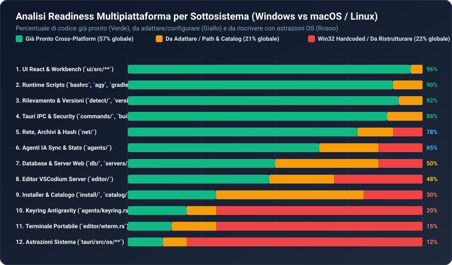

# 04 — Promozione per l'Impiego dell'Applicazione Multipiattaforma (Windows, macOS, Linux)

> [!IMPORTANT]
> Questo documento risponde in dettaglio alla **Dimensione 8**: *Promozione per l'impiego dell'applicazione multipiattaforma — cosa è già pronto, cosa va ristrutturato e cosa manca* per distribuire Atollo su **Windows (`x64`/`arm64`)**, **macOS (`darwin-arm64`/`darwin-x64`)** e **Linux (`linux-x64`/`linux-arm64`)**.

---

## 1. Sintesi Quantitativa della Portabilità Attuale

| Categoria di Codice | Quota sul Progetto | Stato Attuale | Dettaglio Sottosistemi |
| :--- | :---: | :---: | :--- |
| **1. Già Pronto (Cross-Platform 100%)** | **~57%** | Pronto | Intero frontend React/TS (`ui/src/**`), bridge IPC Tauri 2 (`commands/`), rilevamento linguaggi/framework (`detect/`), semver e relazioni (`versions/`), wizard framework (`projects/frameworks/`), sync/stats agenti IA (`agents/sync/`, `agents/stats.rs`), verifica hash (`net/verify.rs`), estrazione archivi `.zip`/`.tar.gz`/`.7z` (`net/archive.rs`), script Unix già presenti in [`runtime/bashrc`](../../../runtime/bashrc), [`runtime/bin/agy`](../../../runtime/bin/agy), [`runtime/bin/gradle`](../../../runtime/bin/gradle). |
| **2. Da Adattare (Path, Estensioni Binari, Catalogo URL)** | **~21%** | Configurabile | Costruzione `PATH` (`:` vs `;` in [`env.rs`](../../../tauri/src/env.rs)), nomi eseguibili (`.exe`/`.cmd` vs binari POSIX in `install/**`, `editor/`, `db/`, `servers/`), identificatore piattaforma in [`kit.rs`](../../../tauri/src/kit.rs) (`win32-*` → `darwin-*` / `linux-*`), URL dei pacchetti per macOS/Linux in [`tauri/catalog/components.json`](../../../tauri/catalog/components.json). |
| **3. Vincolato a Win32 (Da Ristrutturare con `#[cfg(unix)]`)** | **~22%** | Bloccante per compilazione Unix | Dipendenze Cargo (`windows`, `webview2-com`, `junction`), Job Objects e creazione processi ([`os/jobs.rs`](../../../tauri/src/os/jobs.rs)), Named Mutex/Pipe ([`os/instance.rs`](../../../tauri/src/os/instance.rs), [`editor/wterm.rs`](../../../tauri/src/editor/wterm.rs)), ToolHelp32 ([`os/processes.rs`](../../../tauri/src/os/processes.rs)), Credential Manager & DPAPI ([`agents/keyring.rs`](../../../tauri/src/agents/keyring.rs)), Authenticode WinTrust ([`net/signature.rs`](../../../tauri/src/net/signature.rs)), permessi `icacls`. |

---

## 2. Cosa è GIÀ Pronto e Riutilizzabile senza Modifiche (~57%)

Un punto di forza notevole del progetto è che **gli autori hanno già predisposto molte fondamenta multipiattaforma**:

1. **Runtime Unix Già Scritto in [`runtime/`](../../../runtime/bashrc)**:
   - [`runtime/bashrc`](../../../runtime/bashrc) (accanto a `profile.ps1`), [`runtime/bin/agy`](../../../runtime/bin/agy) (script POSIX `/bin/sh` accanto a `agy.cmd`) e [`runtime/bin/gradle`](../../../runtime/bin/gradle) (accanto a `gradle.cmd`) sono **già presenti nel repository** e copiati da [`tauri/src/setup/kit_files.rs`](../../../tauri/src/setup/kit_files.rs)!
2. **Estrazione Archivi Nativa in Rust ([`tauri/src/net/archive.rs`](../../../tauri/src/net/archive.rs))**:
   - L'estrattore non invoca `7z.exe` o `tar.exe` esterni: utilizza le crate pure-Rust `zip`, `tar`, `flate2` (`.tar.gz` / `.tgz`) e `sevenz-rust2` (`.7z` e SFX `.7z.exe`), che compilano ed estraggono identicamente su Windows, macOS e Linux.
3. **Frontend Completo (`ui/src/**`) e Tauri 2 Core**:
   - L'intero frontend React 19 + Vite + `@vscode-elements/elements` e tutti i 113 comandi IPC in `tauri/src/commands/` sono agnostici rispetto al sistema operativo (fatta eccezione per 3 stringhe nelle impostazioni come `"Lingua di Windows"` / `"Esplora file"`).

---

## 3. Cosa Va Ristrutturato: Mappa Chirurgica File per File (~22% Win32 + ~21% Path)

### 3.1 Dipendenze in [`tauri/Cargo.toml`](../../../tauri/Cargo.toml) e [`tauri/build.rs`](../../../tauri/build.rs)
- **Stato attuale**: `windows = "0.62.2"`, `webview2-com = "0.39.1"`, `junction = "2.1.0"` e la feature `win-system-proxy` di `ureq` sono dichiarati nelle `[dependencies]` globali, impedendo a `cargo check` di compilare su macOS o Linux. Anche [`tauri/build.rs:140`](../../../tauri/build.rs#L140) incorpora incondizionatamente `windows-app.manifest`.
- **Ristrutturazione**:
  - Spostare `windows`, `webview2-com` e `junction` sotto `[target.'cfg(windows)'.dependencies]`.
  - Aggiungere `[target.'cfg(unix)'.dependencies]` con `libc = "0.2"`.
  - In `build.rs`, condizionare `WindowsAttributes::new().app_manifest(...)` a `cfg!(target_os = "windows")`.

### 3.2 Sottosistema `tauri/src/os/` (6 Moduli)

| Modulo | Dipendenza Win32 Attuale | Equivalente Unix (`#[cfg(unix)]`) da Implementare |
| :--- | :--- | :--- |
| [`os/jobs.rs`](../../../tauri/src/os/jobs.rs) | `CreateJobObjectW`, `AssignProcessToJobObject`, `CreateProcessW(CREATE_SUSPENDED)`, `cmd.exe /d /s /c`, `explorer.exe` | Usare `CommandExt::process_group(0)` (`setpgid(0, 0)`) per ogni servizio/job; su Linux aggiungere `prctl(PR_SET_PDEATHSIG, SIGTERM)` in `pre_exec`; su `Job::drop` inviare `killpg(pgid, SIGTERM)` seguito da `SIGKILL`; usare `/bin/sh -c` per `shell_command`; usare `open` (macOS) e `xdg-open` (Linux) per `open_in_explorer` e `open_in_browser`. |
| [`os/processes.rs`](../../../tauri/src/os/processes.rs) & [`os/sessions.rs`](../../../tauri/src/os/sessions.rs) | `CreateToolhelp32Snapshot`, `QueryFullProcessImageNameW`, `TerminateProcess` | Su **Linux**: leggere `/proc/<pid>/stat` (per `ppid`) e `readlink("/proc/<pid>/exe")`; su **macOS**: usare `proc_listallpids` + `proc_pidinfo` + `proc_pidpath` (`libproc`); per `stop()` inviare `SIGTERM` → attendere 200ms → `SIGKILL`. Sostituire il confronto `\\data\\apps\\win32-` in `sessions.rs:34,157` con `Path::starts_with`. |
| [`os/instance.rs`](../../../tauri/src/os/instance.rs) | `CreateMutexW("Local\\Atollo-App-...")` + `CreateNamedPipeW("\\\\.\\pipe\\...")` | Usare `flock(LOCK_EX | LOCK_NB)` su `<temp>/Atollo-<kit.id()>.lock` e un `UnixListener` (`std::os::unix::net::UnixStream`) su `<temp>/Atollo-<kit.id()>.sock` con permessi `0600` per inviare `"show"` o `"exit"` all'istanza già aperta. |
| [`os/volume.rs`](../../../tauri/src/os/volume.rs) | `GetVolumeInformationW`, `GetDiskFreeSpaceExW`, controllo `"FAT32"` / `"exFAT"` | Usare `libc::statvfs` (per `f_bavail * f_frsize` = spazio libero) e `libc::statfs` (`f_fstypename` su macOS, `f_type == MSDOS_SUPER_MAGIC` su Linux) per rilevare volumi FAT32 con limite file a 4 GiB. |
| [`os/safe_path.rs`](../../../tauri/src/os/safe_path.rs) | `MetadataExt::file_attributes() & FILE_ATTRIBUTE_REPARSE_POINT` | Su Unix non esistono NTFS junctions: `meta.file_type().is_symlink()` in `#[cfg(unix)]` (combinato con `symlink_metadata`) è già sufficiente e completo. |
| [`os/webview.rs`](../../../tauri/src/os/webview.rs) | `webview2_com` / controllo WebView2 Runtime Evergreen o Fixed | Su **macOS**: `WKWebView` è sempre integrato in macOS (`check()` restituisce sempre `Ok(())`). Su **Linux**: verificare la presenza di `libwebkit2gtk-4.1.so`. |

### 3.3 Sicurezza, Permessi, Credenziali e Terminale

1. **Permessi File Riservati (`icacls.exe` → `chmod 0700 / 0600`)**:
   - Centralizzare le 3 chiamate a `icacls.exe` ([`editor/mod.rs:365`](../../../tauri/src/editor/mod.rs#L365), [`db/auth.rs:124`](../../../tauri/src/db/auth.rs#L124), [`projects/state.rs:148`](../../../tauri/src/projects/state.rs#L148)) in una funzione `crate::os::restrict_to_owner(path: &Path)`. Su Unix bastano 3 righe: `fs::set_permissions(path, Permissions::from_mode(if path.is_dir() { 0o700 } else { 0o600 }))`.
2. **Keyring di Antigravity ([`tauri/src/agents/keyring.rs`](../../../tauri/src/agents/keyring.rs))**:
   - Su Windows `agy` usa `go-keyring` appoggiandosi al Credential Manager; su **macOS** `go-keyring` usa il **macOS Keychain** (`/usr/bin/security find-generic-password` / `add-generic-password` / `delete-generic-password`); su **Linux** usa D-Bus `org.freedesktop.secrets` (`secret-tool`).
   - Per cifrare `keyring-before.json` (dove oggi si usa `CryptProtectData` DPAPI), su Unix si può usare una chiave random salvata nel Keychain/Secret Service dell'utente ospite o cifratura ChaCha20-Poly1305 legata all'UID/machine-id locale.
3. **Verifica Firma Digitale ([`tauri/src/net/signature.rs`](../../../tauri/src/net/signature.rs))**:
   - Oggi usa `WinVerifyTrust` (Authenticode, usato per `vc_redist.x64.exe`). Su macOS può invocare `/usr/bin/codesign --verify --deep --strict`, mentre per gli archivi `.tar.gz`/`.zip` di componenti multipiattaforma la verifica primaria resta SHA-256/SHA-512 ([`net/verify.rs`](../../../tauri/src/net/verify.rs)).
4. **Terminale Portabile ([`tauri/src/editor/wterm.rs`](../../../tauri/src/editor/wterm.rs) e [`tauri/src/editor/mod.rs`](../../../tauri/src/editor/mod.rs))**:
   - Su macOS e Linux non serve il complesso handshake Named Pipe pensato per aggirare il singleton di Windows Terminal: i terminali Unix (`Terminal.app` / `iTerm.app` su macOS, oppure `x-terminal-emulator` / `gnome-terminal` / `konsole` / `alacritty` / `kitty` su Linux) ereditano direttamente le variabili d'ambiente del processo padre o possono lanciare `/bin/bash --rcfile <kit>/data/kit/bashrc -i`.

---

## 4. Cosa Manca per Distributori & Catalogo Multipiattaforma

### 4.1 Estensione di [`tauri/src/kit.rs`](../../../tauri/src/kit.rs) e [`tauri/src/env.rs`](../../../tauri/src/env.rs)
- In [`kit.rs:23-38`](../../../tauri/src/kit.rs#L23-L38), `Arch::platform()` restituisce solo `"win32-x64"` o `"win32-arm64"`. Va esteso per restituire `"darwin-arm64"`, `"darwin-x64"`, `"linux-x64"`, `"linux-arm64"`, in modo che una stessa chiavetta USB possa contenere `data/apps/win32-x64/`, `data/apps/darwin-arm64/` e `data/apps/linux-x64/` fianco a fianco condividendo la stessa cartella `projects/`!
- In [`env.rs`](../../../tauri/src/env.rs), usare `std::env::join_paths` (che usa `:` su Unix e `;` su Windows) e mappare i layout standard delle tarball Unix (dove i binari di Node, Python, PHP, Go, Java, MySQL risiedono in `<tool>/bin/<name>` invece che nella radice `<tool>/<name>.exe`).

### 4.2 Matrice di Portabilità dei 26 Componenti del Catalogo (`tauri/src/install/**`)

| Gruppo | Componenti | Stato su macOS / Linux | Intervento Richiesto in `install/` e `catalog/components.json` |
| :--- | :--- | :---: | :--- |
| **Pronti con solo cambio URL/Path** | Node.js, Python (`python-build-standalone`), Go, Rust (`rustup-init`), Java (Temurin), Maven, Gradle, Dart, Flutter, Android SDK, Composer, Quarto, GitHub CLI (`gh`), OpenTofu, Ollama, MongoDB, VSCodium (`reh-web`), Claude, Codex, Gemini CLI | Alto (85%) | Aggiungere in `catalog/components.json` le URL per `darwin-arm64`/`darwin-x64`/`linux-x64` e usare una funzione helper `exe_name("node")` (`"node.exe"` su Win, `"node"` su Unix) e `bin_dir` (`""` su Win per Node/Python, `"bin"` su Unix). |
| **Specifici Windows (Da Disabilitare o Sostituire su Unix)** | `vcredist` (`vc_redist.x64.exe`), `terminal` (Windows Terminal), `git` (PortableGit `.7z.exe`), `pwsh`, `apache` (Apache Lounge Win64), `php` (`windows.php.net`), `ruby` (RubyInstaller2) | Specifici OS | • `vcredist` e `terminal`: nascondere su macOS/Linux (`platforms: ["win32"]`). • `git`: su macOS/Linux usare il `git` di sistema (Xcode CLT / distro) o build statica MinGit/conda-forge. • `php` e `apache`: su macOS/Linux usare binari statici portabili (`static-php-cli` / `indygreg` / Homebrew bottles rilocabili) o PHP-FPM integrato con Nginx/Caddy. |

---

## 5. Piano di Refactoring Multipiattaforma in 4 Fasi

1. **Fase 1 — Compilazione Condizionale & Astrazione OS (3–4 giorni)**:
   - Isolare le crate Win32 in `Cargo.toml` sotto `[target.'cfg(windows)'.dependencies]`.
   - Creare `tauri/src/os/windows/` e `tauri/src/os/unix/` esportando la stessa interfaccia pubblica (`jobs`, `processes`, `sessions`, `instance`, `volume`, `safe_path`, `webview`, `permissions`).
2. **Fase 2 — Normalizzazione Path, `KitEnv` e Wrapper POSIX (2–3 giorni)**:
   - Aggiornare `kit.rs` (`darwin-*`, `linux-*`) ed `env.rs` (`std::env::join_paths`, sottocartelle `bin/`).
   - Generare wrapper POSIX `/bin/sh` (`chmod +x`) invece di `.cmd` in `agents/mod.rs` e `setup/kit_files.rs` quando `cfg!(unix)`.
3. **Fase 3 — Catalogo Multi-OS e Installer Componenti (4–5 giorni)**:
   - Strutturare gli URL in `tauri/catalog/components.json` per piattaforma (`win32-x64`, `darwin-arm64`, `linux-x64`) e adattare `install/*.rs` per le tarball `.tar.gz`/`.tar.xz` Unix (preservando i bit di esecuzione POSIX `0755` durante l'estrazione in [`net/archive.rs`](../../../tauri/src/net/archive.rs)).
4. **Fase 4 — CI/CD Multi-Runner in GitHub Actions (1–2 giorni)**:
   - Estendere [`.github/workflows/app.yml`](../../../.github/workflows/app.yml) con una matrix `os: [windows-latest, macos-latest, ubuntu-22.04]` per produrre `.exe`, `.dmg`/`.app` e `.AppImage`/`.deb`.
