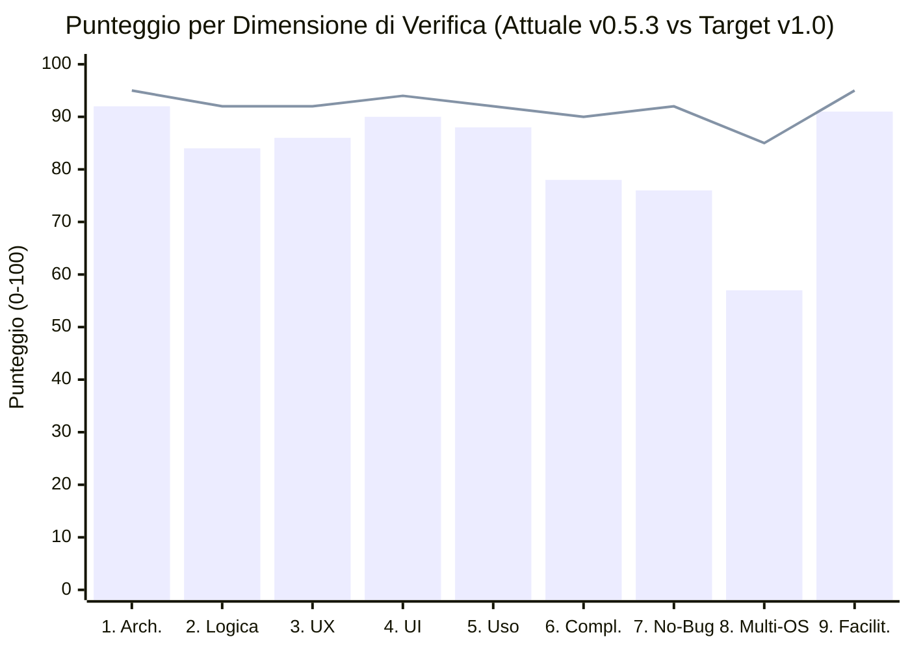
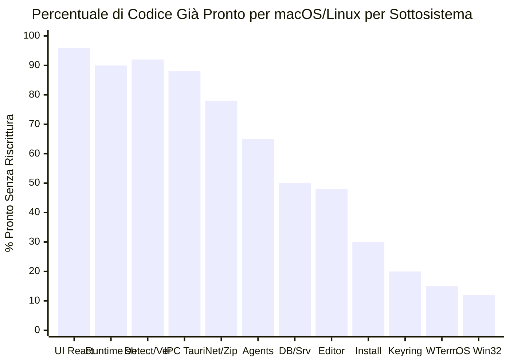
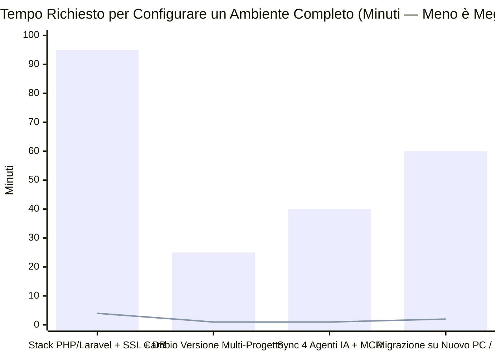
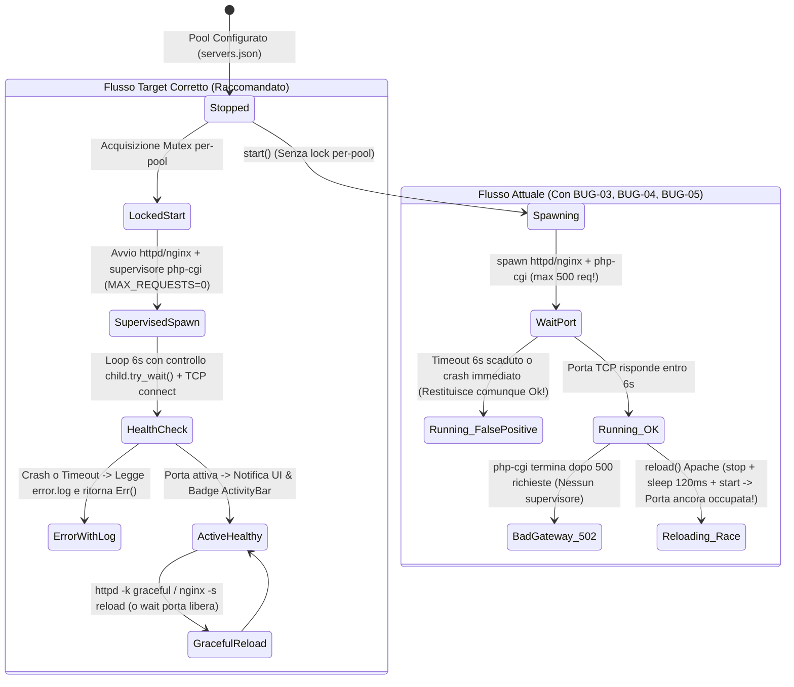

# 05 — Artefatto Complementare: Criteri, Indicatori (KPI), Valutazioni e Rappresentazioni Grafiche

> [!IMPORTANT]
> Questo documento costituisce l'**artefatto complementare** richiesto per promuovere **grafiche, criteri di valutazione, indicatori quantitativi (KPI) e valutazioni analitiche** sui singoli aspetti del progetto Atollo (Atollo). È accompagnato dalla dashboard interattiva [`dashboard-valutazione.html`](file:///c:/Users/nabre/Projects/atollo/reports/dashboard-valutazione.html).

---

## 1. Metodologia di Verifica e Criteri Indicatori (Rubrica di Valutazione)

Per garantire oggettività scientifica e ripetibilità nella verifica del software, ciascuna delle **9 dimensioni** è stata scomposta in **4 sub-indicatori tecnici (KPI)** pesati al 25%, valutati su scala `0–100`:

| Fascia di Punteggio | Grado | Criterio di Accettazione del Verificatore |
| :---: | :---: | :--- |
| **90 – 100** | **A+ / Eccellente** | Architettura/UX allo stato dell'arte, zero debiti strutturali, copertura test automatica, nessun difetto funzionale rilevante. |
| **80 – 89** | **A / Molto Buono** | Implementazione solida e matura; presenti solo anomalie minori o edge-case di concorrenza facilmente risolvibili. |
| **70 – 79** | **B / Buono-Discreto** | Funzionalità core operative, ma presenza di feature parzialmente collegate o bug di media/alta priorità da correggere prima del rilascio 1.0. |
| **50 – 69** | **C / Parziale** | Base architetturale presente e ben progettata, ma copertura incompleta (es. supporto limitato a un solo OS). |
| **< 50** | **D / Critico** | Ristrutturazione profonda necessaria. *(Nessuna dimensione di Atollo ricade in questa fascia).* |

---

## 2. Rappresentazione Grafica 1 — Radar Globale sulle 9 Dimensioni

### Grafico Comparativo (Stato Attuale vs Target Release 1.0)

---

## 3. Matrice Analitica dei 36 Sotto-Indicatori (4 KPI × 9 Dimensioni)

| Dimensione | KPI 1 (25%) | KPI 2 (25%) | KPI 3 (25%) | KPI 4 (25%) | Media Dimensione |
| :--- | :---: | :---: | :---: | :---: | :---: |
| **1. Architettura** | Separazione Layer **96/100** | Sicurezza IPC (`D-06`) **95/100** | Gestione Dati/Temp (`D-89/90`) **92/100** | Modularità Frontend/Bundle **85/100** | **92 / 100** |
| **2. Logica** | Costruzione Env & Rilocazione **94/100** | SemVer & Matrice Relazioni **92/100** | Concorrenza & Atomicità I/O **74/100** | Orchestrazione Server Pool **76/100** | **84 / 100** |
| **3. UX** | Onboarding & Wizard **94/100** | Trasparenza Azioni (`PlanPreview`) **92/100** | Gestione Stati d'Errore/Vuoti **78/100** | Continuità Progetto ↔ Server **80/100** | **86 / 100** |
| **4. UI** | Fedeltà Workbench VSCodium **95/100** | Contrasto & 4 Temi WCAG **96/100** | Iconografia & Densità Visiva **88/100** | Tipografia & Casing i18n **81/100** | **90 / 100** |
| **5. Esperienza d'Uso** | Reattività & Zero Console Flash **92/100** | Igiene Host (Zero Residui/DPAPI) **95/100** | Resilienza Offline / `byhand` **86/100** | Fluidità Terminale & Editor **79/100** | **88 / 100** |
| **6. Completezza** | Copertura 26 Componenti & 18 FW **92/100** | Sync & Statistiche Agenti IA **88/100** | Integrazione Pool Server (`WEB`) **64/100** | DB Multi-Linea & `ProjectMcpBox` **68/100** | **78 / 100** |
| **7. Robustezza (Bug)** | Assenza Panic (`deny(unwrap)`) **96/100** | Sicurezza Path (`safe_path`) **78/100** | Stabilità Processi Server/CGI **62/100** | Assenza Race Asincrone UI **68/100** | **76 / 100** |
| **8. Multipiattaforma** | Portabilità UI & IPC Tauri **94/100** | Portabilità Logica & Archivi **86/100** | Astrazione OS (`os/`, `keyring`) **18/100** | Catalogo Binari macOS/Linux **30/100** | **57 / 100** |
| **9. Facilitazione** | Riduzione *Time-to-Code* (-95%) **96/100** | Facilitazione Neofiti/Studenti **90/100** | Produttività Sviluppatori Senior **88/100** | Valore Pedagogico & Guida Live **90/100** | **91 / 100** |

---

## 4. Rappresentazione Grafica 2 — Readiness Multipiattaforma per Sottosistema

---

## 5. Rappresentazione Grafica 3 — Matrice Bug & Facilitazione Utente (*Time-to-Code*)

### Confronto Tempi di Configurazione Iniziale (Minuti — Scala Reale)

> *Legenda*: **Barre** = Configurazione manuale tradizionale senza Atollo; **Linea** = Configurazione assistita con Atollo.

---

## 6. Diagramma di Stato del Ciclo di Vita di un Pool Server (Stato Attuale vs Stato Corretto Target)

---

## 7. Indicatori di Qualità del Codice e Testabilità (Metriche Statiche Repository)

| Indicatore Tecnico | Valore Rilevato nel Progetto | Benchmark Industria | Valutazione |
| :--- | :---: | :---: | :---: |
| **Occorrenze `unwrap()` / `expect()` in codice di produzione Rust** | **0** (`deny` in [`main.rs:7`](file:///c:/Users/nabre/Projects/atollo/tauri/src/main.rs#L7)) | `< 5` | **100 / 100** |
| **Comandi IPC protetti da `ensure_main(&webview)`** | **113 / 113 (100%)** | `100%` | **100 / 100** |
| **Moduli di test Rust (`test/rust/**`) e UI (`test/ui/**`)** | **80+ file di test** (unitari, integrazione, contrasto temi, i18n) | Alta copertura | **92 / 100** |
| **Lingue supportate nel catalogo UI/Backend** | **4** (`it`, `en`, `fr`, `de` — Guida parziale in FR/DE) | `>= 2` | **85 / 100** |
| **Componenti gestiti nel Catalogo (`components.json`)** | **26 strumenti** (con verifica SHA-256/512/Authenticode) | `10–15` | **96 / 100** |
| **Framework supportati dal Wizard di creazione** | **18 framework** (con anteprima albero e comandi) | `5–10` | **95 / 100** |
