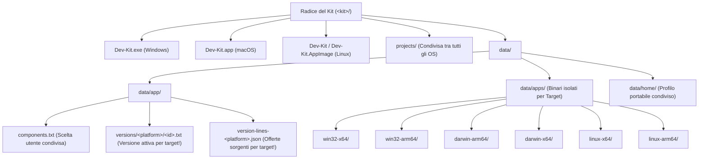

# Piano di Architettura e Implementazione: Matrice di Download e Gestione File Multipiattaforma

> [!IMPORTANT]
> **Obiettivo Operativo**: Ristrutturare l'intero sottosistema di catalogo, download, verifica, estrazione, posizionamento su disco, versionamento affiancato (`versions/`) e risoluzione `PATH` di **NEXKORA (Dev-Kit)** per supportare nativamente e in modo **coabitante sulla stessa unità portabile** le **6 combinazioni Piattaforma × Architettura**:
> - **Windows**: `win32-x64`, `win32-arm64`
> - **macOS**: `darwin-arm64` (Apple Silicon), `darwin-x64` (Intel)
> - **Linux**: `linux-x64` (glibc/musl statico), `linux-arm64` (aarch64)

---

## 1. Principi Architetturali e Coabitazione Multi-Host nello Stesso Kit

Il requisito cardine di NEXKORA ([`docs/app/PLAN.md`](file:///c:/Users/nabre/Projects/dev-kit2/docs/app/PLAN.md), [`tauri/src/kit.rs`](file:///c:/Users/nabre/Projects/dev-kit2/tauri/src/kit.rs)) è che una singola cartella del kit (es. su disco esterno USB/SSD) possa essere collegata a un PC Windows, poi a un Mac e infine a una workstation Linux **senza sovrascrivere i binari o corrompere lo stato delle versioni installate**.



### 1.1 I 4 Gap Critici Attuali da Risolvere per i File e la Matrice

1. **Identificatore di Piattaforma Fisso su `win32-*` ([`tauri/src/kit.rs:19-57`](file:///c:/Users/nabre/Projects/dev-kit2/tauri/src/kit.rs#L19-L57))**:
   - Oggi `Arch` distingue solo `X64` e `Arm64`, e `Arch::platform()` formatta staticamente `"win32-{}"`.
   - Va introdotto `Os` (`Win32`, `Darwin`, `Linux`) combinato in `Target { os: Os, arch: Arch }` la cui stringa canonica è `<os>-<arch>` (`win32-x64`, `win32-arm64`, `darwin-arm64`, `darwin-x64`, `linux-x64`, `linux-arm64`).
2. **Stato delle Versioni Condiviso in `data/app/versions/<id>.txt` ([`tauri/src/setup/catalog.rs:274-303`](file:///c:/Users/nabre/Projects/dev-kit2/tauri/src/setup/catalog.rs#L274-L303)) e `version-lines.json` ([`tauri/src/versions/offered.rs:20-22`](file:///c:/Users/nabre/Projects/dev-kit2/tauri/src/versions/offered.rs#L20-L22))**:
   - **Problema**: Oggi `Component::version_file` scrive in `data/app/versions/<id>.txt` (senza piattaforma!). Se l'utente installa Node `22.11.0` su `win32-x64` e poi apre lo stesso kit su `darwin-arm64`, `installed_version()` legge `22.11.0` anche se `data/apps/darwin-arm64/node/` è vuoto, e `offered.rs` mescola le linee disponibili per Windows con quelle per macOS/Linux (es. Ruby o Java su ARM64).
   - **Soluzione**: Spostare i file di stato versione sotto `data/app/versions/<platform>/<id>.txt` (con migrazione automatica dei vecchi `data/app/versions/<id>.txt` in `data/app/versions/win32-<arch>/<id>.txt`) e `data/app/version-lines/<platform>.json`.
3. **Chiavi del Catalogo (`key`, `keys`, `remove`, `check`, `sha256`) Monolitiche Windows ([`tauri/catalog/components.json`](file:///c:/Users/nabre/Projects/dev-kit2/tauri/catalog/components.json))**:
   - In `components.json`, tutti i path hanno `.exe`, `.cmd`, `.bat` e layout Windows (es. `python/python.exe` invece di `python/bin/python3`, `node/node.exe` invece di `node/bin/node`, `tinytex/bin/windows/pdftex.exe` invece di `tinytex/bin/<tl_platform>/pdftex`).
   - Inoltre `vscodium-server` ha un unico `sha256` hardcoded nel JSON valido solo per `vscodium-reh-web-win32-x64-<v>.tar.gz`.
4. **Estrattore Archivi Cieco ai Permessi POSIX e ai Symlink Interni ([`tauri/src/net/archive.rs:76-124`](file:///c:/Users/nabre/Projects/dev-kit2/tauri/src/net/archive.rs#L76-L124))**:
   - In `extract_tar_gz`, `tar.set_preserve_permissions(false)` e lo skip totale di `tar::EntryType::Symlink` funzionano su Windows, ma **rompono tutti i pacchetti Unix** (es. Node.js, Python standalone, JDK Temurin, Clang/LLVM, Rust, CMake, MariaDB), dove i binari devono avere il bit eseguibile `0o755` e le librerie condivise (`.so`/`.dylib`) o gli alias (`python3 -> python3.13`, `clang++ -> clang`) sono symlink relativi dentro l'archivio.
   - Inoltre, molti pacchetti Linux/macOS (Zig, CMake, LLVM, MariaDB, TinyTeX, Node) sono distribuiti come `.tar.xz` o `.tar.zst`, quindi serve aggiungere `Kind::TarXz` (crate `lzma-rs` o `xz2`) a `archive.rs`.

---

## 2. Riprogettazione di `tauri/src/kit.rs`: `Os`, `Arch` e `Target`

### 2.1 Nuovi Tipi in [`tauri/src/kit.rs`](file:///c:/Users/nabre/Projects/dev-kit2/tauri/src/kit.rs)

```rust
#[derive(Debug, Clone, Copy, PartialEq, Eq, PartialOrd, Ord, Hash, serde::Serialize, serde::Deserialize)]
#[serde(rename_all = "lowercase")]
pub enum Os {
    Win32,
    Darwin,
    Linux,
}

impl Os {
    pub const fn current() -> Os {
        #[cfg(target_os = "windows")]
        { Os::Win32 }
        #[cfg(target_os = "macos")]
        { Os::Darwin }
        #[cfg(target_os = "linux")]
        { Os::Linux }
    }

    pub const fn as_str(self) -> &'static str {
        match self {
            Os::Win32 => "win32",
            Os::Darwin => "darwin",
            Os::Linux => "linux",
        }
    }

    pub const fn exe_suffix(self) -> &'static str {
        match self {
            Os::Win32 => ".exe",
            Os::Darwin | Os::Linux => "",
        }
    }
}

#[derive(Debug, Clone, Copy, PartialEq, Eq, PartialOrd, Ord, Hash, serde::Serialize, serde::Deserialize)]
pub struct Target {
    pub os: Os,
    pub arch: Arch,
}

impl Target {
    pub fn detect() -> Target {
        Target {
            os: Os::current(),
            arch: Arch::detect(),
        }
    }

    /// Ritorna una delle 6 chiavi canoniche:
    /// `win32-x64`, `win32-arm64`, `darwin-arm64`, `darwin-x64`, `linux-x64`, `linux-arm64`
    pub const fn as_str(self) -> &'static str {
        match (self.os, self.arch) {
            (Os::Win32, Arch::X64) => "win32-x64",
            (Os::Win32, Arch::Arm64) => "win32-arm64",
            (Os::Darwin, Arch::Arm64) => "darwin-arm64",
            (Os::Darwin, Arch::X64) => "darwin-x64",
            (Os::Linux, Arch::X64) => "linux-x64",
            (Os::Linux, Arch::Arm64) => "linux-arm64",
        }
    }
}
```

### 2.2 Rilevamento dell'Architettura Reale (Anche sotto Emulazione Rosetta 2 / WOW64)
- **Windows (`Os::Win32`)**: Mantiene la regola `PROCESSOR_ARCHITECTURE` + `PROCESSOR_ARCHITEW6432` già presente in [`kit.rs:30-44`](file:///c:/Users/nabre/Projects/dev-kit2/tauri/src/kit.rs#L30-L44).
- **macOS (`Os::Darwin`)**: Se un binario `x64` gira sotto Rosetta 2 su Apple Silicon, `std::env::consts::ARCH` vale `"x86_64"`, ma l'host reale è ARM64 (`sysctl.proc_translated == 1` oppure `hw.optional.arm64 == 1`). `Arch::detect()` su macOS deve interrogare `sysctlbyname(b"hw.optional.arm64\0")` (o `uname -m`) per scaricare sempre i tool nativi `darwin-arm64`.
- **Linux (`Os::Linux`)**: Usa `std::env::consts::ARCH` (`"aarch64"` → `Arch::Arm64`, `"x86_64"` → `Arch::X64`) o `libc::uname`.

---

## 3. Schema Evoluto del Catalogo (`tauri/catalog/components.json`) e `catalog.rs`

Per evitare di duplicare i 26 componenti per 6 piattaforme nel file [`tauri/catalog/components.json`](file:///c:/Users/nabre/Projects/dev-kit2/tauri/catalog/components.json) e mantenere la leggibilità, il catalogo adotterà **due meccanismi complementari**:

### 3.1 Token Dinamici nei Percorsi di `components.json`
Nella funzione [`kit_path(kit: &Kit, rel: &str)`](file:///c:/Users/nabre/Projects/dev-kit2/tauri/src/setup/catalog.rs#L170-L176) e in [`versions::has_key`](file:///c:/Users/nabre/Projects/dev-kit2/tauri/src/versions/mod.rs#L162-L173), i seguenti segnaposto nei campi `key`, `keys`, `remove` e `check[0]` vengono espansi automaticamente in base al `Target` del `Kit`:
- `{exe}` → `".exe"` su Windows, `""` su macOS/Linux.
- `{cmd}` → `".cmd"` su Windows, `""` su macOS/Linux.
- `{bat}` → `".bat"` su Windows, `""` su macOS/Linux.
- `{bin}` → `""` su Windows, `"bin/"` su macOS/Linux (per quei tool come `node`, `python`, `php` che su Windows hanno l'eseguibile nella radice del pacchetto e su Unix in `bin/`).
- `{pyscript}` → `"Scripts"` su Windows, `"bin"` su macOS/Linux.
- `{tl_bin}` → `"windows"` su Windows, `"universal-darwin"` su macOS, `"x86_64-linux"` su `linux-x64`, `"aarch64-linux"` su `linux-arm64`.

### 3.2 Override Espliciti per Piattaforma e Filtri di Disponibilità
Alcuni componenti hanno differenze strutturali tra sistemi operativi (es. `vscodium-server` ha un `sha256` diverso per ciascuna delle 6 piattaforme; `terminal` esiste solo su Windows; `apache` e `nginx` su Unix possono avere layout specifici o dipendenze diverse).
Aggiungiamo alla struct [`Component`](file:///c:/Users/nabre/Projects/dev-kit2/tauri/src/setup/catalog.rs#L46-L96):

```rust
#[derive(Debug, Clone, Default, Serialize, Deserialize)]
#[serde(rename_all = "camelCase")]
pub struct PlatformOverride {
    pub key: Option<String>,
    pub keys: Option<Vec<String>>,
    pub remove: Option<Vec<String>>,
    pub check: Option<Vec<String>>,
    pub sha256: Option<String>,
    pub mb: Option<u32>,
    pub needs: Option<Vec<String>>,
}
```
E nella struct `Component`:
- `#[serde(default)] pub platforms: Vec<String>`: se vuoto vale per tutte le 6 piattaforme; altrimenti elenca i prefissi OS o i target ammessi (es. `["win32"]` per `terminal`, `["win32-x64", "darwin-arm64", "darwin-x64", "linux-x64", "linux-arm64"]` per `r` che su `win32-arm64` non esiste in conda-forge ma esiste su `osx-arm64` e `linux-aarch64`!).
- `#[serde(default)] pub emulated_on: Vec<String>`: sostituisce il booleano rigido `x64_only`. Ad esempio, `apache` su Windows è emulato su `win32-arm64` (`emulated_on: ["win32-arm64"]`), mentre su macOS e Linux esistono build native `arm64`!
- `#[serde(default)] pub targets: BTreeMap<String, PlatformOverride>`: permette di specificare per ciascuno dei 6 target (`win32-x64`, `win32-arm64`, `darwin-arm64`, `darwin-x64`, `linux-x64`, `linux-arm64`) o per OS (`win32`, `darwin`, `linux`) l'`sha256` fissato (usato da `vscodium-server`) o eventuali chiavi specifiche.

---

## 4. Matrice Completa di Download per tutti i 26 Componenti × 6 Architetture

Di seguito la mappatura esatta di **URL/API, formato archivio (`Kind`), sottocartella (`Inner`), verifica (`Expect`), percorso eseguibile (`key` / `keys`) e azioni post-estrazione (`finish` / `before_swap`)** per ciascuno dei 26 componenti del catalogo su tutte le 6 piattaforme.

---

### 4.1 Gruppo `app` & `required` & `os` (Sistema, Terminale, Editor)

#### 1. `vscodium-server` (`tauri/src/install/editor.rs` — `Server`)
- **Fonte**: Release GitHub fissata nel catalogo (`https://github.com/VSCodium/vscodium/releases/download/{version}/{name}`).
- **Matrice Asset & Hash**:
  | Target | Nome Asset (`name`) | Formato (`Kind`) | `Inner` | `key` e `keys` nel Kit | Note Architetturali |
  | :--- | :--- | :---: | :---: | :--- | :--- |
  | `win32-x64` | `vscodium-reh-web-win32-x64-{version}.tar.gz` | `TarGz` | `Auto` | `vscodium-server/out/server-main.js` + `vscodium-server/node.exe` | Nativo x64 |
  | `win32-arm64` | `vscodium-reh-web-win32-x64-{version}.tar.gz` *(o `arm64` se pubblicato)* | `TarGz` | `Auto` | `vscodium-server/out/server-main.js` + `vscodium-server/node.exe` | Emulato x64 (o nativo se presente nella release) |
  | `darwin-arm64` | `vscodium-reh-web-darwin-arm64-{version}.tar.gz` | `TarGz` | `Auto` | `vscodium-server/out/server-main.js` + `vscodium-server/node` | Nativo Apple Silicon |
  | `darwin-x64` | `vscodium-reh-web-darwin-x64-{version}.tar.gz` | `TarGz` | `Auto` | `vscodium-server/out/server-main.js` + `vscodium-server/node` | Nativo macOS Intel |
  | `linux-x64` | `vscodium-reh-web-linux-x64-{version}.tar.gz` | `TarGz` | `Auto` | `vscodium-server/out/server-main.js` + `vscodium-server/node` | Nativo Linux x64 |
  | `linux-arm64` | `vscodium-reh-web-linux-arm64-{version}.tar.gz` | `TarGz` | `Auto` | `vscodium-server/out/server-main.js` + `vscodium-server/node` | Nativo Linux aarch64 |
- **Modifica a `components.json`**: Sostituire `"sha256": "..."` singolo con una mappa `"sha256ByTarget": { "win32-x64": "...", "darwin-arm64": "...", "darwin-x64": "...", "linux-x64": "...", "linux-arm64": "..." }`.

#### 2. `pwsh` — PowerShell 7 (`tauri/src/install/editor.rs` — `Pwsh`)
- **Fonte**: GitHub Releases `PowerShell/PowerShell` (`github_single`).
- **Matrice Asset**:
  | Target | Regex Asset GitHub | `Kind` | `Inner` | `key` | Post-Install (`finish`) |
  | :--- | :--- | :---: | :---: | :--- | :--- |
  | `win32-x64` | `^PowerShell-\d+\.\d+\.\d+-win-x64\.zip$` | `Zip` | `Auto` | `pwsh/pwsh.exe` | Nessuno |
  | `win32-arm64` | `^PowerShell-\d+\.\d+\.\d+-win-arm64\.zip$` | `Zip` | `Auto` | `pwsh/pwsh.exe` | Nessuno |
  | `darwin-arm64` | `^powershell-\d+\.\d+\.\d+-osx-arm64\.tar\.gz$` | `TarGz` | `Root` | `pwsh/pwsh` | `chmod 0755 pwsh/pwsh` |
  | `darwin-x64` | `^powershell-\d+\.\d+\.\d+-osx-x64\.tar\.gz$` | `TarGz` | `Root` | `pwsh/pwsh` | `chmod 0755 pwsh/pwsh` |
  | `linux-x64` | `^powershell-\d+\.\d+\.\d+-linux-x64\.tar\.gz$` | `TarGz` | `Root` | `pwsh/pwsh` | `chmod 0755 pwsh/pwsh` |
  | `linux-arm64` | `^powershell-\d+\.\d+\.\d+-linux-arm64\.tar\.gz$` | `TarGz` | `Root` | `pwsh/pwsh` | `chmod 0755 pwsh/pwsh` |
- **Nota Strategica**: Poiché PowerShell 7 rilascia tarball portabili ufficiali per tutte le 6 architetture (`osx-arm64`, `osx-x64`, `linux-x64`, `linux-arm64`), mantenerlo disponibile su tutti gli OS permette anche a [`runtime/profile.ps1`](file:///c:/Users/nabre/Projects/dev-kit2/runtime/profile.ps1) e [`runtime/console.ps1`](file:///c:/Users/nabre/Projects/dev-kit2/runtime/console.ps1) di girare identici ovunque, affiancati a `bash --rcfile data/kit/bashrc`!

#### 3. `gh` — GitHub CLI (`tauri/src/install/core.rs` — `Gh`)
- **Fonte**: GitHub Releases `cli/cli`.
- **Matrice Asset**:
  | Target | Regex Asset GitHub | `Kind` | `Inner` | `key` |
  | :--- | :--- | :---: | :---: | :--- |
  | `win32-x64` | `^gh_[\d.]+_windows_amd64\.zip$` | `Zip` | `Auto` | `gh/bin/gh.exe` |
  | `win32-arm64` | `^gh_[\d.]+_windows_arm64\.zip$` | `Zip` | `Auto` | `gh/bin/gh.exe` |
  | `darwin-arm64` | `^gh_[\d.]+_macOS_arm64\.zip$` | `Zip` | `Single` | `gh/bin/gh` |
  | `darwin-x64` | `^gh_[\d.]+_macOS_amd64\.zip$` | `Zip` | `Single` | `gh/bin/gh` |
  | `linux-x64` | `^gh_[\d.]+_linux_amd64\.tar\.gz$` | `TarGz` | `Single` | `gh/bin/gh` |
  | `linux-arm64` | `^gh_[\d.]+_linux_arm64\.tar\.gz$` | `TarGz` | `Single` | `gh/bin/gh` |

#### 4. `terminal` — Windows Terminal (`tauri/src/install/editor.rs` — `Terminal`)
- **Disponibilità**: `platforms: ["win32"]`.
- **Comportamento su macOS e Linux**: Non mostrato/non pianificato su `darwin-*` e `linux-*` (dove [`editor/terminal.rs`](file:///c:/Users/nabre/Projects/dev-kit2/tauri/src/editor/terminal.rs) apre `Terminal.app` / `iTerm.app` su macOS e l'emulatore di terminale XDG/sistema su Linux). Scelta in `components.txt` preservata se il disco viene spostato tra Mac/Linux e Windows.

---

### 4.2 Gruppo `agents` (Agenti IA)

#### 5. `claude` — Claude Code (`tauri/src/install/agents.rs` — `Claude`)
- **Fonte**: Registro npm `@anthropic-ai/claude-code-<platform>-<arch>/latest` (oppure manifesto nativo GCS/npm di Anthropic).
- **Matrice Pacchetti npm Nativi**:
  | Target | Pacchetto npm | Binario Interno (`from`) | Destinazione (`Dest::File`) | Verifica Firma (`Sign`) |
  | :--- | :--- | :--- | :--- | :--- |
  | `win32-x64` | `@anthropic-ai/claude-code-win32-x64` | `claude.exe` | `claude/claude.exe` | Authenticode `Anthropic` |
  | `win32-arm64` | `@anthropic-ai/claude-code-win32-arm64` | `claude.exe` | `claude/claude.exe` | Authenticode `Anthropic` |
  | `darwin-arm64` | `@anthropic-ai/claude-code-darwin-arm64` | `claude` | `claude/claude` (`0755`) | `codesign` su macOS (`Anthropic`) |
  | `darwin-x64` | `@anthropic-ai/claude-code-darwin-x64` | `claude` | `claude/claude` (`0755`) | `codesign` su macOS (`Anthropic`) |
  | `linux-x64` | `@anthropic-ai/claude-code-linux-x64` | `claude` | `claude/claude` (`0755`) | `None` (integrità SHA-512 npm) |
  | `linux-arm64` | `@anthropic-ai/claude-code-linux-arm64` | `claude` | `claude/claude` (`0755`) | `None` (integrità SHA-512 npm) |

#### 6. `codex` — OpenAI Codex CLI (`tauri/src/install/agents.rs` — `Codex`)
- **Fonte**: Registro npm `https://registry.npmjs.org/@openai/codex/latest` → versione `<v>`, poi tarball specifica per target `@openai/codex/<version>-<os>-<arch>` (o asset GitHub `openai/codex` `codex-<triple>.tar.gz`).
- **Matrice Tag npm**:
  | Target | Tag npm `@openai/codex` | `Inner` | `key` |
  | :--- | :--- | :---: | :--- |
  | `win32-x64` | `{version}-win32-x64` | `SingleUnder("package/vendor")` | `codex/bin/codex.exe` |
  | `win32-arm64` | `{version}-win32-arm64` | `SingleUnder("package/vendor")` | `codex/bin/codex.exe` |
  | `darwin-arm64` | `{version}-darwin-arm64` | `SingleUnder("package/vendor")` | `codex/bin/codex` |
  | `darwin-x64` | `{version}-darwin-x64` | `SingleUnder("package/vendor")` | `codex/bin/codex` |
  | `linux-x64` | `{version}-linux-x64` | `SingleUnder("package/vendor")` | `codex/bin/codex` |
  | `linux-arm64` | `{version}-linux-arm64` | `SingleUnder("package/vendor")` | `codex/bin/codex` |

#### 7. `antigravity` — Google Antigravity CLI (`tauri/src/install/agents.rs` — `Antigravity`)
- **Fonte**: Manifesto `https://antigravity-cli-auto-updater-974169037036.us-central1.run.app/manifests/{manifest_platform}.json`.
- **Matrice Manifesti**:
  | Target | `manifest_platform` | Nome File Scaricato | Destinazione (`Dest::File`) | Wrapper in `data/kit/bin/` |
  | :--- | :--- | :--- | :--- | :--- |
  | `win32-x64` | `windows_amd64` | `agy-{version}.exe` | `antigravity/agy.exe` | `agy.cmd` + `agy` |
  | `win32-arm64` | `windows_arm64` | `agy-{version}.exe` | `antigravity/agy.exe` | `agy.cmd` + `agy` |
  | `darwin-arm64` | `darwin_arm64` | `agy-{version}` | `antigravity/agy` (`0755`) | `agy` (POSIX sh) |
  | `darwin-x64` | `darwin_amd64` | `agy-{version}` | `antigravity/agy` (`0755`) | `agy` (POSIX sh) |
  | `linux-x64` | `linux_amd64` | `agy-{version}` | `antigravity/agy` (`0755`) | `agy` (POSIX sh) |
  | `linux-arm64` | `linux_arm64` | `agy-{version}` | `antigravity/agy` (`0755`) | `agy` (POSIX sh) |

---

### 4.3 Gruppo `languages` — Core & Runtimes

#### 8. `git` — Git & Shell POSIX (`tauri/src/install/core.rs` — `Git`)
- **Problema Architetturale**: `git-for-windows/git` (`PortableGit-*.7z.exe`) fornisce sia `git.exe` sia `bash.exe` (MSYS2) solo per Windows. Su macOS e Linux `/bin/bash` e `/bin/sh` fanno già parte del sistema operativo, ma NEXKORA richiede un binario `git` isolato e verificato dentro `data/apps/<platform>/git/`.
- **Soluzione Multipiattaforma**:
  - **Windows (`win32-x64`, `win32-arm64`)**: Invariato (`PortableGit-<v>-(64-bit|arm64).7z.exe` da `git-for-windows/git`, `key: "git/bin/bash.exe"`, `check: ["git/cmd/git.exe", "--version"]`).
  - **macOS (`darwin-arm64`, `darwin-x64`) e Linux (`linux-x64`, `linux-arm64`)**: Scaricare il pacchetto **`git` da `conda-forge` tramite `micromamba`** (esattamente come fa già [`install/native.rs`](file:///c:/Users/nabre/Projects/dev-kit2/tauri/src/install/native.rs) per R!) oppure estrarre i pacchetti rilocabili `conda-forge/git` (`osx-arm64`, `osx-64`, `linux-64`, `linux-aarch64`), che includono `bin/git`, `libexec/git-core/*` e certificati OpenSSL completamente autonomi e rilocabili senza dipendere da Xcode Command Line Tools!
  - **`key` su Unix**: `git/bin/git`, `check: ["git/bin/git", "--version"]`.
  - **`finish` (`core.rs:56-98`)**: Eseguire `post-install.bat` solo su `#[cfg(windows)]`; su Unix configurare `.gitconfig` nella home portabile (`defaultBranch = main`, `safe.directory = *`).

#### 9. `python` — CPython Standalone (`tauri/src/install/core.rs` — `Python`)
- **Fonte**: `astral-sh/python-build-standalone` (`latest-release.json` → `SHA256SUMS`, `cpython-{minor}.N+{date}-{triple}-install_only_stripped.tar.gz`).
- **Matrice Triple & Layout**:
  | Target | Triple `python-build-standalone` | Eseguibile in `tree` | Cartella `site-packages` (`before_swap`) | Cartella Script (`PATH`) |
  | :--- | :--- | :--- | :--- | :--- |
  | `win32-x64` | `x86_64-pc-windows-msvc` | `python.exe` | `Lib\site-packages` | `Scripts` |
  | `win32-arm64` | `aarch64-pc-windows-msvc` | `python.exe` | `Lib\site-packages` | `Scripts` |
  | `darwin-arm64` | `aarch64-apple-darwin` | `bin/python3` | `lib/python{minor}/site-packages` | `bin` |
  | `darwin-x64` | `x86_64-apple-darwin` | `bin/python3` | `lib/python{minor}/site-packages` | `bin` |
  | `linux-x64` | `x86_64-unknown-linux-gnu` | `bin/python3` | `lib/python{minor}/site-packages` | `bin` |
  | `linux-arm64` | `aarch64-unknown-linux-gnu` | `bin/python3` | `lib/python{minor}/site-packages` | `bin` |
- **Adattamento Codice in [`core.rs:164-309`](file:///c:/Users/nabre/Projects/dev-kit2/tauri/src/install/core.rs#L164-L309)**:
  - Creare `fn python_triple(ctx: &Ctx, component: &Component) -> String` che mappa i 6 target alle triple sopra.
  - In `before_swap`: su Windows migrare `Lib\site-packages` e `Scripts`; su Unix migrare `lib/python{minor}/site-packages` e gli script non-core in `bin/`.
  - In `finish`: su Windows copiare `python.exe` → `python3.exe` e cercare il wheel di pip in `Lib\ensurepip\_bundled`; su Unix `bin/python3` e `bin/python` (symlink a `python3`) sono già presenti nell'archivio, e `ensurepip` si trova in `lib/python{minor}/ensurepip/_bundled`.

#### 10. `node` — Node.js LTS (`tauri/src/install/core.rs` — `Node`)
- **Fonte**: `https://nodejs.org/dist/index.json` + `SHASUMS256.txt`.
- **Matrice Identificatori `index.json` (`files`) e Archivi**:
  | Target | Chiave in `index.json` (`wanted`) | Nome File Scaricato | `Kind` | `Inner` | `key` |
  | :--- | :--- | :--- | :---: | :--- | :--- |
  | `win32-x64` | `win-x64-zip` | `node-{v}-win-x64.zip` | `Zip` | `Named("node-{v}-win-x64")` | `node/node.exe` |
  | `win32-arm64` | `win-arm64-zip` | `node-{v}-win-arm64.zip` | `Zip` | `Named("node-{v}-win-arm64")` | `node/node.exe` |
  | `darwin-arm64` | `osx-arm64-tar` | `node-{v}-darwin-arm64.tar.gz` | `TarGz` | `Named("node-{v}-darwin-arm64")` | `node/bin/node` |
  | `darwin-x64` | `osx-x64-tar` | `node-{v}-darwin-x64.tar.gz` | `TarGz` | `Named("node-{v}-darwin-x64")` | `node/bin/node` |
  | `linux-x64` | `linux-x64` | `node-{v}-linux-x64.tar.gz` | `TarGz` | `Named("node-{v}-linux-x64")` | `node/bin/node` |
  | `linux-arm64` | `linux-arm64` | `node-{v}-linux-arm64.tar.gz` | `TarGz` | `Named("node-{v}-linux-arm64")` | `node/bin/node` |
- **Nota `PATH` in `env.rs` e `native.rs` (`Pnpm`)**:
  - Su Windows `node.exe` è in `node/` e `npm-cli.js` è in `node/node_modules/npm/bin/npm-cli.js`.
  - Su macOS e Linux `node` è in `node/bin/node` e `npm-cli.js` è in `node/lib/node_modules/npm/bin/npm-cli.js`! Inoltre `NPM_CONFIG_PREFIX` (`data/npm-global`) su Windows mette i binari in `data/npm-global/pnpm.cmd`, mentre su Unix li mette in `data/npm-global/bin/pnpm`!

#### 11. `uv` — Astral uv (`tauri/src/install/core.rs` — `Uv`)
- **Fonte**: GitHub Releases `astral-sh/uv`.
- **Matrice Asset**:
  | Target | Regex Asset GitHub | `Kind` | `Inner` | `key` & `keys` |
  | :--- | :--- | :---: | :---: | :--- |
  | `win32-x64` | `^uv-x86_64-pc-windows-msvc\.zip$` | `Zip` | `Auto` | `uv/uv.exe`, `uv/uvx.exe` |
  | `win32-arm64` | `^uv-aarch64-pc-windows-msvc\.zip$` | `Zip` | `Auto` | `uv/uv.exe`, `uv/uvx.exe` |
  | `darwin-arm64` | `^uv-aarch64-apple-darwin\.tar\.gz$` | `TarGz` | `Auto` | `uv/uv`, `uv/uvx` |
  | `darwin-x64` | `^uv-x86_64-apple-darwin\.tar\.gz$` | `TarGz` | `Auto` | `uv/uv`, `uv/uvx` |
  | `linux-x64` | `^uv-x86_64-unknown-linux-gnu\.tar\.gz$` | `TarGz` | `Auto` | `uv/uv`, `uv/uvx` |
  | `linux-arm64` | `^uv-aarch64-unknown-linux-gnu\.tar\.gz$` | `TarGz` | `Auto` | `uv/uv`, `uv/uvx` |

#### 12. `rust` — Rustup & Toolchain (`tauri/src/install/native.rs` — `Rust`)
- **Fonte**: `static.rust-lang.org/dist/channel-rust-stable.toml` + `static.rust-lang.org/rustup/dist/{triple}/rustup-init{.exe}`.
- **Matrice Triple**:
  | Target | Triple `rustup-init` | Host Toolchain Predefinita (`rust_host`) | Registro HKCU (`restore_rustup_key`) |
  | :--- | :--- | :--- | :--- |
  | `win32-x64` | `x86_64-pc-windows-msvc` | `x86_64-pc-windows-gnu` (o `msvc`) | Sì (`#[cfg(windows)]`) |
  | `win32-arm64` | `aarch64-pc-windows-msvc` | `aarch64-pc-windows-msvc` | Sì (`#[cfg(windows)]`) |
  | `darwin-arm64` | `aarch64-apple-darwin` | `aarch64-apple-darwin` | No (no-op su Unix) |
  | `darwin-x64` | `x86_64-apple-darwin` | `x86_64-apple-darwin` | No (no-op su Unix) |
  | `linux-x64` | `x86_64-unknown-linux-gnu` | `x86_64-unknown-linux-gnu` | No (no-op su Unix) |
  | `linux-arm64` | `aarch64-unknown-linux-gnu` | `aarch64-unknown-linux-gnu` | No (no-op su Unix) |
- **Nota su `install_custom`**: Rendere eseguibile `rustup-init` (`chmod 0755`) prima di invocarlo su Unix.

#### 13. `go` — Go SDK (`tauri/src/install/lang/go.rs` — `Go`)
- **Fonte**: `https://go.dev/dl/?mode=json` (`include=all` per le linee).
- **Matrice Campi JSON (`os`, `arch`)**:
  | Target | `os` nel JSON | `arch` nel JSON | `Kind` | `Inner` | `key` |
  | :--- | :--- | :--- | :---: | :---: | :--- |
  | `win32-x64` | `"windows"` | `"amd64"` | `Zip` | `Named("go")` | `go/bin/go.exe` |
  | `win32-arm64` | `"windows"` | `"arm64"` | `Zip` | `Named("go")` | `go/bin/go.exe` |
  | `darwin-arm64` | `"darwin"` | `"arm64"` | `TarGz` | `Named("go")` | `go/bin/go` |
  | `darwin-x64` | `"darwin"` | `"amd64"` | `TarGz` | `Named("go")` | `go/bin/go` |
  | `linux-x64` | `"linux"` | `"amd64"` | `TarGz` | `Named("go")` | `go/bin/go` |
  | `linux-arm64` | `"linux"` | `"arm64"` | `TarGz` | `Named("go")` | `go/bin/go` |

#### 14. `java` — Adoptium Temurin JDK + Maven + Gradle (`tauri/src/install/lang/jvm.rs` — `Java`)
- **Fonte JDK**: `https://api.adoptium.net/v3/assets/latest/{feature}/hotspot?architecture={arch}&image_type=jdk&os={os}&vendor=eclipse`.
- **Matrice Parametri Adoptium & Struttura Interna**:
  | Target | `os` API | `architecture` API | Estensione & `Kind` | Nota Cruciale Layout macOS (`Contents/Home`) |
  | :--- | :--- | :--- | :---: | :--- |
  | `win32-x64` | `windows` | `x64` | `.zip` (`Kind::Zip`) | `Inner::Single` → `bin/java.exe` |
  | `win32-arm64` | `windows` | `aarch64` | `.zip` (`Kind::Zip`) | `Inner::Single` → `bin/java.exe` |
  | `darwin-arm64` | `mac` | `aarch64` | `.tar.gz` (`Kind::TarGz`) | **Attenzione**: i tar.gz Adoptium per macOS estraggono `jdk-21.../Contents/Home/bin/java`! Usare un nuovo `Inner::SingleThen("Contents/Home")` (o appiattire in `before_swap`) affinché `java/bin/java` sia uniforme con Linux e Windows! |
  | `darwin-x64` | `mac` | `x64` | `.tar.gz` (`Kind::TarGz`) | Come sopra: estrarre `Contents/Home` nella radice `java/<line>/` |
  | `linux-x64` | `linux` | `x64` | `.tar.gz` (`Kind::TarGz`) | `Inner::Single` → `bin/java` |
  | `linux-arm64` | `linux` | `aarch64` | `.tar.gz` (`Kind::TarGz`) | `Inner::Single` → `bin/java` |
- **Maven e Gradle**: Sono archivi `.zip` multi-piattaforma che contengono già sia `bin/mvn.cmd` + `bin/mvn` sia `bin/gradle.bat` + `bin/gradle`. Basta assicurarsi che su Unix `extract_zip` imposti il bit eseguibile `0755` su `bin/mvn` e `bin/gradle`!

#### 15. `kotlin` — Compilatore Kotlin (`tauri/src/install/lang/jvm.rs` — `Kotlin`)
- **Fonte**: GitHub Releases `JetBrains/kotlin`, asset `^kotlin-compiler-[\d.]+\.zip$`.
- **Multipiattaforma**: Lo zip è universale (contiene `bin/kotlinc.bat` e lo script POSIX `bin/kotlinc`). Su Unix `key` è `kotlin/bin/kotlinc`, e `extract_zip` deve preservare i permessi `0755` degli script in `bin/`.

#### 16. `android` — Android SDK (`tauri/src/install/android.rs` — `Android`)
- **Fonte**: Pagina `https://developer.android.com/studio` → `https://dl.google.com/android/repository/{name}`.
- **Matrice Command-Line Tools**:
  | Piattaforma | Regex su `developer.android.com/studio` | Script `sdkmanager` | Binario `adb` |
  | :--- | :--- | :--- | :--- |
  | `win32-x64` / `win32-arm64` | `commandlinetools-win-(\d+)_latest\.zip` | `cmdline-tools/latest/bin/sdkmanager.bat` | `platform-tools/adb.exe` |
  | `darwin-arm64` / `darwin-x64` | `commandlinetools-mac-(\d+)_latest\.zip` | `cmdline-tools/latest/bin/sdkmanager` | `platform-tools/adb` |
  | `linux-x64` / `linux-arm64` | `commandlinetools-linux-(\d+)_latest\.zip` | `cmdline-tools/latest/bin/sdkmanager` | `platform-tools/adb` |
- **Nota `linux-arm64`**: Google pubblica `commandlinetools-linux-*_latest.zip` (Java, universale), ma i binari scaricati da `sdkmanager` (`platform-tools/adb`, `build-tools`) su Linux sono compilati per `x86_64`. Pertanto su `linux-arm64` `android` va marcato come non disponibile (o richiede binfmt `qemu-x86_64`), mentre su `darwin-arm64` Google fornisce binari nativi universali/ARM64.

#### 17. `dotnet` — .NET SDK (`tauri/src/install/lang/dotnet.rs` — `Dotnet`)
- **Fonte**: `https://builds.dotnet.microsoft.com/dotnet/release-metadata/releases-index.json`.
- **Matrice RID (`rid` nel JSON)**:
  | Target | `rid` | Estensione | `Kind` | `key` | Side-by-Side (`versions/side_by_side.rs`) |
  | :--- | :--- | :--- | :---: | :--- | :--- |
  | `win32-x64` | `win-x64` | `.zip` | `Zip` | `dotnet/dotnet.exe` | Junction NTFS (`sdk/`, `shared/*`) |
  | `win32-arm64` | `win-arm64` | `.zip` | `Zip` | `dotnet/dotnet.exe` | Junction NTFS (`sdk/`, `shared/*`) |
  | `darwin-arm64` | `osx-arm64` | `.tar.gz` | `TarGz` | `dotnet/dotnet` | Symlink POSIX (`std::os::unix::fs::symlink`) |
  | `darwin-x64` | `osx-x64` | `.tar.gz` | `TarGz` | `dotnet/dotnet` | Symlink POSIX (`std::os::unix::fs::symlink`) |
  | `linux-x64` | `linux-x64` | `.tar.gz` | `TarGz` | `dotnet/dotnet` | Symlink POSIX (`std::os::unix::fs::symlink`) |
  | `linux-arm64` | `linux-arm64` | `.tar.gz` | `TarGz` | `dotnet/dotnet` | Symlink POSIX (`std::os::unix::fs::symlink`) |

#### 18. `dart` — Dart SDK (`tauri/src/install/lang/dart.rs` — `Dart`)
- **Fonte**: `https://storage.googleapis.com/dart-archive/channels/stable/release/{v}/sdk/{name}`.
- **Matrice Nomi Zip**:
  - `win32-x64` → `dartsdk-windows-x64-release.zip`
  - `win32-arm64` → `dartsdk-windows-arm64-release.zip`
  - `darwin-arm64` → `dartsdk-macos-arm64-release.zip`
  - `darwin-x64` → `dartsdk-macos-x64-release.zip`
  - `linux-x64` → `dartsdk-linux-x64-release.zip`
  - `linux-arm64` → `dartsdk-linux-arm64-release.zip`
- Tutti sono `.zip` (`Kind::Zip`, `Inner::Named("dart-sdk")`). Su Unix `extract_zip` preserva i permessi Unix registrati negli attributi esterni dello zip (`entry.unix_mode()`).

#### 19. `zig` — Compilatore Zig (`tauri/src/install/lang/zig.rs` — `Zig`)
- **Fonte**: `https://ziglang.org/download/index.json`.
- **Matrice Chiavi JSON e Formato Archivio**:
  > [!WARNING]
  > **Attenzione al cambio di formato in `ziglang.org/download/index.json`**:
  > Mentre per Windows Zig pubblica archivi `.zip` (`Kind::Zip`), per **macOS e Linux** Zig pubblica archivi **`.tar.xz`** (`Kind::TarXz`)!
  | Target | Chiave in `index.json` (`key`) | Formato (`Kind`) | `key` sul disco |
  | :--- | :--- | :---: | :--- |
  | `win32-x64` | `x86_64-windows` | `Kind::Zip` | `zig/zig.exe` |
  | `win32-arm64` | `aarch64-windows` | `Kind::Zip` | `zig/zig.exe` |
  | `darwin-arm64` | `aarch64-macos` | `Kind::TarXz` | `zig/zig` |
  | `darwin-x64` | `x86_64-macos` | `Kind::TarXz` | `zig/zig` |
  | `linux-x64` | `x86_64-linux` | `Kind::TarXz` | `zig/zig` |
  | `linux-arm64` | `aarch64-linux` | `Kind::TarXz` | `zig/zig` |

#### 20. `julia` — Linguaggio Julia (`tauri/src/install/lang/julia.rs` — `Julia`)
- **Fonte**: `https://julialang-s3.julialang.org/bin/versions.json`.
- **Matrice Filtri `versions.json` (`os`, `arch`, `extension`)**:
  | Target | `os` | `arch` | `extension` | `Kind` | `key` |
  | :--- | :--- | :--- | :--- | :---: | :--- |
  | `win32-x64` / `win32-arm64` | `"winnt"` | `"x86_64"` (`x64Only` su Win) | `"zip"` | `Zip` | `julia/bin/julia.exe` |
  | `darwin-arm64` | `"mac"` | `"aarch64"` | `"tar.gz"` | `TarGz` | `julia/bin/julia` |
  | `darwin-x64` | `"mac"` | `"x86_64"` | `"tar.gz"` | `TarGz` | `julia/bin/julia` |
  | `linux-x64` | `"linux"` | `"x86_64"` | `"tar.gz"` | `TarGz` | `julia/bin/julia` |
  | `linux-arm64` | `"linux"` | `"aarch64"` | `"tar.gz"` | `TarGz` | `julia/bin/julia` |
- **Nota**: Su Windows Julia non ha una build stabile ARM64 (`emulated_on: ["win32-arm64"]`), ma su **macOS (`darwin-arm64`) e Linux (`linux-arm64`) ha build native `aarch64`**!

#### 21. `bun` & 22. `deno` (`tauri/src/install/lang/js.rs` — `Bun`, `Deno`)
- **Bun (`oven-sh/bun`)**:
  - `win32-x64` → `^bun-windows-x64\.zip$`
  - `win32-arm64` → `^bun-windows-aarch64\.zip$`
  - `darwin-arm64` → `^bun-darwin-aarch64\.zip$`
  - `darwin-x64` → `^bun-darwin-x64\.zip$`
  - `linux-x64` → `^bun-linux-x64\.zip$`
  - `linux-arm64` → `^bun-linux-aarch64\.zip$`
- **Deno (`denoland/deno`)**:
  - `win32-x64` → `^deno-x86_64-pc-windows-msvc\.zip$`
  - `win32-arm64` → `^deno-aarch64-pc-windows-msvc\.zip$`
  - `darwin-arm64` → `^deno-aarch64-apple-darwin\.zip$`
  - `darwin-x64` → `^deno-x86_64-apple-darwin\.zip$`
  - `linux-x64` → `^deno-x86_64-unknown-linux-gnu\.zip$`
  - `linux-arm64` → `^deno-aarch64-unknown-linux-gnu\.zip$`

#### 23. `typst` & 24. `tinytex` (`tauri/src/install/lang/typeset.rs` — `Typst`, `TinyTex`)
- **Typst (`typst/typst`)**:
  | Target | Regex Asset GitHub | `Kind` | `Inner` | `key` |
  | :--- | :--- | :---: | :---: | :--- |
  | `win32-x64` / `win32-arm64` | `^typst-(x86_64\|aarch64)-pc-windows-msvc\.zip$` | `Zip` | `Single` | `typst/typst.exe` |
  | `darwin-arm64` / `darwin-x64` | `^typst-(aarch64\|x86_64)-apple-darwin\.tar\.xz$` | `TarXz` | `Single` | `typst/typst` |
  | `linux-x64` / `linux-arm64` | `^typst-(x86_64\|aarch64)-unknown-linux-musl\.tar\.xz$` | `TarXz` | `Single` | `typst/typst` |
- **TinyTeX (`rstudio/tinytex-releases`)**:
  | Target | Regex Asset GitHub | `Kind` | `Inner` | Percorso `tlmgr` e `pdftex` |
  | :--- | :--- | :---: | :---: | :--- |
  | `win32-x64` / `win32-arm64` | `^TinyTeX-1-windows-v[\d.]+\.exe$` | `SevenZip` | `Named("TinyTeX")` | `tinytex/bin/windows/tlmgr.bat`, `pdftex.exe` |
  | `darwin-arm64` / `darwin-x64` | `^TinyTeX-1-v[\d.]+\.tgz$` | `TarGz` | `Single` (`.TinyTeX`) | `tinytex/bin/universal-darwin/tlmgr`, `pdftex` |
  | `linux-x64` | `^TinyTeX-1-x86_64-linux-v[\d.]+\.tar\.gz$` (o `.tar.xz`) | `TarGz`/`TarXz` | `Single` (`.TinyTeX`) | `tinytex/bin/x86_64-linux/tlmgr`, `pdftex` |
  | `linux-arm64` | `^TinyTeX-1-aarch64-linux-v[\d.]+\.tar\.xz$` | `TarXz` | `Single` (`.TinyTeX`) | `tinytex/bin/aarch64-linux/tlmgr`, `pdftex` |

#### 25. `pnpm` — pnpm & Yarn via Corepack (`tauri/src/install/native.rs` — `Pnpm`)
- **Differenza Windows vs Unix**:
  - Su Windows `npm install --global --prefix data/npm-global` crea i file in `data/npm-global/pnpm.cmd` e `data/npm-global/yarn.cmd` (e `node_modules` in `data/npm-global/node_modules`).
  - Su **macOS e Linux**, `npm install --global --prefix data/npm-global` segue lo standard FHS Unix: crea i binari/symlink in **`data/npm-global/bin/pnpm`** e **`data/npm-global/bin/yarn`**, e i moduli in **`data/npm-global/lib/node_modules`**!
  - Di conseguenza:
    - In `install/native.rs:400-421`: cercare `node` in `kit_path(kit, "node/{bin}node{exe}")`, `npm-cli.js` in `node/lib/node_modules/npm/bin/npm-cli.js` su Unix, e `corepack.js` in `data/npm-global/lib/node_modules/corepack/dist/corepack.js` (passando `--install-directory data/npm-global/bin`).
    - In `env.rs:439`: su Unix aggiungere `npm_prefix.join("bin")` al `PATH`.

#### 26. `cmake` (+ Ninja) & 27. `cc` (Toolchain C/C++) (`tauri/src/install/lang/cc.rs` — `Cmake`, `Cc`)
- **CMake (`Kitware/CMake`) + Ninja (`ninja-build/ninja`)**:
  | Target | Regex CMake | `Kind` | `Inner` | Asset Ninja |
  | :--- | :--- | :---: | :---: | :--- |
  | `win32-x64` | `^cmake-[\d.]+-windows-x86_64\.zip$` | `Zip` | `Single` | `ninja-win.zip` (`ninja.exe`) |
  | `win32-arm64` | `^cmake-[\d.]+-windows-arm64\.zip$` | `Zip` | `Single` | `ninja-winarm64.zip` (`ninja.exe`) |
  | `darwin-arm64` / `darwin-x64` | `^cmake-[\d.]+-macos(10\.10)?-universal\.tar\.gz$` | `TarGz` | `SingleThen("CMake.app/Contents")` | `ninja-mac.zip` (`ninja`) |
  | `linux-x64` | `^cmake-[\d.]+-linux-x86_64\.tar\.gz$` | `TarGz` | `Single` | `ninja-linux.zip` (`ninja`) |
  | `linux-arm64` | `^cmake-[\d.]+-linux-aarch64\.tar\.gz$` | `TarGz` | `Single` | `ninja-linux-aarch64.zip` (`ninja`) |
- **C/C++ (`cc`)**:
  - **Windows (`win32-x64`, `win32-arm64`)**: `mstorsjo/llvm-mingw` (`^llvm-mingw-\d+-ucrt-(x86_64|aarch64)\.zip$`).
  - **macOS (`darwin-arm64`, `darwin-x64`) e Linux (`linux-x64`, `linux-arm64`)**:
    - Su macOS e Linux `llvm-mingw` è un cross-compiler verso Windows, non un compilatore nativo!
    - **Strategia consigliata**: Usare le release ufficiali `llvm/llvm-project` (`clang+llvm-<v>-arm64-apple-darwin*.tar.xz`, `LLVM-<v>-Linux-X64.tar.xz`, `LLVM-<v>-Linux-ARM64.tar.xz`) oppure installare un ambiente compilatore C/C++ + `make` rilocabile tramite **`micromamba` da `conda-forge`** (`clangxx`, `make`) in `data/apps/<platform>/cc/`, fornendo `cc/bin/clang`, `cc/bin/clang++`, `cc/bin/gcc` (wrapper a `clang`), `cc/bin/g++` e `cc/bin/make`.

#### 28. `ruby` — Ruby + Gem + Bundler (`tauri/src/install/lang/ruby.rs` — `Ruby`)
- **Problema Architetturale**: `oneclick/rubyinstaller2` produce solo build per Windows (`rubyinstaller-X.Y.Z-N-(x64|arm).7z`).
- **Soluzione Multipiattaforma per macOS e Linux**:
  - **Fonte ideale**: **RV / `spinel-coop/rv-ruby`** o **`ruby/setup-ruby` (` ruby-builder`)** oppure **conda-forge `ruby` tramite `micromamba`**. In particolare, il progetto ufficiale Astral/Spinel o **`conda-forge/ruby`** (o le build standalone portabili di **Homebrew Portable Ruby** / **`indygreg` / `spinel-coop/rv`**) forniscono archivi rilocabili `.tar.gz` per `darwin-arm64`, `darwin-x64`, `linux-x64` e `linux-arm64`.
  - Usando `conda-forge` (tramite `micromamba` già integrato nel kit!) o `ruby/ruby-builder`, si ottengono tutte le minor line (`3.4`, `3.3`, `3.2`) con OpenSSL, libyaml, zlib e libffi staticamente o rilocabilmente collegate dentro `ruby/<line>/bin/ruby`.

#### 29. `r` — Linguaggio R da conda-forge (`tauri/src/install/native.rs` — `R`)
- **Fonte**: `https://api.anaconda.org/package/conda-forge/r-base` + `mamba-org/micromamba-releases`.
- **Matrice `subdir` conda-forge e binario `micromamba`**:
  | Target | `subdir` conda-forge | Asset `micromamba-releases` | Binario R Reale | Launcher Creati in `bin/` |
  | :--- | :--- | :--- | :--- | :--- |
  | `win32-x64` | `"win-64"` | `micromamba-win-64` | `lib\R\bin\x64\R.exe` | `bin\R.cmd`, `bin\Rscript.cmd`, `bin\R`, `bin\Rscript` |
  | `win32-arm64` | *Non disponibile* | — | — | Disabilitato (`platforms` esclude `win32-arm64`) |
  | `darwin-arm64` | `"osx-arm64"` | `micromamba-osx-arm64` | `lib/R/bin/R` | Già creati da conda in `bin/R` e `bin/Rscript` |
  | `darwin-x64` | `"osx-64"` | `micromamba-osx-64` | `lib/R/bin/R` | Già creati da conda in `bin/R` e `bin/Rscript` |
  | `linux-x64` | `"linux-64"` | `micromamba-linux-64` | `lib/R/bin/R` | Già creati da conda in `bin/R` e `bin/Rscript` |
  | `linux-arm64` | `"linux-aarch64"` | `micromamba-linux-aarch64` | `lib/R/bin/R` | Già creati da conda in `bin/R` e `bin/Rscript` |
- **Vantaggio enorme**: Su macOS Apple Silicon (`osx-arm64`) e Linux ARM64 (`linux-aarch64`), `conda-forge` **fornisce R nativamente**! Quindi rimuovendo il blocco globale `noArm64: true` e limitandolo al solo `win32-arm64`, gli utenti Mac M1/M2/M3/M4 avranno R nativo!

---

### 4.4 Gruppo Web (`php`, `apache`, `nginx`) e Gruppo `databases` (`mariadb`, `mongodb`, `sqlite`, `adminer`)

#### 30. `php` (+ Composer) (`tauri/src/install/web.rs` — `Php`)
- **Windows (`win32-x64`, `win32-arm64`)**: Invariato (`windows.php.net/downloads/releases/releases.json`, `vc_runtime`, `php/php.exe`, `php/php-cgi.exe`).
- **macOS (`darwin-arm64`, `darwin-x64`) e Linux (`linux-x64`, `linux-arm64`)**:
  - **Fonte**: **`static-php-cli` (`crazywhalecc/static-php-cli` / `dl.static-php.dev`)** oppure **`shivammathur/php-builder` / `conda-forge`**!
  - *Perché `static-php-cli` o `conda-forge`*: PHP su Unix richiede normalmente decine di librerie di sistema (`libxml2`, `libcurl`, `libpng`, `libzip`, `libicu`, `libsodium`, `libpq`, `openssl`). `static-php-cli` (usato anche da FrankenPHP e Laravel Herd) compila `php`, `php-cgi` e `php-fpm` come **singoli eseguibili statici zero-dependency** per `darwin-arm64`, `darwin-x64`, `linux-x64` e `linux-arm64` con tutte le estensioni standard (`curl`, `gd`, `intl`, `mbstring`, `mysqli`, `openssl`, `pdo_mysql`, `pdo_sqlite`, `sodium`, `sqlite3`, `zip`) già integrate! In alternativa, `conda-forge` fornisce pacchetti `php` rilocabili tramite `micromamba`.
  - **Composer**: `composer.phar` da `getcomposer.org/versions` è identico su tutti gli OS; `composer_launchers` in [`web.rs:522-532`](file:///c:/Users/nabre/Projects/dev-kit2/tauri/src/install/web.rs#L522-L532) su Unix scrive `composer` (`#!/bin/sh\nd="$(dirname "$0")"\nexec "$d/bin/php" "$d/composer.phar" "$@"`) con `chmod 0755`.

#### 31. `apache` (`tauri/src/install/web.rs` — `Apache`) e 32. `nginx` (`tauri/src/install/web.rs` — `Nginx`)
- **Windows (`win32-x64`, `win32-arm64`)**: Apache Lounge (`httpd-*-win64-VS17.zip`) e Nginx ufficiale (`nginx/nginx` release `.zip`).
- **macOS e Linux**:
  - **Fonti Portabili Rilocabili**: Pacchetti `httpd` (Apache 2.4) e `nginx` da **`conda-forge` tramite `micromamba`** (`osx-arm64`, `osx-64`, `linux-64`, `linux-aarch64`), che sono compilati con `rpath` relativi (`@loader_path/../lib` su macOS, `$ORIGIN/../lib` su Linux) e possono girare da qualsiasi cartella utente senza permessi di `root` sulla porta `8080` / `8081..8999`.
  - **Integrazione PHP su Unix**: Mentre su Windows Apache carica `php8apache2_4.dll`, su macOS/Linux sia Apache (`mod_proxy_fcgi`) sia Nginx usano FastCGI (`php-cgi -b 127.0.0.1:<fcgi_port>` o `php-fpm`), già supportato dall'infrastruttura FastCGI di [`tauri/src/projects/nginx.rs`](file:///c:/Users/nabre/Projects/dev-kit2/tauri/src/projects/nginx.rs) e [`tauri/src/servers/mod.rs:121,754`](file:///c:/Users/nabre/Projects/dev-kit2/tauri/src/servers/mod.rs#L754)!

#### 33. `mariadb` (`tauri/src/install/db.rs` — `MariaDb`)
- **Fonte**: REST API `https://downloads.mariadb.org/rest-api/mariadb/{major}/latest/`.
- **Matrice Filtri REST API MariaDB**:
  - **Windows (`win32-x64`, `win32-arm64`)**: `os == "Windows"`, `cpu == "x86_64"`, `package_type == "ZIP file"`.
  - **Linux (`linux-x64`, `linux-arm64`)**: `os == "Linux"`, `cpu == "x86_64"` (o `"aarch64"`), `package_type == "gzipped tar file"` (`mariadb-<v>-linux-systemd-x86_64.tar.gz`), `Kind::TarGz`.
  - **macOS (`darwin-arm64`, `darwin-x64`)**: MariaDB Foundation non pubblica tarball binarie generiche per macOS nella REST API; su macOS si scarica da `conda-forge` (`mariadb`) o Homebrew Bottle rilocabile.
- **Nota Eseguibili MariaDB su Unix**: Su Windows `mariadb-install-db.exe` crea il datadir; su Linux/macOS lo script è `scripts/mariadb-install-db --no-defaults --datadir=<dir> --basedir=<mariadb_dir>`.

#### 34. `mongodb` (+ `mongosh` + `mongodb-tools`) (`tauri/src/install/db.rs` — `MongoDb`)
- **Fonte Server**: `https://downloads.mongodb.org/current.json`.
- **Fonte Shell**: GitHub `mongodb-js/mongosh`.
- **Fonte Tools**: `https://downloads.mongodb.org/tools/db/release.json`.
- **Matrice `current.json` / `mongosh` / `release.json`**:
  | Target | `current.json` (`target`, `arch`) | `mongosh` Asset Regex | `release.json` Tools (`name`, `arch`) | `Kind` |
  | :--- | :--- | :--- | :--- | :---: |
  | `win32-x64` / `win32-arm64` | `target: "windows"`, `arch: "x86_64"` | `^mongosh-[\d.]+-win32-x64\.zip$` | `name: "windows"`, `arch: "x86_64"` | `Zip` |
  | `darwin-arm64` | `target: "macos"`, `arch: "arm64"` | `^mongosh-[\d.]+-darwin-arm64\.zip$` | `name: "macos"`, `arch: "arm64"` | `TarGz` (server) / `Zip` (mongosh, tools) |
  | `darwin-x64` | `target: "macos"`, `arch: "x86_64"` | `^mongosh-[\d.]+-darwin-x64\.zip$` | `name: "macos"`, `arch: "x86_64"` | `TarGz` (server) / `Zip` (mongosh, tools) |
  | `linux-x64` | `target: "ubuntu2204"` (o `"rhel90"`), `arch: "x86_64"` | `^mongosh-[\d.]+-linux-x64\.tgz$` | `name: "ubuntu2204"`, `arch: "x86_64"` | `TarGz` |
  | `linux-arm64` | `target: "ubuntu2204"`, `arch: "aarch64"` | `^mongosh-[\d.]+-linux-arm64\.tgz$` | `name: "ubuntu2204"`, `arch: "arm64"` | `TarGz` |
- **Hook `before_swap` (`db.rs:307-311`)**: Chiamare `copy_vc_runtime` e rimuovere `vc_redist.x64.exe` **solo su `Os::Win32`**.

#### 35. `sqlite` (`tauri/src/install/db.rs` — `Sqlite`) & 36. `adminer` (`Adminer`)
- **SQLite (`https://sqlite.org/download.html`)**:
  - `win32-x64`: `sqlite-tools-win-x64-\d+\.zip`
  - `win32-arm64`: `sqlite-tools-win-arm64-\d+\.zip`
  - `darwin-arm64` / `darwin-x64`: `sqlite-tools-osx-x64-\d+\.zip` (binario Universal Mach-O `x86_64` + `arm64` fornito da sqlite.org!)
  - `linux-x64`: `sqlite-tools-linux-x64-\d+\.zip`
  - `linux-arm64`: da GitHub `nalgeon/sqlite` o `conda-forge/sqlite` (poiché `sqlite.org` pubblica `sqlite-tools-linux` solo per `x64`).
- **Adminer (`vrana/adminer`)**: `adminer-<v>-mysql.php` è un singolo file `.php` multipiattaforma al 100%. In [`setup/checkup.rs:112-124`](file:///c:/Users/nabre/Projects/dev-kit2/tauri/src/setup/checkup.rs#L112-L124) sostituire `"php/php.exe"` con `"php/{bin}php{exe}"`.

#### 37. Estensione Nativa `CodeLLDB` (`tauri/src/editor/ext.rs:612-623`)
- In [`codelldb_asset(kit: &Kit)`](file:///c:/Users/nabre/Projects/dev-kit2/tauri/src/editor/ext.rs#L612-L623):
  - `win32-x64` / `win32-arm64` → `codelldb-win32-x64.vsix` (o `arm64` se `vscodium-server` è nativo)
  - `darwin-arm64` → `codelldb-darwin-arm64.vsix`
  - `darwin-x64` → `codelldb-darwin-x64.vsix`
  - `linux-x64` → `codelldb-linux-x64.vsix`
  - `linux-arm64` → `codelldb-linux-arm64.vsix`

---

## 5. Ristrutturazione del Codice di Gestione File per Ogni Architettura

Oltre alla matrice di download, ecco tutti i moduli Rust che gestiscono i file estratti, i permessi, i link simbolici, le variabili d'ambiente e le migrazioni tra piattaforme, con le modifiche chirurgiche da apportare.

### 5.1 Estrazione Archivi, Permessi POSIX, Symlink e `.tar.xz` ([`tauri/src/net/archive.rs`](file:///c:/Users/nabre/Projects/dev-kit2/tauri/src/net/archive.rs))

1. **Aggiunta di `Kind::TarXz` e `Inner::SingleThen(&'static str)`**:
   - Aggiungere la crate `lzma-rs` (pure Rust) o `xz2` a `Cargo.toml` e supportare `Kind::TarXz` in [`archive::extract`](file:///c:/Users/nabre/Projects/dev-kit2/tauri/src/net/archive.rs#L60-L74) condividendo il loop di estrazione `extract_tar_stream(reader, dest)`.
   - Aggiungere `Inner::SingleThen(&'static str)` a [`archive::pick_inner`](file:///c:/Users/nabre/Projects/dev-kit2/tauri/src/net/archive.rs#L220-L255) per gestire i pacchetti macOS (come Temurin JDK `jdk-21.../Contents/Home` e CMake `cmake-.../CMake.app/Contents`).
2. **Normalizzazione Separatori in `safe_join` ([`archive.rs:44-58`](file:///c:/Users/nabre/Projects/dev-kit2/tauri/src/net/archive.rs#L44-L58))**:
   - **Bug Critico Unix**: Oggi la riga 47 fa `Path::new(&name.replace('/', "\\")).components()`. Su Linux e macOS il carattere `\` **non è un separatore di directory**, ma un normale carattere di nome file! Quindi su Unix `safe_join(dest, "bin/node")` creerebbe un unico file chiamato `"bin\\node"` nella radice invece della sottocartella `bin/node`!
   - **Correzione**: Fare `name.split(['/', '\\'])` e verificare che ogni segmento non sia vuoto, non sia `".."` e non contenga `':'`, facendo `out.push(segment)`.
3. **Ripristino Permessi Eseguibili POSIX (`0o755`) e Symlink Relativi Sicuri**:
   - Su `#[cfg(unix)]`, durante l'estrazione:
     - **In `extract_tar_stream` (`.tar.gz` / `.tar.xz`)**: leggere `entry.header().mode()?`; se `(mode & 0o111) != 0`, applicare `fs::set_permissions(&path, PermissionsExt::from_mode(0o755))` (altrimenti `0o644`).
     - **In `extract_zip` (`.zip`)**: leggere `entry.unix_mode()`; se presente e `(mode & 0o111) != 0`, oppure se il file si trova in una cartella `bin/`, applicare `0o755`.
     - **In `Kind::File` (es. `agy`, `rustup-init`, `micromamba`)**: su `#[cfg(unix)]`, se non termina con `.php` o `.txt`, impostare `0o755`.
     - **Symlink Interni (`tar::EntryType::Symlink` e `entry.is_symlink()` in Zip)**: su Unix molte tarball (Python standalone, Node, JDK, LLVM, MariaDB) usano symlink relativi interni (es. `bin/python3 -> python3.13`, `lib/libpython3.so -> libpython3.13.so.1.0`). Invece di ignorarli su Unix:
       - Leggere il target del link (`entry.link_name()?`).
       - Verificare che il target risolto rispetto a `path.parent()` tramite `safe_join` **resti strettamente all'interno di `dest`** (nessun path assoluto o `..` che esca da `dest`).
       - Su `#[cfg(unix)]` creare il symlink con `std::os::unix::fs::symlink(link_target, &path)` (con fallback a copia del file se il filesystem della chiavetta è FAT32/exFAT!).
   - In [`copy_tree`](file:///c:/Users/nabre/Projects/dev-kit2/tauri/src/net/archive.rs#L373-L389): preservare i symlink relativi (su Unix) e i permessi di esecuzione durante `stage_into` tra dischi diversi.

### 5.2 Rimozione dell'Assunzione `replace('/', "\\")` in Tutti i Moduli di Catalogo e Versioni

In molti file del progetto viene chiamato `.replace('/', "\\")` prima di passare una stringa a `Path::join`. Su Windows entrambi i separatori funzionano, ma **su macOS e Linux `Path::join("bin\\node")` cerca un file col backslash nel nome e fallisce sempre!**

Ecco la lista completa dei punti da convertire a una funzione helper `crate::fsx::join_rel(base: &Path, rel: &str) -> PathBuf` (che fa `rel.split(['/', '\\']).filter(|s| !s.is_empty()).fold(base.to_path_buf(), |p, s| p.join(s))`):
1. [`tauri/src/setup/catalog.rs:170-176`](file:///c:/Users/nabre/Projects/dev-kit2/tauri/src/setup/catalog.rs#L170-L176) (`kit_path`)
2. [`tauri/src/versions/mod.rs:149-159`](file:///c:/Users/nabre/Projects/dev-kit2/tauri/src/versions/mod.rs#L149-L159) (`resolve`) e [`162-173`](file:///c:/Users/nabre/Projects/dev-kit2/tauri/src/versions/mod.rs#L162-L173) (`has_key`)
3. [`tauri/src/versions/disk.rs:237`](file:///c:/Users/nabre/Projects/dev-kit2/tauri/src/versions/disk.rs#L237) (`migrate_from_tools`)
4. [`tauri/src/install/mod.rs:487,531,589`](file:///c:/Users/nabre/Projects/dev-kit2/tauri/src/install/mod.rs#L487) (`install_part`, `check_key`)
5. [`tauri/src/net/archive.rs:47,243`](file:///c:/Users/nabre/Projects/dev-kit2/tauri/src/net/archive.rs#L47) (`safe_join`, `pick_inner`)
6. Tutte le stringhe literal `r"..."` passate a `.join(...)` in `env.rs`, `install/*.rs`, `editor/*.rs`, `db/*.rs`, `servers/mod.rs`, `agents/*.rs`.

### 5.3 Costruzione di `KitEnv` e `PATH` per Architettura ([`tauri/src/env.rs`](file:///c:/Users/nabre/Projects/dev-kit2/tauri/src/env.rs))

| Aspetto in `env.rs` | Comportamento Windows (`Os::Win32`) | Comportamento macOS (`Os::Darwin`) & Linux (`Os::Linux`) |
| :--- | :--- | :--- |
| **Variabili di Sistema Preservate (`SYSTEM_VARS`)** | `SystemRoot`, `windir`, `ComSpec`, `PATHEXT`, `APPDATA`, `LOCALAPPDATA`, ecc. | `USER`, `LOGNAME`, `SHELL`, `TERM`, `LANG`, `LC_ALL`, `DISPLAY`, `WAYLAND_DISPLAY`, `XDG_RUNTIME_DIR`, `DBUS_SESSION_BUS_ADDRESS`, `SSH_AUTH_SOCK`. |
| **Separatore `PATH` (`path_entries`, `build`, `choice::rewrite_value`)** | `';'` (`std::env::MAIN_SEPARATOR` = `'\\'`) | `':'` (`std::env::MAIN_SEPARATOR` = `'/'`) — usare una costante `PATH_SEP: char = if cfg!(windows) { ';' } else { ':' };` |
| **Percorsi Strumenti nel `PATH`** | `app("python")`, `app("python/Scripts")`, `app("node")`, `npm_prefix`, `app("php")`, `app("nginx")`, `app("dotnet")`, `app("zig")`, `app("bun")`, `app("deno")`, `app("typst")`, `app("sqlite")` | `app("python/bin")`, `app("node/bin")`, `npm_prefix.join("bin")`, `app("php/bin")`, `app("nginx/sbin")`, `app("dotnet")`, `app("zig")`, `app("bun")`, `app("deno")`, `app("typst")`, `app("sqlite")` |
| **Code di Sistema in fondo al `PATH` (`env.rs:548-556`)** | `C:\Windows\System32`, `Wbem`, `WindowsPowerShell\v1.0` | `/usr/bin`, `/bin`, `/usr/sbin`, `/sbin` |
| **Profilo Utente Portabile (`env.rs:274-298`)** | `HOME`, `USERPROFILE`, `APPDATA`, `LOCALAPPDATA`, `TEMP`, `TMP` | `HOME` = `data/home`, `XDG_CONFIG_HOME` = `data/home/.config`, `XDG_CACHE_HOME` = `data/cache/xdg`, `XDG_DATA_HOME` = `data/home/.local/share`, `TMPDIR` = `program_tmp` |
| **Riscrittura Versioni in Shell ([`runtime/bashrc`](file:///c:/Users/nabre/Projects/dev-kit2/runtime/bashrc))** | Usa `cygpath -u` (Git Bash su Windows) | Se `command -v cygpath >/dev/null 2>&1`, usa `cygpath -u`; altrimenti (macOS/Linux nativo) usa direttamente i percorsi POSIX di `versions.txt` e confronta con `/` anziché `\\`! |

### 5.4 Auto-Aggiornamento (`tauri/src/setup/self_update.rs`) e Scambio Binario App

In [`tauri/src/setup/self_update.rs:69-71`](file:///c:/Users/nabre/Projects/dev-kit2/tauri/src/setup/self_update.rs#L69-L71), `asset_name(kit)` oggi restituisce solo `Dev-Kit-<x64|arm64>.exe`:
- **Estensione Matrice Asset App (`nabre/dev-kit2`)**:
  - `win32-x64`: `Dev-Kit-win32-x64.exe` (con fallback a `Dev-Kit-x64.exe` per retrocompatibilità)
  - `win32-arm64`: `Dev-Kit-win32-arm64.exe` (con fallback a `Dev-Kit-arm64.exe`)
  - `darwin-arm64`: `Dev-Kit-darwin-arm64.app.tar.gz`
  - `darwin-x64`: `Dev-Kit-darwin-x64.app.tar.gz`
  - `linux-x64`: `Dev-Kit-linux-x64.AppImage` (o `.tar.gz`)
  - `linux-arm64`: `Dev-Kit-linux-arm64.AppImage` (o `.tar.gz`)

### 5.5 Rilocazione del Kit tra Sistemi Operativi Diversi ([`tauri/src/agents/relocate.rs`](file:///c:/Users/nabre/Projects/dev-kit2/tauri/src/agents/relocate.rs) & [`tauri/src/kit.rs:208-226`](file:///c:/Users/nabre/Projects/dev-kit2/tauri/src/kit.rs#L208-L226))

- **Scenario**: L'utente usa il kit su Windows (`E:\DevKit`), poi collega il disco esterno al Mac (`/Volumes/USB/DevKit`) o a Linux (`/media/user/USB/DevKit`).
- **Adattamento di `Replacer::new(from, to)` in [`relocate.rs:69-152`](file:///c:/Users/nabre/Projects/dev-kit2/tauri/src/agents/relocate.rs#L69-L152)**:
  - `uri_path(p)` gestisce già sia i percorsi con lettera d'unità (`E:\kit` → `/e%3A/kit`) sia i percorsi POSIX (`/Volumes/USB/DevKit` → `/Volumes/USB/DevKit`).
  - Quando `from` è un path Windows (`E:\DevKit`) e `to` è un path Unix (`/Volumes/USB/DevKit`), o viceversa:
    - In `relocate_claude_projects`, `claude_folder_name` converte già qualunque carattere non alfanumerico in `-` (`E:\kit` → `E--kit`, `/Volumes/USB/kit` → `-Volumes-USB-kit`), quindi la rinomina/merge delle cartelle di progetto di Claude funziona automaticamente tra OS diversi!
    - In `venv_files` ([`relocate.rs:368-378`](file:///c:/Users/nabre/Projects/dev-kit2/tauri/src/agents/relocate.rs#L368-L378)): aggiungere anche `bin` e `lib/python*/site-packages` accanto a `Scripts` e `Lib\site-packages`.

### 5.6 Selezione File Scaricati a Mano (`ByHand`) Multipiattaforma ([`tauri/src/setup/downloads.rs:128-184`](file:///c:/Users/nabre/Projects/dev-kit2/tauri/src/setup/downloads.rs#L128-L184))

- Oggi `downloads::pick(owner, title)` usa COM `IFileOpenDialog` (`windows::Win32::UI::Shell`).
- **Soluzione Multipiattaforma**:
  - Su `#[cfg(windows)]`: mantenere `IFileOpenDialog`.
  - Su `#[cfg(target_os = "macos")]`: invocare `osascript -e 'choose file with prompt "..." default location (path to downloads folder) with multiple selections allowed'` (zero dipendenze esterne, dialogo nativo macOS Finder) oppure usare `rfd` (`Rusty File Dialog`).
  - Su `#[cfg(target_os = "linux")]`: usare `zenity --file-selection --multiple` / `kdialog --getopenfilename` o `rfd`.
  - Inoltre, il Drag & Drop sulla finestra Tauri (`onDragDropEvent` in [`ui/src/api/setup.ts:191-204`](file:///c:/Users/nabre/Projects/dev-kit2/ui/src/api/setup.ts#L191-L204)) funziona già nativamente su Windows, macOS e Linux!

---

## 6. Tabella di Lavoro Dettagliata File per File (Sequenza di Esecuzione)

| Fase | File da Modificare | Intervento Specifico | Test di Verifica |
| :---: | :--- | :--- | :--- |
| **1** | [`tauri/src/kit.rs`](file:///c:/Users/nabre/Projects/dev-kit2/tauri/src/kit.rs), [`tauri/src/fsx.rs`](file:///c:/Users/nabre/Projects/dev-kit2/tauri/src/fsx.rs) | • Aggiungere `Os` (`Win32`, `Darwin`, `Linux`) e `Target { os, arch }`.<br>• Aggiornare `Kit::apps()` per usare `self.target.as_str()` (`win32-x64`, `darwin-arm64`, `linux-x64`, ecc.).<br>• Aggiungere `fsx::join_rel(base, rel)` per unire path con `/` o `\` su qualunque OS senza backslash nei nomi file Unix. | [`test/rust/kit.rs`](file:///c:/Users/nabre/Projects/dev-kit2/test/rust/kit.rs), [`test/rust/fsx.rs`](file:///c:/Users/nabre/Projects/dev-kit2/test/rust/fsx.rs) |
| **2** | [`tauri/catalog/components.json`](file:///c:/Users/nabre/Projects/dev-kit2/tauri/catalog/components.json), [`tauri/src/setup/catalog.rs`](file:///c:/Users/nabre/Projects/dev-kit2/tauri/src/setup/catalog.rs), [`tauri/src/versions/offered.rs`](file:///c:/Users/nabre/Projects/dev-kit2/tauri/src/versions/offered.rs) | • Espandere i token `{exe}`, `{cmd}`, `{bat}`, `{bin}`, `{tl_bin}` in `kit_path` e `versions::has_key`.<br>• Aggiungere `platforms`, `emulated_on` e `targets` (`sha256` per target su `vscodium-server`).<br>• Isolare `version_file` in `data/app/versions/<target>/<id>.txt` e `offered_file` in `data/app/version-lines-<target>.json` (con fallback/migrazione automatica dei file esistenti a `win32-<arch>`). | [`test/rust/setup/catalog.rs`](file:///c:/Users/nabre/Projects/dev-kit2/test/rust/setup/catalog.rs), [`test/rust/versions/offered.rs`](file:///c:/Users/nabre/Projects/dev-kit2/test/rust/versions/offered.rs) |
| **3** | [`tauri/src/net/archive.rs`](file:///c:/Users/nabre/Projects/dev-kit2/tauri/src/net/archive.rs), [`tauri/Cargo.toml`](file:///c:/Users/nabre/Projects/dev-kit2/tauri/Cargo.toml) | • Correggere `safe_join` per splittare su `['/', '\\']`.<br>• Aggiungere `Kind::TarXz` e `Inner::SingleThen`.<br>• Su `#[cfg(unix)]`, preservare i bit di esecuzione `0o755` da Tar/Zip/File e ricreare i symlink relativi interni sicuri. | [`test/rust/net/archive.rs`](file:///c:/Users/nabre/Projects/dev-kit2/test/rust/net/archive.rs) |
| **4** | [`tauri/src/install/agents.rs`](file:///c:/Users/nabre/Projects/dev-kit2/tauri/src/install/agents.rs), [`tauri/src/install/core.rs`](file:///c:/Users/nabre/Projects/dev-kit2/tauri/src/install/core.rs), [`tauri/src/install/editor.rs`](file:///c:/Users/nabre/Projects/dev-kit2/tauri/src/install/editor.rs) | • Parametrizzare `Claude`, `Codex`, `Antigravity` sui 6 target.<br>• Parametrizzare `Python`, `Node`, `Uv`, `Gh`, `Git` sui 6 target.<br>• Parametrizzare `Pwsh`, `Server` (`vscodium-server`) e limitare `Terminal` a `Os::Win32`. | [`test/rust/install/core.rs`](file:///c:/Users/nabre/Projects/dev-kit2/test/rust/install/core.rs), [`test/rust/install/editor.rs`](file:///c:/Users/nabre/Projects/dev-kit2/test/rust/install/editor.rs) |
| **5** | [`tauri/src/install/lang/*.rs`](file:///c:/Users/nabre/Projects/dev-kit2/tauri/src/install/lang/mod.rs), [`tauri/src/install/native.rs`](file:///c:/Users/nabre/Projects/dev-kit2/tauri/src/install/native.rs), [`tauri/src/install/android.rs`](file:///c:/Users/nabre/Projects/dev-kit2/tauri/src/install/android.rs) | • Aggiornare `Go`, `Java` (`Contents/Home` su macOS), `Kotlin`, `Dotnet`, `Dart`, `Zig` (`TarXz` su Unix), `Julia`, `Bun`, `Deno`, `Typst` (`TarXz` su Unix), `TinyTex`, `Cmake`, `Cc`, `Ruby`, `Rust`, `Pnpm`, `R`, `Android` secondo la Matrice §4. | [`test/rust/install/lang/*.rs`](file:///c:/Users/nabre/Projects/dev-kit2/test/rust/install/lang/mod.rs), [`test/rust/install/native.rs`](file:///c:/Users/nabre/Projects/dev-kit2/test/rust/install/native.rs) |
| **6** | [`tauri/src/install/db.rs`](file:///c:/Users/nabre/Projects/dev-kit2/tauri/src/install/db.rs), [`tauri/src/install/web.rs`](file:///c:/Users/nabre/Projects/dev-kit2/tauri/src/install/web.rs) | • Aggiornare `MariaDb`, `MongoDb`, `Sqlite`, `Adminer`, `Php`, `Apache`, `Nginx` per i 6 target.<br>• Eseguire `vc_runtime` solo su `Os::Win32`. | [`test/rust/install/db.rs`](file:///c:/Users/nabre/Projects/dev-kit2/test/rust/install/db.rs), [`test/rust/install/web.rs`](file:///c:/Users/nabre/Projects/dev-kit2/test/rust/install/web.rs) |
| **7** | [`tauri/src/env.rs`](file:///c:/Users/nabre/Projects/dev-kit2/tauri/src/env.rs), [`tauri/src/versions/choice.rs`](file:///c:/Users/nabre/Projects/dev-kit2/tauri/src/versions/choice.rs), [`tauri/src/versions/side_by_side.rs`](file:///c:/Users/nabre/Projects/dev-kit2/tauri/src/versions/side_by_side.rs), [`runtime/bashrc`](file:///c:/Users/nabre/Projects/dev-kit2/runtime/bashrc) | • Usare `PATH_SEP` (`:` su Unix, `;` su Windows) in `env.rs` e `choice.rs`.<br>• Mappare le directory `bin/` Unix in `env.rs`.<br>• In `side_by_side.rs`, usare symlink Unix per `.NET` su macOS/Linux.<br>• In `runtime/bashrc`, rendere opzionale `cygpath -u`. | [`test/rust/env.rs`](file:///c:/Users/nabre/Projects/dev-kit2/test/rust/env.rs), [`test/rust/versions/choice.rs`](file:///c:/Users/nabre/Projects/dev-kit2/test/rust/versions/choice.rs) |
| **8** | [`docs/app/CATALOG.md`](file:///c:/Users/nabre/Projects/dev-kit2/docs/app/CATALOG.md), [`test/rust/install/mod.rs`](file:///c:/Users/nabre/Projects/dev-kit2/test/rust/install/mod.rs) | • Estendere il test `live_lines` / `live_latest` per verificare in un'unica esecuzione (senza scaricare gli archivi, interrogando solo i manifesti JSON/SHA256) che **tutte le 6 architetture risolvano un URL e un SHA-256 validi per ogni componente**! | `cargo test live_matrix -- --ignored --nocapture` |
