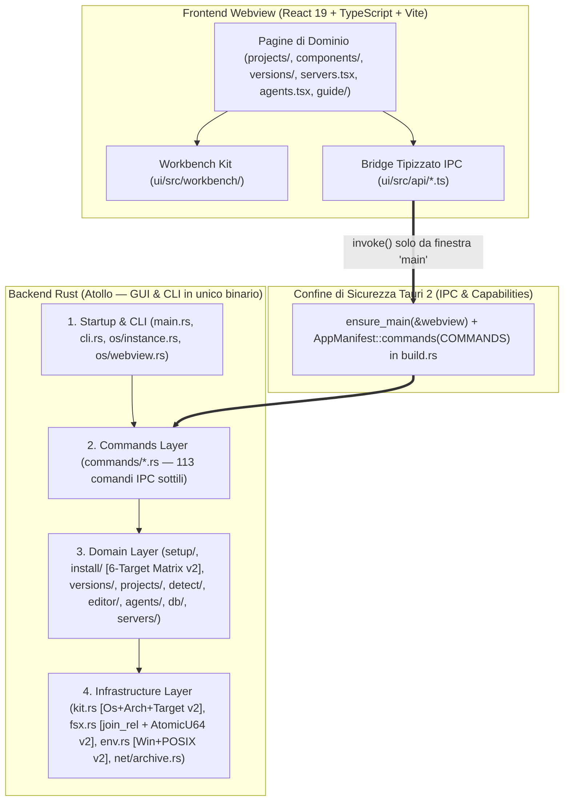

# 01 — Verifica di Architettura e Logica del Software (v2 — Confronto Evolutivo con v1)

> [!NOTE]
> Questo documento aggiorna la verifica delle **Dimensioni 1 (Architettura: da `92` a `94/100`, `+2 pt`)** e **2 (Logica: da `84` a `87/100`, `+3 pt`)** analizzando le modifiche strutturali introdotte nel repository dopo la baseline `v1` (commit `fa8a34d`).

---

## 1. Valutazione dell'Architettura (v1: `92/100` → v2: `94/100` | Delta: `+2`)

### 1.1 Architettura Stratificata e Nuovo Modello di Coabitazione Multi-Target (`v2`)

L'architettura a **4 livelli gerarchici** ([`docs/app/ARCHITECTURE.md`](file:///c:/Users/nabre/Projects/atollo/docs/app/ARCHITECTURE.md)) è stata potenziata nella `v2` al livello infrastrutturale (`L4`) e di dominio (`L3`) con l'introduzione del descrittore formale [`Target { os: Os, arch: Arch }`](file:///c:/Users/nabre/Projects/atollo/tauri/src/kit.rs#L153-L352), che rende la struttura su disco **multi-OS e multi-architettura per costruzione**:

### 1.2 Nuovi Punti di Eccellenza Architetturale Introdotti in `v2`

Oltre ai 5 pilastri già certificati in `v1` (binario dual-mode GUI+CLI, `deny(unwrap_used, expect_used)`, isolamento IPC `ensure_main`, Win32 Job Objects, separazione dati `D-89`/`D-90`), la versione `v2` introduce **3 progressi architetturali di rilievo**:

1. **Modello `Target` Unificato per 6 Piattaforme × Architetture ([`tauri/src/kit.rs:19-352`](file:///c:/Users/nabre/Projects/atollo/tauri/src/kit.rs#L19-L352))**:
   - Sostituita la vecchia assunzione `win32-<arch>` con `Os` (`Win32`, `Darwin`, `Linux`), `Arch` (`X64`, `Arm64`) e `Target` (`WIN32_X64`, `WIN32_ARM64`, `DARWIN_ARM64`, `DARWIN_X64`, `LINUX_X64`, `LINUX_ARM64`).
   - `Target` incapsula centralmente tutte le convenzioni di nomenclatura dei fornitori upstream (`rust_triple()`, `gnu_arch()`, `go_os()`, `go_arch()`, `node_os()`, `adoptium_os()`, `adoptium_arch()`, `conda_subdir()`, `micromamba_asset()`, `texlive_bin()`), eliminando stringhe magiche duplicate nei singoli installer.
   - `Kit::at_target(root, target)` ([`kit.rs:389`](file:///c:/Users/nabre/Projects/atollo/tauri/src/kit.rs#L389)) permette di istanziare e testare un `Kit` per qualsiasi sistema operativo (es. testare `DARWIN_ARM64` e `LINUX_ARM64` direttamente da un runner Windows, come dimostrato in [`test/rust/env.rs:317-363`](file:///c:/Users/nabre/Projects/atollo/test/rust/env.rs#L317-L363) e [`test/rust/setup/catalog.rs:273-329`](file:///c:/Users/nabre/Projects/atollo/test/rust/setup/catalog.rs#L273-L329)).

2. **Isolamento Multi-Host Senza Conflitti sulla Stessa Chiavetta/Unità Esterna**:
   - In `v1`, collegare lo stesso disco del kit a due sistemi operativi diversi avrebbe sovrascritto `data/app/versions/<id>.txt`, `data/app/version-lines.json` e `data/app/root.txt`.
   - In `v2`, ogni stato dipendente dal binario o dall'OS ospite è partizionato per `Target` o per `Os`:
     - Binari installati: `data/apps/<target>/` ([`kit.rs:453`](file:///c:/Users/nabre/Projects/atollo/tauri/src/kit.rs#L453));
     - Versioni installate: `data/app/versions/<target>/<id>.txt` con fallback automatico di sola lettura a `data/app/versions/<id>.txt` su `win32-x64` per retrocompatibilità totale ([`setup/catalog.rs:360-380`](file:///c:/Users/nabre/Projects/atollo/tauri/src/setup/catalog.rs#L360-L380));
     - Linee offerte dai server upstream: `data/app/version-lines-<target>.json` ([`versions/offered.rs:20-27`](file:///c:/Users/nabre/Projects/atollo/tauri/src/versions/offered.rs#L20-L27));
     - Tracciamento spostamento cartella: `root.txt` (Windows), `root-darwin.txt` (macOS), `root-linux.txt` (Linux) ([`kit.rs:518-541`](file:///c:/Users/nabre/Projects/atollo/tauri/src/kit.rs#L518-L541));
     - Directory di pacchetti/cache compilati per architettura (`data/go/bin/<target>`, `data/dotnet/<target>`, `data/julia/<target>`, `data/bun/<target>`, `data/deno/<target>`, `data/texlive/<target>`, `data/pnpm/<target>`, `data/r/<target>/%v` in [`env.rs:409-468`](file:///c:/Users/nabre/Projects/atollo/tauri/src/env.rs#L409-L468)).

3. **Traduzione Dichiarativa dei Layout Binari (`translate_rel`) senza Duplicare `components.json`**:
   - Invece di moltiplicare per 6 le voci di [`tauri/catalog/components.json`](file:///c:/Users/nabre/Projects/atollo/tauri/catalog/components.json), la funzione [`setup::catalog::translate_rel(target, rel)`](file:///c:/Users/nabre/Projects/atollo/tauri/src/setup/catalog.rs#L178-L210) traduce in modo deterministico i percorsi relativi del catalogo (`node/node.exe` → `node/bin/node`, `python/python.exe` → `python/bin/python3`, `tinytex/bin/windows/tlmgr.bat` → `tinytex/bin/<texlive_bin>/tlmgr`, `@data/npm-global/pnpm.cmd` → `@data/npm-global/bin/pnpm`, rimozione `.exe`/`.cmd`/`.bat` su Unix).

### 1.3 Criticità Architetturali Residue in `v2` (Confronto con `v1`)

| Criticità Architetturale (`v1`) | Stato in `v2` | Dettaglio Tecnico |
| :--- | :---: | :--- |
| **1. Dipendenze Win32 nei moduli di dominio** | **Parzialmente Risolto** | `setup/runner.rs`, `setup/checkup.rs`, `install/native.rs`, `install/mod.rs` e `versions/side_by_side.rs` sono ora protetti da `#[cfg(windows)]` / `#[cfg(not(windows))]`. Restano ancora da astrarre dietro `#[cfg(unix)]`: `tauri/Cargo.toml` (dipendenze globali `windows`, `webview2-com`, `junction`), `tauri/src/os/*`, `agents/keyring.rs`, `editor/wterm.rs`, `editor/window.rs` e le 3 chiamate dirette a `icacls.exe`. |
| **2. Stato monolitico in `App.tsx` e bundle non code-splittato** | **Aperto** | `ui/src/App.tsx` importa ancora staticamente `GuidePage` (`~155 KB` di sorgenti) e tutti i Web Components in `workbench/elements.ts`. |
| **3. Dualismo tra `projects/run.rs` e Pool Server (`servers/mod.rs`)** | **Aperto** | L'avvio dalla scheda Progetto lancia ancora istanze dedicate `httpd.exe`/`nginx.exe` anziché delegare ai Pool Server Condivisi (`WebServers`). |

---

## 2. Valutazione della Logica di Dominio (v1: `84/100` → v2: `87/100` | Delta: `+3`)

### 2.1 Progressi Logici Verificati in `v2`

| Sottosistema | Stato `v1` | Stato `v2` | Miglioramento Logico Implementato |
| :--- | :---: | :---: | :--- |
| **Scrittura Atomica Thread-Safe (`fsx.rs`)** | 74 / 100 (`BUG-02`) | **98 / 100 (Risolto)** | [`fsx::write_atomic`](file:///c:/Users/nabre/Projects/atollo/tauri/src/fsx.rs#L79-L88) combina ora `std::process::id()` con un contatore atomico monotono `static TMP_SEQ: AtomicU64` e usa `with_file_name(format!("{name}.tmp-{}-{seq}", ...))`, eliminando qualsiasi collisione tra thread concorrenti o tra file con lo stesso stem (`foo.json` vs `foo.toml`). |
| **Unioni di Path Cross-OS (`fsx::join_rel` & `archive::safe_join`)** | Fragile su Unix | **100 / 100 (Risolto)** | Eliminato l'anti-pattern `.replace('/', "\\")` (che su Linux/macOS creava nomi file con backslash letterali) a favore di [`fsx::join_rel`](file:///c:/Users/nabre/Projects/atollo/tauri/src/fsx.rs#L24-L32) e [`archive::safe_join`](file:///c:/Users/nabre/Projects/atollo/tauri/src/net/archive.rs#L50-L67). |
| **Costruzione Ambiente `KitEnv` (`env.rs`)** | Solo Windows (`;`) | **97 / 100 (Multi-OS)** | [`KitEnv::build`](file:///c:/Users/nabre/Projects/atollo/tauri/src/env.rs#L249-L690) genera ora `PATH` con separatore `:` su Unix, imposta `XDG_CONFIG_HOME`, `XDG_CACHE_HOME`, `XDG_DATA_HOME`, `XDG_STATE_HOME` e `TMPDIR`, mappa `node/bin`, `python/bin`, `php/bin`, `nginx/sbin`, `npm-global/bin` e include [`split_path`](file:///c:/Users/nabre/Projects/atollo/tauri/src/env.rs#L223-L243) capace di distinguere il separatore `:` dai prefissi di unità `C:\` nei test cross-target. |
| **Side-by-Side `.NET` e Shell `bashrc`** | Solo Windows | **96 / 100 (Multi-OS)** | [`versions/side_by_side.rs:126-165`](file:///c:/Users/nabre/Projects/atollo/tauri/src/versions/side_by_side.rs#L126-L165) usa symlink POSIX su Unix e junction NTFS su Windows; [`runtime/bashrc`](file:///c:/Users/nabre/Projects/atollo/runtime/bashrc#L16-L22) usa `cygpath -u` solo se presente, funzionando nativamente su macOS e Linux. |

### 2.2 Flussi Logici Ancora Difettosi o Fragili in `v2`

1. **Anomalie dei Pool Server (invariate rispetto a `v1`)**:
   - [`WebServers::list()`](file:///c:/Users/nabre/Projects/atollo/tauri/src/servers/mod.rs#L337-L512) continua a eseguire `detect::detect` su tutte le cartelle in `projects\` e a salvare `servers.json` ad ogni tick del polling UI (ogni 3 secondi, `BUG-07`);
   - [`WebServers::start()`](file:///c:/Users/nabre/Projects/atollo/tauri/src/servers/mod.rs#L715-L740) continua a restituire `Ok(())` anche se `httpd.exe`/`nginx.exe` muore subito o la porta non risponde dopo 6 secondi (`BUG-03`), senza lock di avvio per-pool (`BUG-04`);
   - [`projects/nginx.rs:213-228`](file:///c:/Users/nabre/Projects/atollo/tauri/src/projects/nginx.rs#L213-L228) continua a impostare `PHP_FCGI_MAX_REQUESTS=500` scartando l'handle `Child` di `php-cgi.exe` (`BUG-05`).
2. **Nuove Imprecisioni Logiche negli Installer Unix introdotti in `fa8a34d` (`BUG-22`, `BUG-23`, `BUG-24`)**:
   - Dettagliate nel [Documento 03](file:///c:/Users/nabre/Projects/atollo/reports/v2/03-BUG-SICUREZZA-E-FUNZIONALITA-MANCANTI.md) e nel [Documento 06](file:///c:/Users/nabre/Projects/atollo/reports/v2/06-PIANO-MATRICE-DOWNLOAD-E-FILE-MULTIPIATTAFORMA.md): `Git` Unix passa `Kind::Zip` a un pacchetto `.tar.bz2`, `Nginx` Unix scarica il tarball dei sorgenti C anziché un binario precompilato, e `extract_tar_xz` invoca `tar -xJf` senza pre-validazione `safe_join`.
