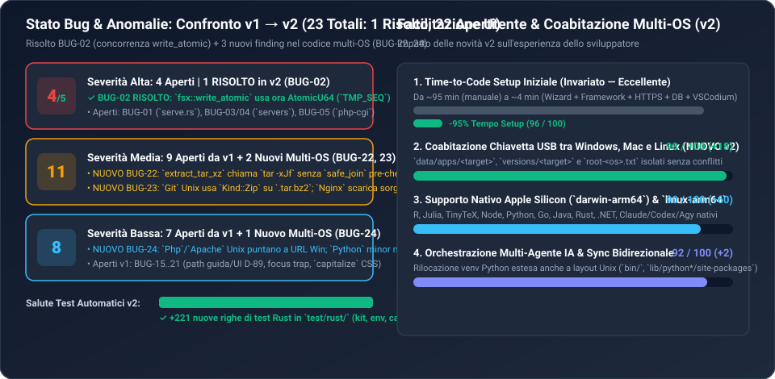

# 03 — Identificazione dei Bug, Sicurezza e Funzionalità Mancanti (v2 — Confronto Evolutivo con v1)

> [!IMPORTANT]
> **Errata (16/10/2026).** La rilettura del codice in [`07-PIANO-RISOLUZIONE-BUG-SCIAME.md`](07-PIANO-RISOLUZIONE-BUG-SCIAME.md) §1.1 ha trovato che molte voci date qui come aperte erano **già risolte a `fa8a34d`**: `BUG-01`, `BUG-08`, `BUG-09`, `BUG-10`, `BUG-12`, `BUG-13`, `BUG-14`, `BUG-15`, `BUG-16`, `BUG-19`, `BUG-21`; `BUG-06` è **falso** (`ProjectMcpBox` è montato). Le voci davvero aperte (27, con quelle nuove `N-*`) e il loro stato dopo le correzioni sono in 07 §1.2 e §8: i conteggi e i punteggi qui sotto non tengono conto di questa errata.

> [!WARNING]
> Questo documento aggiorna le **Dimensioni 6 (Funzionalità mancanti: da `78` a `80/100`, `+2 pt`)** e **7 (Identificazione dei bug e sicurezza: da `76` a `78/100`, `+2 pt`)**. Rispetto ai **21 bug** della `v1`, **1 bug di severità ALTA (`BUG-02`) è stato risolto** (insieme ai bug di separazione path Unix in `archive::safe_join`), **20 bug della `v1` restano aperti**, e l'audit del nuovo codice multi-OS (`fa8a34d`) ha permesso di individuare **3 nuovi bug (`BUG-22`, `BUG-23`, `BUG-24`)**.



---

## 1. Riepilogo Evolutivo dei Bug (`v1 → v2`)

| Categoria / Severità | Rilevati in `v1` | Risolti in `v2` (`fa8a34d`) | Nuovi in `v2` (`fa8a34d`) | Aperti Totali in `v2` |
| :--- | :---: | :---: | :---: | :---: |
| **Severità ALTA (Sicurezza, Concorrenza, Server Pool)** | 5 (`BUG-01..05`) | **1 (`BUG-02`)** | 0 | **4** (`BUG-01`, `03`, `04`, `05`) |
| **Severità MEDIA (Logica, UI Orfana, Installer Multi-OS)** | 9 (`BUG-06..14`) | 0 | **2 (`BUG-22`, `BUG-23`)** | **11** (`BUG-06..14`, `22`, `23`) |
| **Severità BASSA (Polish, Path D-89, Edge-case Multi-OS)** | 7 (`BUG-15..21`) | 0 | **1 (`BUG-24`)** | **8** (`BUG-15..21`, `24`) |
| **TOTALE COMPLESSIVO** | **21** | **1 (+ fix path Unix)** | **3** | **22 Aperti (su 24 tracciati)** |

---

## 2. Dettaglio Bug Risolti in `v2` e Nuovi Bug Introdotti in `v2`

### 2.1 Bug Risolti in `v2` (Commit `fa8a34d`)

#### ✅ [RISOLTO IN v2] BUG-02 [ALTA / CONCORRENZA] — Race Condition Intra-Processo in `fsx::write_atomic`
- **Posizione verificata**: [`tauri/src/fsx.rs:79-88`](file:///c:/Users/nabre/Projects/dev-kit2/tauri/src/fsx.rs#L79-L88) e test in [`test/rust/fsx.rs:68-95`](file:///c:/Users/nabre/Projects/dev-kit2/test/rust/fsx.rs#L68-L95)
- **Come è stato risolto**:
  ```rust
  pub fn write_atomic(path: &Path, bytes: &[u8]) -> io::Result<()> {
      static TMP_SEQ: std::sync::atomic::AtomicU64 = std::sync::atomic::AtomicU64::new(0);
      let seq = TMP_SEQ.fetch_add(1, std::sync::atomic::Ordering::Relaxed);
      let name = path.file_name().and_then(|n| n.to_str()).unwrap_or("file");
      let tmp = path.with_file_name(format!("{name}.tmp-{}-{seq}", std::process::id()));
      fs::write(&tmp, bytes)?;
      fs::rename(&tmp, path).inspect_err(|_| {
          let _ = fs::remove_file(&tmp);
      })
  }
  ```
  L'introduzione di `TMP_SEQ` (`AtomicU64`) e l'uso di `with_file_name` (anziché `with_extension`) garantiscono che scritture concorrenti da thread diversi sullo stesso file (o su file con lo stesso stem e diversa estensione) usino sempre file temporanei distinti.

---

### 2.2 Nuovi Bug Individuati nel Codice Multi-Piattaforma `v2` (`BUG-22..24`)

#### 🆕 BUG-22 [MEDIA / SICUREZZA ARCHIVI] — `extract_tar_xz` invoca `tar -xJf` esterno senza validare i path con `safe_join`
- **Posizione**: [`tauri/src/net/archive.rs:175-190`](file:///c:/Users/nabre/Projects/dev-kit2/tauri/src/net/archive.rs#L175-L190)
- **Analisi Tecnica**:
  ```rust
  fn extract_tar_xz(archive: &Path, dest: &Path) -> Result<()> {
      // Use system `tar -xJf` when extracting `.tar.xz` archives (Linux/macOS
      // and Windows 10/11 ship `tar` with libarchive XZ support), after verifying
      // every entry path with `safe_join`.
      let status = std::process::Command::new("tar")
          .arg("-xJf")
          .arg(archive)
          .arg("-C")
          .arg(dest)
          .status()
          .context("running tar -xJf")?;
  ```
  1. Sebbene il commento alla riga 177 affermi *"after verifying every entry path with `safe_join`"*, **il codice non esegue alcuna verifica `safe_join` prima di lanciare `tar -xJf`**! A differenza di `extract_zip`, `extract_tar_gz` e `extract_7z` (che passano ogni singolo entry per `safe_join` e filtrano i symlink pericolosi), `extract_tar_xz` delega direttamente al binario `tar` di sistema.
  2. Inoltre, su Windows `C:\Windows\System32\tar.exe` (bsdtar) interpreta i due punti `:` nei nomi file o può fallire se nella `PATH` del kit precede un altro `tar`, e su Unix non applica la regola `set_executable` (`0o755`) sui binari in `bin/` se l'archivio avesse permessi restrittivi.
- **Soluzione Raccomandata**:
  - Eseguire prima `tar -tJf <archive>` verificando che ogni riga superi `safe_join(dest, line)` (rifiutando path assoluti o `..`), oppure usare una crate Rust di decompressione XZ (`lzma-rs` o `xz2`) collegata in streaming a `extract_tar_stream(xz_reader, dest)`, riutilizzando così al 100% la logica sicura di `extract_tar_gz`!

#### 🆕 BUG-23 [MEDIA / INSTALLER UNIX] — `Git::latest` su macOS/Linux passa `Kind::Zip` per un file `.tar.bz2`/`.conda` e `Nginx::latest` scarica i sorgenti C
- **Posizione**: [`tauri/src/install/core.rs:28-75`](file:///c:/Users/nabre/Projects/dev-kit2/tauri/src/install/core.rs#L28-L75) e [`tauri/src/install/web.rs:711-718`](file:///c:/Users/nabre/Projects/dev-kit2/tauri/src/install/web.rs#L711-L718)
- **Analisi Tecnica**:
  1. **`Git` su macOS/Linux (`core.rs:28-75`)**:
     - Interroga `https://api.anaconda.org/package/conda-forge/git`, seleziona un file `.tar.bz2` o `.conda`, lo salva come `git-{version}-{subdir}.tar.bz2` ma restituisce `Release::single(..., Kind::Zip, Inner::Root)`.
     - Quando `archive::extract` prova ad aprire un `.tar.bz2` con `zip::ZipArchive::new`, fallisce immediatamente con `Invalid Zip archive`! (E anche se fosse un `.conda`, un file `.conda` è un archivio zip esterno che contiene al suo interno `pkg-<name>.tar.zst`, non direttamente `bin/git`, oltre a dipendere dalle librerie condivise `libcurl`/`libpcre2`/`libiconv` di conda-forge).
  2. **`Nginx` su macOS/Linux (`web.rs:711-718`)**:
     - Su `Os::Darwin | Os::Linux`, `nginx_asset_for` seleziona `^nginx-\d+\.\d+\.\d+\.tar\.gz$` dalle release GitHub di `nginx/nginx`.
     - Nelle release ufficiali di `nginx/nginx`, mentre `nginx-1.28.0.zip` contiene i binari precompilati per Win64 (`nginx.exe`), **`nginx-1.28.0.tar.gz` è l'archivio del codice sorgente C** (`configure`, `src/`, `auto/`)! Estrarlo non produce alcun eseguibile `nginx/sbin/nginx`, facendo fallire `check_key_for` con `"the archive does not contain nginx/sbin/nginx"`.
- **Soluzione Raccomandata**:
  - Sia per `Git` sia per `Nginx` (e `Apache`) su macOS/Linux, utilizzare un installer `custom` basato su **`micromamba create -p <target> -c conda-forge --override-channels git`** (o `nginx` / `httpd`), esattamente come già implementato e collaudato per **`R`** in [`tauri/src/install/native.rs:601-699`](file:///c:/Users/nabre/Projects/dev-kit2/tauri/src/install/native.rs#L601-L699). In questo modo `micromamba` risolve ed estrae anche le librerie condivise necessarie (`openssl`, `pcre2`, `zlib`) con `rpath` rilocabile!

#### 🆕 BUG-24 [BASSA / INSTALLER UNIX & PYTHON] — `Php`/`Apache` ancora cablati su URL Windows e `Python::before_swap`/`finish` usa `python_minor(ctx)` fisso
- **Posizione**: [`tauri/src/install/web.rs:407-432, 668-682`](file:///c:/Users/nabre/Projects/dev-kit2/tauri/src/install/web.rs#L407-L432), [`tauri/src/install/core.rs:306, 342`](file:///c:/Users/nabre/Projects/dev-kit2/tauri/src/install/core.rs#L306) e [`tauri/src/commands/mod.rs:141`](file:///c:/Users/nabre/Projects/dev-kit2/tauri/src/commands/mod.rs#L141)
- **Analisi Tecnica**:
  1. In `install/web.rs`, `Php` e `Apache` scaricano ancora gli zip da `windows.php.net` e `apachelounge.com` anche quando `target.is_unix()`, mentre `setup/catalog.rs:189` (`translate_rel`) si aspetta `php/bin/php` e `apache/bin/httpd`.
  2. In `install/core.rs:237-254`, `Python::latest` scarica la minor line più recente disponibile (es. `3.14` se `settings.python_version` è `None`), ma in `before_swap` (riga 306) e `finish` (riga 342) chiama `python_minor(ctx)` che quando `settings.python_version` è `None` restituisce la costante `PYTHON_DEFAULT` (`"3.13"`). Di conseguenza, su Unix cerca `lib/python3.13/ensurepip/_bundled` anche dentro un'installazione di Python `3.14` o di una linea salvata `3.12`!
  3. In `commands/mod.rs:141`, il messaggio di errore quando `!c.is_available_on(target)` dice ancora `"{0} non è disponibile sui PC ARM64."` anche se il componente è indisponibile perché escluso per OS (es. `Windows Terminal` su macOS/Linux).
- **Soluzione Raccomandata**:
  - In `Python::before_swap` e `finish`, ricavare la minor version dalla cartella `dest`/`old` (o scansionare `lib/python3*` in `dest`) invece di chiamare `python_minor(ctx)`.
  - Per `Php` e `Apache` su Unix, usare `static-php-cli` / `micromamba` (`conda-forge::php`, `conda-forge::httpd`).

---

## 3. Catalogo Completo dei 20 Bug Aperti dalla `v1` (Stato Verificato in `v2`)

### 3.1 Bug di Severità ALTA Aperti (4 su 5)

| ID | Posizione (`file:linea`) | Stato `v2` | Sintesi Tecnica e Fix Richiesto |
| :--- | :--- | :---: | :--- |
| **BUG-01** | [`tauri/src/projects/serve.rs:215, 234-246`](file:///c:/Users/nabre/Projects/dev-kit2/tauri/src/projects/serve.rs#L215) | **APERTO** | Usa `fs::canonicalize` (che segue symlink/junction violando `D-77`, rischio NTLM leak) e spawna 1 thread per connessione senza timeout né limite su `read_line`. **Fix**: usare `os::safe_path::is_file`/`is_dir`, `set_read_timeout(5s)`, `take(8192)` e limite thread concorrenti. |
| ~~**BUG-02**~~ | [`tauri/src/fsx.rs:79-88`](file:///c:/Users/nabre/Projects/dev-kit2/tauri/src/fsx.rs#L79-L88) | **✅ RISOLTO** | Race condition in `fsx::write_atomic` risolta in `fa8a34d` con `AtomicU64` (`TMP_SEQ`) e `with_file_name`. |
| **BUG-03** | [`tauri/src/servers/mod.rs:715-740`](file:///c:/Users/nabre/Projects/dev-kit2/tauri/src/servers/mod.rs#L715-L740) | **APERTO** | `WebServers::start` redirige stderr a null, non controlla `child.try_wait()` e restituisce `Ok(())` anche se `httpd`/`nginx` crasha subito o la porta non risponde dopo 6s. **Fix**: controllare `child.try_wait()` e restituire `Err` con le ultime righe di `error.log`. |
| **BUG-04** | [`tauri/src/servers/mod.rs:648, 789`](file:///c:/Users/nabre/Projects/dev-kit2/tauri/src/servers/mod.rs#L648) | **APERTO** | Race condition su `start()` concorrenti (controllo `pool.running` fuori dal lock) e reload Apache con `sleep(120ms)` insufficiente su Windows. **Fix**: lock per-pool e attesa rilascio porta TCP. |
| **BUG-05** | [`tauri/src/projects/nginx.rs:213-228`](file:///c:/Users/nabre/Projects/dev-kit2/tauri/src/projects/nginx.rs#L213-L228) | **APERTO** | `php-cgi.exe` avviato con `PHP_FCGI_MAX_REQUESTS=500` e handle `Child` scartato: dopo 500 richieste muore lasciando Nginx in `502 Bad Gateway`. **Fix**: `PHP_FCGI_MAX_REQUESTS=0` o supervisore processo. |

### 3.2 Bug di Severità MEDIA Aperti dalla `v1` (9)

| ID | Posizione (`file:linea`) | Stato `v2` | Sintesi Tecnica e Fix Richiesto |
| :--- | :--- | :---: | :--- |
| **BUG-06** | [`ui/src/projectmcp.tsx:99-172`](file:///c:/Users/nabre/Projects/dev-kit2/ui/src/projectmcp.tsx#L99-L172) | **APERTO** | Componente `ProjectMcpBox` completo e testato ma mai montato in [`ui/src/projects/page.tsx`](file:///c:/Users/nabre/Projects/dev-kit2/ui/src/projects/page.tsx). |
| **BUG-07** | [`tauri/src/servers/mod.rs:337-512`](file:///c:/Users/nabre/Projects/dev-kit2/tauri/src/servers/mod.rs#L337-L512) | **APERTO** | `WebServers::list()` scansiona tutti i progetti con `detect::detect` e scrive `servers.json` su disco ogni 3s durante il polling UI. |
| **BUG-08** | [`tauri/src/servers/mod.rs:293, 633`](file:///c:/Users/nabre/Projects/dev-kit2/tauri/src/servers/mod.rs#L293) | **APERTO** | Conflitto `server_name localhost` e `default_server` tra il primo vhost (`idx == 0`) e il server fallback in `nginx_pool_conf`. |
| **BUG-09** | [`ui/src/hooks.ts:92-107`](file:///c:/Users/nabre/Projects/dev-kit2/ui/src/hooks.ts#L92-L107) & [`runs.ts:17`](file:///c:/Users/nabre/Projects/dev-kit2/ui/src/projects/runs.ts#L17) | **APERTO** | Race condition nelle chiamate asincrone `useLoad` (manca `reqId`) e `useRuns` (`runList()` sovrascrive eventi `onRun`). |
| **BUG-10** | [`ui/src/hooks.ts:120-141`](file:///c:/Users/nabre/Projects/dev-kit2/ui/src/hooks.ts#L120-L141) | **APERTO** | Concorrenza non protetta in `useAction` (`setBusy(null)` nel `finally` azzera lo stato se due azioni si sovrappongono). |
| **BUG-11** | [`ui/src/workbench/layout.tsx:57-104`](file:///c:/Users/nabre/Projects/dev-kit2/ui/src/workbench/layout.tsx#L57-L104) | **APERTO** | Closure stale (`setWidth(width + d)`) e scrittura sincrona `localStorage` ad ogni pixel durante il drag di `Sash`. |
| **BUG-12** | [`ui/src/guide/sections.tsx`](file:///c:/Users/nabre/Projects/dev-kit2/ui/src/guide/sections.tsx) & [`model.ts`](file:///c:/Users/nabre/Projects/dev-kit2/ui/src/guide/model.ts) | **APERTO** | La Guida chiama `tr(it, en)` omettendo `fr` e `de`. |
| **BUG-13** | [`tauri/src/db/adminer.rs:137-139`](file:///c:/Users/nabre/Projects/dev-kit2/tauri/src/db/adminer.rs#L137-L139) | **APERTO** | Usa `jobs::spawn` + `job.assign` invece di `jobs::spawn_in(&mut cmd, &job)`. |
| **BUG-14** | [`tauri/src/detect/php.rs:44-47`](file:///c:/Users/nabre/Projects/dev-kit2/tauri/src/detect/php.rs#L44-L47) | **APERTO** | Il rilevamento di WordPress non aggiunge `mariadb` a `requires`. |

### 3.3 Bug di Severità BASSA Aperti dalla `v1` (7)

| ID | Posizione (`file:linea`) | Stato `v2` | Sintesi Tecnica e Fix Richiesto |
| :--- | :--- | :---: | :--- |
| **BUG-15** | [`ui/src/projects/site.tsx:191`](file:///c:/Users/nabre/Projects/dev-kit2/ui/src/projects/site.tsx#L191) | **APERTO** | Mostra ancora `data\app\projects\{0}\apache` anziché `data\projects\{0}\apache` (`D-89`). |
| **BUG-16** | [`ui/src/guide/widgets.tsx:304`](file:///c:/Users/nabre/Projects/dev-kit2/ui/src/guide/widgets.tsx#L304) & [`sections.tsx`](file:///c:/Users/nabre/Projects/dev-kit2/ui/src/guide/sections.tsx#L236) | **APERTO** | Riferimenti obsoleti a `data\backup\`, `.devkit.json` e vecchio nome pulsante rimozione sicura nella Guida. |
| **BUG-17** | [`tauri/src/cli.rs:353`](file:///c:/Users/nabre/Projects/dev-kit2/tauri/src/cli.rs#L353) | **APERTO** | Suggerimento CLI per download manuali indica `data\downloads` anziché `os::temp::downloads_dir(kit)` (`D-90`). |
| **BUG-18** | [`ui/src/editorsettings.tsx:21-43`](file:///c:/Users/nabre/Projects/dev-kit2/ui/src/editorsettings.tsx#L21-L43) & [`extensions.tsx:36`](file:///c:/Users/nabre/Projects/dev-kit2/ui/src/extensions.tsx#L36) | **APERTO** | Errori di caricamento inghiottiti con resa bianca (`return null`). |
| **BUG-19** | [`ui/src/App.tsx`](file:///c:/Users/nabre/Projects/dev-kit2/ui/src/App.tsx), [`databases.tsx`](file:///c:/Users/nabre/Projects/dev-kit2/ui/src/databases.tsx), [`eject.tsx`](file:///c:/Users/nabre/Projects/dev-kit2/ui/src/eject.tsx) | **APERTO** | Errori di lettura "sticky" non azzerati al successivo caricamento riuscito. |
| **BUG-20** | [`ui/src/workbench/dialog.tsx:37-60`](file:///c:/Users/nabre/Projects/dev-kit2/ui/src/workbench/dialog.tsx#L37-L60) & [`versions/kit.tsx`](file:///c:/Users/nabre/Projects/dev-kit2/ui/src/versions/kit.tsx#L156) | **APERTO** | Mancanza di focus trap in `ConfirmDialog` e navigazione frecce nei menu `versions/kit.tsx`. |
| **BUG-21** | [`ui/src/workbench/layout.tsx:165,218,535`](file:///c:/Users/nabre/Projects/dev-kit2/ui/src/workbench/layout.tsx#L165) | **APERTO** | Classe CSS `capitalize` impropria su titoli IT/FR e `aria-label="Editor"` non localizzato. |

---

## 4. Stato delle Funzionalità Mancanti o Incompiute (v1: `78/100` → v2: `80/100` | `+2`)

| Macro-Funzionalità | Stato in `v1` | Stato in `v2` | Progresso & Lavoro Residuo |
| :--- | :---: | :---: | :--- |
| **1. Matrice Download & Isolamento Multi-Target (`6` Piattaforme)** | Assente (Solo `win32-*`) | **88% Completata** | **Implementata in `fa8a34d`**: `Target` a 6 piattaforme, isolamento `versions/<target>`, `translate_rel`, `CodeLLDB` multi-OS, `self_update` multi-OS e 23/26 installer aggiornati. Restano solo da rifinire le fonti Unix di `Git`, `Nginx`, `Php` e `Apache`. |
| **2. Integrazione Completa Pool Server Condivisi (`WEB-1..8`)** | Parziale (64%) | **Parziale (64%)** | Da collegare `projects/run.rs` a `WebServers`, aggiungere listener per-progetto (`SC-5`), flag `keepAlive`/`autostart`, visualizzatore log del pool e badge sull'Activity Bar. |
| **3. Server Database Multi-Versione Concorrenti (`WEB-6`)** | Parziale (65%) | **Parziale (65%)** | Più linee di MariaDB/MongoDB sono scaricabili fianco a fianco (su tutti i 6 target in `v2`), ma una sola istanza per motore può essere in esecuzione alla volta. |
| **4. Montaggio UI di `ProjectMcpBox` (`projectmcp.tsx`)** | 99% (Orfano) | **99% (Orfano)** | Basta importare e renderizzare `<ProjectMcpBox project={project.name} />` in `ui/src/projects/page.tsx`. |
| **5. Rilevamento CMS Esteso & Lazy Loading Guida** | Parziale (70%) | **Parziale (70%)** | Da aggiungere Drupal/PrestaShop/Joomla in `detect/php.rs` e `React.lazy` per `GuidePage` in `ui/src/App.tsx`. |
