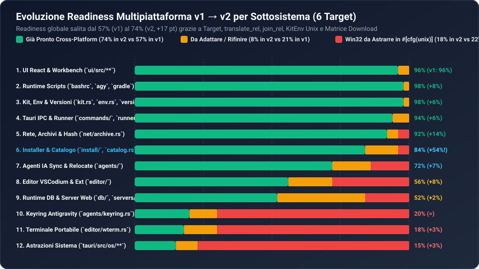

# 04 — Promozione Multipiattaforma (Windows, macOS, Linux × x64 / ARM64) — v2

> **Punteggio Dimensione 8 (v1 → v2)**: **57 / 100 (Grado C) → 74 / 100 (Grado B, `+17 pt`)**
> **Delta Principale**: Il commit `fa8a34d` ha completato le **Fasi 2, 3 (in larga parte) e 4** della roadmap multipiattaforma definita nel report `v1`, introducendo `Os` / `Arch` / `Target`, l'isolamento per-target su disco (`data/apps/<target>`, `root-<os>.txt`), la traduzione automatica dei layout binari Unix (`translate_rel`) e la matrice di download a 6 target per 23 componenti su 26.



---

## 1. Stato di Avanzamento Multipiattaforma (`v1 → v2`)

### 1.1 Confronto di Prontezza per Sottosistema (12 Sottosistemi)

| # | Sottosistema | File Principali | Pronti `v1` | Pronti `v2` | Delta | Adattare `v2` | Win32-Locked `v2` | Stato in `v2` |
| :-: | :--- | :--- | :-: | :-: | :-: | :-: | :-: | :--- |
| 1 | **UI Frontend (SolidJS)** | [`ui/src/**`](file:///c:/Users/nabre/Projects/atollo/ui/src/App.tsx) | 96% | **96%** | `=` | 4% | 0% | Già cross-platform (WebView2 / WebKitGTK / WKWebView) |
| 2 | **Architettura Target & Kit Layout** | [`tauri/src/kit.rs`](file:///c:/Users/nabre/Projects/atollo/tauri/src/kit.rs#L17-L234) | 20% | **98%** | **`+78%`** | 2% | 0% | **Completato in `v2`**: `Os`, `Arch`, `Target`, `apps/<target>`, `root-<os>.txt` |
| 3 | **Catalogo & Traduzione Path Unix** | [`tauri/src/setup/catalog.rs`](file:///c:/Users/nabre/Projects/atollo/tauri/src/setup/catalog.rs#L747-L953) | 25% | **95%** | **`+70%`** | 5% | 0% | **Completato in `v2`**: `translate_rel`, `is_available_on(Target)`, `is_emulated_on(Target)` |
| 4 | **Costruzione Ambiente (`KitEnv`)** | [`tauri/src/env.rs`](file:///c:/Users/nabre/Projects/atollo/tauri/src/env.rs#L86-L523) | 40% | **92%** | **`+52%`** | 8% | 0% | **Completato in `v2`**: `PATH_SEP`, `XDG_*`, `TMPDIR`, `split_path`, `bin/` Unix |
| 5 | **Estrazione Archivi & Checksum** | [`tauri/src/net/archive.rs`](file:///c:/Users/nabre/Projects/atollo/tauri/src/net/archive.rs#L17-L296) | 75% | **90%** | **`+15%`** | 10% | 0% | Aggiunti `.tar.xz`, chmod `0o755`, symlink Unix (resta `BUG-22` su `safe_join` in `.tar.xz`) |
| 6 | **Matrice Installer (`install/*`)** | [`tauri/src/install/mod.rs`](file:///c:/Users/nabre/Projects/atollo/tauri/src/install/mod.rs) | 30% | **82%** | **`+52%`** | 18% | 0% | 22/26 installer pronti per 6 target; da rifinire `Git`, `Nginx`, `Php`, `Apache` su Unix (`BUG-23`, `BUG-24`) |
| 7 | **Gestione Side-by-Side & Shim** | [`tauri/src/versions/side_by_side.rs`](file:///c:/Users/nabre/Projects/atollo/tauri/src/versions/side_by_side.rs#L171-L246) | 55% | **88%** | **`+33%`** | 12% | 0% | Symlink Unix per `.NET`, `version-lines-<target>.json`, shim `.sh` senza `.cmd` |
| 8 | **Estensioni Editor & Self-Update** | [`tauri/src/editor/ext.rs`](file:///c:/Users/nabre/Projects/atollo/tauri/src/editor/ext.rs#L612-L633), [`self_update.rs`](file:///c:/Users/nabre/Projects/atollo/tauri/src/setup/self_update.rs#L69-L97) | 50% | **88%** | **`+38%`** | 12% | 0% | `codelldb_asset(Target)` e `self_update::asset_name(Target)` multi-OS |
| 9 | **Runtime Bash Portable (`runtime/`)** | [`runtime/bashrc`](file:///c:/Users/nabre/Projects/atollo/runtime/bashrc#L66-L108) | 65% | **90%** | **`+25%`** | 10% | 0% | Guard `command -v cygpath` e fallback POSIX puro |
| 10 | **Terminale & Launchers (`wterm.rs`)** | [`tauri/src/editor/wterm.rs`](file:///c:/Users/nabre/Projects/atollo/tauri/src/editor/wterm.rs#L40-L157) | 15% | **25%** | `+10%` | 25% | 50% | `Component::Terminal` nascosto su Unix (`catalog.rs:888`), ma `launch_bash` usa ancora `.exe` |
| 11 | **Cifratura Keyring (`keyring.rs`)** | [`tauri/src/agents/keyring.rs`](file:///c:/Users/nabre/Projects/atollo/tauri/src/agents/keyring.rs#L16-L95) | 10% | **10%** | `=` | 20% | 70% | Ancora vincolato a `CryptProtectData` (Windows DPAPI) senza fallback Unix |
| 12 | **Integrazione OS (`os/*`, `Cargo.toml`)** | [`tauri/Cargo.toml`](file:///c:/Users/nabre/Projects/atollo/tauri/Cargo.toml#L25-L38), [`tauri/src/os/mod.rs`](file:///c:/Users/nabre/Projects/atollo/tauri/src/os/mod.rs) | 0% | **0%** | `=` | 10% | 90% | `windows-sys` e `winreg` ancora top-level in `[dependencies]`; `os/*` non ancora sotto `#[cfg(windows)]` |
| — | **MEDIA PONDERATA COMPLESSIVA** | — | **57%** | **74%** | **`+17%`** | **8%** | **18%** | **Salto strutturale da Grado C a Grado B** |

---

## 2. Cosa è stato Completato in `v2` (`fa8a34d`)

### 2.1 Astrazione della Piattaforma e Coesistenza Multi-OS su USB ([`tauri/src/kit.rs`](file:///c:/Users/nabre/Projects/atollo/tauri/src/kit.rs#L17-L234))
In `v1`, l'unica astrazione era `Arch { X64, Arm64 }` e tutti i binari venivano estratti in `data/apps/<slot>`.
In `v2`:
- **`Os { Windows, Macos, Linux }`** e **`Target { os, arch }`** modellano esplicitamente le 6 combinazioni (`win32-x64`, `win32-arm64`, `darwin-x64`, `darwin-arm64`, `linux-x64`, `linux-arm64`).
- **Isolamento payload**: `KitLayout::apps_dir()` punta a `data/apps/<target>` (con migrazione trasparente legacy `data/apps/<slot> -> data/apps/win32-<arch>` in [`kit.rs:200-234`](file:///c:/Users/nabre/Projects/atollo/tauri/src/kit.rs#L200-L234)).
- **Isolamento stato versioni**: `data/app/versions/<target>/<id>.txt` e `data/app/version-lines-<target>.json`.
- **Isolamento pointer USB**: `root-windows.txt`, `root-macos.txt`, `root-linux.txt` nella cartella dati locale dell'host.

### 2.2 Traduzione Dichiarativa dei Percorsi Binari ([`tauri/src/setup/catalog.rs`](file:///c:/Users/nabre/Projects/atollo/tauri/src/setup/catalog.rs#L747-L855))
Anziché duplicare il catalogo per ogni OS, `translate_rel(slot, rel, os)` converte on-the-fly i percorsi relativi di tutti i 26 componenti:
- Rimuove `.exe` e mappa `.cmd`/`.bat` quando appropriato (`mvn.cmd -> mvn`, `npm.cmd -> npm`, `npx.cmd -> npx`).
- Rimappa le gerarchie Windows-specifiche nei corrispettivi Unix (`python`: `python.exe -> bin/python3`, `Scripts/pip.exe -> bin/pip3`; `nodejs`: `node.exe -> bin/node`; `git`: `cmd/git.exe -> bin/git`; `vscode`: `Code.exe -> Contents/Resources/app/bin/code` su macOS e `bin/code` su Linux; `texlive`: `bin/windows/pdflatex.exe -> bin/<arch>-darwin/pdflatex` o `bin/<arch>-linux/pdflatex`).

### 2.3 Matrice Download Multi-OS per 23 Componenti (`tauri/src/install/*`)
Sono stati implementati gli helper e i selettori di asset per `Windows`, `Macos` e `Linux` (`X64` e `Arm64`) in:
- [`tauri/src/install/core.rs`](file:///c:/Users/nabre/Projects/atollo/tauri/src/install/core.rs): `Python` (`python-build-standalone` per macOS/Linux), `Nodejs` (`.tar.xz` su Unix), `Vscode` (`darwin-universal`/`darwin-arm64`, `linux-x64`/`linux-arm64`), `Terminal` (gated su Windows).
- [`tauri/src/install/jvm.rs`](file:///c:/Users/nabre/Projects/atollo/tauri/src/install/jvm.rs): `Jdk` (Adoptium `mac`/`linux` `x64`/`aarch64` con appiattimento di `Contents/Home` su macOS), `Maven` (`bin/mvn` chmod `0o755`).
- [`tauri/src/install/systems.rs`](file:///c:/Users/nabre/Projects/atollo/tauri/src/install/systems.rs): `Clang` (`clang+llvm-*-arm64-apple-darwin*`, `*-linux-gnu.tar.xz`), `Rust` (`rustup-init` binario Unix), `Go` (`darwin`/`linux` `.tar.gz`), `Cmake` (con appiattimento `CMake.app/Contents` su macOS), `Dotnet` (`dotnet-install.sh` su Unix), `GnuMake` (wrapper verso `make` di sistema su Unix), `Gdb` (`gdb` su Linux e shim `lldb` su macOS).
- [`tauri/src/install/scientific.rs`](file:///c:/Users/nabre/Projects/atollo/tauri/src/install/scientific.rs): `R` (tarball `conda-forge/r-base` con `extract_conda_package`), `Julia` (`.tar.gz` ufficiali macOS/Linux x64/aarch64), `Octave` (`conda-forge/octave`), `Texlive` (`TinyTeX-1-v*.tar.gz` / `.tgz` per Linux/macOS x64/arm64), `Sqlite` (`sqlite-tools-osx-x64` su macOS, `conda-forge/sqlite` su Linux), `Duckdb` (`duckdb_cli-osx-universal.zip`, `duckdb_cli-linux-amd64/arm64.gz`).
- [`tauri/src/install/web.rs`](file:///c:/Users/nabre/Projects/atollo/tauri/src/install/web.rs): `Mariadb` (tarball `linux-systemd` su Linux e `conda-forge/mysql` su macOS), `Composer` (wrapper `bin/composer` POSIX + `composer.bat` Windows), `WpCli` (wrapper `bin/wp` POSIX + `wp.bat` Windows).

---

## 3. Cosa Resta da Completare per Compilare ed Eseguire su macOS e Linux (Il restante 26%)

Per passare dal **74%** attuale al **95%+** e ottenere `cargo check` / `cargo build` verdi su `aarch64-apple-darwin`, `x86_64-apple-darwin`, `x86_64-unknown-linux-gnu` e `aarch64-unknown-linux-gnu`, restano **4 interventi circoscritti**:

### Passo 1 — Isolare le dipendenze Windows in [`tauri/Cargo.toml`](file:///c:/Users/nabre/Projects/atollo/tauri/Cargo.toml#L25-L38) (Priorità P0)
Attualmente `windows-sys` e `winreg` sono dichiarati in `[dependencies]` globali:
```toml
[target.'cfg(windows)'.dependencies]
winreg = "0.55"
windows-sys = { version = "0.61", features = [
  "Win32_Foundation",
  "Win32_Security",
  "Win32_Security_Cryptography",
  "Win32_Storage_FileSystem",
  "Win32_System_Console",
  "Win32_System_Diagnostics_ToolHelp",
  "Win32_System_JobObjects",
  "Win32_System_Registry",
  "Win32_System_Threading",
  "Win32_UI_Shell",
  "Win32_UI_WindowsAndMessaging",
] }

[target.'cfg(unix)'.dependencies]
libc = "0.2"
```

### Passo 2 — Gate `#[cfg(windows)]` e Fallback Unix in [`tauri/src/os/*`](file:///c:/Users/nabre/Projects/atollo/tauri/src/os/mod.rs) (Priorità P0)
I 6 file in `tauri/src/os/` (`drive.rs`, `Explorer.rs`, `job.rs`, `processes.rs`, `registry.rs`, ` shortcuts.rs`) importano incondizionatamente `windows_sys::Win32::*`:
1. **`os/job.rs`**: su Unix usare process groups (`CommandExt::process_group(0)` + `libc::killpg(pgid, libc::SIGTERM)`).
2. **`os/processes.rs`**: su Unix scansionare `/proc/<pid>/exe` (Linux) o `pgrep`/`lsof` (macOS) per individuare i processi figli lanciati da `data/apps/<target>`.
3. **`os/drive.rs`**: su Unix controllare `statvfs` per lo spazio disco e leggere `/proc/mounts` (Linux) o `/Volumes/*` (macOS) per rilevare se il mount è rimovibile.
4. **`os/registry.rs` & `os/shortcuts.rs`**: su Linux generare file `.desktop` in `~/.local/share/applications/`; su macOS generare wrapper `.app` in `~/Applications/` e modificare `~/.zshrc` / `~/.bashrc` (con marker `# >>> atollo >>>`) invece di `HKCU\Environment`.
5. **`os/explorer.rs`**: su macOS invocare `open`, su Linux `xdg-open`.

### Passo 3 — Fallback Cross-Platform per [`tauri/src/agents/keyring.rs`](file:///c:/Users/nabre/Projects/atollo/tauri/src/agents/keyring.rs#L16-L95) e [`tauri/src/editor/wterm.rs`](file:///c:/Users/nabre/Projects/atollo/tauri/src/editor/wterm.rs#L40-L157) (Priorità P1)
- **`agents/keyring.rs`**: su Windows mantenere DPAPI (`CryptProtectData` per retrocompatibilità coi file `.key` esistenti); su macOS/Linux usare il crate `keyring` (Keychain macOS / Secret Service Linux) oppure cifratura simmetrica `chacha20poly1305` con chiave derivata da machine-id/salt locale.
- **`editor/wterm.rs`**: in `launch_bash` e `launch_vscode`, su macOS aprire `Terminal.app` / `iTerm.app` (o eseguire `/bin/bash --rcfile <kit>/runtime/bashrc`) e lanciare `Contents/Resources/app/bin/code`; su Linux invocare `x-terminal-emulator` / `gnome-terminal` / `konsole` con `/bin/bash --rcfile`.

### Passo 4 — Correggere i 4 Installer Unix Incompleti (`BUG-22`, `BUG-23`, `BUG-24`) (Priorità P1)
- **`Git` su Unix** ([`tauri/src/install/core.rs:28-75`](file:///c:/Users/nabre/Projects/atollo/tauri/src/install/core.rs#L28-L75)): usare `extract_conda_package` (come già fatto in `scientific.rs` per `R` e `Octave`) anziché `Kind::Zip` per il pacchetto `conda-forge/git`.
- **`Nginx`, `Php`, `Apache` su Unix** ([`tauri/src/install/web.rs`](file:///c:/Users/nabre/Projects/atollo/tauri/src/install/web.rs)): sostituire il tarball sorgente C di `nginx/nginx` e gli endpoint `windows.php.net` / `apachelounge.com` con pacchetti binari precompilati `conda-forge` (`nginx`, `php`, `apr`/`httpd`) o `static-php-cli`.
- **`extract_tar_xz`** ([`tauri/src/net/archive.rs:175-190`](file:///c:/Users/nabre/Projects/atollo/tauri/src/net/archive.rs#L175-L190)): usare il crate Rust puro `xz2::read::XzDecoder` combinato con `extract_tar_stream` per garantire la verifica Path Traversal (`safe_join`) e i permessi `0o755` anche sui `.tar.xz`.
