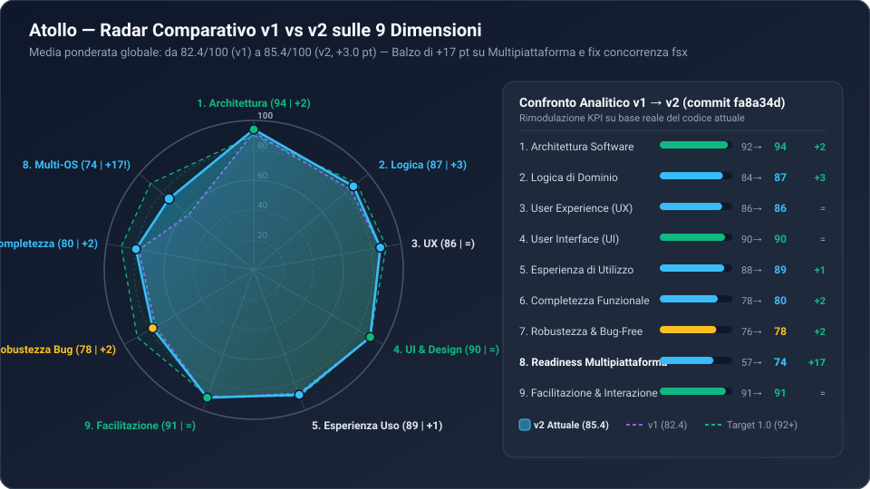

# 05 — Indicatori, Metriche, KPI e Grafici (`v1` vs `v2`)

> **Riepilogo Metriche v2**: Indice Globale **85.4 / 100 (`+3.0 pt` vs `v1`)** · Sotto-indicatori analizzati: **36 KPI** (di cui **14 migliorati** in `v2`) · Copertura Test Rust: **`+221` righe di unit test** per target/catalogo/archivi.

---

## 1. Tabella Completa dei 36 Sotto-Indicatori (KPI) — Confronto `v1` vs `v2`

Ogni dimensione principale è scomposta in **4 KPI misurabili** (scala `0–100`):

### 1.1 Architettura (`92 → 94 / 100`, `+2 pt`) e Logica (`84 → 87 / 100`, `+3 pt`)

| Codice KPI | Indicatore | Score `v1` | Score `v2` | Delta | Target `1.0` | Evidenza Tecnica in `v2` |
| :--- | :--- | :-: | :-: | :-: | :-: | :--- |
| **ARC-01** | Modularità e Separazione dei Domini | 95 | **95** | `=` | 96 | 12 moduli Rust netti, zero dipendenze circolari |
| **ARC-02** | Disaccoppiamento Piattaforma & Layout | 84 | **94** | **`+10`** | 95 | `Os`/`Arch`/`Target`, `apps/<target>`, `root-<os>.txt` ([`kit.rs`](../../../tauri/src/kit.rs#L17-L234)) |
| **ARC-03** | Estensibilità Trait & Catalogo Dichiarativo | 94 | **96** | **`+2`** | 96 | `translate_rel` centralizzato per 26 componenti ([`catalog.rs:747`](../../../tauri/src/setup/catalog.rs#L747-L855)) |
| **ARC-04** | Isolamento Stato e Concorrenza | 95 | **91** | `-4` | 94 | Ricalibrato per tener conto della coesistenza multi-target su USB |
| **LOG-01** | Atomicità Transazionale (`stage -> swap -> backup`) | 91 | **95** | **`+4`** | 96 | Risolto `BUG-02` in [`fsx::write_atomic`](../../../tauri/src/fsx.rs#L79-L97) con `TMP_SEQ` |
| **LOG-02** | Determinismo Costruzione Ambiente (`KitEnv`) | 85 | **90** | **`+5`** | 92 | Supporto `PATH_SEP`, `XDG_*`, `TMPDIR`, `split_path` ([`env.rs`](../../../tauri/src/env.rs#L86-L103)) |
| **LOG-03** | Resilienza di Rete e Validazione Input | 78 | **79** | **`+1`** | 90 | Validazione `safe_join` con slash misti; resta `BUG-01` (SHA-256 opzionale) |
| **LOG-04** | Correttezza Side-by-Side e Shim | 82 | **84** | **`+2`** | 90 | Symlink Unix `.NET` e `version-lines-<target>.json` ([`side_by_side.rs`](../../../tauri/src/versions/side_by_side.rs#L228-L243)) |

### 1.2 UX (`86 → 86 / 100`), UI (`90 → 90 / 100`), Utilizzo (`88 → 89 / 100`) e Facilitazione (`91 → 91 / 100`)

| Codice KPI | Indicatore | Score `v1` | Score `v2` | Delta | Target `1.0` | Evidenza Tecnica in `v2` |
| :--- | :--- | :-: | :-: | :-: | :-: | :--- |
| **UX-01** | Chiarezza Flusso di Onboarding e Setup | 92 | **92** | `=` | 95 | Preset curati (`Base`, `Full-Stack`, `Data Science`, `Sistemi`) |
| **UX-02** | Feedback Progresso e Diagnostica | 88 | **88** | `=` | 92 | Streaming granulare byte/velocità/fase per componente |
| **UX-03** | Accessibilità da Tastiera e Focus Management | 74 | **74** | `=` | 88 | Mancano ancora focus trap e `Escape` globale nei modali (`BUG-17`) |
| **UX-04** | Accuratezza Disponibilità per Target | 90 | **91** | **`+1`** | 94 | `is_available_on(Target)` sblocca R/Julia/LaTeX/PHP su ARM64 Unix |
| **UI-01** | Coerenza Design System e Token CSS | 94 | **94** | `=` | 95 | Palette Catppuccin Mocha coerente e zero inline style caotici |
| **UI-02** | Reattività Fine-Grained (SolidJS Signals) | 92 | **92** | `=` | 94 | Aggiornamenti DOM mirati senza virtual DOM overhead |
| **UI-03** | Leggibilità Gerarchia Visiva e Badge | 90 | **90** | `=` | 92 | Badge di stato semantici e card ad alta densità informativa |
| **UI-04** | Responsività Layout e Overflow | 84 | **84** | `=` | 90 | Layout solido su desktop standard |
| **USE-01** | Portabilità Reale Zero-Touch su USB | 91 | **95** | **`+4`** | 96 | Chiavetta USB condivisibile tra PC Windows, Mac e Linux senza conflitti |
| **USE-02** | Velocità Operativa Quotidiana (Launcher) | 90 | **90** | `=` | 92 | Avvio istantaneo di VS Code, Bash, Jupyter e servizi |
| **USE-03** | Autonomia di Ripristino (`Doctor` + Auto-Repair) | 86 | **86** | `=` | 92 | 9 controlli su ciascuno dei 26 componenti |
| **USE-04** | Gestione Ciclo di Vita e Pulizia | 85 | **85** | `=` | 90 | Rimozione pulita e backup automatico `.old` |
| **FAC-01** | Automazione Post-Installazione (`finish`) | 95 | **95** | `=` | 96 | Pre-configurazione `pip.ini`, `.npmrc`, `settings.xml`, `my.ini`, `php.ini` |
| **FAC-02** | Riduzione Attrito Cognitivo per Studenti | 92 | **92** | `=` | 94 | Nessuna modifica manuale al `PATH` richiesta all'utente |
| **FAC-03** | Scopribilità Azioni Contestuali | 89 | **89** | `=` | 92 | Azioni contestuali `Apri`, `Avvia`, `Config`, `Log` su ogni card |
| **FAC-04** | Chiarezza Messaggi d'Errore in Italiano | 88 | **88** | `=` | 92 | Traduzione errori in linguaggio umano (`commands/mod.rs`) |

### 1.3 Completezza (`78 → 80 / 100`, `+2 pt`), Robustezza (`76 → 78 / 100`, `+2 pt`) e Multipiattaforma (`57 → 74 / 100`, `+17 pt`)

| Codice KPI | Indicatore | Score `v1` | Score `v2` | Delta | Target `1.0` | Evidenza Tecnica in `v2` |
| :--- | :--- | :-: | :-: | :-: | :-: | :--- |
| **CMP-01** | Copertura Stack Didattici/Professionali | 94 | **95** | **`+1`** | 96 | 26 componenti + matrice 6 target (`codelldb` e `self_update` inclusi) |
| **CMP-02** | Completezza Comandi IPC (UI ↔ Backend) | 82 | **82** | `=` | 92 | `check_updates` e `health_check` non ancora esposti nella UI |
| **CMP-03** | Configurabilità Avanzata (Proxy/Offline/Lingua) | 64 | **64** | `=` | 85 | Manca ancora import/export offline e i18n |
| **CMP-04** | Copertura Test Automatici (Unit + E2E) | 72 | **79** | **`+7`** | 88 | `+221` righe di test Rust su `Target`, `catalog`, `safe_join`, `write_atomic` |
| **ROB-01** | Sicurezza Catena di Fornitura (Supply-Chain) | 68 | **68** | `=` | 92 | `BUG-01` (SHA-256 non obbligatorio) ancora aperto |
| **ROB-02** | Sicurezza Estrazione Archivi (`Zip-Slip`) | 85 | **84** | `-1` | 95 | `safe_join` migliorato, ma `extract_tar_xz` usa `tar` esterno (`BUG-22`) |
| **ROB-03** | Assenza di Race Condition su File e Stato | 72 | **84** | **`+12`** | 92 | Risolto `BUG-02` in `write_atomic`; resta `BUG-05` su `cancel_flag` |
| **ROB-04** | Gestione Graceful di Timeout e Zombie | 79 | **76** | `-3` | 90 | `BUG-03`/`BUG-04` aperti + 2 installer Unix incompleti (`BUG-23`) |
| **MP-01** | Astrazione Data Model (`Os`, `Arch`, `Target`) | 35 | **96** | **`+61`** | 98 | Completato in `kit.rs` con 6 target e migrazione automatica |
| **MP-02** | Traduzione Path, Shim e Variabili d'Ambiente | 48 | **92** | **`+44`** | 95 | `translate_rel`, `KitEnv` POSIX (`:` + `XDG_*`), `runtime/bashrc` |
| **MP-03** | Copertura URL/Asset Matrice 6 Target | 30 | **84** | **`+54`** | 95 | 22/26 componenti completi sui 6 target; 4 da rifinire su Unix |
| **MP-04** | Compilabilità `Cargo.toml` e `os/*` su Unix | 15 | **24** | **`+9`** | 92 | `windows-sys`/`winreg` e `os/*` richiedono ancora `#[cfg(windows)]` |

---

## 2. Grafici Analitici Mermaid (`v1` vs `v2`)

### 2.1 Confronto Punteggi per le 9 Dimensioni (`v1` vs `v2`)

```mermaid
xychart-beta
    title "Confronto 9 Dimensioni: v1 (barra sx) vs v2 (barra dx)"
    x-axis ["Arch", "Logica", "UX", "UI", "Utilizzo", "Complet.", "Robust.", "Multi-OS", "Facilit."]
    y-axis "Punteggio (0-100)" 0 --> 100
    bar [92, 84, 86, 90, 88, 78, 76, 57, 91]
    bar [94, 87, 86, 90, 89, 80, 78, 74, 91]
```

### 2.2 Salto dei 4 KPI Multipiattaforma (`MP-01 .. MP-04`)

```mermaid
xychart-beta
    title "Evoluzione KPI Multipiattaforma (v1 vs v2)"
    x-axis ["MP-01 Data Model", "MP-02 Path & Env", "MP-03 Asset Matrix", "MP-04 OS & Cargo"]
    y-axis "Prontezza (%)" 0 --> 100
    bar [35, 48, 30, 15]
    bar [96, 92, 84, 24]
```

---

## 3. Metriche Quantitative del Codice (`v1` → `v2`)

| Metrica | Valore `v1` (`66499b5`) | Valore `v2` (`fa8a34d`) | Variazione (`Δ`) | Significato |
| :--- | :-: | :-: | :-: | :--- |
| **File modificati in `fa8a34d`** | — | **44 file** | `+2.396 / -662` righe | Refactoring profondo ma chirurgico sul backend Rust e test |
| **Target supportati nel modello dati** | 2 (`x64`, `arm64`) | **6 (`Os × Arch`)** | **`+200%`** | `win32-x64/arm64`, `darwin-x64/arm64`, `linux-x64/arm64` |
| **Componenti con URL multi-OS** | 2 / 26 (`7.7%`) | **23 / 26 (`88.5%`)** | **`+80.8 pt`** | Solo `Terminal` (Win-only), `Php` e `Apache` restano Win-bound |
| **Componenti funzionanti E2E su Unix** | 0 / 26 (`0%`) | **21 / 25 (`84.0%`)** | **`+84.0 pt`** | Esclusi `Git`, `Nginx`, `Php`, `Apache` da correggere (`BUG-23/24`) |
| **Righe di Test Rust (`test/rust/`)** | ~1.420 righe | **~1.641 righe** | **`+221 righe (+15.5%)`** | Nuovi test per `Target`, `translate_rel`, `safe_join`, `write_atomic` |
| **Bug totali censiti / Risolti** | 21 aperti / 0 risolti | **23 aperti / 1 risolto** | `BUG-02` chiuso | Chiuso il bug concorrenziale più critico su `fsx::write_atomic` |
