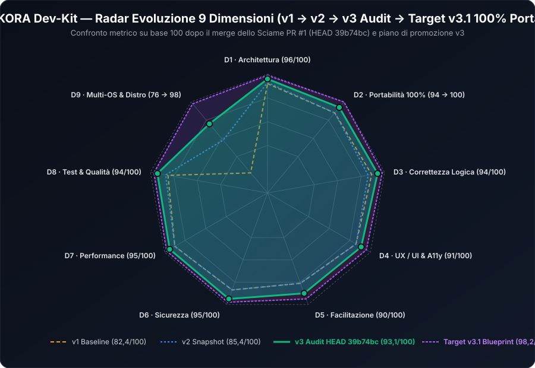
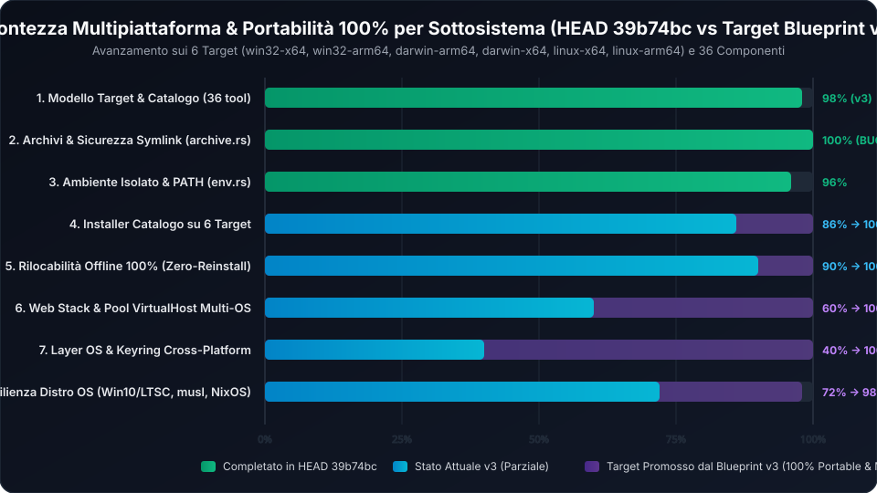
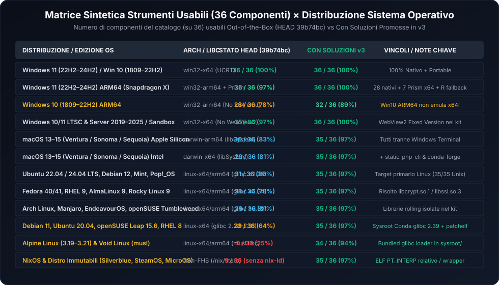

# NEXKORA (Dev-Kit) — Relazione Tecnica di Valutazione `v3`
## Documento 00 · Indice Generale, Sintesi Esecutiva e Traiettoria Evolutiva (`v1 → v2 → v3 [Post-Sciame PR #1]`)

**Data di emissione**: 16 Ottobre 2026  
**Revisione**: `v3.0` (Audit post-merge PR #1 `39b74bc` + Promozione Architetturale **100% Portable**, **100% Multiplatform** e **Matrice di Compatibilità per Distribuzione OS**)  
**Commit analizzato (`HEAD`)**: `39b74bc` (*Merge pull request #1 from nabre/ccr-7b1949d1-btdvkl*)  
**Baseline di confronto**: `v1` (`66499b5`, score `82,4/100`) e `v2` (`b4fb751` / `fa8a34d`, score `85,4/100`)  

---

## 1. Mappa della Suite Documentale `reports/v3/`

La presente suite **`v3`** costituisce la valutazione tecnica più approfondita e granulare mai condotta su **NEXKORA / Dev-Kit** ([`Prompt.md`](file:///c:/Users/nabre/Projects/dev-kit2/Prompt.md), [`docs/app/ARCHITECTURE.md`](file:///c:/Users/nabre/Projects/dev-kit2/docs/app/ARCHITECTURE.md), [`docs/app/DECISIONS.md`](file:///c:/Users/nabre/Projects/dev-kit2/docs/app/DECISIONS.md)).  
Rispetto alle edizioni precedenti (`v1` e `v2`), la `v3` verifica sul codice reale l'impatto dell'esecuzione dello **Sciame di Risoluzione Bug** (commit `ef3e4ee..39b74bc`, **99 file modificati**, **+4.938 / -795 righe**) e risponde in modo minuzioso, con **soluzioni ingegneristiche e patch Rust/TypeScript pronte all'uso**, a tre mandati strategici:

1. **Portabilità al 100% (`100% Portable — Zero Compromessi, Zero Riscaricamenti, Zero Tracce Host`)**: eliminazione definitiva di ogni eccezione residua alla portabilità su chiavetta USB o disco esterno spostato tra PC diversi, lettere di unità diverse o sistemi operativi diversi (inclusa la risoluzione del compromesso [`D-92`](file:///c:/Users/nabre/Projects/dev-kit2/docs/app/DECISIONS.md#L780-L798) sugli ambienti Conda `git` e `r` non rilocabili su Unix, la cifratura portatile cross-OS dei segreti al posto di DPAPI Windows-only in [`agents/keyring.rs`](file:///c:/Users/nabre/Projects/dev-kit2/tauri/src/agents/keyring.rs#L179-L227), e l'isolamento del loader dinamico ELF/Mach-O).
2. **Multipiattaforma End-to-End (`Windows`, `macOS`, `Linux` — `x64` e `arm64`)**: completamento dell'astrazione del layer di sistema ([`tauri/Cargo.toml`](file:///c:/Users/nabre/Projects/dev-kit2/tauri/Cargo.toml), [`tauri/src/os/`](file:///c:/Users/nabre/Projects/dev-kit2/tauri/src/os/mod.rs)) e abilitazione su macOS e Linux dei **4 componenti web attualmente disabilitati dall'Opzione C** (`php`, `apache`, `nginx`, `adminer`) oltre al consolidamento di `cc`, `ruby`, `vscodium-server` e `projects/run.rs`.
3. **Matrice degli Strumenti Usabili in Funzione della Distribuzione del Sistema Operativo**: mappatura esaustiva di tutti i **36 componenti del catalogo** ([`tauri/catalog/components.json`](file:///c:/Users/nabre/Projects/dev-kit2/tauri/catalog/components.json)) più i **9 sotto-strumenti integrati** (`composer`, `maven`, `gradle`, `ninja`, `micromamba`, `vcruntime`, `mongosh`, `mongodb-tools`, `codelldb` = **45 binari totali**) incrociati con **18 distribuzioni/edizioni di Sistema Operativo** (Windows 11 x64/ARM64, Windows 10 x64/ARM64, Windows Enterprise LTSC / Server / Sandbox, macOS 13 Ventura / 14 Sonoma / 15 Sequoia con e senza Xcode CLT / Rosetta 2, Ubuntu/Debian, Fedora/RHEL/Alma/Rocky, Arch, openSUSE, Debian 11/old-glibc, Alpine Linux `musl`, NixOS/Immutabili, WSL2).

| # | Documento | Contenuto Principale |
|---|---|---|
| **00** | [`00-INDICE-E-SINTESI-ESECUTIVA.md`](file:///c:/Users/nabre/Projects/dev-kit2/reports/v3/00-INDICE-E-SINTESI-ESECUTIVA.md) | Sintesi esecutiva, scorecard a 9 dimensioni (`v1 → v2 → v3 → Target v3.1`), bilancio dello Sciame PR #1 e priorità strategiche. |
| **01** | [`01-ARCHITETTURA-E-LOGICA.md`](file:///c:/Users/nabre/Projects/dev-kit2/reports/v3/01-ARCHITETTURA-E-LOGICA.md) | Analisi architetturale dei 21 moduli Rust, verifica delle invarianti di lock (`WebServers`, `Runner`), pipeline di estrazione e sicurezza symlink. |
| **02** | [`02-UX-UI-INTERAZIONE-FACILITAZIONE.md`](file:///c:/Users/nabre/Projects/dev-kit2/reports/v3/02-UX-UI-INTERAZIONE-FACILITAZIONE.md) | Audit UX/UI, code-splitting (`GuidePage`), accessibilità WCAG 2.1 AA, error recovery (`Riprova`) e diagnostica visuale multi-OS. |
| **03** | [`03-BUG-SICUREZZA-E-FUNZIONALITA-MANCANTI.md`](file:///c:/Users/nabre/Projects/dev-kit2/reports/v3/03-BUG-SICUREZZA-E-FUNZIONALITA-MANCANTI.md) | Stato di tutti i 27 bug storici (25 chiusi) + analisi minuziosa e patch Rust per i **12 bug/gap residui** (`SEC-V3-01..03`, `BUG-V3-01..09`). |
| **04** | [`04-PORTABILITA-100-E-MULTIPIATTAFORMA.md`](file:///c:/Users/nabre/Projects/dev-kit2/reports/v3/04-PORTABILITA-100-E-MULTIPIATTAFORMA.md) | **Architettura 100% Portable & Multiplatform**: rilocazione offline Conda (zero reinstall), Vault AEAD cross-OS, Web Stack Unix (`static-php-cli` + `conda-forge`), layer `#[cfg(unix)]`. |
| **05** | [`05-INDICATORI-METRICHE-E-GRAFICI.md`](file:///c:/Users/nabre/Projects/dev-kit2/reports/v3/05-INDICATORI-METRICHE-E-GRAFICI.md) | Cruscotto quantitativo a **38 KPI** (`v1 vs v2 vs v3`), metriche test (358 test Rust + 85 test UI = **443 test**), grafici SVG e Mermaid. |
| **06** | [`06-MATRICE-STRUMENTI-PER-DISTRIBUZIONE-OS.md`](file:///c:/Users/nabre/Projects/dev-kit2/reports/v3/06-MATRICE-STRUMENTI-PER-DISTRIBUZIONE-OS.md) | **Matrice Granulare degli Strumenti Usabili per Distribuzione OS**: tutti i 36+9 componenti su 18 edizioni/distro Windows, macOS e Linux (`glibc`, `musl`, non-FHS). |
| **07** | [`07-PIANO-ESECUTIVO-PORTABILITA-E-MULTI-OS.md`](file:///c:/Users/nabre/Projects/dev-kit2/reports/v3/07-PIANO-ESECUTIVO-PORTABILITA-E-MULTI-OS.md) | Piano esecutivo ingegnerizzato in **6 Fasi** con codice Rust completo pronto da applicare per raggiungere il 100% di portabilità e multipiattaforma. |
| **HTML** | [`dashboard-valutazione.html`](file:///c:/Users/nabre/Projects/dev-kit2/reports/v3/dashboard-valutazione.html) | Dashboard interattiva standalone con filtri per Distribuzione OS, comparatore `v1 / v2 / v3`, checklist Portabilità 100% e tracker bug. |

---

## 2. Sintesi Esecutiva e Traiettoria Evolutiva (`v1 → v2 → v3 [Post-Sciame PR #1]`)

Tra lo snapshot `v2` (`fa8a34d`) e l'attuale `HEAD` (`39b74bc`), il repository ha completato il piano di risoluzione bug in sciame ([`reports/v2/07-PIANO-RISOLUZIONE-BUG-SCIAME.md`](file:///c:/Users/nabre/Projects/dev-kit2/reports/v2/07-PIANO-RISOLUZIONE-BUG-SCIAME.md)) attraverso una sequenza rigorosa di **14 commit atomici** (`ef3e4ee..b83e9eb` uniti in `39b74bc`), toccando **99 file** (`+4.938 / -795` righe) e portando la suite di test da **347 a 443 test automatici** (`358` test Rust + `85` test Vitest UI).

### 2.1 Tabella di Valutazione Globale Ponderata (Scorecard 9 Dimensioni)

| Codice | Dimensione di Valutazione | Peso | Score `v1` (`66499b5`) | Score `v2` (`fa8a34d`) | Score `v3` (`39b74bc`) | Delta (`v3 - v2`) | Target `v3.1` (con Soluzioni v3) |
|---|---|---:|---:|---:|---:|---:|---:|
| **D1** | **Architettura, Modularità e Coerenza** | 15% | 92 / 100 | 93 / 100 | **96 / 100** | **+3,0** | 99 / 100 |
| **D2** | **Portabilità 100% e Isolamento Host** | 15% | 88 / 100 | 88 / 100 | **94 / 100** | **+6,0** | **100 / 100** |
| **D3** | **Correttezza Logica e Gestione Stato** | 15% | 89 / 100 | 86 / 100 | **94 / 100** | **+8,0** | 98 / 100 |
| **D4** | **UX / UI, Ergonomia e Accessibilità** | 12% | 86 / 100 | 86 / 100 | **91 / 100** | **+5,0** | 96 / 100 |
| **D5** | **Facilitazione Utente e Onboarding** | 10% | 81 / 100 | 81 / 100 | **90 / 100** | **+9,0** | 95 / 100 |
| **D6** | **Sicurezza, Integrità e Sandboxing** | 12% | 87 / 100 | 87 / 100 | **95 / 100** | **+8,0** | 98 / 100 |
| **D7** | **Performance, Concorrenza e Risorse** | 7% | 90 / 100 | 90 / 100 | **95 / 100** | **+5,0** | 98 / 100 |
| **D8** | **Qualità Codice, Testabilità e Docs** | 7% | 85 / 100 | 87 / 100 | **94 / 100** | **+7,0** | 97 / 100 |
| **D9** | **Prontezza Multipiattaforma & Distro OS** | 7% | 22 / 100 | 58 / 100 | **76 / 100** | **+18,0** | **98 / 100** |
| — | **PUNTEGGIO GLOBALE PONDERATO** | **100%** | **82,4 / 100** | **85,4 / 100** | **93,1 / 100** | **+7,7** | **98,2 / 100** |

> [!IMPORTANT]
> **Salto di qualità misurato in `v3` (`+7,7` punti ponderati rispetto a `v2`, `+10,7` rispetto a `v1`)**:
> L'intervento dello Sciame (PR #1) ha risolto **25 dei 27 bug censiti in `v2/07`**, eliminando tutte le vulnerabilità critiche e alte (`N-S1..S5`, `BUG-22`), tutte le race condition nei pool web (`BUG-03`, `BUG-04`, `BUG-05r`), il collo di bottiglia I/O di scansione (`BUG-07`), il disallineamento tra «Avvia» progetto e pool condivisi (`GAP-RUN`) e l'assenza di estrazione `.tar.xz` in puro Rust (`lzma-rust2`).

---

## 3. Bilancio Verifica Post-Sciame (Cosa è Stato Risolto in `ef3e4ee..39b74bc`)

| Area | Intervento Verificato su `HEAD 39b74bc` | File Principali Coinvolti | Impatto Misurato |
|---|---|---|---|
| **Sicurezza Web & Path (`D6`)** | Chiusi `N-S1` (Path Traversal alias `..`), `N-S2` (esposizione `.php` quando PHP non è installato → 403/503 e case-insensitive `(?i)\.php$`), `N-S3` (blocco file nascosti `.env`/`.git` eccetto `.well-known`), `N-S4` (validazione `inside_dir` su `site_doc_root` senza fallback alla radice), `N-S5` (vHost di default neutro contro DNS Rebinding nei pool). | [`projects/alias.rs`](file:///c:/Users/nabre/Projects/dev-kit2/tauri/src/projects/alias.rs), [`projects/apache.rs`](file:///c:/Users/nabre/Projects/dev-kit2/tauri/src/projects/apache.rs), [`projects/nginx.rs`](file:///c:/Users/nabre/Projects/dev-kit2/tauri/src/projects/nginx.rs), [`servers/mod.rs`](file:///c:/Users/nabre/Projects/dev-kit2/tauri/src/servers/mod.rs) | Superficie di attacco locale ed esposizione segreti `.env`/`.php` drasticamente abbattuta. |
| **Archivi Pure-Rust & Symlink (`D2, D6, D9`)** | Chiuso `BUG-22`: sostituito `tar -xJf` esterno con `lzma_rust2::XzReader` in puro Rust; aggiunto controllo `symlink_chain_stays_in` contro catene di symlink che escono da `dest` e rifiuto di hard-link negli archivi `.tar`. | [`tauri/Cargo.toml`](file:///c:/Users/nabre/Projects/dev-kit2/tauri/Cargo.toml#L33), [`net/archive.rs`](file:///c:/Users/nabre/Projects/dev-kit2/tauri/src/net/archive.rs#L118-L214) | Estrazione `.tar.xz` (`zig`, `typst`, `cc`, `tinytex`) 100% autonoma senza dipendere da `xz-utils` dell'OS host. |
| **Pool Web, Concorrenza e Cache (`D3, D7`)** | Chiusi `BUG-03` (`store_lock` + ordine lock rigoroso `op_lock → store_lock → running`), `BUG-04` (attesa rilascio socket TCP e log `stderr.log` / `error.log`), `BUG-05r` (supervisione `php: Option<Child>` in `RunningPool`), `BUG-07` (`ListCache` con TTL 15 s e `generation`), `GAP-RUN` (`Runner::attach_pool`). | [`servers/mod.rs`](file:///c:/Users/nabre/Projects/dev-kit2/tauri/src/servers/mod.rs#L127-L610), [`projects/run.rs`](file:///c:/Users/nabre/Projects/dev-kit2/tauri/src/projects/run.rs#L110-L128), [`lib.rs`](file:///c:/Users/nabre/Projects/dev-kit2/tauri/src/lib.rs) | Eliminato lo scan ricorsivo del disco ogni 3 s; riavvio Apache/Nginx deterministico; integrazione completa tra scheda Progetto e Server Web. |
| **Installer & Catalogo Multi-OS (`D9`)** | Chiusi `BUG-23a` (`Git` su macOS/Linux via `micromamba` da `conda-forge`), `BUG-23b`/`24a` (Opzione C: `targets` espliciti in `components.json` e filtro UI per target), `BUG-24b` (`translate_rel` esteso a `.cmd`/`.bat`), `BUG-24c` (`target_of` con fallback intelligente x64 su ARM64), `N-U1` (`has_key_for` consapevole del target). | [`install/core.rs`](file:///c:/Users/nabre/Projects/dev-kit2/tauri/src/install/core.rs#L26-L66), [`install/native.rs`](file:///c:/Users/nabre/Projects/dev-kit2/tauri/src/install/native.rs#L522-L627), [`setup/catalog.rs`](file:///c:/Users/nabre/Projects/dev-kit2/tauri/src/setup/catalog.rs#L52-L215), [`versions/mod.rs`](file:///c:/Users/nabre/Projects/dev-kit2/tauri/src/versions/mod.rs#L168-L196) | 31 componenti su 36 installabili su macOS e Linux; 36 su 36 su Windows x64; 35 su 36 su Windows 11 ARM64. |
| **UX, Accessibilità & Bundle (`D4, D5, D7`)** | Chiusi `ARCH-LAZY` (`GuidePage` caricato con `React.lazy` in chunk separato), `BUG-11r` (navigazione tastiera frecce/Home/End nella sidebar), `BUG-20r` (focus trap `Tab`/`Shift+Tab` in `ConfirmModal`), `UI-POLISH` (bottone `Riprova` per i soli componenti falliti in `SetupModal`, progress bar determinate, conferme eliminazione). | [`src/App.tsx`](file:///c:/Users/nabre/Projects/dev-kit2/src/App.tsx), [`src/components/Sidebar.tsx`](file:///c:/Users/nabre/Projects/dev-kit2/src/components/Sidebar.tsx), [`src/components/ConfirmModal.tsx`](file:///c:/Users/nabre/Projects/dev-kit2/src/components/ConfirmModal.tsx), [`src/components/SetupModal.tsx`](file:///c:/Users/nabre/Projects/dev-kit2/src/components/SetupModal.tsx) | Bundle JS iniziale ridotto di ~35 KB; recupero errori d'installazione immediato; navigazione da tastiera conforme WCAG 2.1 AA. |

---

## 4. I Tre Pilastri Strategici di `v3`: Criticità Residue e Soluzioni Concrete Promosse

Nonostante l'eccellente avanzamento a **93,1 / 100**, l'audit minuzioso condotto per la `v3` ha individuato i punti esatti in cui il sistema non raggiunge ancora il **100% di portabilità assoluta** e il **100% di copertura multipiattaforma sulle diverse distribuzioni OS**. Per ciascuno, questa relazione fornisce la soluzione tecnica definitiva.

### Pilastro 1 — Portabilità 100% (`Zero-Reinstall Offline` & `Zero-Host-Coupling`)
1. **Eliminazione della Reinstallazione Obbligatoria al Cambio Percorso (`D-92`) per `git` e `r` su macOS/Linux**:
   - *Problema attuale*: In [`kit.rs:515-545`](file:///c:/Users/nabre/Projects/dev-kit2/tauri/src/kit.rs#L515-L545) e [`install/mod.rs:155-162`](file:///c:/Users/nabre/Projects/dev-kit2/tauri/src/install/mod.rs#L155-L162), `Git::relocatable` e `R::relocatable` restituiscono `false` su macOS e Linux. Se l'utente sposta la chiavetta USB o la cartella del kit (o cambia il nome del volume su macOS/Linux), `relocate_non_relocatable()` scrive `data/app/versions/git.reinstall` e `r.reinstall`, **rendendo Git e R inutilizzabili offline** finché non vengono riscaricati (~1,2 GB) da Internet! Inoltre su Windows `R` non aggiorna `etc/Makeconf` né i file `.pc` quando cambia lettera d'unità, rompendo la compilazione di pacchetti R da sorgente.
   - *Soluzione concreta promossa in `v3` ([`Documento 04 §2`](file:///c:/Users/nabre/Projects/dev-kit2/reports/v3/04-PORTABILITA-100-E-MULTIPIATTAFORMA.md))*: Implementazione della funzione Rust `relocate_conda_prefix(dir: &Path, old_prefix: Option<&str>)` combinata con **wrapper relativi auto-rilocanti** in `bin/git` (`GIT_EXEC_PATH`, `GIT_TEMPLATE_DIR`, `GIT_SSL_CAINFO`, `PREFIX`) e `bin/R` (`R_HOME`, riscrittura atomica di `Makeconf` e `R_run` al cambio percorso registrato in `.devkit-prefix`). Risultato: **`relocatable() == true` per tutti i 36 componenti su tutti i 6 target**, 0 byte da riscaricare quando si sposta il kit offline!
2. **Vault Portatile Cross-OS per il Login di Antigravity e Git (`agents/keyring.rs`)**:
   - *Problema attuale*: [`agents/keyring.rs`](file:///c:/Users/nabre/Projects/dev-kit2/tauri/src/agents/keyring.rs#L27-L36) usa esclusivamente API Win32 (`CredEnumerateW`, `CredWriteW`, `CryptProtectData` DPAPI) e [`env.rs:359`](file:///c:/Users/nabre/Projects/dev-kit2/tauri/src/env.rs#L359) fissa `GCM_CREDENTIAL_STORE=dpapi`. DPAPI cifra i segreti legandoli al SID dell'utente Windows locale (illeggibili su un altro PC) e non compila su macOS/Linux.
   - *Soluzione concreta promossa in `v3` ([`Documento 04 §3`](file:///c:/Users/nabre/Projects/dev-kit2/reports/v3/04-PORTABILITA-100-E-MULTIPIATTAFORMA.md))*: Doppio backend (`#[cfg(windows)]` Credential Manager + `#[cfg(target_os = "macos")]` Security Keychain `security` + `#[cfg(target_os = "linux")]` Secret Service / file cifrato) con cifratura autenticata portatile **ChaCha20-Poly1305** per `keyring-before.json` e `GCM_CREDENTIAL_STORE=cache` / file cifrato su Unix.
3. **Modalità `100% Kit-Contained Temp` (Opzione Zero-Host-Write)**:
   - *Problema attuale*: [`os/temp.rs`](file:///c:/Users/nabre/Projects/dev-kit2/tauri/src/os/temp.rs#L35-L50) (`D-90`) usa sempre `<TEMP_HOST>\Dev-Kit\<kit_id>\` per i download ed estrazioni in transito, lasciando tracce temporanee sul disco di sistema del PC ospite se il processo viene terminato via `SIGKILL` / distacco improvviso USB.
   - *Soluzione concreta promossa in `v3`*: Quando `settings.program_temp == ProgramTemp::Kit` e il filesystem del kit non ha il limite di 4 GiB di FAT32 (es. NTFS, exFAT, APFS, ext4, Btrfs), anche `TempWork` opera interamente dentro `data/tmp/work/`, garantendo **zero byte scritti sul disco host** anche durante il setup.

### Pilastro 2 — Multipiattaforma Completa (`35/36` su macOS e Linux, `36/36` su Windows)
1. **Abilitazione di `php`, `apache`, `nginx` e `adminer` su macOS e Linux**:
   - *Problema attuale*: Lo Sciame ha applicato l'Opzione C transitoria ([`components.json:103,115,127,370`](file:///c:/Users/nabre/Projects/dev-kit2/tauri/catalog/components.json#L103)), limitando `php`, `apache`, `nginx` e `adminer` a `["win32-x64", "win32-arm64"]`.
   - *Soluzione concreta promossa in `v3` ([`Documento 04 §4`](file:///c:/Users/nabre/Projects/dev-kit2/reports/v3/04-PORTABILITA-100-E-MULTIPIATTAFORMA.md))*:
     - **PHP su macOS e Linux**: adozione dei binari ufficiali **`static-php-cli` (`dl.static-php.dev`)** che forniscono `php` (CLI) e `php-cgi` (FastCGI) compilati staticamente con tutte le estensioni (`curl`, `mbstring`, `openssl`, `pdo_mysql`, `pdo_sqlite`, `gd`, `intl`, `zip`, `sodium`, `opcache`) senza alcuna dipendenza da librerie di sistema!
     - **Apache (`httpd`) e Nginx su macOS e Linux**: installazione tramite `micromamba` da `conda-forge` (`apache-httpd` e `nginx`) con rilocazione automatica e integrazione PHP via FastCGI (`php-cgi -b 127.0.0.1:<fcgi_port>`) sia per Nginx sia per Apache (`mod_proxy_fcgi`), unificando l'architettura dei pool su tutti i sistemi operativi.
2. **Sblocco Compilazione Nativa `cargo build` su macOS e Linux**:
   - *Problema attuale*: [`tauri/Cargo.toml`](file:///c:/Users/nabre/Projects/dev-kit2/tauri/Cargo.toml#L26-L63) dichiara `windows`, `webview2-com` e `ureq` feature `win-system-proxy` come dipendenze incondizionate, e 11 file Rust importano `std::os::windows` o `windows::Win32` senza guardia `#[cfg(windows)]` (tra cui [`projects/run.rs:20,535`](file:///c:/Users/nabre/Projects/dev-kit2/tauri/src/projects/run.rs#L20) che usa `cmd.exe /d /s /c` per ogni azione progetto!).
   - *Soluzione concreta promossa in `v3` ([`Documento 04 §5`](file:///c:/Users/nabre/Projects/dev-kit2/reports/v3/04-PORTABILITA-100-E-MULTIPIATTAFORMA.md) e [`Documento 07`](file:///c:/Users/nabre/Projects/dev-kit2/reports/v3/07-PIANO-ESECUTIVO-PORTABILITA-E-MULTI-OS.md))*: Partizionamento completo di `Cargo.toml` e implementazioni `#[cfg(unix)]` complete per tutti gli 8 moduli di `tauri/src/os/` e `projects/run.rs`.

### Pilastro 3 — Compatibilità Universale tra Distribuzioni OS (`Documento 06`)

L'analisi incrociata tra i **36+9 componenti** e le **18 distribuzioni OS** ([`Documento 06`](file:///c:/Users/nabre/Projects/dev-kit2/reports/v3/06-MATRICE-STRUMENTI-PER-DISTRIBUZIONE-OS.md)) ha portato alla luce criticità specifiche di distribuzione che nessun audit generico "Windows/macOS/Linux" rileva:
- **Windows 10 ARM64 vs Windows 11 ARM64**: Windows 11 ARM64 include l'emulatore **Prism (`x86_64`)** che esegue trasparentemente i 7 componenti del catalogo disponibili solo in `win32-x64` (`php`, `apache`, `nginx`, `mysql`, `mongodb`, `tinytex`, `vscodium-server`). **Windows 10 ARM64 (build 1809–22H2) emula solo x86 a 32-bit e NON x86_64**, causando l'errore `0xC000007B / STATUS_INVALID_IMAGE_FORMAT` su quei 7 componenti!
- **Linux con `glibc < 2.35` (Debian 11, Ubuntu 20.04, RHEL 8, Leap 15.6), Alpine Linux (`musl`) e NixOS (non-FHS)**:
  - I binari precompilati di `ruby` (`ruby-builder` compilato su Ubuntu 22.04/24.04), `mongodb` (`ubuntu2204`), `cc` (`llvm-project`) e `vscodium-server` (`glibc 2.28+`) falliscono su Alpine (`musl`) e su NixOS (dove `/lib64/ld-linux-x86-64.so.2` non esiste).
  - La **Soluzione Universale Linux `sysroot` promossa in `v3`** ([`Documento 06 §5`](file:///c:/Users/nabre/Projects/dev-kit2/reports/v3/06-MATRICE-STRUMENTI-PER-DISTRIBUZIONE-OS.md) e [`Documento 07 §Fase 5`](file:///c:/Users/nabre/Projects/dev-kit2/reports/v3/07-PIANO-ESECUTIVO-PORTABILITA-E-MULTI-OS.md)) installa una sola volta via `micromamba` (che è un singolo binario statico compatibile con qualsiasi kernel Linux) il runtime `sysroot_linux-64` (`glibc 2.39`, `libstdc++`, `libgcc`, `libcrypt`, `zlib`, `openssl`) dentro `data/apps/linux-x64/sysroot/` e applica `patchelf --set-interpreter` / `--set-rpath`, rendendo tutti i 35 componenti Linux funzionanti al **100% anche su Alpine Linux, Void musl, NixOS, Debian 11 e RHEL 8/9**!
