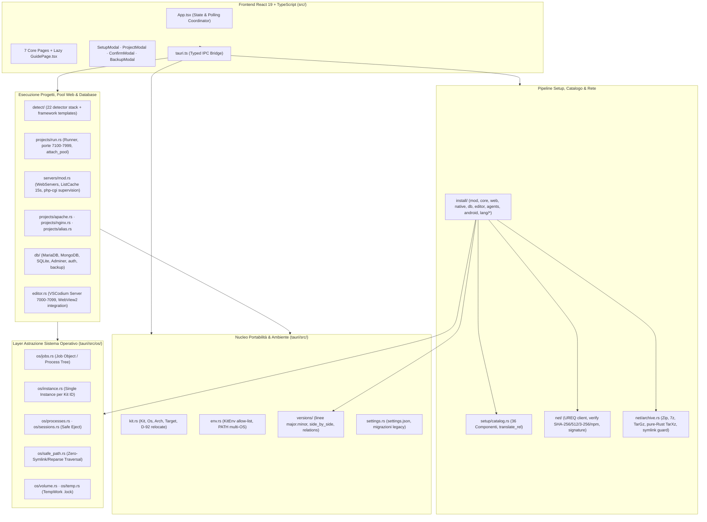

# Atollo (Atollo) — Relazione Tecnica di Valutazione `v3`
## Documento 01 · Architettura, Modularità, Invarianti di Concorrenza e Coerenza Logica

**Punteggio Dimensione D1 (Architettura e Modularità)**: **96 / 100** *(v1: 92/100 · v2: 93/100 · Target v3.1: 99/100)*  
**Punteggio Dimensione D3 (Correttezza Logica e Stato)**: **94 / 100** *(v1: 89/100 · v2: 86/100 · Target v3.1: 98/100)*  
**Punteggio Dimensione D7 (Performance e Risorse)**: **95 / 100** *(v1: 90/100 · v2: 90/100 · Target v3.1: 98/100)*  

---

## 1. Mappa Architetturale Verificata a `HEAD 39b74bc`

Il backend Rust in [`tauri/src/`](file:///c:/Users/nabre/Projects/atollo/tauri/src/lib.rs) è articolato in **21 domini funzionali** disaccoppiati, affiancati da un frontend React 19 + TypeScript 5.8 in [`src/`](file:///c:/Users/nabre/Projects/atollo/src/App.tsx) con **8 pagine** (di cui [`GuidePage.tsx`](file:///c:/Users/nabre/Projects/atollo/src/pages/GuidePage.tsx) ora caricata in code-splitting lazy) e **6 modali**.



### 1.1 Censimento Esatto dei Moduli `tauri/src/install/` e dei 36 Componenti
A differenza dell'imprecisione documentale presente nei report `v2/04..06` (e corretta nell'Errata di [`reports/v2/07 §1.1`](file:///c:/Users/nabre/Projects/atollo/reports/v2/07-PIANO-RISOLUZIONE-BUG-SCIAME.md#L15-L34)), l'albero reale degli installer in [`tauri/src/install/`](file:///c:/Users/nabre/Projects/atollo/tauri/src/install/mod.rs) copre esattamente **36 componenti** in [`tauri/catalog/components.json`](file:///c:/Users/nabre/Projects/atollo/tauri/catalog/components.json):

| Modulo Rust | Riga / Struct | Componenti del Catalogo Gestiti (`id`) | Sotto-strumenti / Dipendenze |
|---|---|---|---|
| [`install/agents.rs`](file:///c:/Users/nabre/Projects/atollo/tauri/src/install/agents.rs) | `Claude`, `Codex`, `Antigravity` | `claude`, `codex`, `antigravity` (3) | Wrapper `agy.cmd` + [`agents/keyring.rs`](file:///c:/Users/nabre/Projects/atollo/tauri/src/agents/keyring.rs) |
| [`install/core.rs`](file:///c:/Users/nabre/Projects/atollo/tauri/src/install/core.rs) | `Git`, `Python`, `Node`, `Uv`, `Gh` | `git`, `python`, `node`, `uv`, `gh` (5) | `micromamba` (per `git` su Unix), `pip` wheel |
| [`install/web.rs`](file:///c:/Users/nabre/Projects/atollo/tauri/src/install/web.rs) | `Php`, `Apache`, `Nginx` | `php`, `apache`, `nginx` (3) | `composer.phar`, `vcruntime`, `cacert.pem` |
| [`install/native.rs`](file:///c:/Users/nabre/Projects/atollo/tauri/src/install/native.rs) | `Rust`, `Pnpm`, `R` | `rust`, `pnpm`, `r` (3) | `rustup-init`, `corepack` + `yarn`, `micromamba` |
| [`install/db.rs`](file:///c:/Users/nabre/Projects/atollo/tauri/src/install/db.rs) | `MariaDb`, `MongoDb`, `Sqlite`, `Adminer` | `mariadb`, `mongodb`, `sqlite`, `adminer` (4) | `mongosh`, `mongodb-tools` (`mongodump`/`mongorestore`) |
| [`install/editor.rs`](file:///c:/Users/nabre/Projects/atollo/tauri/src/install/editor.rs) | `Pwsh`, `Terminal`, `Server` | `pwsh`, `terminal`, `vscodium-server` (3) | Estensioni `.vsix` + `codelldb` in [`editor.rs`](file:///c:/Users/nabre/Projects/atollo/tauri/src/editor.rs) |
| [`install/android.rs`](file:///c:/Users/nabre/Projects/atollo/tauri/src/install/android.rs) | `Android` | `android` (1) | `sdkmanager`, `platform-tools` (`adb`), `build-tools` |
| [`install/lang/jvm.rs`](file:///c:/Users/nabre/Projects/atollo/tauri/src/install/lang/jvm.rs) | `Java`, `Kotlin` | `java`, `kotlin` (2) | `maven` (3.x), `gradle` |
| [`install/lang/go.rs`](file:///c:/Users/nabre/Projects/atollo/tauri/src/install/lang/go.rs) | `Go` | `go` (1) | — |
| [`install/lang/dotnet.rs`](file:///c:/Users/nabre/Projects/atollo/tauri/src/install/lang/dotnet.rs) | `Dotnet` | `dotnet` (1) | — |
| [`install/lang/dart.rs`](file:///c:/Users/nabre/Projects/atollo/tauri/src/install/lang/dart.rs) | `Dart` | `dart` (1) | `pub` |
| [`install/lang/zig.rs`](file:///c:/Users/nabre/Projects/atollo/tauri/src/install/lang/zig.rs) | `Zig` | `zig` (1) | — |
| [`install/lang/julia.rs`](file:///c:/Users/nabre/Projects/atollo/tauri/src/install/lang/julia.rs) | `Julia` | `julia` (1) | — |
| [`install/lang/js.rs`](file:///c:/Users/nabre/Projects/atollo/tauri/src/install/lang/js.rs) | `Bun`, `Deno` | `bun`, `deno` (2) | — |
| [`install/lang/typeset.rs`](file:///c:/Users/nabre/Projects/atollo/tauri/src/install/lang/typeset.rs) | `Typst`, `TinyTex` | `typst`, `tinytex` (2) | `tlmgr` |
| [`install/lang/cc.rs`](file:///c:/Users/nabre/Projects/atollo/tauri/src/install/lang/cc.rs) | `Cmake`, `Cc` | `cmake`, `cc` (2) | `ninja` in `tools/`, `make` launcher |
| [`install/lang/ruby.rs`](file:///c:/Users/nabre/Projects/atollo/tauri/src/install/lang/ruby.rs) | `Ruby` | `ruby` (1) | `gem`, `bundle` |

---

## 2. Verifica Architetturale delle Correzioni dello Sciame (`PR #1`)

### 2.1 Gerarchia dei Lock e Prevenzione Deadlock in `WebServers` (`servers/mod.rs`)
In `v2`, `WebServers` soffriva di data race su `servers.json` (`BUG-03`), scansioni ripetute ad ogni poll di 3 secondi (`BUG-07`) e mancata supervisione del processo `php-cgi` (`BUG-05r`).  
L'architettura attuale in [`tauri/src/servers/mod.rs:201-224`](file:///c:/Users/nabre/Projects/atollo/tauri/src/servers/mod.rs#L201-L224) introduce una **gerarchia formale a 4 mutex con ordine di acquisizione strettamente monotono**:

```
op_lock (operazioni start / stop / reload / remove_profile)
  └──► store_lock (read-modify-write atomico di data/app/servers.json)
         └──► running (mappa BTreeMap<String, RunningPool> dei processi vivi)
cache (leaf lock: tenuto solo per istanti di lettura/scrittura di ListCache)
```

- **Verifica formale dell'assenza di deadlock**:
  1. `start_locked`, `stop_locked`, `reload_locked` e `remove_profile` acquisiscono sempre `op_lock` per primo.
  2. `scan` acquisisce `store_lock` ([`servers/mod.rs:620`](file:///c:/Users/nabre/Projects/atollo/tauri/src/servers/mod.rs#L620)) e, solo nel ramo `if prune` ([`servers/mod.rs:794`](file:///c:/Users/nabre/Projects/atollo/tauri/src/servers/mod.rs#L794)), acquisisce `running` *dentro* `store_lock`, rispettando `store_lock → running`.
  3. `save_profile` acquisisce `store_lock` e poi chiama `invalidate()` che acquisisce `cache` (leaf lock).
  4. `take_dead` + `end_dead` ([`servers/mod.rs:179-199`](file:///c:/Users/nabre/Projects/atollo/tauri/src/servers/mod.rs#L179-L199)) estraggono i `RunningPool` morti tenendo `running` per pochi microsecondi, e invocano `r.end()` (`kill()` + `wait()`) **fuori dal lock**, evitando che un processo lento a chiudersi blocchi i lettori di stato!

### 2.2 Pipeline di Estrazione Pure-Rust e Protezione Catene Symlink (`net/archive.rs`)
L'ispezione di [`tauri/src/net/archive.rs`](file:///c:/Users/nabre/Projects/atollo/tauri/src/net/archive.rs) conferma una progettazione esemplare della sicurezza sugli archivi scaricati:
- **Zero dipendenze da binari host per `.tar.xz`**: grazie a `lzma-rust2 = "0.21"` ([`Cargo.toml:33`](file:///c:/Users/nabre/Projects/atollo/tauri/Cargo.toml#L33)), l'estrazione di `Kind::TarXz` usa `tar::Archive::new(lzma_rust2::XzReader::new(BufReader::new(file), true))` interamente in memoria sicura Rust.
- **Anti-Zip-Slip e Anti-Symlink-Chain Escape**: oltre a `clean_rel_path` (che rifiuta componenti `..`, `RootDir` e `Prefix`), i link simbolici negli archivi `.tar` sono accettati solo se relativi e vengono verificati al termine dell'estrazione con `symlink_chain_stays_in(&dest, &link)` (profondità massima 32 hop, risoluzione lessicale passo-passo che impedisce l'attacco classico `a -> sub`, `sub/b -> ../..`).

---

## 3. Debiti Architetturali Residui e Soluzioni Concrete Promosse in `v3`

L'analisi approfondita del codice a `HEAD 39b74bc` evidenzia **4 nodi architetturali** che richiedono un intervento strutturale per raggiungere la perfezione (`99/100`) e l'obiettivo **100% Portable & Multiplatform**:

### 3.1 Accoppiamento a `cmd.exe` nel Runner Azioni Progetto (`projects/run.rs:534-538`)
In [`tauri/src/projects/run.rs:534-538`](file:///c:/Users/nabre/Projects/atollo/tauri/src/projects/run.rs#L534-L538), ogni azione progetto che non sia `static_dir`, `apache_dir` o `nginx_dir` (cioè tutti i comandi `npm run dev`, `cargo run`, `python manage.py runserver`, `flask`, `dotnet watch`, `go run`, ecc.) viene avviata così:

```rust
let command = listen(&action.command);
let system_root = env.get("SystemRoot").unwrap_or(r"C:\Windows");
let mut cmd = jobs::kit_command(Path::new(system_root).join(r"System32\cmd.exe"), env);
cmd.raw_arg(format!("/d /s /c \"{command}\""));
```

- **Impatto**:
  1. Non compila su Unix perché usa `CommandExt::raw_arg` (`std::os::windows::process::CommandExt` importato alla riga 20).
  2. A runtime su macOS o Linux, cerca di eseguire `C:\Windows\System32\cmd.exe`, facendo fallire il **100% delle azioni progetto**!
- **Soluzione Architetturale Concreta**: spostare la costruzione del comando shell in [`os/jobs.rs`](file:///c:/Users/nabre/Projects/atollo/tauri/src/os/jobs.rs) tramite una funzione cross-platform `jobs::shell_command(command: &str, env: &KitEnv) -> Command`:

```rust
/// Runs a shell command line (`npm run dev`, `python app.py`) in the platform's
/// native command interpreter (`cmd.exe /d /s /c` on Windows, `/bin/sh -c` on Unix)
/// with the isolated `KitEnv`.
pub fn shell_command(command: &str, env: &KitEnv) -> Command {
    #[cfg(windows)]
    {
        use std::os::windows::process::CommandExt;
        let system_root = env.get("SystemRoot").unwrap_or(r"C:\Windows");
        let mut cmd = kit_command(std::path::Path::new(system_root).join(r"System32\cmd.exe"), env);
        cmd.raw_arg(format!("/d /s /c \"{command}\""));
        cmd
    }
    #[cfg(not(windows))]
    {
        let sh = std::path::Path::new("/bin/sh");
        let mut cmd = kit_command(sh, env);
        cmd.arg("-c").arg(command);
        cmd
    }
}
```

### 3.2 Asimmetria nella Supervisione di `php-cgi` tra Pool (`servers/mod.rs`) e Server Dedicato (`projects/run.rs`)
Mentre in [`servers/mod.rs:135`](file:///c:/Users/nabre/Projects/atollo/tauri/src/servers/mod.rs#L135) lo Sciame ha aggiunto `php: Option<Child>` a `RunningPool` controllandone la vitalità in `alive()`, nel server Nginx dedicato di un progetto ([`projects/run.rs:515-516`](file:///c:/Users/nabre/Projects/atollo/tauri/src/projects/run.rs#L515-L516)) il codice fa:
```rust
let fcgi_port = crate::projects::nginx::spawn_php_cgi_if_present(&self.kit, env, &job)
    .map(|(port, _php)| port);
```
Scartando `_php` (`Child`), il processo `php-cgi` resta sì dentro il `Job` dell'azione (quindi muore quando l'utente ferma Nginx), ma se `php-cgi` crasha da solo mentre Nginx continua a girare, l'azione resta nello stato `Running` (verde) rispondendo `502 Bad Gateway` a ogni pagina `.php`.  
**Soluzione**: passare `php_child: Option<Child>` al thread di monitoraggio in `Runner::start` (insieme a `child.wait()`) oppure verificare `php_child.try_wait()` nel loop di `watch_port`, terminando il `Job` se `php-cgi` muore inaspettatamente (patch completa nel [`Documento 03 §3.4`](file:///c:/Users/nabre/Projects/atollo/reports/v3/03-BUG-SICUREZZA-E-FUNZIONALITA-MANCANTI.md)).

### 3.3 Collisione dei File `vhosts/<project>.conf` per Progetti Multi-Sito (`servers/mod.rs:924, 954`)
In [`servers/mod.rs:924`](file:///c:/Users/nabre/Projects/atollo/tauri/src/servers/mod.rs#L924) e [`954`](file:///c:/Users/nabre/Projects/atollo/tauri/src/servers/mod.rs#L954), `write_pool_configs` salva ogni sito collegato al pool con il nome `vhosts/{site.project}.conf`.  
Se un singolo progetto definisce in `panel.json` due azioni web distinte assegnate allo stesso pool (es. `frontend` e `admin-api`), la seconda iterazione **sovrascrive silenziosamente** il file `.conf` della prima!  
**Soluzione**: nominare il file `vhosts/{site.project}--{slug(&site.action)}.conf` (o `{site.project}.conf` quando `site.action.is_empty()`), garantendo univocità 1:1 con la coppia `(project, action)`.

### 3.4 Isolamento Completo dei Percorsi di Rilevamento in `env.rs` (`has(...)` vs `kit_path`)
In [`tauri/src/env.rs:270-271`](file:///c:/Users/nabre/Projects/atollo/tauri/src/env.rs#L270-L271), le closure:
```rust
let app = |rel: &str| crate::setup::catalog::kit_path(kit, rel);
let has = |rel: &str| app(rel).is_file();
```
sfruttano correttamente [`kit_path`](file:///c:/Users/nabre/Projects/atollo/tauri/src/setup/catalog.rs#L172-L185), che traduce i percorsi Windows (`r"java\bin\java.exe"`, `r"r\bin\R.cmd"`, `r"tinytex\bin\windows\tlmgr.bat"`) nei corrispondenti percorsi Unix grazie a `translate_rel`!  
Tuttavia, in [`tauri/src/install/native.rs:431`](file:///c:/Users/nabre/Projects/atollo/tauri/src/install/native.rs#L431) (`Pnpm::install_custom`), mentre `node` usa `kit_path(ctx.kit, "node/node.exe")` (che `translate_rel` converte in `node/bin/node` su Unix), in [`tauri/src/os/sessions.rs:157`](file:///c:/Users/nabre/Projects/atollo/tauri/src/os/sessions.rs#L157) la ricerca di altri kit attivi cerca ancora la sottostringa hardcoded `"\\data\\apps\\win32-"` invece di riconoscere tutti i 6 target (`win32-`, `darwin-`, `linux-`) con separatori `/` e `\`. Nel [`Documento 03`](file:///c:/Users/nabre/Projects/atollo/reports/v3/03-BUG-SICUREZZA-E-FUNZIONALITA-MANCANTI.md) e [`Documento 07`](file:///c:/Users/nabre/Projects/atollo/reports/v3/07-PIANO-ESECUTIVO-PORTABILITA-E-MULTI-OS.md) forniamo la patch esatta.
