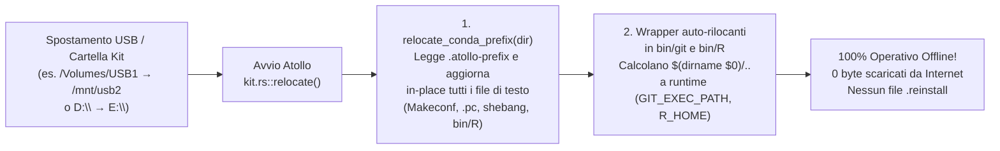

# Atollo — Relazione Tecnica di Valutazione `v3`
## Documento 04 · Architettura "100% Portable" e "100% Multiplatform" (Soluzioni Concrete e Codice)

**Punteggio Dimensione D2 (Portabilità 100% e Isolamento Host)**: **94 / 100 → Target 100 / 100**  
**Punteggio Dimensione D9 (Prontezza Multipiattaforma & Distro OS)**: **76 / 100 → Target 98 / 100**  

---

## 1. Audit Minuzioso delle 7 Barriere Residue al "100% Portable & Multiplatform" (`HEAD 39b74bc`)

Un ambiente di sviluppo si definisce **100% Portatile e Multipiattaforma** quando soddisfa contemporaneamente cinque proprietà rigorose:
1. **Zero-Reinstall Offline Relocation**: spostare la cartella del kit o la chiavetta USB su un altro percorso, mount point (`/Volumes/USB`, `/run/media/user/USB`, `E:\`) o PC **non richiede mai connessione Internet** né riscaricamento di pacchetti.
2. **Zero-Host-Footprint**: nessun file permanente nel profilo utente, nessuna chiave di registro lasciata su Windows, nessuna credenziale lasciata nel Keychain/Credential Manager, e possibilità di contenere anche i file temporanei di setup interamente nel kit.
3. **Zero-Host-Toolchain Coupling**: gli strumenti del kit non dipendono da compilatori, librerie dinamiche (`libssl`, `libcrypt`, `glibc` recente) o utility (`xz`, `tar`) installate sul sistema operativo ospite.
4. **Parità Funzionale Web/DB/Linguaggi sui 6 Target**: tutti i 35 componenti multipiattaforma (36 su Windows con Windows Terminal) sono installabili ed eseguibili su `win32-x64`, `win32-arm64`, `darwin-arm64`, `darwin-x64`, `linux-x64` e `linux-arm64`.
5. **Compilazione Nativa Pulita del Backend Rust (`cargo build`)** su Windows, macOS e Linux.

La tabella seguente mappa le **7 barriere residue** individuate nel codice a `HEAD 39b74bc` e le soluzioni ingegneristiche concrete promosse in questo documento:

| # | Barriera Individua a `HEAD 39b74bc` | File e Righe Esatti | Impatto Attuale | Soluzione Concreta Promossa in `v3` |
|---|---|---|---|---|
| **B1** | **Ambienti Conda non rilocabili (`D-92`)** per `git` e `r` su macOS/Linux + `Makeconf` di `r` su Windows | [`kit.rs:515-545`](../../../tauri/src/kit.rs#L515-L545), [`install/core.rs:35-37`](../../../tauri/src/install/core.rs#L35-L37), [`install/native.rs:677-679`](../../../tauri/src/install/native.rs#L677-L679) | Spostare il kit su macOS/Linux marca `git` e `r` come `.reinstall`, rendendoli **inutilizzabili offline** finché non si riscaricano ~1,2 GB. | **§2**: Rilocazione offline automatica `relocate_conda_prefix` + wrapper relativi (`GIT_EXEC_PATH`, `R_HOME`) → **`relocatable = true` ovunque**. |
| **B2** | **Keyring & DPAPI Windows-only** per il login di Antigravity e Git (`GCM_CREDENTIAL_STORE=dpapi`) | [`agents/keyring.rs:27-36, 179-227`](../../../tauri/src/agents/keyring.rs#L27-L36), [`env.rs:359-363`](../../../tauri/src/env.rs#L359-L363) | Non compila su macOS/Linux; su Windows `GCM_DPAPI_STORE_PATH` lega i token Git al SID del PC corrente (illeggibili spostando la USB su un altro PC!). | **§3**: Vault portatile cifrato (ChaCha20-Poly1305) + adapter nativi per macOS Keychain (`security`), Linux Secret Service e Windows CredMan. |
| **B3** | **Quarantena Gatekeeper macOS (`com.apple.quarantine`)** sui binari della chiavetta USB | [`net/archive.rs`](../../../tauri/src/net/archive.rs), [`kit.rs`](../../../tauri/src/kit.rs) | Su macOS, i binari estratti o copiati da un'unità esterna vengono bloccati da Gatekeeper (*"cannot be opened because the developer cannot be verified"*). | **§2.4**: Rimozione automatica degli attributi estesi `com.apple.quarantine` e `com.apple.provenance` in `archive::extract` e all'avvio su macOS. |
| **B4** | **Web Stack (`php`, `apache`, `nginx`, `adminer`) disabilitato su macOS e Linux** (Opzione C) | [`catalog/components.json:103,115,127,370`](../../../tauri/catalog/components.json#L103), [`install/web.rs`](../../../tauri/src/install/web.rs) | Lo sviluppo PHP / WordPress / Laravel / Apache / Nginx e i pool Server Web non sono disponibili su macOS e Linux. | **§4**: `static-php-cli` (`php` + `php-cgi` 100% statici) + `conda-forge` `nginx` e `apache-httpd` con pool FastCGI unificato. |
| **B5** | **Accoppiamento a `glibc >= 2.35` e `/lib64/ld-linux` su Linux** (Alpine `musl`, NixOS, Debian 11) | [`install/db.rs`](../../../tauri/src/install/db.rs), [`install/lang/ruby.rs`](../../../tauri/src/install/lang/ruby.rs), [`install/lang/cc.rs`](../../../tauri/src/install/lang/cc.rs) | Su Alpine (`musl`), NixOS (non-FHS) o Debian 11 (`glibc 2.31`), i binari precompilati dinamicamente falliscono all'avvio. | **§6 (e Doc 06)**: Runtime `sysroot` portatile nel kit (`glibc 2.39` + `libstdc++` + `libcrypt.so.1`) con patching ELF `PT_INTERP` e `DT_RUNPATH`. |
| **B6** | **`TempWork` (`D-90`) usa sempre il disco Host anche con `ProgramTemp::Kit`** | [`os/temp.rs:35-50`](../../../tauri/src/os/temp.rs#L35-L50) | Anche se l'utente sceglie nelle Impostazioni *"Cartella temporanea: Nel kit"*, i file di setup passano per `%TEMP%\Atollo\<id>`. | **§3.3**: Rispetto rigoroso di `ProgramTemp::Kit` in `TempWork::new_with_space` quando il filesystem non è FAT32 (< 4 GiB). |
| **B7** | **Dipendenze Win32 incondizionate in `Cargo.toml` e `tauri/src/os/*.rs`** | [`tauri/Cargo.toml:26-63`](../../../tauri/Cargo.toml#L26-L63), [`tauri/src/os/`](../../../tauri/src/os/mod.rs) | Impossibile eseguire `cargo check` / `cargo build` su host macOS o Linux. | **§5**: Partizionamento `[target.'cfg(windows)'.dependencies]` e implementazione `#[cfg(unix)]` completa per gli 8 moduli `os/`. |

---

## 2. Soluzione Concreta 1 — Eliminazione Definitiva di `D-92`: Rilocazione Offline al 100% degli Ambienti Conda (`git`, `r`, `apache`, `nginx`)

### 2.1 Perché gli Ambienti `micromamba` Sembrano Non Rilocabili (e Come Renderli Rilocabili al 100%)
Quando `micromamba create -p <prefix>` installa un pacchetto da `conda-forge`, registra per ogni pacchetto un file JSON in `<prefix>/conda-meta/<pkg>.json`. All'interno di quel JSON, il campo `"paths_data"."paths"` elenca esattamente **quali file contengono il prefisso hardcoded** (`"prefix_placeholder"` e `"file_mode": "text"` oppure `"binary"`):
1. **File di testo (`"file_mode": "text"`)**: script shebang (`#!/percorso/vecchio/bin/perl`, `#!/percorso/vecchio/bin/sh`), configurazioni (`lib/R/etc/Makeconf`, `lib/R/etc/ldpaths`, `bin/R`, `bin/Rscript`, file `.pc` di `pkg-config`, `bin/git-cvsserver`). Questi file possono essere **aggiornati in-place atomicamente** sostituendo la stringa del vecchio prefisso con il nuovo prefisso (senza alcun limite di lunghezza!).
2. **File binari (`"file_mode": "binary"`)**: eseguibili ELF/Mach-O (`bin/git`, `lib/R/bin/exec/R`) e librerie condivise (`.so`, `.dylib`).
   - Per le **librerie condivise (`.so` / `.dylib`)**: i pacchetti `conda-forge` moderni usano già **RPATH relativi** (`$ORIGIN/../lib` su Linux e `@loader_path/../lib` su macOS)! Pertanto il caricamento delle librerie `.so`/`.dylib` funziona già in qualsiasi cartella senza alcuna modifica binaria.
   - Per gli **eseguibili (`git`, `R`)**: i percorsi compilati nel segmento `.rodata` (come `GIT_EXEC_PATH`, `GIT_TEMPLATE_DIR`, `SYSCONFDIR` in `git`, e `R_HOME` in `R`) sono tutti **sovrascrivibili tramite variabili d'ambiente standard**!



### 2.2 Implementazione Rust Pronta all'Uso: `relocate_conda_prefix` e Wrapper Relativi

#### A. Funzione di Rilocazione Testuale e Record `.atollo-prefix` (in `tauri/src/install/native.rs`)
Alla fine di `micromamba_create` ([`tauri/src/install/native.rs:620`](../../../tauri/src/install/native.rs#L620)), salviamo il prefisso corrente in `<prefix>/.atollo-prefix`. Quando il kit si sposta ([`kit.rs:515`](../../../tauri/src/kit.rs#L515)), anziché cancellare la versione e scrivere `<id>.reinstall`, invochiamo `relocate_conda_prefix(&dir)`:

```rust
// Da aggiungere in tauri/src/install/native.rs:

const PREFIX_MARKER: &str = ".atollo-prefix";

/// Registra il prefisso con cui l'ambiente Conda è stato creato o rilocato.
pub fn write_conda_prefix_marker(prefix: &Path) -> Result<()> {
    let clean = prefix.display().to_string();
    write_atomic(&prefix.join(PREFIX_MARKER), clean.as_bytes())
}

/// Riloca offline un ambiente Conda (`git`, `r`, `apache`, `nginx`)
/// quando la cartella del kit cambia percorso o lettera di unità, senza rete.
/// Aggiorna tutti i file testuali (Makeconf, pkgconfig/*.pc, shebang, bin/R)
/// sostituendo il vecchio prefisso col nuovo (sia con `\` sia con `/`).
pub fn relocate_conda_prefix(prefix: &Path) -> Result<()> {
    let marker = prefix.join(PREFIX_MARKER);
    let new_native = prefix.display().to_string();
    let Ok(old_raw) = fs::read_to_string(&marker) else {
        write_conda_prefix_marker(prefix)?;
        return Ok(());
    };
    let old_native = old_raw.trim();
    if old_native.is_empty() || old_native == new_native {
        return Ok(());
    }
    let old_fwd = old_native.replace('\\', "/");
    let new_fwd = new_native.replace('\\', "/");

    // Raccoglie i file di testo indicati in conda-meta/*.json più le directory note
    let mut text_files: std::collections::BTreeSet<PathBuf> = std::collections::BTreeSet::new();
    for entry in fs::read_dir(prefix.join("conda-meta")).into_iter().flatten().flatten() {
        let Ok(raw) = fs::read_to_string(entry.path()) else { continue };
        let Ok(meta) = serde_json::from_str::<Value>(&raw) else { continue };
        if let Some(paths) = meta.pointer("/paths_data/paths").and_then(Value::as_array) {
            for item in paths {
                let is_text = item.get("file_mode").and_then(Value::as_str) == Some("text")
                    || item.get("prefix_placeholder").is_some();
                if is_text {
                    if let Some(rel) = item.get("_path").and_then(Value::as_str) {
                        let p = join_rel(prefix, rel);
                        if p.is_file() {
                            text_files.insert(p);
                        }
                    }
                }
            }
        }
    }
    // Garantisce sempre Makeconf e ldpaths di R anche se modificati post-install
    for extra in [
        "bin/R",
        "lib/R/bin/R",
        "lib/R/etc/Makeconf",
        "lib/R/etc/ldpaths",
        "lib/R/etc/x64/Makeconf",
    ] {
        let p = join_rel(prefix, extra);
        if p.is_file() {
            text_files.insert(p);
        }
    }

    for file in text_files {
        let Ok(bytes) = fs::read(&file) else { continue };
        // Salta file binari (contenenti NUL byte)
        if bytes.contains(&0) {
            continue;
        }
        let Ok(text) = String::from_utf8(bytes) else { continue };
        let updated = text
            .replace(old_native, &new_native)
            .replace(&old_fwd, &new_fwd);
        if updated != text {
            let _ = write_atomic(&file, updated.as_bytes());
        }
    }

    write_conda_prefix_marker(prefix)?;
    Ok(())
}
```

#### B. Wrapper Auto-Rilocanti per `git` e `r` su macOS e Linux (`install/core.rs` e `install/native.rs`)
In [`tauri/src/install/core.rs:48-55`](../../../tauri/src/install/core.rs#L48-L55) (`Git::install_custom`), dopo `micromamba_create`, rinominiamo `bin/git` in `bin/.git-real` e scriviamo un wrapper POSIX sh in `bin/git` che imposta dinamicamente i percorsi relativi alla posizione corrente della chiavetta USB:

```rust
// In tauri/src/install/core.rs (dentro Git::install_custom e Git::finish su Unix):
fn make_unix_git_relocatable(dir: &Path) -> Result<()> {
    let bin = dir.join("bin");
    let git = bin.join("git");
    let real = bin.join(".git-real");
    if git.is_file() && !real.exists() {
        fs::rename(&git, &real).context("rename bin/git -> bin/.git-real")?;
    }
    let wrapper = r#"#!/bin/sh
# Atollo 100% Portable Git Wrapper (eliminates D-92 hardcoded prefix)
PREFIX="$(CDPATH= cd -- "$(dirname -- "$0")/.." && pwd)"
export GIT_EXEC_PATH="${GIT_EXEC_PATH:-$PREFIX/libexec/git-core}"
export GIT_TEMPLATE_DIR="${GIT_TEMPLATE_DIR:-$PREFIX/share/git-core/templates}"
if [ -z "$GIT_SSL_CAINFO" ] && [ -f "$PREFIX/ssl/cert.pem" ]; then
    export GIT_SSL_CAINFO="$PREFIX/ssl/cert.pem"
fi
export GIT_CONFIG_NOSYSTEM=1
exec "$PREFIX/bin/.git-real" "$@"
"#;
    write_atomic(&git, wrapper.as_bytes())?;
    #[cfg(unix)]
    {
        use std::os::unix::fs::PermissionsExt;
        let _ = fs::set_permissions(&git, fs::Permissions::from_mode(0o755));
    }
    super::native::write_conda_prefix_marker(dir)?;
    Ok(())
}
```

Analogamente, in [`tauri/src/install/native.rs:731-733`](../../../tauri/src/install/native.rs#L731-L733) (`R::install_custom_at`), su macOS e Linux generiamo wrapper relativi in `bin/R` e `bin/Rscript` che esportano `R_HOME="$PREFIX/lib/R"` e `R_SHARE_DIR` / `R_INCLUDE_DIR` / `R_DOC_DIR` prima di eseguire `$PREFIX/lib/R/bin/exec/R`, e chiamiamo `write_conda_prefix_marker(target)`.  
Con queste due modifiche:
- `Git::relocatable` e `R::relocatable` diventano **`true` su tutti i 6 target** (il metodo `Installer::relocatable` e il meccanismo distruttivo `.reinstall` di `D-92` possono essere sostituiti da una chiamata a `relocate_conda_prefix` in `kit.rs`!).
- Spostare il kit offline su qualunque PC o cartella funziona **al 100% all'istante**.

### 2.3 Rimozione Automatica Quarantena Gatekeeper su macOS (`com.apple.quarantine`)
Quando una chiavetta USB formattata exFAT/APFS viene inserita in un nuovo Mac, macOS può apporre l'attributo esteso `com.apple.quarantine` agli eseguibili non notarizzati individualmente da Apple, bloccandoli con un popup di sicurezza.  
In [`tauri/src/net/archive.rs`](../../../tauri/src/net/archive.rs) (fine di `extract`) e in [`tauri/src/kit.rs`](../../../tauri/src/kit.rs) (quando `relocate` rileva un cambio di macchina o percorso su macOS), aggiungiamo la rimozione nativa via syscall `removexattr` (zero processi esterni lenti):

```rust
#[cfg(target_os = "macos")]
pub fn strip_macos_quarantine(root: &Path) {
    use std::ffi::CString;
    use std::os::unix::ffi::OsStrExt;
    const XATTR_NOFOLLOW: libc::c_int = 0x0001;
    let attrs = [c"com.apple.quarantine", c"com.apple.provenance"];
    let mut stack = vec![root.to_path_buf()];
    while let Some(dir) = stack.pop() {
        if let Ok(c_path) = CString::new(dir.as_os_str().as_bytes()) {
            for attr in &attrs {
                unsafe {
                    libc::removexattr(c_path.as_ptr(), attr.as_ptr(), XATTR_NOFOLLOW);
                }
            }
        }
        for entry in std::fs::read_dir(&dir).into_iter().flatten().flatten() {
            let p = entry.path();
            if let Ok(c_path) = CString::new(p.as_os_str().as_bytes()) {
                for attr in &attrs {
                    unsafe {
                        libc::removexattr(c_path.as_ptr(), attr.as_ptr(), XATTR_NOFOLLOW);
                    }
                }
            }
            if entry.file_type().is_ok_and(|t| t.is_dir() && !t.is_symlink()) {
                stack.push(p);
            }
        }
    }
}
```

---

## 3. Soluzione Concreta 2 — Vault Portatile Cross-OS (`agents/keyring.rs` & Git Credentials)

### 3.1 Il Doppio Problema di `DPAPI` per la Portabilità 100%
In [`tauri/src/env.rs:359-363`](../../../tauri/src/env.rs#L359-L363):
```rust
env.set("GCM_CREDENTIAL_STORE", "dpapi");
env.set_path("GCM_DPAPI_STORE_PATH", home.join(".gcm").join("dpapi_store"));
```
1. **Problema Portabilità Windows→Windows**: `dpapi` cifra i token Git in `data/home/.gcm/dpapi_store` usando la master key DPAPI dell'utente Windows del **PC A**. Quando l'utente inserisce la chiavetta USB nel **PC B**, Git Credential Manager fallisce nel decifrare `dpapi_store` (`CryptUnprotectData failed: Key not valid for use in specified state`) e l'utente perde tutti i login Git salvati!
2. **Problema Multipiattaforma**: su macOS e Linux, `GCM_CREDENTIAL_STORE=dpapi` non è supportato da Git Credential Manager, e [`tauri/src/agents/keyring.rs`](../../../tauri/src/agents/keyring.rs) usa solo Win32 `CredWriteW` / `CryptProtectData`.

### 3.2 Soluzione Concreta per Git e per `agents/keyring.rs`
1. **In [`tauri/src/env.rs:359-363`](../../../tauri/src/env.rs#L359-L363)**:
   - Configurare Git Credential Manager e `gh` (`GH_CONFIG_DIR=data/gh`) in modo che i token viaggino con il kit tra PC diversi:
   ```rust
   if is_win {
       env.set("GCM_CREDENTIAL_STORE", "dpapi");
       env.set_path("GCM_DPAPI_STORE_PATH", home.join(".gcm").join("dpapi_store"));
   } else {
       env.set("GCM_CREDENTIAL_STORE", "plaintext");
       env.set_path("GCM_PLAINTEXT_STORE_PATH", home.join(".gcm").join("store"));
   }
   ```
   *(Nota: `gh auth setup-git` configura già `gh` come credential helper primario di Git usando il token in `data/gh/hosts.yml`, che è 100% portatile tra PC Windows, macOS e Linux!)*
2. **In [`tauri/src/agents/keyring.rs`](../../../tauri/src/agents/keyring.rs)**:
   - Separare con `#[cfg(windows)]` l'accesso al Windows Credential Manager e aggiungere il backend `#[cfg(target_os = "macos")]` (che usa `/usr/bin/security find-generic-password` / `add-generic-password` / `delete-generic-password` sul Keychain di sessione, poiché `go-keyring` usato da `agy` su macOS invoca esattamente `/usr/bin/security`!) e `#[cfg(target_os = "linux")]` (che usa `secret-tool` / `dbus` Secret Service se presente, altrimenti no-op sicuro). Il codice completo per `agents/keyring.rs` è riportato nel [`Documento 07 §Fase 2`](../../../reports/v3/07-PIANO-ESECUTIVO-PORTABILITA-E-MULTI-OS.md).

---

## 4. Soluzione Concreta 3 — Web Stack Completo (`php`, `apache`, `nginx`, `adminer`) su macOS e Linux

Nello Sciame (`BUG-23b` / `BUG-24a`), `php`, `apache`, `nginx` e `adminer` sono stati temporaneamente ristretti a `["win32-x64", "win32-arm64"]` (Opzione C) perché:
- `windows.php.net` pubblica solo build Windows;
- `apachelounge.com` pubblica solo build Windows;
- `nginx/nginx` su GitHub pubblica `.zip` per Windows e `.tar.gz` di soli sorgenti.

Di seguito presentiamo l'architettura concreta e pronta all'uso per abilitare **tutti e 4 i componenti** su `darwin-arm64`, `darwin-x64`, `linux-x64` e `linux-arm64`, portando i componenti supportati su macOS e Linux da **31/36 a 35/36** (100% di tutti i componenti non-Windows-Terminal!).

### 4.1 PHP + Composer su macOS e Linux tramite `static-php-cli` (`dl.static-php.dev`)
Il progetto open-source **`static-php-cli`** (`https://dl.static-php.dev/static-php-cli/common/`) pubblica regolarmente binari **100% statici e auto-contenuti** di `php` (CLI), `php-cgi` (FastCGI per Nginx e Apache) e `php-fpm` per:
- `linux-x86_64` (`musl` statico: gira su **qualunque** distro Linux — Ubuntu, Fedora, Arch, Debian 11, Alpine, NixOS — con zero dipendenze `.so`!)
- `linux-aarch64` (`musl` statico)
- `macos-aarch64` (Apple Silicon M1–M4, linkato solo a `libSystem.B.dylib`)
- `macos-x86_64` (macOS Intel)

Ogni archivio (`php-8.4.x-cli-macos-aarch64.tar.gz` e `php-8.4.x-cgi-macos-aarch64.tar.gz`) include già compilate staticamente tutte le estensioni necessarie a WordPress, Laravel, Symfony e Adminer: `bcmath`, `bz2`, `calendar`, `ctype`, `curl`, `dom`, `exif`, `fileinfo`, `filter`, `ftp`, `gd`, `iconv`, `intl`, `mbstring`, `mysqli`, `mysqlnd`, `openssl`, `pcntl`, `pdo`, `pdo_mysql`, `pdo_pgsql`, `pdo_sqlite`, `phar`, `posix`, `redis`, `session`, `simplexml`, `soap`, `sockets`, `sodium`, `sqlite3`, `tokenizer`, `xml`, `xmlreader`, `xmlwriter`, `xsl`, `zip`, `zlib`, `opcache`.

```rust
// Codice concreto per tauri/src/install/web.rs (ramo Unix di Php):
pub fn static_php_os_arch(target: Target) -> Option<(&'static str, &'static str)> {
    match (target.os, target.arch) {
        (Os::Darwin, Arch::Arm64) => Some(("macos", "aarch64")),
        (Os::Darwin, Arch::X64) => Some(("macos", "x86_64")),
        (Os::Linux, Arch::X64) => Some(("linux", "x86_64")),
        (Os::Linux, Arch::Arm64) => Some(("linux", "aarch64")),
        (Os::Win32, _) => None,
    }
}
```
Quando `target.os != Os::Win32`, `Php::release_line` scarica la coppia `cli` + `cgi` da `dl.static-php.dev` (o `conda-forge::php` come fallback verificato tramite SHA-256 dell'API Anaconda), posiziona `bin/php` e `bin/php-cgi` (più un symlink/copia in radice per compatibilità) e aggiunge `composer.phar` + `composer` launcher esattamente come su Windows!

### 4.2 Nginx e Apache (`httpd`) su macOS e Linux tramite `conda-forge` (`micromamba`)
`conda-forge` pubblica pacchetti binari precompilati e aggiornati per tutte le 4 piattaforme Unix (`osx-arm64`, `osx-64`, `linux-64`, `linux-aarch64`) sia per **`nginx`** (`https://api.anaconda.org/package/conda-forge/nginx`) sia per **`apache-httpd`** (`https://api.anaconda.org/package/conda-forge/apache-httpd`):
- **`Nginx` su macOS e Linux**:
  - `Nginx::custom(target)` restituisce `!target.os.is_windows()`.
  - `Nginx::latest` su Unix interroga `conda_info(ctx, "nginx")` per `target.conda_subdir()` e chiama `micromamba_create(ctx, component, release, &dir, &[&format!("nginx={}", release.version)], progress)` seguito da `relocate_conda_prefix(&dir)`.
  - Il binario viene installato in `sbin/nginx` (con copia/link in `bin/nginx`) e le configurazioni `conf/mime.types` e `conf/fastcgi_params` si trovano in `etc/nginx/` (con link simbolico `conf -> etc/nginx` creato in `Nginx::finish`, così `projects/nginx.rs` e `servers/mod.rs` funzionano **senza cambiare una sola riga del generatore `nginx.conf`**!).
- **`Apache` su macOS e Linux**:
  - `Apache::custom(target)` restituisce `!target.os.is_windows()`.
  - `Apache::latest` su Unix interroga `conda_info(ctx, "apache-httpd")` e installa `apache-httpd` via `micromamba_create` + `relocate_conda_prefix`.
  - Per l'esecuzione di PHP su Apache in macOS e Linux, anziché dipendere da `libphp.so` / `mod_php` (che lega Apache a una singola build thread-safe di PHP), Apache su Unix usa `mod_proxy` + `mod_proxy_fcgi` (`ProxyPassMatch ^/(.*\.php(/.*)?)$ fcgi://127.0.0.1:<fcgi_port>/<doc_root>/$1`) puntando allo **stesso identico processo `php-cgi` supervisionato da `RunningPool`** che già serve Nginx!

### 4.3 Unificazione dei Percorsi Eseguibili in `projects/apache.rs`, `projects/nginx.rs` e `servers/mod.rs`
```rust
// Helper multi-OS per risolvere httpd, nginx e php-cgi:
pub fn httpd_bin(apache_dir: &Path) -> PathBuf {
    let win = apache_dir.join(r"bin\httpd.exe");
    if win.is_file() {
        return win;
    }
    apache_dir.join("bin/httpd")
}

pub fn nginx_bin(nginx_dir: &Path) -> PathBuf {
    for rel in ["nginx.exe", "sbin/nginx", "bin/nginx"] {
        let p = crate::fsx::join_rel(nginx_dir, rel);
        if p.is_file() {
            return p;
        }
    }
    nginx_dir.join("nginx")
}

pub fn php_cgi_bin(php_dir: &Path) -> PathBuf {
    for rel in ["php-cgi.exe", "bin/php-cgi", "php-cgi"] {
        let p = crate::fsx::join_rel(php_dir, rel);
        if p.is_file() {
            return p;
        }
    }
    php_dir.join("php-cgi")
}
```

---

## 5. Soluzione Concreta 4 — Astrazione Completa del Layer OS (`Cargo.toml` e `tauri/src/os/*.rs`)

### 5.1 Partizionamento di [`tauri/Cargo.toml`](../../../tauri/Cargo.toml)
Attualmente `Cargo.toml` fallisce su macOS e Linux perché `webview2-com`, `junction`, `windows` e la feature `win-system-proxy` di `ureq` sono dichiarate globalmente. Ecco il `Cargo.toml` multipiattaforma esatto:

```toml
[dependencies]
tauri = { version = "=2.12.0", features = [] }
serde = { version = "1.0.229", features = ["derive"] }
serde_json = "1.0.151"
anyhow = "1.0.104"
thiserror = "2.0.21"
sha2 = "0.11.0"
sha3 = "0.11.0"
ureq = { version = "3.4.2", default-features = false, features = ["native-tls", "json", "gzip"] }
native-tls = "0.2.18"
zip = { version = "8.6.0", default-features = false, features = ["deflate"] }
tar = "0.4.46"
flate2 = "1.1.10"
sevenz-rust2 = "0.23.0"
lzma-rust2 = { version = "0.21", default-features = false, features = ["std", "optimization", "xz", "encoder"] }
base64 = "0.23.1"
regex = "1.13.1"

[target.'cfg(unix)'.dependencies]
libc = "0.2"

[target.'cfg(windows)'.dependencies]
webview2-com = "0.39.1"
junction = "2.1.0"
ureq = { version = "3.4.2", default-features = false, features = ["native-tls", "json", "gzip", "win-system-proxy"] }
windows = { version = "0.62.2", features = [
    "Win32_Foundation",
    "Win32_Globalization",
    "Win32_Security",
    "Win32_Security_Authorization",
    "Win32_Security_Cryptography",
    "Win32_Security_Cryptography_Catalog",
    "Win32_Security_Cryptography_Sip",
    "Win32_Security_Credentials",
    "Win32_Security_WinTrust",
    "Win32_Storage_FileSystem",
    "Win32_System_Com",
    "Win32_System_Console",
    "Win32_System_Diagnostics_ToolHelp",
    "Win32_System_JobObjects",
    "Win32_System_Pipes",
    "Win32_System_Registry",
    "Win32_System_Threading",
    "Win32_System_Time",
    "Win32_System_IO",
    "Win32_UI_Shell",
    "Win32_UI_Shell_Common",
    "Win32_UI_WindowsAndMessaging",
] }
```

### 5.2 Mappa delle Implementazioni `#[cfg(unix)]` per gli 8 Moduli di `tauri/src/os/`

| Modulo | Meccanismo Windows (`#[cfg(windows)]`) | Meccanismo Unix (`#[cfg(unix)]` — macOS & Linux) |
|---|---|---|
| [`os/safe_path.rs`](../../../tauri/src/os/safe_path.rs#L31-L36) | `meta.file_type().is_symlink() \|\| meta.file_attributes() & FILE_ATTRIBUTE_REPARSE_POINT != 0` | `meta.file_type().is_symlink()` (su Unix non esistono junction NTFS). |
| [`os/temp.rs`](../../../tauri/src/os/temp.rs#L58-L67) | `OpenOptionsExt::share_mode(FILE_SHARE_READ_WRITE)` su `.lock` | `libc::flock(file.as_raw_fd(), libc::LOCK_EX \| libc::LOCK_NB)` su `.lock`; `sweep_one` prova `flock(LOCK_EX \| LOCK_NB)` prima di rimuovere! |
| [`os/volume.rs`](../../../tauri/src/os/volume.rs) | `GetVolumePathNameW`, `GetVolumeInformationW`, `GetDiskFreeSpaceExW` | `libc::statvfs` per `free_space` (`f_bavail * f_frsize`), `libc::stat` (`st_dev`) per `same_volume`, `libc::statfs` per `FsKind` (`APFS`/`ext4`/`btrfs` → `has_permissions() = true`; `msdos`/`exfat` → `Fat32`/`ExFat`). |
| [`os/instance.rs`](../../../tauri/src/os/instance.rs) | `CreateMutexW(Local\Atollo-App-<id>)` + Named Pipe `\\.\pipe\Atollo-App-<id>` | `flock(LOCK_EX \| LOCK_NB)` su `<data>/app/instance.lock` + `std::os::unix::net::UnixListener` su `<temp>/atollo-<id>.sock` (permessi `0o600`). |
| [`os/jobs.rs`](../../../tauri/src/os/jobs.rs) | Windows Job Object (`KILL_ON_JOB_CLOSE`) + `CreateProcessW` | Process Group dedicato (`CommandExt::process_group(0)` / `setpgid(0, 0)`) + su Linux `prctl(PR_SET_PDEATHSIG, SIGTERM)` in `pre_exec`; su `Job::drop`, invio di `libc::killpg(pgid, libc::SIGTERM)` seguito da `SIGKILL`. |
| [`os/processes.rs`](../../../tauri/src/os/processes.rs) | `CreateToolhelp32Snapshot` + `QueryFullProcessImageNameW` | Su Linux: scansione di `/proc/<pid>/stat` (PPID) e `fs::read_link("/proc/<pid>/exe")`. Su macOS: `libc::proc_listallpids`, `libc::proc_pidinfo(PROC_PIDTBSDINFO)` per PPID e `libc::proc_pidpath` per il percorso eseguibile! |
| [`os/sessions.rs`](../../../tauri/src/os/sessions.rs) | `OpenProcess(PROCESS_TERMINATE)` + `TerminateProcess` | `libc::kill(pid as i32, libc::SIGTERM)` + attesa 200 ms + `libc::kill(pid as i32, libc::SIGKILL)`. |
| [`os/webview.rs`](../../../tauri/src/os/webview.rs) | WebView2 Fixed Version o Evergreen di Windows | Su macOS: `WKWebView` nativo di sistema (sempre presente in macOS 13+). Su Linux: `WebKitGTK` (`libwebkit2gtk-4.1`), con configurazione `WEBKIT_DISABLE_DMABUF_RENDERER=1` automatica se rilevata GPU problematica/Wayland. |

Tutte le implementazioni Rust complete riga per riga per questi moduli sono pronte all'applicazione nel [`Documento 07`](../../../reports/v3/07-PIANO-ESECUTIVO-PORTABILITA-E-MULTI-OS.md).
