# Atollo — Relazione Tecnica di Valutazione `v3`
## Documento 05 · Indicatori Quantitativi, Metriche, Test e Grafici Evolutivi (`v1 → v2 → v3`)

**Punteggio Dimensione D8 (Qualità Codice, Testabilità e Documentazione)**: **94 / 100** *(v1: 85/100 · v2: 87/100 · Target v3.1: 97/100)*  

---

## 1. Cruscotto Completo dei 38 KPI Tecnici (`v1` vs `v2` vs `v3` vs `Target v3.1`)

La tabella seguente confronta le metriche oggettive misurate sul repository tra `v1` (`66499b5`), `v2` (`fa8a34d`), l'attuale `HEAD` `v3` (`39b74bc`) e il target `v3.1` (dopo l'applicazione delle patch del [`Documento 07`](../../../reports/v3/07-PIANO-ESECUTIVO-PORTABILITA-E-MULTI-OS.md)):

| # | Indicatore / KPI | `v1` (`66499b5`) | `v2` (`fa8a34d`) | `v3` (`39b74bc`) | Delta (`v3 - v2`) | Target `v3.1` |
|---|---|---|---|---|---|---|
| **K01** | **Punteggio Globale Ponderato (su 100)** | 82,4 | 85,4 | **93,1** | **+7,7** | **98,2** |
| **K02** | **Componenti totali a catalogo (`components.json`)** | 36 | 36 | **36** | `=` | **36** |
| **K03** | **Sotto-strumenti bundled automatici** (`composer`, `maven`, `gradle`, `ninja`, `micromamba`, `vcruntime`, `mongosh`, `mongodb-tools`, `codelldb`) | 9 | 9 | **9** | `=` | **9 + `sysroot`** |
| **K04** | **Target OS/Arch modellati in `kit.rs`** | 2 (`win32-*`) | 6 | **6** | `=` | **6** |
| **K05** | **Componenti installabili su `win32-x64`** | 36 / 36 (100%) | 36 / 36 (100%) | **36 / 36 (100%)** | `=` | **36 / 36 (100%)** |
| **K06** | **Componenti installabili su `win32-arm64` (Win 11 Prism)** | 35 / 36 (97%) | 35 / 36 (97%) | **35 / 36 (97%)** | `=` | **36 / 36 (100%)** |
| **K07** | **Componenti installabili su `darwin-arm64` (macOS Silicon)** | 0 / 36 (0%) | 29 / 36 (81%) | **30 / 36 (83%)** | **+1** (`git`) | **35 / 36 (97%)** |
| **K08** | **Componenti installabili su `darwin-x64` (macOS Intel)** | 0 / 36 (0%) | 28 / 36 (78%) | **29 / 36 (81%)** | **+1** (`git`) | **35 / 36 (97%)** |
| **K09** | **Componenti installabili su `linux-x64` (Ubuntu/Debian)** | 0 / 36 (0%) | 30 / 36 (83%) | **31 / 36 (86%)** | **+1** (`git`) | **35 / 36 (97%)** |
| **K10** | **Componenti installabili su `linux-arm64`** | 0 / 36 (0%) | 30 / 36 (83%) | **31 / 36 (86%)** | **+1** (`git`) | **35 / 36 (97%)** |
| **K11** | **Componenti usabili su Linux `musl` (Alpine) / NixOS** | 0 / 36 (0%) | 8 / 36 (22%) | **9 / 36 (25%)** | **+1** | **34–35 / 36 (97%)** |
| **K12** | **Componenti 100% rilocabili offline su Windows** | 36 / 36 | 36 / 36 | **36 / 36 (100%)** | `=` | **36 / 36 (100%)** |
| **K13** | **Componenti 100% rilocabili offline su macOS / Linux** | N/D | 29 / 31 | **29 / 31 (93,5%)** (`git`, `r` = `D-92`) | — | **35 / 35 (100%)** |
| **K14** | **Estrazione archivi `.tar.xz` senza tool esterni (`lzma-rust2`)** | No | No (`tar -xJf`) | **Sì (100% Pure-Rust)** | **Risolto (`BUG-22`)** | **Sì (100%)** |
| **K15** | **Protezione Symlink Chain Traversal in `.tar` / `.tar.xz`** | Parziale | Parziale | **100% (`symlink_chain_stays_in`)** | **Risolto (`BUG-22`)** | **100%** |
| **K16** | **Vulnerabilità Critiche / Alte aperte** | 6 | 7 | **0** | **-7 (Tutte chiuse)** | **0** |
| **K17** | **Vulnerabilità Medie / Basse aperte** | 5 | 5 | **3** (`SEC-V3-01..03`) | **-2** | **0** |
| **K18** | **Bug di concorrenza / race condition nei Pool Web** | 3 | 3 | **0** (`store_lock` + `op_lock`) | **-3 (Tutti chiusi)** | **0** |
| **K19** | **I/O disco per poll UI 3 s in `ServersPage`** | Scan completo | Scan completo | **0 letture disco (`ListCache` 15 s)** | **-100% I/O idle** | **0 letture disco** |
| **K20** | **Supervisione processo `php-cgi` nei Pool Nginx** | Assente | Assente | **Attiva (`RunningPool.php`)** | **Risolto (`BUG-05r`)** | **Pool + Dedicato** |
| **K21** | **Collegamento «Avvia» progetto → Pool condiviso** | Assente | Assente | **Attivo (`Runner::attach_pool`)** | **Risolto (`GAP-RUN`)** | **Attivo** |
| **K22** | **Test automatici Rust (`test/rust/`)** | 248 | 281 | **358** | **+77 test (+27,4%)** | **395+** |
| **K23** | **Test automatici Frontend Vitest (`test/ui/`)** | 66 | 66 | **85** | **+19 test (+28,8%)** | **95+** |
| **K24** | **Totale test automatici della suite** | 314 | 347 | **443** | **+96 test (+27,7%)** | **490+** |
| **K25** | **Code-splitting lazy della `GuidePage` (1.375 righe)** | No | No | **Sì (`React.lazy` + `Suspense`)** | **Risolto (`ARCH-LAZY`)** | **Sì** |
| **K26** | **Navigazione tastiera WAI-ARIA Sidebar + Focus Trap** | Parziale | Parziale | **Completa (`Sidebar` + `ConfirmModal`)** | **Risolto (`BUG-11r/20r`)** | **Tutte le 4 modali** |
| **K27** | **Retry selettivo dei componenti falliti in `SetupModal`** | No | No | **Sì (`failedIds` → «Riprova»)** | **Risolto (`UI-POLISH`)** | **Sì** |
| **K28** | **Moduli `tauri/src/os/*.rs` con `#[cfg(unix)]` completo** | 0 / 8 | 0 / 8 | **0 / 8** | `=` | **8 / 8 (100%)** |

---

## 2. Analisi della Crescita della Suite di Test (`347 → 443 Test Automatici`)

Uno dei risultati più tangibili dello Sciame tra `v2` e `v3` è l'espansione della suite di test:
- **Backend Rust (`test/rust/`)**: cresciuto a **358 `#[test]`** distribuiti in 39 file di test speculari a `tauri/src/`.
  - Nuovi test di sicurezza per `symlink_chain_stays_in` e hard-link in [`test/rust/net/archive.rs`](../../../test/rust/net/archive.rs).
  - Nuovi test per `Git` via `micromamba`, `relocatable` e `D-92` in [`test/rust/install/core.rs`](../../../test/rust/install/core.rs), [`test/rust/install/native.rs`](../../../test/rust/install/native.rs) e [`test/rust/kit.rs`](../../../test/rust/kit.rs).
  - Nuovi test per `php_module_blocks` case-insensitive `(?i)\.php$`, `hidden_deny` (`.env`, `.git`, `.well-known`), `site_doc_root`, `needs_restart` e `Runner::attach_pool` in [`test/rust/projects/apache.rs`](../../../test/rust/projects/apache.rs), [`test/rust/projects/nginx.rs`](../../../test/rust/projects/nginx.rs), [`test/rust/servers/mod.rs`](../../../test/rust/servers/mod.rs) e [`test/rust/projects/run.rs`](../../../test/rust/projects/run.rs).
- **Frontend UI (`test/ui/`)**: cresciuto da **66 a 85 test Vitest** (`+28,8%`), coprendo il focus trap di `ConfirmModal`, la navigazione da tastiera di `Sidebar`, il retry selettivo in `SetupModal` e i flussi di conferma in `ServersPage` e `DatabasesPage`.

```mermaid
xychart-beta
    title "Evoluzione Suite di Test Automatici (Rust + Vitest UI)"
    x-axis ["v1 (66499b5)", "v2 (fa8a34d)", "v3 Audit (39b74bc)", "Target v3.1"]
    y-axis "Numero di Test" 0 --> 520
    bar [248, 281, 358, 395]
    bar [66, 66, 85, 95]
    line [314, 347, 443, 490]
```

---

## 3. Distribuzione dei 36 Componenti per Metodo di Verifica Crittografica e Formato Archivio

L'analisi di [`tauri/src/install/`](../../../tauri/src/install/mod.rs) mostra che il **100% dei 36 componenti** (e tutti i 9 sotto-strumenti) sono verificati crittograficamente prima dell'estrazione:

| Metodo di Verifica (`Expect`) | N. Componenti / Sotto-tool | Componenti |
|---|---:|---|
| **`Expect::Sha256` (GitHub Release Digest / Checksum File / JSON API)** | 37 | `git`, `python`, `node`, `uv`, `gh`, `php`, `composer`, `apache`, `nginx`, `rust`, `go`, `java`, `gradle`, `kotlin`, `android`, `dart`, `zig`, `julia`, `bun`, `deno`, `typst`, `tinytex`, `cmake`, `ninja`, `cc`, `ruby`, `micromamba`, `mysql`, `mongodb`, `mongosh`, `mongodb-tools`, `adminer`, `pwsh`, `terminal`, `vscodium-server`, `cacert.pem`, `codelldb` |
| **`Expect::Sha512` (Manifest / Maven / .NET Releases)** | 3 | `antigravity`, `dotnet`, `maven` |
| **`Expect::Sha3_256` (SQLite Download CSV)** | 1 | `sqlite` |
| **`Expect::NpmIntegrity` (SHA-512 Subresource Integrity npm + Authenticode)** | 2 | `claude` (+ verifica firma `Anthropic` su Windows), `codex` |
| **Firma Digitale X.509 Authenticode (`O=Microsoft Corporation`)** | 1 | `vcruntime` (`vc_redist.x64.exe` e `vcruntime140.dll`) |
| **Installazione via Package Manager Verificato del Kit** | 3 | `pnpm` + `yarn` (via `npm`/`corepack` del kit), `r` e `git` Unix (via `micromamba` HTTPS `conda-forge` con verifica SHA-256 dei pacchetti `.conda`) |
