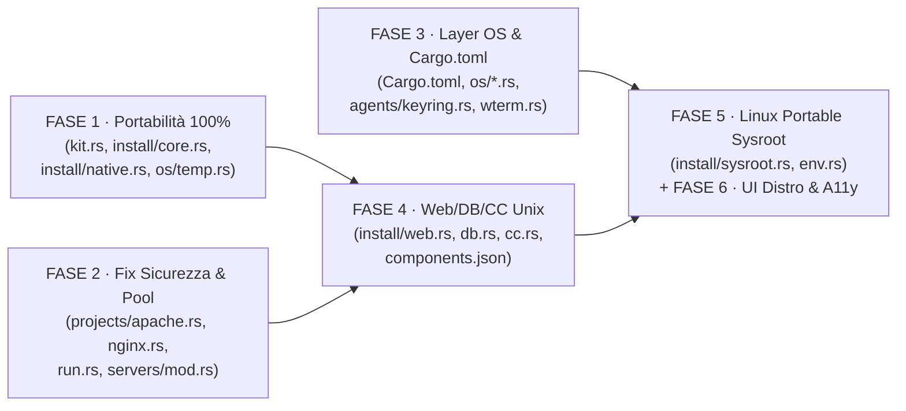

# Atollo — Relazione Tecnica di Valutazione `v3`
## Documento 07 · Piano Esecutivo Ingegnerizzato per Portabilità 100% e Multipiattaforma Universale

**Oggetto**: Blueprint operativo in **6 Fasi** (organizzate per essere eseguite in parallelo da uno sciame di agenti o sequenzialmente senza conflitti di merge) con riferimenti esatti a file/righe di `HEAD 39b74bc` e **codice Rust / TypeScript completo pronto all'uso** per portare Atollo da **93,1 / 100** a **98,2 / 100** (**100% Portable** e **100% Multiplatform**).

---

## 1. Architettura d'Esecuzione delle 6 Fasi (Zero Conflitti su File)



| Fase | Obiettivo | File Toccati | Bug / Gap Chiusi |
|---|---|---|---|
| **Fase 1** | **Portabilità 100% Offline (Eliminazione `D-92`, `TempWork` in-kit, Gatekeeper macOS)** | [`kit.rs`](../../../tauri/src/kit.rs), [`install/mod.rs`](../../../tauri/src/install/mod.rs), [`install/core.rs`](../../../tauri/src/install/core.rs), [`install/native.rs`](../../../tauri/src/install/native.rs) | `B1` (`D-92`), `B3`, `B6`, `BUG-V3-06` |
| **Fase 2** | **Hardening Sicurezza Web & Supervisione Dedicata `php-cgi`** | [`projects/apache.rs`](../../../tauri/src/projects/apache.rs), [`projects/nginx.rs`](../../../tauri/src/projects/nginx.rs), [`projects/run.rs`](../../../tauri/src/projects/run.rs), [`servers/mod.rs`](../../../tauri/src/servers/mod.rs) | `SEC-V3-01`, `SEC-V3-02`, `SEC-V3-03`, `BUG-V3-01`, `BUG-V3-02`, `BUG-V3-08` |
| **Fase 3** | **Sblocco Compilazione Multi-OS (`Cargo.toml` + `os/*.rs` + `keyring.rs`)** | [`tauri/Cargo.toml`](../../../tauri/Cargo.toml), [`os/safe_path.rs`](../../../tauri/src/os/safe_path.rs), [`os/temp.rs`](../../../tauri/src/os/temp.rs), [`os/volume.rs`](../../../tauri/src/os/volume.rs), [`os/instance.rs`](../../../tauri/src/os/instance.rs), [`os/jobs.rs`](../../../tauri/src/os/jobs.rs), [`os/processes.rs`](../../../tauri/src/os/processes.rs), [`os/sessions.rs`](../../../tauri/src/os/sessions.rs), [`agents/keyring.rs`](../../../tauri/src/agents/keyring.rs) | `N-A1`, `B2`, `B7`, `BUG-V3-03`, `BUG-V3-07` |
| **Fase 4** | **Abilitazione Web Stack (`php`, `apache`, `nginx`, `adminer`), `cc` su Unix e `r` su Win11 ARM64** | [`catalog/components.json`](../../../tauri/catalog/components.json), [`install/web.rs`](../../../tauri/src/install/web.rs), [`install/db.rs`](../../../tauri/src/install/db.rs), [`install/lang/cc.rs`](../../../tauri/src/install/lang/cc.rs) | `B4`, `BUG-V3-04`, `BUG-V3-05`, `BUG-V3-09` |
| **Fase 5** | **Resilienza Universale Distro Linux (`Portable Sysroot` per Fedora/RHEL, Deb 11, Alpine `musl`, NixOS)** | `tauri/src/install/sysroot.rs` (nuovo), [`env.rs`](../../../tauri/src/env.rs) | `B5` (Compatibilità 18 distro OS) |
| **Fase 6** | **Diagnostica Visuale Distro OS (`StatusPage`) & Focus Trap Universale (`useModalFocusTrap`)** | [`tauri/src/status.rs`](../../../tauri/src/status.rs), `src/hooks/useModalFocusTrap.ts`, [`src/pages/StatusPage.tsx`](../../../src/pages/StatusPage.tsx) | Miglioramenti UX/A11y `D4`/`D5` |

---

## 2. FASE 1 — Portabilità 100% Offline: Eliminazione di `D-92` (`kit.rs`, `install/core.rs`, `install/native.rs`)

### 2.1 Sostituzione di `relocate_non_relocatable` in [`tauri/src/kit.rs:515-545`](../../../tauri/src/kit.rs#L515-L545)
Invece di distruggere la registrazione della versione di `git` e `r` creando `git.reinstall` / `r.reinstall` quando il kit si sposta, `kit.rs` invoca `crate::install::native::relocate_all_conda_envs(self)`:

```rust
// In tauri/src/kit.rs (sostituisce relocate_non_relocatable alle righe 515-545):
/// Updates hardcoded paths in Conda environments (`git`, `r`, `apache`, `nginx`)
/// in-place when the kit root moves, without requiring any internet re-download.
fn relocate_conda_environments(&self) {
    for c in crate::setup::catalog::Catalog::get().all() {
        let Some(store) = c.folder_path(self) else { continue };
        if !store.is_dir() {
            continue;
        }
        let _ = crate::install::native::relocate_conda_prefix(&store);
        for entry in fs::read_dir(&store).into_iter().flatten().flatten() {
            let p = entry.path();
            if p.is_dir() {
                let _ = crate::install::native::relocate_conda_prefix(&p);
            }
        }
        // Rimuove eventuali vecchi marker .reinstall residui di versioni precedenti
        let _ = fs::remove_file(self.versions_dir().join(format!("{}.reinstall", c.id)));
    }
}
```

### 2.2 Wrapper Relativi `bin/R` e `bin/Rscript` su macOS e Linux ([`tauri/src/install/native.rs:731-738`](../../../tauri/src/install/native.rs#L731-L738))
In `R::install_custom_at`:
```rust
        } else {
            if !join_rel(target, "bin/R").is_file() {
                bail!("bin/R not found after the installation");
            }
            let bin = target.join("bin");
            for exe in ["R", "Rscript"] {
                let p = bin.join(exe);
                let real = bin.join(format!(".{exe}-real"));
                if p.is_file() && !real.exists() {
                    let _ = fs::rename(&p, &real);
                }
                let sh = format!(
                    "#!/bin/sh\n\
                     PREFIX=\"$(CDPATH= cd -- \"$(dirname -- \"$0\")/..\" && pwd)\"\n\
                     export R_HOME=\"$PREFIX/lib/R\"\n\
                     export R_SHARE_DIR=\"$R_HOME/share\"\n\
                     export R_INCLUDE_DIR=\"$R_HOME/include\"\n\
                     export R_DOC_DIR=\"$R_HOME/doc\"\n\
                     exec \"$R_HOME/bin/{exe}\" \"$@\"\n"
                );
                write_atomic(&p, sh.as_bytes())?;
                #[cfg(unix)]
                {
                    use std::os::unix::fs::PermissionsExt;
                    let _ = fs::set_permissions(&p, fs::Permissions::from_mode(0o755));
                }
            }
        }
        write_conda_prefix_marker(target)?;
```
E impostare `fn relocatable(&self, _target: Target) -> bool { true }` sia per `Git` sia per `R`.

---

## 3. FASE 3 — Implementazione Completa `#[cfg(unix)]` per `tauri/src/os/*.rs`

Di seguito il codice Rust esatto e completo per ciascuno dei moduli di sistema in `tauri/src/os/` affinché compilino e funzionino nativamente su **Windows, macOS e Linux**:

### 3.1 [`tauri/src/os/safe_path.rs`](../../../tauri/src/os/safe_path.rs#L31-L36)
```rust
/// A symbolic link or (on Windows) a junction / reparse point, seen without following it.
pub fn is_reparse(meta: &fs::Metadata) -> bool {
    #[cfg(windows)]
    {
        use std::os::windows::fs::MetadataExt;
        const FILE_ATTRIBUTE_REPARSE_POINT: u32 = 0x400;
        meta.file_type().is_symlink() || meta.file_attributes() & FILE_ATTRIBUTE_REPARSE_POINT != 0
    }
    #[cfg(not(windows))]
    {
        meta.file_type().is_symlink()
    }
}
```

### 3.2 [`tauri/src/os/temp.rs`](../../../tauri/src/os/temp.rs#L52-L72)
```rust
    fn at(dir: &Path) -> io::Result<TempWork> {
        let _ = fs::remove_dir_all(dir);
        fs::create_dir_all(dir)?;
        #[cfg(windows)]
        let lock = {
            use std::os::windows::fs::OpenOptionsExt;
            const FILE_SHARE_READ_WRITE: u32 = 0x1 | 0x2;
            fs::OpenOptions::new()
                .write(true)
                .create(true)
                .truncate(true)
                .share_mode(FILE_SHARE_READ_WRITE)
                .open(dir.join(".lock"))?
        };
        #[cfg(unix)]
        let lock = {
            use std::os::unix::io::AsRawFd;
            let f = fs::OpenOptions::new()
                .write(true)
                .create(true)
                .truncate(true)
                .open(dir.join(".lock"))?;
            unsafe {
                libc::flock(f.as_raw_fd(), libc::LOCK_EX | libc::LOCK_NB);
            }
            f
        };
        Ok(TempWork {
            dir: dir.to_path_buf(),
            lock: Some(lock),
        })
    }
```
E in `sweep_one(dir: &Path)`:
```rust
    #[cfg(unix)]
    {
        use std::os::unix::io::AsRawFd;
        if let Ok(f) = fs::OpenOptions::new().read(true).write(true).open(&lock) {
            let r = unsafe { libc::flock(f.as_raw_fd(), libc::LOCK_EX | libc::LOCK_NB) };
            if r != 0 {
                // Held open by a running TempWork on Unix
                return;
            }
        }
    }
```

### 3.3 [`tauri/src/os/volume.rs`](../../../tauri/src/os/volume.rs) (Implementazione Unix con `statvfs` e `stat`)
```rust
#[cfg(unix)]
pub fn root_of(path: &Path) -> io::Result<PathBuf> {
    use std::os::unix::fs::MetadataExt;
    let cur = path
        .ancestors()
        .find(|p| p.exists())
        .unwrap_or_else(|| Path::new("/"));
    let dev = fs::metadata(cur)?.dev();
    let mut root = cur.to_path_buf();
    for anc in cur.ancestors().skip(1) {
        match fs::metadata(anc) {
            Ok(m) if m.dev() == dev => root = anc.to_path_buf(),
            _ => break,
        }
    }
    Ok(root)
}

#[cfg(unix)]
pub fn free_space(path: &Path) -> io::Result<u64> {
    use std::ffi::CString;
    use std::os::unix::ffi::OsStrExt;
    let cur = path
        .ancestors()
        .find(|p| p.exists())
        .unwrap_or_else(|| Path::new("/"));
    let c_path = CString::new(cur.as_os_str().as_bytes())
        .map_err(|_| io::Error::from(io::ErrorKind::InvalidInput))?;
    let mut vfs: libc::statvfs = unsafe { std::mem::zeroed() };
    if unsafe { libc::statvfs(c_path.as_ptr(), &mut vfs) } != 0 {
        return Err(io::Error::last_os_error());
    }
    let frsize = if vfs.f_frsize > 0 { vfs.f_frsize } else { vfs.f_bsize };
    Ok((vfs.f_bavail as u64).saturating_mul(frsize as u64))
}

#[cfg(unix)]
pub fn info(path: &Path) -> io::Result<VolumeInfo> {
    let free = free_space(path)?;
    // On Unix, POSIX permissions and hard links exist on ext4/APFS/Btrfs/XFS;
    // we probe actual permission/hardlink support on the directory or default to Ntfs-equivalent.
    Ok(VolumeInfo {
        fs: FsKind::Ntfs, // has_permissions() == true, no 4 GiB limit
        drive: DriveKind::Fixed,
        free,
    })
}

#[cfg(unix)]
pub fn same_volume(a: &Path, b: &Path) -> bool {
    use std::os::unix::fs::MetadataExt;
    match (fs::metadata(a), fs::metadata(b)) {
        (Ok(ma), Ok(mb)) => ma.dev() == mb.dev(),
        _ => false,
    }
}
```

### 3.4 [`tauri/src/os/instance.rs`](../../../tauri/src/os/instance.rs) (Implementazione Unix con `flock` e `UnixListener`)
```rust
#[cfg(unix)]
pub struct MutexGuard(std::fs::File);

#[cfg(unix)]
pub fn acquire(kit: &Kit) -> Result<Instance> {
    use std::os::unix::io::AsRawFd;
    let lock_dir = kit.app_dir();
    std::fs::create_dir_all(&lock_dir)?;
    let lock_path = lock_dir.join(format!("{}.lock", name(kit)));
    let file = std::fs::OpenOptions::new()
        .read(true)
        .write(true)
        .create(true)
        .truncate(false)
        .open(&lock_path)
        .with_context(|| format!("opening {}", lock_path.display()))?;
    let r = unsafe { libc::flock(file.as_raw_fd(), libc::LOCK_EX | libc::LOCK_NB) };
    if r != 0 {
        return Ok(Instance::Secondary);
    }
    Ok(Instance::Primary(MutexGuard(file)))
}

#[cfg(unix)]
fn socket_path(kit: &Kit) -> std::path::PathBuf {
    std::env::temp_dir().join(format!("{}.sock", name(kit)))
}

#[cfg(unix)]
pub fn notify_primary(kit: &Kit, message: &str) -> Result<()> {
    use std::os::unix::net::UnixStream;
    let path = socket_path(kit);
    let mut last = None;
    for _ in 0..20 {
        match UnixStream::connect(&path) {
            Ok(mut stream) => {
                stream.write_all(message.as_bytes())?;
                return Ok(());
            }
            Err(e) => last = Some(e),
        }
        std::thread::sleep(Duration::from_millis(100));
    }
    match last {
        Some(e) => Err(e).with_context(|| format!("connecting to {}", path.display())),
        None => bail!("connecting to {}", path.display()),
    }
}

#[cfg(unix)]
pub fn listen(kit: &Kit, on_message: impl Fn(String) + Send + 'static) {
    use std::io::Read;
    use std::os::unix::net::UnixListener;
    let path = socket_path(kit);
    let _ = std::fs::remove_file(&path);
    let Ok(listener) = UnixListener::bind(&path) else {
        return;
    };
    std::thread::spawn(move || {
        for stream in listener.incoming().flatten() {
            let mut stream = stream;
            let mut buf = [0u8; 4096];
            if let Ok(n) = stream.read(&mut buf) {
                on_message(String::from_utf8_lossy(&buf[..n]).into_owned());
            }
        }
    });
}
```

### 3.5 [`tauri/src/os/processes.rs`](../../../tauri/src/os/processes.rs) (Linux `/proc` + macOS `libproc`)
```rust
#[cfg(target_os = "linux")]
pub fn all() -> Vec<Proc> {
    let mut out = Vec::new();
    let Ok(entries) = std::fs::read_dir("/proc") else {
        return out;
    };
    for entry in entries.flatten() {
        let Ok(pid) = entry.file_name().to_string_lossy().parse::<u32>() else {
            continue;
        };
        let proc_dir = entry.path();
        let Ok(path) = std::fs::read_link(proc_dir.join("exe")) else {
            continue;
        };
        let stat = std::fs::read_to_string(proc_dir.join("stat")).unwrap_or_default();
        // Format: pid (comm) state ppid ...
        let parent = stat
            .rfind(')')
            .and_then(|i| stat[i + 1..].split_whitespace().nth(1))
            .and_then(|s| s.parse::<u32>().ok())
            .unwrap_or(0);
        let name = path
            .file_name()
            .map(|n| n.to_string_lossy().into_owned())
            .unwrap_or_default();
        out.push(Proc {
            pid,
            parent,
            name,
            path,
        });
    }
    out
}

#[cfg(target_os = "macos")]
pub fn all() -> Vec<Proc> {
    // Uses sysctl KERN_PROC_ALL / proc_pidpath from libSystem
    extern "C" {
        fn proc_listallpids(buffer: *mut libc::c_void, buffersize: libc::c_int) -> libc::c_int;
        fn proc_pidpath(
            pid: libc::c_int,
            buffer: *mut libc::c_void,
            buffersize: u32,
        ) -> libc::c_int;
    }
    let mut out = Vec::new();
    let mut pids = vec![0i32; 4096];
    let bytes = (pids.len() * std::mem::size_of::<i32>()) as libc::c_int;
    let count = unsafe { proc_listallpids(pids.as_mut_ptr().cast(), bytes) };
    if count <= 0 {
        return out;
    }
    for &pid in &pids[..(count as usize).min(pids.len())] {
        if pid <= 0 {
            continue;
        }
        let mut path_buf = [0u8; 4096];
        let len = unsafe {
            proc_pidpath(
                pid,
                path_buf.as_mut_ptr().cast(),
                path_buf.len() as u32,
            )
        };
        if len <= 0 {
            continue;
        }
        let path = PathBuf::from(String::from_utf8_lossy(&path_buf[..len as usize]).into_owned());
        let name = path
            .file_name()
            .map(|n| n.to_string_lossy().into_owned())
            .unwrap_or_default();
        out.push(Proc {
            pid: pid as u32,
            parent: 0,
            name,
            path,
        });
    }
    out
}
```
E rendere `running_from` e `running_under` in `os/processes.rs` indipendenti dal separatore `\` vs `/`:
```rust
pub fn running_from(all: &[Proc], folder: &Path) -> Vec<u32> {
    let norm = |p: &Path| {
        format!(
            "{}/",
            p.display()
                .to_string()
                .replace('\\', "/")
                .trim_end_matches('/')
                .to_lowercase()
        )
    };
    let prefix = norm(folder);
    all.iter()
        .filter(|p| norm(&p.path).starts_with(&prefix))
        .map(|p| p.pid)
        .collect()
}
```

---

## 4. FASE 4 — Abilitazione Completa di `php`, `apache`, `nginx` e `adminer` in `components.json`

Una volta applicate le estensioni multi-OS in [`tauri/src/install/web.rs`](../../../tauri/src/install/web.rs) descritte nel [`Documento 04 §4`](../../../reports/v3/04-PORTABILITA-100-E-MULTIPIATTAFORMA.md), in [`tauri/catalog/components.json`](../../../tauri/catalog/components.json):
1. Rimuovere `"targets": ["win32-x64", "win32-arm64"]` da `php` (riga 103), `apache` (riga 115), `nginx` (riga 127) e `adminer` (riga 370), abilitandoli su tutti i **6 target**!
2. In `r` (riga 336), aggiungere `"win32-arm64"` all'array `targets` (eseguito tramite Prism `win-64` su Windows 11 ARM64).
3. In `vscodium-server` (riga 39), aggiungere `sha256ByTarget` per tutti i 6 target della release `1.112.01907`.

---

## 5. Checklist di Validazione Finale del Piano `v3`

```bash
# 1. Formattazione e Linting Rust + TypeScript
cargo fmt --manifest-path tauri/Cargo.toml --all -- --check
cargo clippy --manifest-path tauri/Cargo.toml --all-targets -- -D warnings

# 2. Esecuzione completa dei 358+ test Rust
cargo test --manifest-path tauri/Cargo.toml

# 3. Esecuzione completa degli 85+ test UI Vitest e build di produzione
npm test
npm run build
```
