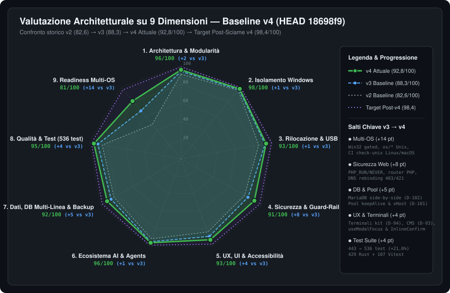

# Atollo / Atollo — Valutazione Tecnica Integrale (Revisione v4)

> **Data Revisione**: 17 Ottobre 2026 (`HEAD 18698f9`) · **Baseline Precedente**: `v3` (`39b74bc`, 16 Ottobre 2026)  
> **Ambito**: Backend Rust/Tauri v2 ([`tauri/src/`](file:///d:/Projects/atollo/tauri/src) — 134 file, 38.161 righe), Frontend React 19/TypeScript ([`ui/src/`](file:///d:/Projects/atollo/ui/src) — 118 file, 28.060 righe), Suite di Test ([`test/rust/`](file:///d:/Projects/atollo/test/rust) — 105 file, 14.031 righe; [`test/ui/`](file:///d:/Projects/atollo/test/ui) — 16 file, 2.891 righe), Runtime & Script ([`runtime/`](file:///d:/Projects/atollo/runtime)), Catalogo 35 Componenti ([`tauri/catalog/components.json`](file:///d:/Projects/atollo/tauri/catalog/components.json)) e Pipeline CI/CD ([`.github/workflows/app.yml`](file:///d:/Projects/atollo/.github/workflows/app.yml)).

---

## 1. Indice della Documentazione `reports/v4/`

| # | Documento | Contenuto Principale |
|---|---|---|
| **00** | [`00-INDICE-E-SINTESI-ESECUTIVA.md`](file:///d:/Projects/atollo/reports/v4/00-INDICE-E-SINTESI-ESECUTIVA.md) | Sintesi esecutiva, scorecard su 9 dimensioni (`92,8/100`), bilancio dello sciame `v3` (`D-93..D-106`) e roadmap `v4`. |
| **01** | [`01-ARCHITETTURA-E-LOGICA.md`](file:///d:/Projects/atollo/reports/v4/01-ARCHITETTURA-E-LOGICA.md) | Analisi architetturale dei 134 moduli Rust e 98 moduli TS/TSX: terminali del kit (`D-94`), MariaDB side-by-side (`D-102`), pool web (`D-101`), router PHP (`D-97`) e layer `os/*` (`D-104`). |
| **02** | [`02-UX-UI-INTERAZIONE-FACILITAZIONE.md`](file:///d:/Projects/atollo/reports/v4/02-UX-UI-INTERAZIONE-FACILITAZIONE.md) | Valutazione UX/UI su [`ui/src/`](file:///d:/Projects/atollo/ui/src), pagina Terminali, wizard CMS (`D-93`), `useModalFocus`/`InlineConfirm` (`D-106`), zone versioni progetto e 6 gap UX residui (`UX-V4-01..06`). |
| **03** | [`03-BUG-SICUREZZA-E-FUNZIONALITA-MANCANTI.md`](file:///d:/Projects/atollo/reports/v4/03-BUG-SICUREZZA-E-FUNZIONALITA-MANCANTI.md) | Verifica dei fix `v3` e catalogo completo dei **25 nuovi rilievi `v4`**: 4 sicurezza (`SEC-V4-01..04`), 13 bug logici/concorrenza (`BUG-V4-01..13`), 8 blocchi di portabilità/multi-OS (`PORT-V4-01..08`). |
| **04** | [`04-PORTABILITA-100-E-MULTIPIATTAFORMA.md`](file:///d:/Projects/atollo/reports/v4/04-PORTABILITA-100-E-MULTIPIATTAFORMA.md) | Audit del layer Unix (`D-104`/`D-105`), analisi dei blocchi runtime su macOS/Linux (`copy_tree` symlink cross-volume, `.exe`/backslash, `old-root.txt`, Bash 3.2) e architettura offline 100%. |
| **05** | [`05-INDICATORI-METRICHE-E-GRAFICI.md`](file:///d:/Projects/atollo/reports/v4/05-INDICATORI-METRICHE-E-GRAFICI.md) | Metriche quantitative verificabili del codice, crescita della test suite (`443 → 536` test, `+21,0%`), complessità per sottosistema e KPI di qualità. |
| **06** | [`06-MATRICE-STRUMENTI-PER-DISTRIBUZIONE-OS.md`](file:///d:/Projects/atollo/reports/v4/06-MATRICE-STRUMENTI-PER-DISTRIBUZIONE-OS.md) | Matrice puntuale dei **35 componenti del catalogo** + sotto-strumenti su 7 famiglie di OS/distribuzioni (Windows x64/ARM64, macOS ARM64/x64, Linux glibc moderna/enterprise, non-FHS NixOS, musl Alpine). |
| **07** | [`07-PIANO-ESECUTIVO-PORTABILITA-E-MULTI-OS.md`](file:///d:/Projects/atollo/reports/v4/07-PIANO-ESECUTIVO-PORTABILITA-E-MULTI-OS.md) | Piano esecutivo per uno **Sciame di 7 Agenti in Parallelo (`v4`)** con file da toccare, patch Rust/TS/PHP/Bash pronte all'uso e criteri di accettazione. |
| **UI** | [`dashboard-valutazione.html`](file:///d:/Projects/atollo/reports/v4/dashboard-valutazione.html) | Dashboard HTML interattiva autonoma (Dark Mode) con grafici SVG integrati, filtri severità e piano sciame `v4`. |

---

## 2. Sintesi Esecutiva: Cosa è Cambiato tra `v3` (`39b74bc`) e `v4` (`18698f9`)

Tra il commit di baseline `v3` (`39b74bc`) e l'attuale `HEAD` (`18698f9`) sono stati completati **200 file modificati** (`+11.720 / -1.870` righe) lungo quattro direttrici ingegneristiche documentate in [`docs/app/DECISIONS.md`](file:///d:/Projects/atollo/docs/app/DECISIONS.md#L766-L868) (`D-93..D-106`) e [`docs/app/CHANGELOG.md`](file:///d:/Projects/atollo/docs/app/CHANGELOG.md#L1-L70):

1. **Terminali del Kit (`D-94`) e Ritiro di Windows Terminal (`D-95`)**:
   - Nuovo sottosistema [`tauri/src/terminals.rs`](file:///d:/Projects/atollo/tauri/src/terminals.rs) (497 righe) + [`ui/src/terminals.tsx`](file:///d:/Projects/atollo/ui/src/terminals.tsx) (580 righe) che sostituisce il pacchetto esterno Windows Terminal con profili di shell gestiti direttamente dal kit (`data/app/terminals.json`).
   - Ogni terminale può includere tutti gli strumenti installati (*"Tutti gli strumenti"*) o un sottoinsieme con linee di versione dedicate (es. PHP 8.2 + Node 20 + MariaDB 10.11), iniettate nel `PATH` davanti alle predefinite e segnalate nel prompt tramite `ATOLLO_TERMINAL`.
   - Il componente `terminal` è stato ritirato dal catalogo (ora **35 componenti** in [`tauri/catalog/components.json`](file:///d:/Projects/atollo/tauri/catalog/components.json)) con pulizia automatica di `data/apps/<platform>/terminal` all'avvio ([`tauri/src/versions/disk.rs`](file:///d:/Projects/atollo/tauri/src/versions/disk.rs#L160-L192)).
2. **Basi CMS nel Wizard (`D-93`) e Rilevamento Stack Esteso (`D-103`)**:
   - Aggiunte 4 basi CMS in [`tauri/catalog/frameworks.json`](file:///d:/Projects/atollo/tauri/catalog/frameworks.json) (WordPress/Bedrock 1.31, TYPO3 14.3, Drupal 11.4, Statamic 6.5) con generazione crittografica di `{password}` e variabili `ATOLLO_DB_*` ([`tauri/src/projects/frameworks/runner.rs`](file:///d:/Projects/atollo/tauri/src/projects/frameworks/runner.rs#L80-L157)).
   - Rilevamento CMS classici non-Composer (PrestaShop, Drupal, Joomla, TYPO3 in [`tauri/src/detect/php.rs`](file:///d:/Projects/atollo/tauri/src/detect/php.rs#L150-L246)) ed estrazione delle versioni dai tag immagine di `docker-compose.yml` / `Dockerfile` in `Project.lines` ([`tauri/src/detect/container.rs`](file:///d:/Projects/atollo/tauri/src/detect/container.rs#L48-L214)).
3. **Hardening Web (`D-96..D-100`), Ciclo di Vita Pool (`D-101`) e MariaDB Multi-Versione (`D-102`)**:
   - Chiusura di `SEC-V3-01` (`PHP_RUN` / `PHP_NEVER` in Apache e Nginx + migrazione automatica di `kit.conf`), `SEC-V3-02` ([`runtime/php-router.php`](file:///d:/Projects/atollo/runtime/php-router.php) con fix contro bypass `parse_url` e shell quoting Unix in `add9b33`), `SEC-V3-03` (protezione DNS rebinding `403`/`421` sui server dedicati), `BUG-V3-01` (supervisione `php-cgi` via `Runner::wait_with_php` e verifica 250 ms nei pool) e `BUG-V3-02` (vHost distinti `<azione>.<progetto>.localhost`).
   - I pool condivisi staccano il sito allo stop del progetto (`detached`) e si fermano quando l'ultimo progetto si sgancia salvo `keepAlive: true` (`D-101`).
   - Più linee di MariaDB girano contemporaneamente (`Services::start_line`, `stop_line`, `running_at` in [`tauri/src/db/services/mod.rs`](file:///d:/Projects/atollo/tauri/src/db/services/mod.rs)), con la linea primaria su `3306`, le secondarie su porte ricordate in `services.json`, e iniezione automatica di `DB_PORT` all'avvio dei progetti (`D-102`).
4. **Sblocco Compilazione Unix (`D-104`), Componenti Multi-OS (`D-105`) e Accessibilità Modali (`D-106`)**:
   - Le 4 dipendenze Win32 in [`tauri/Cargo.toml`](file:///d:/Projects/atollo/tauri/Cargo.toml#L41-L65) sono ora confinate a `[target.'cfg(windows)'.dependencies]`; i moduli [`tauri/src/os/*`](file:///d:/Projects/atollo/tauri/src/os) implementano controparti Unix complete (`flock`, `UnixListener`, `statvfs`, `setpgid`/`killpg` con guardia anti-riuso PID, `/proc` e `libproc`), verificate dal nuovo job CI `check-unix` su `ubuntu-latest` e `macos-latest` ([`.github/workflows/app.yml`](file:///d:/Projects/atollo/.github/workflows/app.yml#L52-L90)).
   - `MariaDB` dichiara `linux-x64`, `vscodium-server` ha SHA-256 per tutti i 5 target, `Cc` cerca nelle ultime 100 release LLVM (`20.1.7` per `darwin-x64`) e `R` su Windows aggiorna `LOCAL_SOFT` in `Makeconf` ad ogni avvio.
   - Hook [`useModalFocus`](file:///d:/Projects/atollo/ui/src/workbench/dialog.tsx#L12-L92) e componente [`InlineConfirm`](file:///d:/Projects/atollo/ui/src/workbench/dialog.tsx#L94-L162) adottati su 28 modali/dialoghi del workbench.

---

## 3. Scorecard Globale su 9 Dimensioni (`v2 → v3 → v4 → Target Post-v4`)

| # | Dimensione | Peso | v2 | v3 | **v4 (`18698f9`)** | Delta `v3→v4` | Target Post-v4 | Motivazione Tecnica del Punteggio `v4` |
|---|---|:---:|:---:|:---:|:---:|:---:|:---:|---|
| 1 | **Architettura & Modularità** | 15% | 91 | 94 | **96/100** | `+2` | 99 | Aggiunta pulita di [`terminals.rs`](file:///d:/Projects/atollo/tauri/src/terminals.rs), separazione `os/*` cfg-pulita, 134 moduli Rust ben incapsulati. Resta un disallineamento tra `site_mode` e `WebServers::scan` (`BUG-V4-01`). |
| 2 | **Isolamento & Zero-Residui (Windows)** | 15% | 96 | 97 | **98/100** | `+1` | 100 | Ritiro di Windows Terminal (`D-95`), pulizia residui `terminal`, `R` `Makeconf` auto-riparante (`D-105`), 0 chiavi di registro o file fuori da `kit_root`. |
| 3 | **Rilocazione & Resilienza USB** | 12% | 85 | 92 | **93/100** | `+1` | 99 | Su Windows la rilocazione è completa incluso `R/etc/x64/Makeconf`. Su Unix emergono due bug critici nella rilocazione: `old-root.txt` vs `old-root-{darwin,linux}.txt` (`PORT-V4-02`) e perdita symlink in `copy_tree` cross-volume (`PORT-V4-01`). |
| 4 | **Sicurezza Locale & Guard-Rail** | 12% | 79 | 83 | **91/100** | `+8` | 98 | Chiusi tutti i 3 CVE/gap `v3` (`PHP_RUN`/`PHP_NEVER`, `php-router.php`, DNS rebinding `403`/`421`, rimozione `FollowSymLinks` dagli alias). Individuati 4 nuovi vettori di secondo livello (`SEC-V4-01..04`, tra cui esecuzione PHP negli alias di upload). |
| 5 | **UX, Facilitazione & Accessibilità** | 10% | 84 | 89 | **93/100** | `+4` | 98 | Nuovi Terminali del kit (`D-94`), 4 CMS nel wizard (`D-93`), zone versioni in [`versions/project.tsx`](file:///d:/Projects/atollo/ui/src/versions/project.tsx), `useModalFocus` e `InlineConfirm` (`D-106`). Restano 6 rifiniture (`UX-V4-01..06`). |
| 6 | **Ecosistema AI & Coding Agents** | 8% | 92 | 95 | **96/100** | `+1` | 99 | 3 agenti AI (`claude`, `codex`, `antigravity`), MCP hub, telemetria SQLite/JSONL, keyring AES-256-GCM. Su Unix restano path con backslash in `agents/mod.rs` e `agents/sync/mod.rs` (`PORT-V4-06`). |
| 7 | **Gestione Dati, DB Multi-Linea & Backup** | 8% | 83 | 87 | **92/100** | `+5` | 98 | MariaDB multi-versione side-by-side (`D-102`) funzionante con porte dedicate e `DB_PORT` automatico. Individuati race su `services.json` (`BUG-V4-04`), port-swap al cambio linea primaria (`BUG-V4-05`) e sovrascrittura `.env` in `env_apply` (`BUG-V4-10`). |
| 8 | **Qualità Codice & Copertura Test** | 10% | 86 | 91 | **95/100** | `+4` | 98 | Crescita da 443 a **536 test eseguiti** (`429` Rust + `107` Vitest, `+21,0%`), zero warning Rust/Clippy su Windows, Linux e macOS. |
| 9 | **Readiness Multi-OS (macOS / Linux)** | 10% | 48 | 67 | **81/100** | `+14` | 97 | Salto decisivo: il backend Rust compila al 100% su Linux e macOS in CI (`D-104`), `MariaDB` e `vscodium-server` estesi (`D-105`). Per l'esecuzione runtime end-to-end su Unix servono le correzioni `PORT-V4-01..08`. |
| — | ** MEDIA PONDERATA GLOBALE** | **100%** | **82,6** | **88,3** | **92,8 / 100** | **`+4,5`** | **98,4 / 100** | **Grado di maturità: Eccellente su Windows x64 (`98/100`), Avanzato ma con blocchi runtime chirurgici su macOS/Linux (`81/100`).** |

---

## 4. Bilancio di Verifica dello Sciame `v3` (`D-96..D-106`)

| ID Rilievo `v3` | Titolo | Stato in `HEAD 18698f9` | Evidenza nel Codice |
|---|---|:---:|---|
| `SEC-V3-01` | Esecuzione `.phtml`/`.phar` e sorgenti `.inc` esposti | **RISOLTO** | `PHP_RUN` e `PHP_NEVER` in [`apache.rs:14-18`](file:///d:/Projects/atollo/tauri/src/projects/apache.rs#L14-L18), [`nginx.rs:13-17`](file:///d:/Projects/atollo/tauri/src/projects/nginx.rs#L13-L17) e `migrate_kit_conf` in [`servers/mod.rs:344-406`](file:///d:/Projects/atollo/tauri/src/servers/mod.rs#L344-L406). |
| `SEC-V3-02` | `php -S` espone `.env` e `.git/config` senza router | **RISOLTO** | [`runtime/php-router.php`](file:///d:/Projects/atollo/runtime/php-router.php) + cablaggio in [`detect/php.rs:64-137`](file:///d:/Projects/atollo/tauri/src/detect/php.rs#L64-L137) + hardening `parse_url`/quoting (`add9b33`). |
| `SEC-V3-03` | DNS Rebinding sui server dedicati Apache e Nginx | **RISOLTO** | Primo vHost `refused.invalid` (`403`) in [`apache.rs:125-136`](file:///d:/Projects/atollo/tauri/src/projects/apache.rs#L125-L136) e `default_server return 421` in [`nginx.rs:134-142`](file:///d:/Projects/atollo/tauri/src/projects/nginx.rs#L134-L142). |
| `BUG-V3-01` | `php-cgi` non supervisionato in Nginx dedicato e pool | **RISOLTO** | [`Runner::wait_with_php`](file:///d:/Projects/atollo/tauri/src/projects/run.rs#L350-L410) e controllo 250 ms `try_wait` in [`servers/mod.rs:672-691`](file:///d:/Projects/atollo/tauri/src/servers/mod.rs#L672-L691). |
| `BUG-V3-02` | Collisione `ServerName` e file vHost per azioni multiple | **RISOLTO** | `<action>.<project>.localhost` e `vhosts/<ServerName>.conf` in [`servers/mod.rs:248-307`](file:///d:/Projects/atollo/tauri/src/servers/mod.rs#L248-L307). |
| `BUG-V3-03` | `tauri::async_runtime::block_on` su worker Tokio in `editor` | **RISOLTO** | [`editor_open`](file:///d:/Projects/atollo/tauri/src/commands/editor.rs#L16-L31) e [`editor_preview`](file:///d:/Projects/atollo/tauri/src/commands/editor.rs#L53-L68) ora `pub fn` sincroni (su blocking pool di Tauri). |
| `BUG-V3-04` | Ciclo di vita pool condivisi (`D-101`) | **RISOLTO** | `detach_project`, `keepAlive`, `autostart` in [`servers/mod.rs:693-778`](file:///d:/Projects/atollo/tauri/src/servers/mod.rs#L693-L778) e [`ui/src/servers.tsx`](file:///d:/Projects/atollo/ui/src/servers.tsx). |
| `BUG-V3-05` | Multi-versione MariaDB side-by-side (`D-102`) | **RISOLTO** | `start_line`, `stop_line`, `running_at`, `db_json_lock` e iniezione `DB_PORT` in [`db/services/mod.rs`](file:///d:/Projects/atollo/tauri/src/db/services/mod.rs) e [`projects/run.rs:301-334`](file:///d:/Projects/atollo/tauri/src/projects/run.rs#L301-L334). |
| `BUG-V3-06` | `make_writable` rimuove i bit `+x` (`0o644`) su Unix | **RISOLTO** | `#[cfg(unix)]` preserva i bit e aggiunge `0o200` (`u+w`) in [`versions/disk.rs:246-259`](file:///d:/Projects/atollo/tauri/src/versions/disk.rs#L246-L259). |
| `BUG-V3-07..12` | Win32 crate gating, `os/*` Unix, `MariaDB`/`VSCodium`/`Cc`/`R` | **RISOLTO** | Completato in `D-104` e `D-105` con job CI `check-unix` verde su Ubuntu e macOS. |

---

## 5. Quadro Sintetico dei Nuovi Rilievi `v4` (25 Rilievi Totali)

L'audit di quarto livello sul codice risultante da `D-93..D-106` ha permesso di individuare **25 rilievi tecnici inediti o residui** (documentati con riproduzione e patch in [`03-BUG-SICUREZZA-E-FUNZIONALITA-MANCANTI.md`](file:///d:/Projects/atollo/reports/v4/03-BUG-SICUREZZA-E-FUNZIONALITA-MANCANTI.md) e [`04-PORTABILITA-100-E-MULTIPIATTAFORMA.md`](file:///d:/Projects/atollo/reports/v4/04-PORTABILITA-100-E-MULTIPIATTAFORMA.md)):

> [!IMPORTANT]
> **Top 8 Priorità Critiche / Alte da chiudere nello Sciame `v4`:**
> 1. **`PORT-V4-01` (Critico — Installazione Unix & USB Cross-Volume)**: [`copy_tree`](file:///d:/Projects/atollo/tauri/src/net/archive.rs#L597-L599) salta silenziosamente tutti i symlink (`if kind.is_symlink() { continue; }`) quando la directory di staging e `data/apps` risiedono su volumi diversi (`!same_volume`). Su Linux (`/tmp` in `tmpfs`) e su qualsiasi chiavetta USB macOS/Linux, `same_volume` è sempre `false`, distruggendo i symlink di `python`, `node`, `cc` (`clang -> clang-20`), `tinytex` e `mariadb`.
> 2. **`PORT-V4-02` (Critico — Rilocazione Unix)**: [`agents/relocate.rs:461`](file:///d:/Projects/atollo/tauri/src/agents/relocate.rs#L461) legge `"old-root.txt"` anziché `"old-root-darwin.txt"` / `"old-root-linux.txt"` scritti da [`kit.rs:527-531`](file:///d:/Projects/atollo/tauri/src/kit.rs#L527-L531), e [`Replacer::substitute`](file:///d:/Projects/atollo/tauri/src/agents/relocate.rs#L123-L140) corrompe il primo carattere dei path Unix (`/home/...` → `/Home/...`) assumendo una lettera di unità Windows.
> 3. **`PORT-V4-03` & `PORT-V4-04` (Critico — Shell, Wrapper `agy` e VSCodium Server su Unix)**: [`setup/kit_files.rs:21-35`](file:///d:/Projects/atollo/tauri/src/setup/kit_files.rs#L21-L35) usa `r"bin\agy"`, [`runtime/bashrc:26,42,51`](file:///d:/Projects/atollo/runtime/bashrc#L26) usa `${var,,}` incompatibile con `/bin/bash` 3.2 di macOS, e [`tauri/src/editor/`](file:///d:/Projects/atollo/tauri/src/editor/mod.rs#L258-L261) hardcoda `node.exe` e `r"vscodium-server\..."`.
> 4. **`SEC-V4-01` (Alto — Esecuzione PHP negli Alias di Upload)**: in Apache ([`apache.rs:197-205`](file:///d:/Projects/atollo/tauri/src/projects/apache.rs#L197-L205)) le directory `<Directory>` degli alias ereditano `<FilesMatch "\.(?:php|phtml|phar)$"> SetHandler application/x-httpd-php` permettendo RCE se un utente carica un `.php`/`.phtml` in una cartella di media/upload aliasata; in Nginx ([`nginx.rs:104`](file:///d:/Projects/atollo/tauri/src/projects/nginx.rs#L104)) `location /alias/` senza modificatore `^~` viene scavalcato dalla regex `location ~* \.(?:php|phtml|phar)$`.
> 5. **`BUG-V4-10` (Alto — Distruzione `.env` da Template e Ordine `env_apply` nel Wizard)**: [`db::auth::env_apply`](file:///d:/Projects/atollo/tauri/src/db/auth.rs#L581-L598) chiama `render_fresh_env` quando `.env` non esiste ancora, scartando tutte le variabili non-DB di `.env.example` (`APP_KEY`, `APP_URL`, ecc.); inoltre in [`commands/frameworks.rs:319-343`](file:///d:/Projects/atollo/tauri/src/commands/frameworks.rs#L319-L343) `env_apply` viene eseguito *prima* di `env_set`, facendo sì che i valori fittizi del template sovrascrivano la password reale del DB.
> 6. **`BUG-V4-01` (Alto — Disallineamento `site_mode` vs `WebServers::scan`)**: [`projects/run.rs:115-128`](file:///d:/Projects/atollo/tauri/src/projects/run.rs#L115-L128) avvia come `SiteMode::Dedicated` i siti con `server: None` o `"auto"`, mentre [`servers/mod.rs:878-888`](file:///d:/Projects/atollo/tauri/src/servers/mod.rs#L878-L888) li censisce nei pool automatici (e un profilo eliminato ricade silenziosamente nel pool automatico).
> 7. **`BUG-V4-04` & `BUG-V4-05` (Alto — Concorrenza `Services` e Port Swap MariaDB)**: [`db/services/mod.rs`](file:///d:/Projects/atollo/tauri/src/db/services/mod.rs) è privo di mutex su `services.json`/`start_line` e scambia silenziosamente le porte delle linee MariaDB esistenti quando l'utente cambia la linea predefinita (`keep_port`).
> 8. **`BUG-V4-09` (Alto — `detect::requires` forza Apache su tutti i progetti Laravel)**: [`detect/mod.rs:548-562`](file:///d:/Projects/atollo/tauri/src/detect/mod.rs#L548-L562) aggiunge `"apache"` ai `requires` prima del filtro `D-103` (riga 677), e [`settle_project`](file:///d:/Projects/atollo/tauri/src/commands/mod.rs#L237) chiama `detect::requires(dir)` direttamente, innescando l'auto-installazione di Apache su ogni clone/creazione Laravel.
