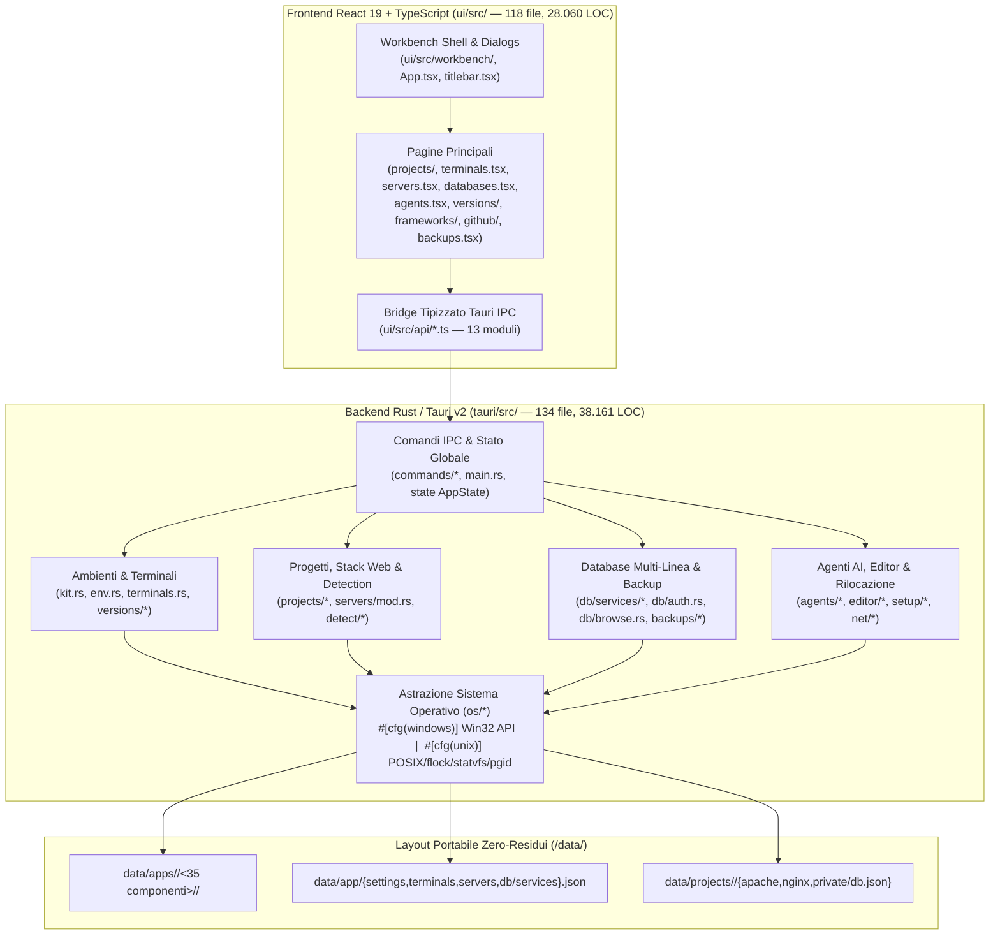
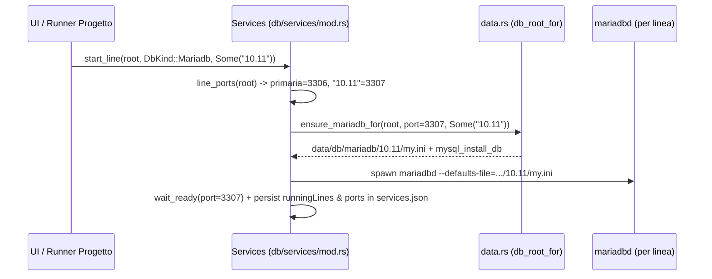

# 01 — Architettura del Sistema e Logica Applicativa (`v4`)

> **Riferimento Codice**: `HEAD 18698f9` · **Backend**: [`tauri/src/`](file:///d:/Projects/atollo/tauri/src) (134 file `.rs`, 38.161 LOC) · **Frontend**: [`ui/src/`](file:///d:/Projects/atollo/ui/src) (118 file, 28.060 LOC) · **Runtime**: [`runtime/`](file:///d:/Projects/atollo/runtime)

---

## 1. Mappa Architetturale Globale (`HEAD 18698f9`)

Atollo / Atollo è organizzato secondo un'architettura a **3 livelli disaccoppiati** con stato persistito esclusivamente su filesystem locale dentro `<kit_root>/data/`:

### 1.1 Inventario Completo dei Sottosistemi Backend (`tauri/src/`)

| Sottosistema | File Principali | File `.rs` | LOC | Responsabilità Architetturale |
|---|---|:---:|:---:|---|
| **Core, Kit Root & Env** | [`main.rs`](file:///d:/Projects/atollo/tauri/src/main.rs), [`kit.rs`](file:///d:/Projects/atollo/tauri/src/kit.rs), [`env.rs`](file:///d:/Projects/atollo/tauri/src/env.rs), [`catalog.rs`](file:///d:/Projects/atollo/tauri/src/catalog.rs), [`settings.rs`](file:///d:/Projects/atollo/tauri/src/settings.rs) | 10 | ~2.850 | Risoluzione `kit_root`, costruzione `PATH` isolato e variabili di ambiente per 35 strumenti, gestione marker di rilocazione `old-root*.txt`. |
| **Terminali del Kit (`D-94`)** | [`terminals.rs`](file:///d:/Projects/atollo/tauri/src/terminals.rs), [`commands/terminals.rs`](file:///d:/Projects/atollo/tauri/src/commands/terminals.rs) | 2 | 569 | Persistenza profili terminale in `data/app/terminals.json`, selezione strumenti/linee, generazione ambiente shell con `ATOLLO_TERMINAL` e avvio in finestra esterna o integrata. |
| **Layer OS Multi-Piattaforma (`D-104`)** | [`os/mod.rs`](file:///d:/Projects/atollo/tauri/src/os/mod.rs), [`os/instance.rs`](file:///d:/Projects/atollo/tauri/src/os/instance.rs), [`os/jobs.rs`](file:///d:/Projects/atollo/tauri/src/os/jobs.rs), [`os/processes.rs`](file:///d:/Projects/atollo/tauri/src/os/processes.rs), [`os/volume.rs`](file:///d:/Projects/atollo/tauri/src/os/volume.rs), [`os/sessions.rs`](file:///d:/Projects/atollo/tauri/src/os/sessions.rs), [`os/safe_path.rs`](file:///d:/Projects/atollo/tauri/src/os/safe_path.rs), [`os/temp.rs`](file:///d:/Projects/atollo/tauri/src/os/temp.rs), [`os/webview.rs`](file:///d:/Projects/atollo/tauri/src/os/webview.rs) | 9 | 2.194 | Astrazione cross-OS per single-instance lock, uccisione alberi di processi (Job Objects / process groups `setpgid` + verifica start-time), spazio disco, sessioni su file, short-path 8.3 e WebView. |
| **Progetti, Server Dedicati & Framework** | [`projects/mod.rs`](file:///d:/Projects/atollo/tauri/src/projects/mod.rs), [`projects/run.rs`](file:///d:/Projects/atollo/tauri/src/projects/run.rs), [`projects/apache.rs`](file:///d:/Projects/atollo/tauri/src/projects/apache.rs), [`projects/nginx.rs`](file:///d:/Projects/atollo/tauri/src/projects/nginx.rs), [`projects/serve.rs`](file:///d:/Projects/atollo/tauri/src/projects/serve.rs), [`projects/alias.rs`](file:///d:/Projects/atollo/tauri/src/projects/alias.rs), [`projects/frameworks/*`](file:///d:/Projects/atollo/tauri/src/projects/frameworks/mod.rs) | 16 | 5.420 | Esecuzione azioni di progetto, generazione `httpd.conf` / `nginx.conf` dedicati, server statico HTTP integrato, alias web, scaffolding 16 framework/CMS (`D-93`). |
| **Pool Web Condivisi (`D-101`)** | [`servers/mod.rs`](file:///d:/Projects/atollo/tauri/src/servers/mod.rs), [`commands/servers.rs`](file:///d:/Projects/atollo/tauri/src/commands/servers.rs) | 2 | 1.615 | Gestione pool condivisi Apache/Nginx per linea PHP, profili utente (`servers.json`), vHost `<azione>.<progetto>.localhost`, ciclo di vita `detached` / `keepAlive` / `autostart`. |
| **Motore di Rilevamento (`D-103`)** | [`detect/mod.rs`](file:///d:/Projects/atollo/tauri/src/detect/mod.rs), [`detect/php.rs`](file:///d:/Projects/atollo/tauri/src/detect/php.rs), [`detect/node.rs`](file:///d:/Projects/atollo/tauri/src/detect/node.rs), [`detect/python.rs`](file:///d:/Projects/atollo/tauri/src/detect/python.rs), [`detect/container.rs`](file:///d:/Projects/atollo/tauri/src/detect/container.rs), ecc. | 13 | 3.180 | Rilevamento zero-config di 25+ stack, CMS classici (WordPress, PrestaShop, Drupal, Joomla, TYPO3), router `php -S` e versioni da `compose.yaml`/`Dockerfile`. |
| **Database Multi-Linea (`D-102`)** | [`db/mod.rs`](file:///d:/Projects/atollo/tauri/src/db/mod.rs), [`db/services/mod.rs`](file:///d:/Projects/atollo/tauri/src/db/services/mod.rs), [`db/services/data.rs`](file:///d:/Projects/atollo/tauri/src/db/services/data.rs), [`db/services/access.rs`](file:///d:/Projects/atollo/tauri/src/db/services/access.rs), [`db/services/backups.rs`](file:///d:/Projects/atollo/tauri/src/db/services/backups.rs), [`db/services/tools.rs`](file:///d:/Projects/atollo/tauri/src/db/services/tools.rs), [`db/auth.rs`](file:///d:/Projects/atollo/tauri/src/db/auth.rs), [`db/browse.rs`](file:///d:/Projects/atollo/tauri/src/db/browse.rs), [`db/adminer.rs`](file:///d:/Projects/atollo/tauri/src/db/adminer.rs) | 9 | 3.640 | Esecuzione simultanea di più linee MariaDB + MongoDB, provisioning DB/utente per progetto, sincronizzazione `.env`, browser SQL/NoSQL nativo e Adminer. |
| **Installatori & Versioni (`D-95`, `D-105`)** | [`install/*`](file:///d:/Projects/atollo/tauri/src/install/mod.rs), [`setup/*`](file:///d:/Projects/atollo/tauri/src/setup/mod.rs), [`versions/*`](file:///d:/Projects/atollo/tauri/src/versions/mod.rs), [`net/*`](file:///d:/Projects/atollo/tauri/src/net/mod.rs) | 38 | 9.810 | Download verificato SHA-256, estrazione atomica, gestione multi-versione side-by-side (`data/apps/<platform>/<id>/<line>`), grafo di relazioni e pulizia versioni. |
| **Agenti AI, Editor & Rilocazione** | [`agents/*`](file:///d:/Projects/atollo/tauri/src/agents/mod.rs), [`editor/*`](file:///d:/Projects/atollo/tauri/src/editor/mod.rs) | 18 | 5.190 | Sincronizzazione skill/istruzioni/MCP per Claude/Codex/Antigravity, keyring AES-256-GCM, VSCodium Server integrato, rilocazione post-spostamento `relocate.rs`. |

---

## 2. Analisi Approfondita delle Nuove Architetture Introdotte in `v4`

### 2.1 Sottosistema Terminali del Kit (`D-94`, [`tauri/src/terminals.rs`](file:///d:/Projects/atollo/tauri/src/terminals.rs))

Con la decisione `D-94` e il contestuale ritiro del componente esterno Windows Terminal (`D-95`), il kit ha introdotto un gestore nativo di profili di shell:

- **Modello Dati ([`terminals.rs:27-96`](file:///d:/Projects/atollo/tauri/src/terminals.rs#L27-L96))**:
  - Il terminale predefinito `default` (*"Tutti gli strumenti"*) è sempre presente in testa alla lista, non è eliminabile, espone `all_tools: true` e segue dinamicamente tutti i componenti installati con le loro linee di versione predefinite.
  - I terminali personalizzati salvati in `data/app/terminals.json` specificano un vettore `tools: Vec<String>` e una mappa `lines: BTreeMap<String, String>` (es. `{"php": "8.2", "node": "20", "mariadb": "10.11"}`).
- **Costruzione dell'Ambiente Isolato ([`terminals.rs:265-360`](file:///d:/Projects/atollo/tauri/src/terminals.rs#L265-L360))**:
  - Per il terminale predefinito con `lines` vuota, `terminal_env` delega a [`env::kit_env(&root)`](file:///d:/Projects/atollo/tauri/src/env.rs#L316) e poi applica eventuali override di linea tramite [`versions::env::apply_overrides`](file:///d:/Projects/atollo/tauri/src/versions/env.rs#L230).
  - Per un terminale personalizzato (`all_tools == false`), `filtered_env` costruisce il `PATH` includendo **solo** i componenti selezionati nel profilo (più le relative dipendenze di runtime) con le linee di versione scelte, ed esporta `ATOLLO_TERMINAL=<nome>` affinché [`runtime/profile.ps1`](file:///d:/Projects/atollo/runtime/profile.ps1#L45) e [`runtime/bashrc`](file:///d:/Projects/atollo/runtime/bashrc#L60) mostrino il badge del terminale attivo nel prompt.

### 2.2 MariaDB Multi-Versione Side-by-Side (`D-102`, [`tauri/src/db/services/mod.rs`](file:///d:/Projects/atollo/tauri/src/db/services/mod.rs))

La revisione `D-102` ha trasformato `Services` da gestore mono-istanza a orchestratore multi-linea per MariaDB:

- **Separazione su Disco ([`db/services/data.rs:28-55`](file:///d:/Projects/atollo/tauri/src/db/services/data.rs#L28-L55))**: `db_root_for(root, DbKind::Mariadb, line)` risolve `data/db/mariadb/<line>` (con migrazione automatica di un eventuale `data/db/mariadb/data` legacy nella sottocartella della linea predefinita).
- **Allocazione Porte ([`db/services/mod.rs:188-222`](file:///d:/Projects/atollo/tauri/src/db/services/mod.rs#L188-L222))**: la linea predefinita usa `cfg.mariadb_port` (`3306`); ogni linea secondaria ottiene la prima porta libera a partire da `3307` (`next_mariadb_port`), salvata in `services.json` sotto `ports: BTreeMap<String, u16>`.
- **Iniezione `DB_PORT` nei Progetti ([`projects/run.rs:301-334`](file:///d:/Projects/atollo/tauri/src/projects/run.rs#L301-L334))**: quando un progetto ha scelto una linea MariaDB in `data/projects/
/private/db.json` (`lines.mariadb`), `Runner` risolve la porta tramite `Services::mariadb_port_for_line` e inietta `DB_PORT` e `ATOLLO_MARIADB_PORT` nell'ambiente del processo, a meno che il file `.env` del progetto non specifichi già una `DB_PORT` diversa da `3306` (commit `3e7986f`).
- **Punti Critici Individuati nell'Audit `v4`**:
  - Assenza di lock di serializzazione in `Services` su `services.json` e `start_line` (`BUG-V4-04`).
  - Scambio silenzioso delle porte (`port swap`) quando l'utente cambia la linea predefinita di MariaDB in `Versions`, perché `keep_port` omette di salvare la porta della linea primaria in `services.json` (`BUG-V4-05`).

### 2.3 Ciclo di Vita dei Pool Web Condivisi (`D-101`, [`tauri/src/servers/mod.rs`](file:///d:/Projects/atollo/tauri/src/servers/mod.rs))

I pool condivisi Apache/Nginx sono stati arricchiti con il tracciamento dei progetti agganciati:

- **Stato Runtime ([`servers/mod.rs:155-170`](file:///d:/Projects/atollo/tauri/src/servers/mod.rs#L155-L170))**: `PoolProcess` mantiene `project_started: bool` e `detached: HashSet<String>`.
- **Sgancio allo Stop del Progetto ([`servers/mod.rs:693-778`](file:///d:/Projects/atollo/tauri/src/servers/mod.rs#L693-L778))**: quando l'utente ferma un progetto in [`Runner::stop`](file:///d:/Projects/atollo/tauri/src/projects/run.rs#L412-L428), `WebServers::detach_project` aggiunge la chiave `<progetto>` o `<progetto>:<azione>` a `detached`, rigenera la configurazione del pool escludendo il vHost fermato ed esegue un reload grazioso (`nginx -s reload` o riavvio Apache). Se il pool era stato acceso da un progetto (`project_started == true`), non ha `keep_alive == true` e tutti i siti del pool risultano sganciati, il pool si arresta automaticamente.
- **Disallineamento Critico Rilevato (`BUG-V4-01`)**:
  - In [`tauri/src/projects/run.rs:115-128`](file:///d:/Projects/atollo/tauri/src/projects/run.rs#L115-L128), `site_mode` restituisce `SiteMode::Dedicated` quando `action.server` è `None` o `Some("auto")`, mentre [`WebServers::scan`](file:///d:/Projects/atollo/tauri/src/servers/mod.rs#L878-L888) assegna tutti i siti con `server: None | Some("auto")` al pool automatico! Di conseguenza, i pool automatici mostreranno i siti nell'elenco della pagina *Server web*, ma premendo *Avvia* nella scheda Progetto verrà lanciato un server dedicato sulla porta di progetto anziché usare il pool automatico (e viceversa se un profilo di pool viene eliminato, `site_mode` vede ancora `Some("id-eliminato")` come `SiteMode::Pool` e `pool_of` ricade silenziosamente nel pool automatico).

### 2.4 Sicurezza Web e Router PHP (`D-96..D-100`)

Il modello di sicurezza per i server web locali è stato notevolmente rafforzato:

1. **Estensioni PHP (`D-96`)**: sia i server dedicati ([`apache.rs:14-18`](file:///d:/Projects/atollo/tauri/src/projects/apache.rs#L14-L18), [`nginx.rs:13-17`](file:///d:/Projects/atollo/tauri/src/projects/nginx.rs#L13-L17)) sia i pool condivisi e il file `data/apache/conf/kit.conf` (migrato all'avvio da `migrate_kit_conf` in [`servers/mod.rs:344-406`](file:///d:/Projects/atollo/tauri/src/servers/mod.rs#L344-L406)) eseguono `PHP_RUN = \.(?:php|phtml|phar)$` e bloccano con `403`/`404` `PHP_NEVER = \.(?:inc|php[34578]|phps)$`.
2. **Router per `php -S` (`D-97`)**: [`runtime/php-router.php`](file:///d:/Projects/atollo/runtime/php-router.php) verifica l'header `Host` contro DNS rebinding (`421 Misdirected Request`), blocca i segmenti dotfile (`.env`, `.git/*`) tranne `.well-known` e blocca `.inc`/`.php3..8`/`.phar` con `404 Not Found`. In `add9b33` sono stati chiusi due bypass importanti: l'uso di `parse_url($uri, PHP_URL_PATH)` (che falliva su URL malformati `http:///..`) è stato sostituito con `explode('?', $uri, 2)[0]` + `rawurldecode`, e su Unix il comando `php -S` quota ora il percorso del router tra singoli apici quando contiene spazi ([`detect/php.rs:119-135`](file:///d:/Projects/atollo/tauri/src/detect/php.rs#L119-L135)).
3. **Symlink Hardening (`WEB-8`)**: rimosso `FollowSymLinks` dagli alias Apache ([`apache.rs:200`](file:///d:/Projects/atollo/tauri/src/projects/apache.rs#L200)) e aggiunto `disable_symlinks on;` nei blocchi Nginx su Unix ([`nginx.rs:22-29`](file:///d:/Projects/atollo/tauri/src/projects/nginx.rs#L22-L29)).
4. **Nuovo Vettore Individuato (`SEC-V4-01`)**: né `alias_directives` in Apache ([`apache.rs:197-205`](file:///d:/Projects/atollo/tauri/src/projects/apache.rs#L197-L205)) né `alias_locations` in Nginx ([`nginx.rs:95-114`](file:///d:/Projects/atollo/tauri/src/projects/nginx.rs#L95-L114)) disabilitano l'interprete PHP dentro le directory aliasate (tipicamente usate per upload/media fuori dalla document root), lasciando aperta l'esecuzione di script `.php`/`.phtml` caricati negli alias.
