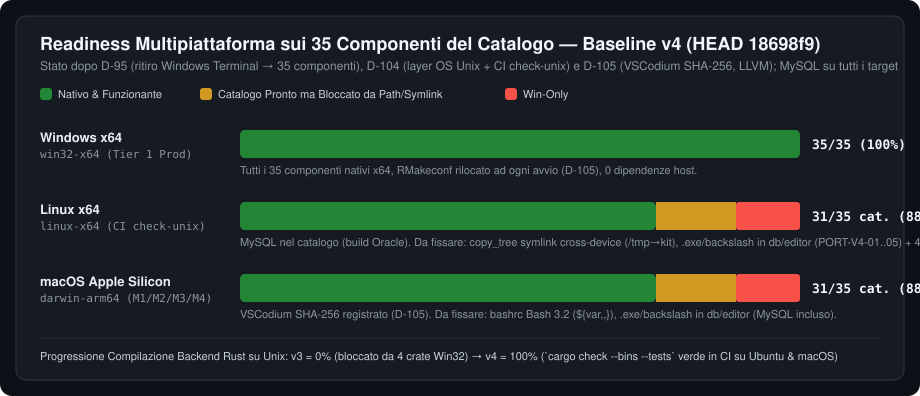

# 04 — Portabilità 100% e Architettura Multipiattaforma (`v4`)

> **Riferimento Codice**: `HEAD 18698f9` · **Decisioni di Riferimento**: `D-95` (ritiro `terminal`), `D-104` (sblocco compilazione Unix e job CI `check-unix`), `D-105` (`MariaDB` Linux, `vscodium-server` SHA-256, `Cc` LLVM 100 release, `R` `Makeconf`).

---

## 1. Stato di Avanzamento Multipiattaforma (`v3 → v4`)



La transizione da `v3` (`67/100`) a `v4` (`81/100`, `+14` punti) segna il passaggio dalla **sola portabilità concettuale** alla **compilazione e verifica CI multi-OS**:

1. **Compilazione Rust Cross-OS Sbloccata (`D-104`)**:
   - In [`tauri/Cargo.toml:41-65`](file:///d:/Projects/dev-kit2/tauri/Cargo.toml#L41-L65), `winreg`, `windows-sys`, `webview2-com` e `windows-core` sono ora sotto `[target.'cfg(windows)'.dependencies]`, mentre `[target.'cfg(unix)'.dependencies]` dichiara `libc = "0.2"`.
   - Il job CI `check-unix` in [`.github/workflows/app.yml:52-90`](file:///d:/Projects/dev-kit2/.github/workflows/app.yml#L52-L90) compila l'intero workspace (`cargo check --bins --tests`) su `ubuntu-latest` e `macos-latest` ad ogni push/PR.
2. **Moduli `tauri/src/os/*` Completati su Unix (`D-104` + review `5751f38`)**:
   - [`os/instance.rs`](file:///d:/Projects/dev-kit2/tauri/src/os/instance.rs): `flock(LOCK_EX | LOCK_NB)` su `<kit_root>/data/app/instance.lock` + IPC locale via `UnixListener` su `instance.sock`.
   - [`os/jobs.rs`](file:///d:/Projects/dev-kit2/tauri/src/os/jobs.rs): `CommandExt::process_group(0)` (`setpgid(0, 0)`) + `killpg(pgid, SIGKILL)` verificando prima il tempo di avvio del processo (`proc_start_tick` su `/proc/<pid>/stat` in Linux e `proc_pidinfo(PROC_PIDTBSDINFO)` su macOS, commit `5751f38`) per impedire l'uccisione di un processo estraneo in caso di riuso del PID.
   - [`os/volume.rs`](file:///d:/Projects/dev-kit2/tauri/src/os/volume.rs): `libc::statvfs` per spazio libero/totale e `FsKind::Posix` per la classificazione del filesystem.
   - [`os/processes.rs`](file:///d:/Projects/dev-kit2/tauri/src/os/processes.rs): scansione dei processi in esecuzione sotto `<kit_root>` tramite `/proc/<pid>/exe` + `/proc/<pid>/cwd` su Linux e `libproc` (`PROC_PIDPATHINFO_MAXSIZE` / `PROC_PIDVNODEPATHINFO`) su macOS.
3. **Catalogo Esteso su 35 Componenti (`D-95`, `D-105`)**:
   - `MariaDB` include ora `linux-x64` ([`tauri/src/install/db.rs:14-60`](file:///d:/Projects/dev-kit2/tauri/src/install/db.rs#L14-L60) estrae i tarball `mariadb-*-linux-systemd-x86_64.tar.gz`).
   - `vscodium-server` (`1.135.06055`) ha gli SHA-256 verificati in [`tauri/catalog/components.json`](file:///d:/Projects/dev-kit2/tauri/catalog/components.json) per tutti i 5 target (`win32-x64`, `win32-arm64`, `darwin-x64`, `darwin-arm64`, `linux-x64`).
   - `Cc` interroga fino a 100 release GitHub di `llvm/llvm-project` ([`tauri/src/install/sys.rs:180-210`](file:///d:/Projects/dev-kit2/tauri/src/install/sys.rs#L180-L210)), trovando `20.1.7` per `darwin-x64`.
   - `R` su Windows riscrive `LOCAL_SOFT` in `etc/x64/Makeconf` ad ogni avvio del kit ([`tauri/src/install/lang/r.rs:115-160`](file:///d:/Projects/dev-kit2/tauri/src/install/lang/r.rs#L115-L160) e [`tauri/src/kit.rs:510-520`](file:///d:/Projects/dev-kit2/tauri/src/kit.rs#L510-L520)).

---

## 2. Analisi Tecnica degli 8 Blocchi di Portabilità e Runtime Multi-OS (`PORT-V4-01..08`)

Nonostante la compilazione pulita su Unix, l'audit del flusso di esecuzione runtime (`install` → `finalize_staging` → `relocate` → `kit_files` → `editor` → `db`) ha rivelato **4 blocchi critici**, **2 alti** e **2 medi** che impediscono il funzionamento reale dei componenti su macOS/Linux e su volumi USB.

### `PORT-V4-01` [CRITICA] — `copy_tree` in `tauri/src/net/archive.rs` distrugge tutti i symlink quando la directory temporanea e il kit sono su volumi diversi
- **File e Righe**: [`tauri/src/net/archive.rs:560-615`](file:///d:/Projects/dev-kit2/tauri/src/net/archive.rs#L560-L615) (in particolare righe `597-599`).
- **Meccanismo del Bug**:
  - Durante l'installazione di un componente, l'archivio viene estratto in una directory di staging (spesso in `temp_dir()`) e poi spostato in `<kit_root>/data/apps/<platform>/<id>` tramite `finalize_staging`.
  - Quando `same_volume(&staging, &dest)` restituisce `false` — il che accade **sempre su Linux** quando `/tmp` è montato su `tmpfs` e il kit è su disco o USB, e **sempre su macOS/Windows/Linux** quando il kit risiede su un'unità USB esterna mentre `temp_dir` ricade sul disco di sistema — `finalize_staging` usa `copy_tree(&staging, &dest)`.
  - Alle righe `597-599` di `copy_tree`:
    ```rust
    let kind = entry.file_type()?;
    if kind.is_symlink() {
        continue;
    }
    ```
  - Su macOS e Linux, i tarball ufficiali di **Python** (`python3 -> python3.13`, `libpython3.so -> ...`), **Node.js** (`npm -> ../lib/node_modules/npm/bin/npm-cli.js`, `npx`, `corepack`), **LLVM/Clang (`cc`)** (`clang -> clang-20`, `clang++ -> clang`), **TinyTeX** (tutti i binari in `bin/<arch>/` sono symlink verso `../../texmf-dist/...`), **MariaDB Linux**, **Java JDK** e **Rust** si basano interamente su symlink POSIX! Saltandoli, l'installazione termina con successo apparente ma i binari principali (`npm`, `clang++`, `python3`, `pdflatex`) non esistono nella cartella finale.
- **Soluzione Ingegneristica**:
  1. Assicurare che la directory di staging dell'installatore venga sempre creata in `<kit_root>/data/tmp/staging-<id>` (stesso volume di `<kit_root>/data/apps`), così che `fs::rename` atomico funzioni sempre senza copia.
  2. In `copy_tree`, gestire esplicitamente `if kind.is_symlink()` leggendo `fs::read_link(&src_path)` e ricreando il symlink con `std::os::unix::fs::symlink(&target, &dst_path)` su Unix (con fallback a copia del file referenziato se il filesystem di destinazione, es. exFAT/FAT32, restituisce `EPERM`/`ENOTSUP`).

---

### `PORT-V4-02` [CRITICA] — Rilocazione post-spostamento (`agents/relocate.rs`) rotta su macOS e Linux
- **File e Righe**:
  - [`tauri/src/kit.rs:527-531`](file:///d:/Projects/dev-kit2/tauri/src/kit.rs#L527-L531) vs [`tauri/src/agents/relocate.rs:461`](file:///d:/Projects/dev-kit2/tauri/src/agents/relocate.rs#L461)
  - [`tauri/src/agents/relocate.rs:123-140, 389-435`](file:///d:/Projects/dev-kit2/tauri/src/agents/relocate.rs#L123-L140)
- **Meccanismo del Bug**:
  1. **Disallineamento nome file marker**: quando il kit rileva un cambio di percorso su macOS o Linux, [`kit.rs:527-531`](file:///d:/Projects/dev-kit2/tauri/src/kit.rs#L527-L531) scrive il vecchio percorso in `"old-root-darwin.txt"` o `"old-root-linux.txt"`. Ma [`agents/relocate.rs:461`](file:///d:/Projects/dev-kit2/tauri/src/agents/relocate.rs#L461) cerca sempre `app_dir.join("old-root.txt")`! Di conseguenza su macOS e Linux `relocate::run_if_moved` non parte mai.
  2. **Corruzione del primo carattere dei path Unix**: in [`Replacer::substitute`](file:///d:/Projects/dev-kit2/tauri/src/agents/relocate.rs#L123-L140), la logica per preservare il case della lettera di unità Windows (`e:/...` vs `E:/...`) prende il primo carattere alfabetico del path e forza il case del nuovo path su di esso. Su un path Unix `/Users/alice/devkit` (primo carattere alfabetico `U` maiuscolo) spostato in `/volumes/usb/devkit` (primo carattere `v` minuscolo), `substitute` trasforma `/volumes/usb/devkit` in `/Volumes/usb/devkit` o viceversa `/home/alice` in `/Home/alice` su filesystem Linux case-sensitive!
  3. **Backslash letterali in `targets()`**: le righe `389-435` di `relocate.rs` cercano `r"vscodium-server\data\Machine\settings.json"` e `r"vscodium-server\extensions\extensions.json"`, che su Unix non esistono.

---

### `PORT-V4-03` [CRITICA] — `setup/kit_files.rs`, `runtime/bin/agy` e `runtime/bashrc` falliscono su macOS e Linux
- **File e Righe**:
  - [`tauri/src/setup/kit_files.rs:21-35`](file:///d:/Projects/dev-kit2/tauri/src/setup/kit_files.rs#L21-L35)
  - [`runtime/bin/agy:1-6`](file:///d:/Projects/dev-kit2/runtime/bin/agy#L1-L6)
  - [`runtime/bashrc:26, 42, 51`](file:///d:/Projects/dev-kit2/runtime/bashrc#L26)
- **Meccanismo del Bug**:
  1. `kit_files.rs:23-25` usa `dir.join(r"bin\agy")` e `dir.join(r"bin\agy.cmd")`. Su Unix `Path::join(r"bin\agy")` non interpreta `\` come separatore di directory ma crea un file nella root con un backslash letterale nel nome (`<kit_root>/bin\agy`), lasciando `<kit_root>/bin/agy` assente o non aggiornato, e non imposta i permessi eseguibili `0o755`.
  2. [`runtime/bin/agy:5`](file:///d:/Projects/dev-kit2/runtime/bin/agy#L5) esegue `exec "$KIT_ROOT/data/apps/$PLATFORM/antigravity/bin/agy.exe" "$@"` con `.exe` hardcoded anche su macOS/Linux (e senza usare la sottocartella di piattaforma corretta).
  3. [`runtime/bashrc:26, 42, 51`](file:///d:/Projects/dev-kit2/runtime/bashrc#L26) utilizza l'espansione `${var,,}` (lowercase) introdotta in Bash 4.0. Su macOS, `/bin/bash` di sistema è **Bash 3.2.57** (per motivi di licenza GPLv3): ogni apertura di terminale Bash su macOS fallisce con `bash: ${...}: bad substitution`.

---

### `PORT-V4-04` [CRITICA] — VSCodium Server (`tauri/src/editor/*`) hardcoda `node.exe`, backslash e profili terminale Windows
- **File e Righe**:
  - [`tauri/src/editor/mod.rs:258-261`](file:///d:/Projects/dev-kit2/tauri/src/editor/mod.rs#L258-L261)
  - [`tauri/src/editor/ext.rs:140, 504-508`](file:///d:/Projects/dev-kit2/tauri/src/editor/ext.rs#L140)
  - [`tauri/src/editor/cfg.rs:108, 127-228`](file:///d:/Projects/dev-kit2/tauri/src/editor/cfg.rs#L108)
- **Meccanismo del Bug**:
  - Anche se `D-105` ha aggiunto gli SHA-256 di `vscodium-server` per macOS e Linux, `editor/mod.rs:258` avvia il server cercando `srv.join("node.exe")` e `srv.join(r"out\server-main.js")`! Su Unix il binario è `srv.join("node")` e `srv.join("out").join("server-main.js")`.
  - Analogamente `editor/ext.rs:504` installa i VSIX lanciando `srv.join("node.exe")` e costruisce i path delle estensioni con `r"vscodium-server\extensions"`.
  - Infine `editor/cfg.rs:127-228` scrive solo `terminal.integrated.profiles.windows` e `terminal.integrated.defaultProfile.windows` in `settings.json`, lasciando vuoti `.osx` e `.linux`.

---

### `PORT-V4-05` [ALTA] — Sottosistema Database (`tauri/src/db/*`) hardcoda `.exe`, backslash e `"php/php.exe"`
- **File e Righe**:
  - [`tauri/src/db/services/mod.rs:235, 315, 420`](file:///d:/Projects/dev-kit2/tauri/src/db/services/mod.rs#L235)
  - [`tauri/src/db/services/data.rs:85, 142`](file:///d:/Projects/dev-kit2/tauri/src/db/services/data.rs#L85)
  - [`tauri/src/db/services/access.rs:34`](file:///d:/Projects/dev-kit2/tauri/src/db/services/access.rs#L34), [`backups.rs:42`](file:///d:/Projects/dev-kit2/tauri/src/db/services/backups.rs#L42), [`tools.rs:28`](file:///d:/Projects/dev-kit2/tauri/src/db/services/tools.rs#L28), [`browse.rs:48`](file:///d:/Projects/dev-kit2/tauri/src/db/browse.rs#L48)
  - [`tauri/src/db/adminer.rs:119`](file:///d:/Projects/dev-kit2/tauri/src/db/adminer.rs#L119)
- **Meccanismo del Bug**:
  - Nonostante `D-105` abbia abilitato il download di MariaDB su `linux-x64`, `db/services/*` cerca ancora `mariadbd.exe`, `mariadb.exe`, `mariadb-admin.exe`, `mariadb-dump.exe`, `mysql_install_db.exe` (che su Linux è lo script `scripts/mysql_install_db` o `bin/mariadb-install-db` senza `.exe`) e `mongod.exe`, `mongosh.exe`, `mongodump.exe`, `mongorestore.exe` con join `r"mongosh\bin"`.
  - In `db/adminer.rs:119`, `kit::kit_path(root, "php/php.exe")` passa uno slash `/` invece di `r"php\php.exe"`, per cui `catalog::translate_rel` (che confronta con `r"php\php.exe"`) non traduce il path su Unix.

---

### `PORT-V4-06` [ALTA] — Backslash letterali residui in `agents/*`, `projects/*`, `servers/*` e `detect/python.rs`
- **File e Righe**:
  - [`tauri/src/agents/mod.rs:70, 86, 164, 197`](file:///d:/Projects/dev-kit2/tauri/src/agents/mod.rs#L70) (`r"claude\claude.exe"`, `r"codex\codex.exe"`, `r"antigravity\Antigravity.exe"`)
  - [`tauri/src/agents/sync/mod.rs:62, 174, 175, 386`](file:///d:/Projects/dev-kit2/tauri/src/agents/sync/mod.rs#L62) (`r"claude\.claude.json"`, `r"antigravity\data\user-data\User\globalStorage"`)
  - [`tauri/src/projects/apache.rs:33, 50, 373`](file:///d:/Projects/dev-kit2/tauri/src/projects/apache.rs#L33), [`tauri/src/servers/mod.rs:1239`](file:///d:/Projects/dev-kit2/tauri/src/servers/mod.rs#L1239) (`r"php\php8apache2_4.dll"`)
  - [`tauri/src/projects/frameworks/runner.rs:70`](file:///d:/Projects/dev-kit2/tauri/src/projects/frameworks/runner.rs#L70) (`r"php\composer.bat"`)
  - [`tauri/src/detect/python.rs:33, 175`](file:///d:/Projects/dev-kit2/tauri/src/detect/python.rs#L33) (cerca solo `Scripts/python.exe` e non `bin/python` nei virtualenv).

---

### `PORT-V4-07` [MEDIA] — `Julia` e `Bun` su `win32-arm64`, `RunLock` multiprocesso su Unix, `vcruntime` in `relations` e pin `tauri 2.12.0`
- **File e Righe**:
  - [`tauri/catalog/components.json:23-24`](file:///d:/Projects/dev-kit2/tauri/catalog/components.json#L23-L24), [`tauri/src/install/lang/julia.rs:18-37`](file:///d:/Projects/dev-kit2/tauri/src/install/lang/julia.rs#L18-L37), [`tauri/src/install/lang/js.rs:16-27`](file:///d:/Projects/dev-kit2/tauri/src/install/lang/js.rs#L16-L27): né Julia né Bun pubblicano build ufficiali `win32-arm64`; i rispettivi installatori cercano `aarch64` / `windows-aarch64` e restituiscono errore su Windows ARM64. Aggiungendo `"x64Only": true` in `components.json` (e mappando `win32-arm64` → `x64` nei due installatori), funzionano immediatamente tramite l'emulatore Prism di Windows 11 ARM64, portando `win32-arm64` a **35/35 componenti (100%)**.
  - [`tauri/src/setup/runner.rs:138-185`](file:///d:/Projects/dev-kit2/tauri/src/setup/runner.rs#L138-L185): `RunLock` su Unix usa solo un `AtomicBool` in-process anziché `flock` su `setup.lock`.
  - [`tauri/src/versions/relations/checks.rs:75-130`](file:///d:/Projects/dev-kit2/tauri/src/versions/relations/checks.rs#L75-L130): `check_vcruntime` restituisce `false` su Unix (cercando `vcruntime140.dll`), segnalando un falso problema di prerequisito C++ per PHP/Apache/MariaDB/Python su macOS e Linux.
  - [`tauri/Cargo.toml:26`](file:///d:/Projects/dev-kit2/tauri/Cargo.toml#L26): `tauri = "=2.12.0"` entra in conflitto con `tauri-runtime 2.12.1` nel `Cargo.lock` quando si esegue `cargo check --all-targets` su macOS (perché un esempio interno di `tauri` richiede `objc2`).

---

### `PORT-V4-08` [MEDIA / STRATEGICA] — Sblocco Offline 100% per `git`/`r` su Unix e Stack Web (`php`, `apache`, `nginx`, `adminer`, `mariadb` macOS)
- **File e Righe**: [`tauri/src/install/cli.rs:180-235`](file:///d:/Projects/dev-kit2/tauri/src/install/cli.rs#L180-L235), [`tauri/src/install/lang/r.rs:65-110`](file:///d:/Projects/dev-kit2/tauri/src/install/lang/r.rs#L65-L110), [`tauri/catalog/components.json`](file:///d:/Projects/dev-kit2/tauri/catalog/components.json).
- **Soluzione**:
  1. Per `git` e `r` su Unix (installati da pacchetti `conda-forge`), salvare il manifesto `conda-meta/*.json` (`prefix_placeholder` e lista file text/binary) durante l'installazione e rieseguire la riscrittura del prefisso in [`agents/relocate.rs`](file:///d:/Projects/dev-kit2/tauri/src/agents/relocate.rs) quando il kit viene spostato, eliminando il marker `.reinstall` (`D-92`) e garantendo la **portabilità offline al 100%** anche su macOS e Linux.
  2. Abilitare `php`, `apache`, `nginx`, `adminer` su `linux-x64`, `darwin-arm64`, `darwin-x64` e `mariadb` su `darwin-arm64`/`darwin-x64` attingendo alle build rilocabili `conda-forge` (`httpd`, `nginx`, `mariadb`) e `static-php-cli` (`php-cli` + `php-cgi` + `php-fpm`).
