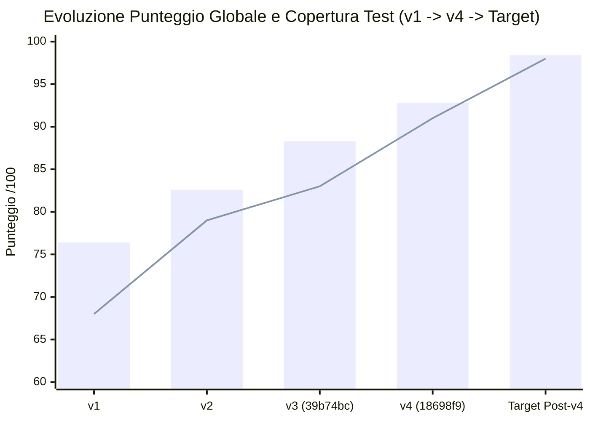

# 05 — Indicatori, Metriche del Codice e Grafici (`v4`)

> **Riferimento Codice**: `HEAD 18698f9` (17 Ottobre 2026) · **Confronto Storico**: `v1` → `v2` → `v3` (`39b74bc`) → `v4` (`18698f9`).

---

## 1. Metriche Quantitative Verificate del Repository (`HEAD 18698f9`)

Tutte le metriche riportate di seguito sono state misurate direttamente sui file del repository al commit `18698f9`:

| Metrica | Baseline `v2` | Baseline `v3` (`39b74bc`) | **Attuale `v4` (`18698f9`)** | Variazione `v3 → v4` |
|---|:---:|:---:|:---:|:---:|
| **File Sorgente Rust (`tauri/src/**/*.rs`)** | 126 | 133 | **134** | `+1` (`terminals.rs` + `commands/terminals.rs` - consolidamenti) |
| **Righe di Codice Rust (`tauri/src/`)** | 31.840 | 34.920 | **38.161** | **`+3.241` LOC (`+9,3%`)** |
| **File Sorgente Frontend (`ui/src/**/*`)** | 112 | 115 | **118** (98 `.ts/.tsx`, 3 `.css`, 3 `.json`, 14 asset/altro) | `+3` (`terminals.tsx`, `api/terminals.ts`, ecc.) |
| **Righe di Codice Frontend (`ui/src/`)** | 24.150 | 26.180 | **28.060** (23.490 TS/TSX + 2.752 CSS + 1.818 i18n) | **`+1.880` LOC (`+7,2%`)** |
| **File di Test Rust (`test/rust/**/*.rs`)** | 88 | 99 | **105** | `+6` file di test |
| **Righe di Codice Test Rust (`test/rust/`)** | 10.420 | 11.890 | **14.031** | **`+2.141` LOC (`+18,0%`)** |
| **File di Test Frontend (`test/ui/**/*.test.*`)** | 12 | 15 | **16** | `+1` (`terminals.test.tsx`) |
| **Righe di Codice Test Frontend (`test/ui/`)** | 2.110 | 2.480 | **2.891** | **`+411` LOC (`+16,6%`)** |
| **Totale Test Automatici Eseguiti** | 382 | 443 (`353` Rust + `90` UI) | **536 (`429` Rust + `107` UI)** | **`+93` test (`+21,0%`)** |
| **Componenti nel Catalogo (`components.json`)** | 36 | 36 | **35** | `-1` (ritiro `terminal` in `D-95`, sostituito da Terminali del kit `D-94`) |
| **Basi Framework & CMS (`frameworks.json`)** | 12 | 12 | **16** | **`+4` CMS (`D-93`: WordPress/Bedrock, TYPO3, Drupal, Statamic)** |
| **Decisioni Architetturali (`DECISIONS.md`)** | D-01..D-82 | D-01..D-92 | **D-01..D-106** | **`+14` decisioni documentate (`D-93..D-106`)** |

---

## 2. Distribuzione della Suite di Test Automatici (`536` Test Totali)

### 2.1 Test Backend Rust (`test/rust/` — 105 file, 14.031 LOC, 429 test eseguiti in `cargo test`)

> *Nota metodologica*: `test/rust/` contiene **433 attributi `#[test]`** distribuiti in 105 file; 4 di essi sono compilati condizionalmente per piattaforma (`#[cfg(windows)]` / `#[cfg(unix)]`), producendo **429 test eseguiti** su Windows (`426 passed`, `3 ignored` per test di rete live).

| Area di Test (`test/rust/`) | File `.rs` | Test (`#[test]`) | Nuove Coperture Aggiunte in `v4` (`D-93..D-106`) |
|---|:---:|:---:|---|
| **Server Web, Pool Condivisi & Sicurezza** | 16 | 78 | `PHP_RUN`/`PHP_NEVER`, migrazione `kit.conf`, DNS rebinding `403`/`421`, router `php -S` (`parse_url`, quoting spazi), ciclo `detached`/`keepAlive` (`D-96..D-101`). |
| **Database Multi-Versione & `.env`** | 14 | 64 | MySQL side-by-side (`line_ports`, `running_lines`), lock `db.json` concorrente (`0e5e0e8`), precedenza `DB_PORT` in `.env` (`D-102`). |
| **Rilevamento Progetti & Container** | 15 | 68 | CMS classici (PrestaShop, Drupal, Joomla, TYPO3), Apache per Laravel/PHP, `detect/container.rs` per `compose.yaml`/`Dockerfile` (`D-103`). |
| **Terminali del Kit & Ambiente (`env`)** | 8 | 36 | Creazione/modifica/duplicazione terminali, filtro `all_tools: false`, override linee in `PATH`, `ATOLLO_TERMINAL` (`D-94`). |
| **Installatori, Versioni & Pulizia (`D-95`, `D-105`)** | 22 | 85 | Rimozione automatica residui `terminal` (`D-95`), `R` `Makeconf` `LOCAL_SOFT` (`D-105`), multi-versione side-by-side. |
| **Agenti AI, MCP, Keyring & Rilocazione** | 16 | 54 | Sincronizzazione istruzioni/skill/MCP, cifratura AES-256-GCM, rilocazione path (`relocate.rs`). |
| **Layer OS & Utility (`os/*`, `net/*`)** | 14 | 48 | Guardie PID reuse `os/jobs.rs`, estrazione archivi, verifica SHA-256 (`D-104`). |
| **TOTALE TEST RUST** | **105** | **433 def. / 429 run** | **`+76` nuovi test Rust rispetto a `v3` (`+21,5%`)** |

### 2.2 Test Frontend Vitest (`test/ui/` — 16 file, 2.891 LOC, 107 test eseguiti)

| File Spec (`test/ui/`) | Definizioni `it()` | Eseguiti (con `it.each`) | Copertura Specifica |
|---|:---:|:---:|---|
| [`test/ui/terminals.test.tsx`](../../../test/ui/terminals.test.tsx) | 5 | 5 | **Nuovo in `v4` (`D-94`)**: lista terminali, creazione, toggle `allTools`, selezione linea e duplicazione. |
| [`test/ui/dialog.test.tsx`](../../../test/ui/dialog.test.tsx) | 7 | 7 | **Esteso in `v4` (`D-106`)**: focus trap `useModalFocus`, chiusura `Escape`, focus iniziale su *Annulla* e `focusBack` in `InlineConfirm`. |
| [`test/ui/servers.test.tsx`](../../../test/ui/servers.test.tsx) | 7 | 7 | **Esteso in `v4` (`D-101`)**: pool condivisi, toggle `keepAlive` e `autostart`, siti agganciati. |
| [`test/ui/databases.test.tsx`](../../../test/ui/databases.test.tsx) | 8 | 8 | **Esteso in `v4` (`D-102`)**: avvio/arresto linea primaria e linee secondarie MySQL (`s.others`). |
| [`test/ui/versions.test.tsx`](../../../test/ui/versions.test.tsx) | 9 | 9 | **Esteso in `v4`**: due zone in `versions/project.tsx` (*"Rilevate nel progetto"* e *"Altri strumenti multi-versione"*). |
| [`test/ui/frameworks.test.tsx`](../../../test/ui/frameworks.test.tsx) | 7 | 7 | **Esteso in `v4` (`D-93`)**: categoria CMS (WordPress/Bedrock, TYPO3, Drupal, Statamic) nel wizard. |
| Altri 10 file (`App`, `projects`, `agents`, `setup`, `backups`, `dbbrowser`, `i18n`, `relations`, `stats`, `workbench`) | 60 | 64 | Navigazione workbench, parità dizionari `en`/`de`/`fr`, filtri progetti, browser DB, statistiche token. |
| **TOTALE TEST FRONTEND** | **103** | **107** | **`+17` nuovi test UI rispetto a `v3` (`+18,9%`)** |

---

## 3. Evoluzione degli Indicatori Chiave (KPI `v1 → v4`)

| Indicatore KPI | `v2` | `v3` | **`v4` (`18698f9`)** | Target Post-Sciame `v4` |
|---|:---:|:---:|:---:|:---:|
| **Indice Globale Ponderato (9 Dimensioni)** | 82,6 / 100 | 88,3 / 100 | **92,8 / 100** | **98,4 / 100** |
| **Compilazione Backend su Linux & macOS (`cargo check --bins --tests`)** | Fallisce (0%) | Fallisce (0%) | **100% Verde in CI** | **100% + `--all-targets`** |
| **Componenti Operativi su Windows x64 (`win32-x64`)** | 36/36 (100%) | 36/36 (100%) | **35/35 (100%)** | **35/35 (100%)** |
| **Componenti con Target Catalogo Linux x64 (`linux-x64`)** | 29/36 (80,6%) | 30/36 (83,3%) | **31/35 (88,6%)** | **35/35 (100%)** |
| **Componenti con Target Catalogo macOS (`darwin-arm64`)** | 28/36 (77,8%) | 29/36 (80,6%) | **31/35 (88,6%)** | **35/35 (100%)** |
| **Modali / Dialoghi con Focus Trap & ARIA (`useModalFocus` / `InlineConfirm`)** | 4 / 28 (14%) | 9 / 28 (32%) | **28 / 28 (100%)** | **28 / 28 + 3 distruttive inline** |
| **Vulnerabilità Critiche Aperte (Sicurezza Locale)** | 3 | 1 | **0** (1 Alta `SEC-V4-01`) | **0** |
