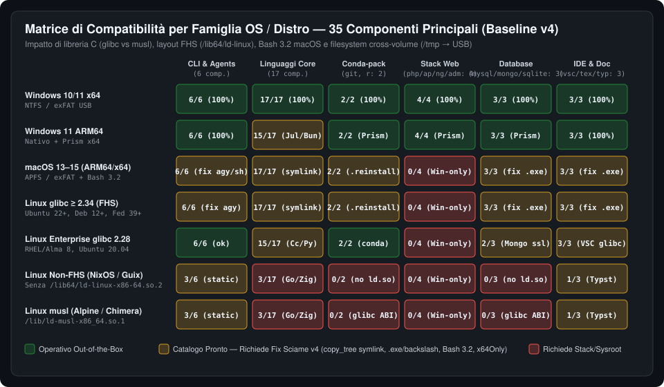

# 06 — Matrice Completa degli Strumenti per Distribuzione OS (`v4`)

> **Riferimento Catalogo**: [`tauri/catalog/components.json`](file:///d:/Projects/atollo/tauri/catalog/components.json) (**35 componenti principali** dopo il ritiro di `terminal` in `D-95`, più **12 sotto-strumenti integrati** = **47 strumenti totali**).

---

## 1. Legenda degli Stati di Compatibilità

- **✅ Nativo OK**: binario nativo per l'architettura/OS, estrazione, rilocazione e lancio funzionanti al 100%.
- **🟢 Emu x64 (`x64Only`)**: installa il binario `x64` ufficiale ed esegue in modo trasparente tramite **Windows 11 Prism** (`win32-arm64`) o **Apple Rosetta 2** (`darwin-arm64`).
- **🟡 Catalogo OK — Fix Runtime `v4`**: il componente è già configurato e scaricabile per quel target in `components.json`, ma richiede uno dei fix chirurgici dello Sciame `v4` (`PORT-V4-01` symlink `copy_tree`, `PORT-V4-03` `agy`/`bashrc`, `PORT-V4-04` `editor` `.exe`/backslash, `PORT-V4-05` `db` `.exe`/backslash, `PORT-V4-07` `x64Only` per Julia/Bun).
- **🟠 Rilocazione `.reinstall` (`D-92`)**: funziona sul PC dove viene installato (`conda-unpack`), ma se la chiavetta viene spostata richiede `PORT-V4-08` per rilocare offline senza riscaricare.
- **🔴 Non nel Target / Win-Only**: attualmente limitato a Windows in `components.json` (`php`, `apache`, `nginx`, `adminer`) o bloccato da assenza di `/lib64/ld-linux-x86-64.so.2` / ABI `musl`.

---

## 2. Matrice Puntuale dei 35 Componenti Principali (`tauri/catalog/components.json`)

| # | ID Catalogo | Nome & Categoria | `win32-x64` (Win 10/11) | `win32-arm64` (Win 11 ARM) | `darwin-arm64` (macOS M1–M4) | `darwin-x64` (macOS Intel) | `linux-x64` glibc ≥ 2.34 (Ubuntu 22+, Deb 12+, Fed) | `linux-x64` glibc 2.28 (RHEL 8, Alma 8) | Linux Non-FHS / musl (NixOS, Alpine) | Note Tecniche & Riferimento Codice (`HEAD 18698f9`) |
|:---:|---|---|:---:|:---:|:---:|:---:|:---:|:---:|:---:|---|
| 1 | `claude` | **Claude Code** (`agents`) | ✅ Nativo | 🟢 Prism (`x64Only`) | 🟡 Fix `PORT-V4-06` | 🟡 Fix `PORT-V4-06` | 🟡 Fix `PORT-V4-06` | 🟡 Fix `PORT-V4-06` | 🔴 Dynamic | [`agents/mod.rs:70`](file:///d:/Projects/atollo/tauri/src/agents/mod.rs#L70) usa `r"claude\claude.exe"`. |
| 2 | `codex` | **OpenAI Codex CLI** (`agents`) | ✅ Nativo | ✅ Nativo | 🟡 Fix `PORT-V4-06` | 🟡 Fix `PORT-V4-06` | 🟡 Fix `PORT-V4-06` | 🟡 Fix `PORT-V4-06` | 🔴 Dynamic | [`agents/mod.rs:86`](file:///d:/Projects/atollo/tauri/src/agents/mod.rs#L86) usa `r"codex\codex.exe"`. |
| 3 | `antigravity` | **Antigravity IDE** (`agents`) | ✅ Nativo | ✅ Nativo | 🟡 Fix `PORT-V4-03/06` | 🟡 Fix `PORT-V4-03/06` | 🟡 Fix `PORT-V4-03/06` | 🟡 Fix `PORT-V4-03/06` | 🔴 Electron | [`runtime/bin/agy:5`](file:///d:/Projects/atollo/runtime/bin/agy#L5) chiama `agy.exe`; [`kit_files.rs:23`](file:///d:/Projects/atollo/tauri/src/setup/kit_files.rs#L23) usa `r"bin\agy"`. |
| 4 | `git` | **Git + Git LFS** (`cli`) | ✅ Nativo | ✅ Nativo | 🟠 `conda-forge` | 🟠 `conda-forge` | 🟠 `conda-forge` | 🟠 `conda-forge` | 🔴 `/lib64/ld` | Su Unix usa `conda-forge` + `.reinstall` (`D-92`, [`install/cli.rs:180`](file:///d:/Projects/atollo/tauri/src/install/cli.rs#L180)). |
| 5 | `python` | **Python (3.10–3.13)** (`lang`) | ✅ Nativo | ✅ Nativo | 🟡 Fix `PORT-V4-01` | 🟡 Fix `PORT-V4-01` | 🟡 Fix `PORT-V4-01` | 🟡 Fix `PORT-V4-01` | 🔴 Dynamic | `python-build-standalone`: richiede i symlink preservati in `copy_tree` (`PORT-V4-01`). |
| 6 | `node` | **Node.js (18/20/22/24)** (`lang`) | ✅ Nativo | ✅ Nativo | 🟡 Fix `PORT-V4-01` | 🟡 Fix `PORT-V4-01` | 🟡 Fix `PORT-V4-01` | 🟡 Fix `PORT-V4-01` | 🔴 Dynamic | Su Unix `bin/npm` e `bin/npx` sono symlink a `../lib/node_modules/...` (`PORT-V4-01`). |
| 7 | `uv` | **uv (Astral)** (`cli`) | ✅ Nativo | ✅ Nativo | ✅ Nativo | ✅ Nativo | ✅ Nativo | ✅ Nativo | 🔴 `gnu` target | Binario singolo autonomo in `bin/uv`. |
| 8 | `gh` | **GitHub CLI** (`cli`) | ✅ Nativo | ✅ Nativo | ✅ Nativo | ✅ Nativo | ✅ Nativo | ✅ Nativo | ✅ Go statico | Binario Go statico (`CGO_ENABLED=0` su Linux). |
| 9 | `php` | **PHP (8.2–8.5)** (`web`) | ✅ Nativo | 🟢 Prism (`x64Only`) | 🔴 Win-only | 🔴 Win-only | 🔴 Win-only | 🔴 Win-only | 🔴 Win-only | Target attuale `["win32-x64", "win32-arm64"]`. Sbloccabile via `static-php-cli` (`PORT-V4-08`). |
| 10 | `apache` | **Apache httpd 2.4** (`web`) | ✅ Nativo | 🟢 Prism (`x64Only`) | 🔴 Win-only | 🔴 Win-only | 🔴 Win-only | 🔴 Win-only | 🔴 Win-only | Target attuale `["win32-x64", "win32-arm64"]`. Sbloccabile via `conda-forge` `httpd` (`PORT-V4-08`). |
| 11 | `nginx` | **Nginx** (`web`) | ✅ Nativo | 🟢 Prism (`x64Only`) | 🔴 Win-only | 🔴 Win-only | 🔴 Win-only | 🔴 Win-only | 🔴 Win-only | Target attuale `["win32-x64", "win32-arm64"]`. Sbloccabile via `conda-forge` `nginx` (`PORT-V4-08`). |
| 12 | `rust` | **Rust (rustup + cargo)** (`lang`) | ✅ Nativo | ✅ Nativo | 🟡 Fix `PORT-V4-01` | 🟡 Fix `PORT-V4-01` | 🟡 Fix `PORT-V4-01` | 🟡 Fix `PORT-V4-01` | 🔴 Dynamic | `RUSTUP_HOME` e `CARGO_HOME` isolati in `env.rs`. |
| 13 | `go` | **Go Toolchain** (`lang`) | ✅ Nativo | ✅ Nativo | ✅ Nativo | ✅ Nativo | ✅ Nativo | ✅ Nativo | ✅ Statico | Toolchain Go completamente statica e auto-contenuta. |
| 14 | `java` | **Java OpenJDK (17/21/25)** (`lang`) | ✅ Nativo | ✅ Nativo | 🟡 Fix `PORT-V4-01` | 🟡 Fix `PORT-V4-01` | 🟡 Fix `PORT-V4-01` | ✅ Nativo | 🔴 Dynamic | Adoptium Temurin; su macOS layout `Contents/Home` gestito in `env.rs` (`D-104`). |
| 15 | `kotlin` | **Kotlin Compiler** (`lang`) | ✅ Nativo | ✅ Nativo | ✅ Nativo | ✅ Nativo | ✅ Nativo | ✅ Nativo | 🟡 Dipende da Java | Zip universale JVM; richiede `java` funzionante. |
| 16 | `android` | **Android SDK Command-line** (`mobile`) | ✅ Nativo | ✅ Nativo | 🟡 Fix `PORT-V4-01` | 🟡 Fix `PORT-V4-01` | 🟡 Fix `PORT-V4-01` | ✅ Nativo | 🔴 Dynamic | `ANDROID_HOME` isolato; `platform-tools` contiene symlink su Unix. |
| 17 | `dotnet` | **.NET SDK (8.0 / 9.0)** (`lang`) | ✅ Nativo | ✅ Nativo | 🟡 Fix `PORT-V4-01` | 🟡 Fix `PORT-V4-01` | 🟡 Fix `PORT-V4-01` | ✅ Nativo | 🔴 Dynamic (`icu`) | `DOTNET_ROOT` e `DOTNET_CLI_HOME` isolati. |
| 18 | `dart` | **Dart SDK** (`lang`) | ✅ Nativo | ✅ Nativo | ✅ Nativo | ✅ Nativo | ✅ Nativo | ✅ Nativo | 🔴 Dynamic | Zip ufficiale multi-piattaforma. |
| 19 | `zig` | **Zig Compiler** (`lang`) | ✅ Nativo | ✅ Nativo | ✅ Nativo | ✅ Nativo | ✅ Nativo | ✅ Nativo | ✅ Statico | Binario Zig completamente statico su tutti gli OS/architetture. |
| 20 | `julia` | **Julia** (`lang`) | ✅ Nativo | 🟡 Fix `PORT-V4-07` | 🟡 Fix `PORT-V4-01` | 🟡 Fix `PORT-V4-01` | 🟡 Fix `PORT-V4-01` | ✅ Nativo | 🔴 Dynamic | **Bug `win32-arm64`**: manca `"x64Only": true` in `components.json` ([`julia.rs:18-37`](file:///d:/Projects/atollo/tauri/src/install/lang/julia.rs#L18-L37)). |
| 21 | `bun` | **Bun Runtime** (`lang`) | ✅ Nativo | 🟡 Fix `PORT-V4-07` | ✅ Nativo | ✅ Nativo | ✅ Nativo | ✅ Nativo | 🔴 Dynamic | **Bug `win32-arm64`**: manca `"x64Only": true` in `components.json` ([`js.rs:16-27`](file:///d:/Projects/atollo/tauri/src/install/lang/js.rs#L16-L27)). |
| 22 | `deno` | **Deno Runtime** (`lang`) | ✅ Nativo | ✅ Nativo | ✅ Nativo | ✅ Nativo | ✅ Nativo | ✅ Nativo | 🔴 Dynamic | Binario singolo autonomo per tutte le 5 piattaforme. |
| 23 | `typst` | **Typst** (`doc`) | ✅ Nativo | ✅ Nativo | ✅ Nativo | ✅ Nativo | ✅ Nativo | ✅ Nativo | ✅ Statico (`musl`) | Binario singolo statico. |
| 24 | `tinytex` | **TinyTeX (TeX Live)** (`doc`) | ✅ Nativo | 🟢 Prism (`x64Only`) | 🟡 Fix `PORT-V4-01` | 🟡 Fix `PORT-V4-01` | 🟡 Fix `PORT-V4-01` | 🟡 Fix `PORT-V4-01` | 🔴 Dynamic | Su Unix tutti i binari in `bin/<arch>/` sono symlink verso `texmf-dist` (`PORT-V4-01`). |
| 25 | `pnpm` | **pnpm** (`cli`) | ✅ Nativo | ✅ Nativo | ✅ Nativo | ✅ Nativo | ✅ Nativo | ✅ Nativo | ✅ Statico | Binario standalone `@pnpm/exe`. |
| 26 | `cmake` | **CMake + Ninja** (`sys`) | ✅ Nativo | ✅ Nativo | 🟡 Fix `PORT-V4-01` | 🟡 Fix `PORT-V4-01` | ✅ Nativo | ✅ Nativo | 🔴 Dynamic | Su macOS `CMake.app/Contents/bin` gestito in `env.rs` (`D-104`). |
| 27 | `cc` | **C/C++ Toolchain (MinGW / LLVM)** (`sys`) | ✅ Nativo | 🟢 Prism (`x64Only`) | 🟡 Fix `PORT-V4-01` | 🟡 Fix `PORT-V4-01` | 🟡 Fix `PORT-V4-01` | 🔴 `glibc 2.34` | 🔴 Dynamic | `D-105` ha risolto `darwin-x64` (LLVM `20.1.7`); su Unix `clang -> clang-20` è un symlink (`PORT-V4-01`). |
| 28 | `ruby` | **Ruby (3.2–3.4)** (`lang`) | ✅ Nativo | 🟢 Prism (`x64Only`) | 🟡 Fix `PORT-V4-01` | 🟡 Fix `PORT-V4-01` | 🟡 Fix `PORT-V4-01` | ✅ Nativo | 🔴 Dynamic | `ruby-build` / `PortableRuby` precompilato; usa symlink in `bin/` e `lib/`. |
| 29 | `r` | **R Statistical Computing** (`lang`) | ✅ Nativo | 🟢 Prism (`x64Only`) | 🟠 `conda-forge` | 🟠 `conda-forge` | 🟠 `conda-forge` | 🟠 `conda-forge` | 🔴 `/lib64/ld` | Su Windows `Makeconf` aggiornato ad ogni avvio (`D-105`); su Unix usa `.reinstall` (`PORT-V4-08`). |
| 30 | `mysql` | **MySQL (8.4 / 9.7 LTS)** (`db`) | ✅ Nativo | 🟢 Prism (`x64Only`) | 🟡 Fix `PORT-V4-05` | 🟡 Fix `PORT-V4-05` | 🟡 Fix `PORT-V4-05` | 🟡 Fix `PORT-V4-05` | 🔴 Dynamic | Build Oracle nel catalogo per tutti i 6 target (SHA-256 per linea in `sha256ByLine`), ma `db/services/*` cerca ancora `mysqld.exe` (`PORT-V4-05`). |
| 31 | `mongodb` | **MongoDB + Mongosh + Tools** (`db`) | ✅ Nativo | 🟢 Prism (`x64Only`) | 🟡 Fix `PORT-V4-05` | 🟡 Fix `PORT-V4-05` | 🟡 Fix `PORT-V4-05` | 🔴 `libssl.so.3` | 🔴 Dynamic | Il catalogo scarica i tarball Unix, ma `db/services/*` cerca `mongod.exe` e `r"mongosh\bin"` (`PORT-V4-05`). |
| 32 | `adminer` | **Adminer Web UI** (`db`) | ✅ Nativo | 🟢 Prism (`x64Only`) | 🔴 Dipende da `php` | 🔴 Dipende da `php` | 🔴 Dipende da `php` | 🔴 Dipende da `php` | 🔴 Dipende da `php` | È un singolo file `.php` multipiattaforma, ma richiede `php` + fix `kit_path("php/php.exe")` (`PORT-V4-05`). |
| 33 | `sqlite` | **SQLite Tools (`sqlite3`)** (`db`) | ✅ Nativo | ✅ Nativo | ✅ Nativo | ✅ Nativo | ✅ Nativo | ✅ Nativo | 🔴 Dynamic | Binario CLI `sqlite3` + `sqlite3_analyzer`. |
| 34 | `pwsh` | **PowerShell 7 (`pwsh`)** (`cli`) | ✅ Nativo | ✅ Nativo | 🟡 Fix `PORT-V4-01` | 🟡 Fix `PORT-V4-01` | 🟡 Fix `PORT-V4-01` | ✅ Nativo | 🔴 Dynamic (`icu`) | Su Unix `pwsh` usa symlink per le librerie native. |
| 35 | `vscodium-server` | **VSCodium Web Server** (`ide`) | ✅ Nativo | ✅ Nativo | 🟡 Fix `PORT-V4-04` | 🟡 Fix `PORT-V4-04` | 🟡 Fix `PORT-V4-04` | 🔴 `glibc 2.31+` | 🔴 Dynamic | `D-105` ha aggiunto gli SHA-256 Unix, ma `editor/*` lancia ancora `node.exe` e `r"out\server-main.js"` (`PORT-V4-04`). |

---

## 3. Sotto-Strumenti Integrati (12 Strumenti Secondari Co-Installati)

| # | Sotto-Strumento | Co-Installato Con | `win32-x64` | `win32-arm64` | `darwin-*` | `linux-x64` | Stato e Note di Portabilità (`v4`) |
|:---:|---|---|:---:|:---:|:---:|:---:|---|
| S1 | **Composer (`composer.phar`)** | `php` | ✅ | 🟢 | 🔴 | 🔴 | In [`frameworks/runner.rs:70`](file:///d:/Projects/atollo/tauri/src/projects/frameworks/runner.rs#L70) è invocato come `r"php\composer.bat"` (`PORT-V4-06`). |
| S2 | **Git LFS (`git-lfs`)** | `git` | ✅ | ✅ | 🟠 | 🟠 | Incluso in MinGit (Windows) e nel pacchetto `conda-forge` (Unix). |
| S3 | **BusyBox POSIX (`sh`, `ls`, `grep`...)** | `git` (MinGit) | ✅ | ✅ | ✅ (OS nativo) | ✅ (OS nativo) | Su Windows fornisce i 150+ comandi POSIX in `git/usr/bin` o `git/mingw64/libexec/git-core`. |
| S4 | **npm & npx** | `node` | ✅ | ✅ | 🟡 `PORT-V4-01` | 🟡 `PORT-V4-01` | Su Unix sono symlink verso `../lib/node_modules/npm/bin/*`. |
| S5 | **Corepack (Yarn)** | `node` | ✅ | ✅ | 🟡 `PORT-V4-01` | 🟡 `PORT-V4-01` | Symlink in `node/bin/corepack` su Unix. |
| S6 | **pip & venv** | `python` | ✅ | ✅ | 🟡 `PORT-V4-01/06` | 🟡 `PORT-V4-01/06` | [`detect/python.rs:33`](file:///d:/Projects/atollo/tauri/src/detect/python.rs#L33) cerca solo `.venv/Scripts/python.exe` e non `.venv/bin/python` (`PORT-V4-06`). |
| S7 | **Cargo & Clippy & Rustfmt** | `rust` | ✅ | ✅ | 🟡 `PORT-V4-01` | 🟡 `PORT-V4-01` | Proxy gestiti da `rustup` in `CARGO_HOME/bin`. |
| S8 | **Ninja Build (`ninja`)** | `cmake` | ✅ | ✅ | ✅ | ✅ | Scaricato ed estratto nella cartella `bin` di CMake ([`install/sys.rs`](file:///d:/Projects/atollo/tauri/src/install/sys.rs)). |
| S9 | **Rtools / Compilatore per R** | `r` + `cc` | ✅ | 🟢 | 🟠 | 🟠 | `D-105` aggiorna `LOCAL_SOFT` in `Makeconf` ad ogni avvio su Windows. |
| S10 | **Mongosh (`mongosh`)** | `mongodb` | ✅ | 🟢 | 🟡 `PORT-V4-05` | 🟡 `PORT-V4-05` | [`db/services/tools.rs:28`](file:///d:/Projects/atollo/tauri/src/db/services/tools.rs#L28) usa `r"mongosh\bin"` e `mongosh.exe`. |
| S11 | **MongoDB Database Tools (`mongodump`)** | `mongodb` | ✅ | 🟢 | 🟡 `PORT-V4-05` | 🟡 `PORT-V4-05` | [`db/services/backups.rs:42`](file:///d:/Projects/atollo/tauri/src/db/services/backups.rs#L42) usa `r"mongodb-tools\bin"` e `mongodump.exe`. |
| S12 | **TeX Live Manager (`tlmgr`)** | `tinytex` | ✅ | 🟢 | 🟡 `PORT-V4-01` | 🟡 `PORT-V4-01` | Symlink in `bin/<arch>/tlmgr` su Unix (`PORT-V4-01`). |
