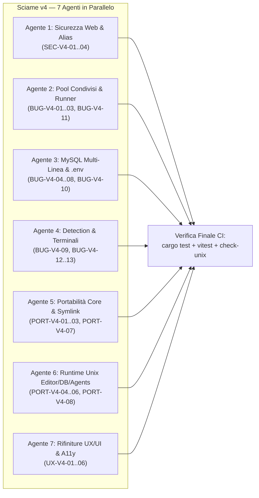

# 07 — Piano Esecutivo di Risoluzione: Sciame `v4` (7 Agenti in Parallelo)

> **Obiettivo**: portare il punteggio globale di Atollo / Atollo da **92,8 / 100** a **98,4 / 100**, chiudendo tutti i **25 rilievi `v4`** (`SEC-V4-01..04`, `BUG-V4-01..13`, `PORT-V4-01..08`, `UX-V4-01..06`) senza conflitti di merge grazie al partizionamento dei file su **7 Agenti specializzati**.

---

## 1. Partizionamento dello Sciame `v4` (Zero Conflitti di File)



| Agente | Rilievi Assegnati | File in Esclusiva |
|---|---|---|
| **Agente 1 — Sicurezza Web & Router PHP** | `SEC-V4-01`, `SEC-V4-02`, `SEC-V4-03`, `SEC-V4-04` | [`runtime/php-router.php`](file:///d:/Projects/atollo/runtime/php-router.php), [`tauri/src/projects/apache.rs`](file:///d:/Projects/atollo/tauri/src/projects/apache.rs), [`tauri/src/projects/nginx.rs`](file:///d:/Projects/atollo/tauri/src/projects/nginx.rs), [`tauri/src/projects/serve.rs`](file:///d:/Projects/atollo/tauri/src/projects/serve.rs) |
| **Agente 2 — Pool Condivisi & Port Guard** | `BUG-V4-01`, `BUG-V4-02`, `BUG-V4-03`, `BUG-V4-11` | [`tauri/src/servers/mod.rs`](file:///d:/Projects/atollo/tauri/src/servers/mod.rs), [`tauri/src/projects/run.rs`](file:///d:/Projects/atollo/tauri/src/projects/run.rs), [`tauri/src/commands/projects.rs`](file:///d:/Projects/atollo/tauri/src/commands/projects.rs), [`tauri/src/commands/github.rs`](file:///d:/Projects/atollo/tauri/src/commands/github.rs) |
| **Agente 3 — Database Multi-Linea & `.env`** | `BUG-V4-04`, `BUG-V4-05`, `BUG-V4-06`, `BUG-V4-07`, `BUG-V4-08`, `BUG-V4-10` | [`tauri/src/db/services/mod.rs`](file:///d:/Projects/atollo/tauri/src/db/services/mod.rs), [`tauri/src/db/services/tools.rs`](file:///d:/Projects/atollo/tauri/src/db/services/tools.rs), [`tauri/src/db/auth.rs`](file:///d:/Projects/atollo/tauri/src/db/auth.rs), [`tauri/src/db/browse.rs`](file:///d:/Projects/atollo/tauri/src/db/browse.rs), [`tauri/src/commands/frameworks.rs`](file:///d:/Projects/atollo/tauri/src/commands/frameworks.rs) |
| **Agente 4 — Detection & Terminali** | `BUG-V4-09`, `BUG-V4-12`, `BUG-V4-13` | [`tauri/src/detect/mod.rs`](file:///d:/Projects/atollo/tauri/src/detect/mod.rs), [`tauri/src/detect/container.rs`](file:///d:/Projects/atollo/tauri/src/detect/container.rs), [`tauri/src/detect/python.rs`](file:///d:/Projects/atollo/tauri/src/detect/python.rs), [`tauri/src/terminals.rs`](file:///d:/Projects/atollo/tauri/src/terminals.rs) |
| **Agente 5 — Archivi, Symlink, Shell & ARM64** | `PORT-V4-01`, `PORT-V4-02`, `PORT-V4-03`, `PORT-V4-07` | [`tauri/src/net/archive.rs`](file:///d:/Projects/atollo/tauri/src/net/archive.rs), [`tauri/src/agents/relocate.rs`](file:///d:/Projects/atollo/tauri/src/agents/relocate.rs), [`tauri/src/setup/kit_files.rs`](file:///d:/Projects/atollo/tauri/src/setup/kit_files.rs), [`runtime/bin/agy`](file:///d:/Projects/atollo/runtime/bin/agy), [`runtime/bashrc`](file:///d:/Projects/atollo/runtime/bashrc), [`tauri/catalog/components.json`](file:///d:/Projects/atollo/tauri/catalog/components.json), [`tauri/src/install/lang/julia.rs`](file:///d:/Projects/atollo/tauri/src/install/lang/julia.rs), [`tauri/src/install/lang/js.rs`](file:///d:/Projects/atollo/tauri/src/install/lang/js.rs), [`tauri/src/setup/runner.rs`](file:///d:/Projects/atollo/tauri/src/setup/runner.rs), [`tauri/src/versions/relations/checks.rs`](file:///d:/Projects/atollo/tauri/src/versions/relations/checks.rs) |
| **Agente 6 — Editor, DB & Agenti su Unix** | `PORT-V4-04`, `PORT-V4-05`, `PORT-V4-06`, `PORT-V4-08` | [`tauri/src/editor/mod.rs`](file:///d:/Projects/atollo/tauri/src/editor/mod.rs), [`tauri/src/editor/ext.rs`](file:///d:/Projects/atollo/tauri/src/editor/ext.rs), [`tauri/src/editor/cfg.rs`](file:///d:/Projects/atollo/tauri/src/editor/cfg.rs), [`tauri/src/db/services/data.rs`](file:///d:/Projects/atollo/tauri/src/db/services/data.rs), [`tauri/src/db/services/access.rs`](file:///d:/Projects/atollo/tauri/src/db/services/access.rs), [`tauri/src/db/services/backups.rs`](file:///d:/Projects/atollo/tauri/src/db/services/backups.rs), [`tauri/src/db/adminer.rs`](file:///d:/Projects/atollo/tauri/src/db/adminer.rs), [`tauri/src/agents/mod.rs`](file:///d:/Projects/atollo/tauri/src/agents/mod.rs), [`tauri/src/agents/sync/mod.rs`](file:///d:/Projects/atollo/tauri/src/agents/sync/mod.rs) |
| **Agente 7 — Frontend UX/UI & Accessibilità** | `UX-V4-01`, `UX-V4-02`, `UX-V4-03`, `UX-V4-04`, `UX-V4-05`, `UX-V4-06` | [`ui/src/App.tsx`](file:///d:/Projects/atollo/ui/src/App.tsx), [`ui/src/activity.tsx`](file:///d:/Projects/atollo/ui/src/activity.tsx), [`ui/src/servers.tsx`](file:///d:/Projects/atollo/ui/src/servers.tsx), [`ui/src/terminals.tsx`](file:///d:/Projects/atollo/ui/src/terminals.tsx), [`ui/src/databases.tsx`](file:///d:/Projects/atollo/ui/src/databases.tsx), [`ui/src/projects/site.tsx`](file:///d:/Projects/atollo/ui/src/projects/site.tsx), [`ui/src/projects/databases.tsx`](file:///d:/Projects/atollo/ui/src/projects/databases.tsx), [`ui/src/api/projects.ts`](file:///d:/Projects/atollo/ui/src/api/projects.ts), [`ui/src/api/servers.ts`](file:///d:/Projects/atollo/ui/src/api/servers.ts) |

---

## 2. Specifiche Esecutive Dettagliate per Agente

### Agente 1 — Sicurezza Web, Alias Upload e Router PHP (`SEC-V4-01..04`)
1. **Disabilitare l'esecuzione PHP nelle directory Alias (`SEC-V4-01`)**:
   - In [`tauri/src/projects/apache.rs:197-205`](file:///d:/Projects/atollo/tauri/src/projects/apache.rs#L197-L205) (`alias_directives`), sostituire `AllowOverride Indexes FileInfo Limit` con `AllowOverride Indexes Limit` e aggiungere dentro `<Directory "{target}">`:
     ```apache
     <FilesMatch "\.(?:php|phtml|phar|inc|php[34578]|phps)$">
         SetHandler None
         Require all denied
     </FilesMatch>
     ```
   - In [`tauri/src/projects/nginx.rs:104`](file:///d:/Projects/atollo/tauri/src/projects/nginx.rs#L104) (`alias_locations`), usare `location ^~ {url} {{` e aggiungere una sub-location `location ~* \.(?:php|phtml|phar|inc|php[34578]|phps)$ {{ return 403; }}`.
2. **Router `php -S` e Modalità LAN (`SEC-V4-02`)**:
   - In [`runtime/php-router.php:19`](file:///d:/Projects/atollo/runtime/php-router.php#L19), bloccare anche `$host === ''` quando `getenv('ATOLLO_ALLOW_LAN') !== '1'`.
   - In [`tauri/src/projects/run.rs:202`](file:///d:/Projects/atollo/tauri/src/projects/run.rs#L202), esportare `cmd.env("ATOLLO_ALLOW_LAN", if allow_lan { "1" } else { "0" })`.
3. **Sottodomini `.localhost` in `serve.rs` (`SEC-V4-03`)**:
   - In [`tauri/src/projects/serve.rs:62`](file:///d:/Projects/atollo/tauri/src/projects/serve.rs#L62), accettare `host.ends_with(".localhost")`.
4. **Hardening FastCGI (`SEC-V4-04`)**:
   - In `spawn_php_cgi` ([`nginx.rs:220`](file:///d:/Projects/atollo/tauri/src/projects/nginx.rs#L220) e [`servers/mod.rs:648`](file:///d:/Projects/atollo/tauri/src/servers/mod.rs#L648)), aggiungere `.env("FCGI_WEB_SERVER_ADDRS", "127.0.0.1")`.

---

### Agente 2 — Pool Condivisi, Allineamento `site_mode` e Port Guard (`BUG-V4-01..03`, `BUG-V4-11`)
1. **Allineare `site_mode` e `WebServers::scan` (`BUG-V4-01`)**:
   - In [`tauri/src/projects/run.rs:115-128`](file:///d:/Projects/atollo/tauri/src/projects/run.rs#L115-L128), mappare `Some("auto")` a `SiteMode::Pool("auto".into())` e verificare tramite `servers.has_pool_for(id)` che un profilo personalizzato esista ancora; se è stato eliminato, ricadere su `SiteMode::Dedicated`.
   - In [`tauri/src/servers/mod.rs:878-888`](file:///d:/Projects/atollo/tauri/src/servers/mod.rs#L878-L888), includere nei pool automatici solo le azioni che hanno esplicitamente `action.server.as_deref() == Some("auto")`.
2. **Includere `conf.d/*.conf` di Progetto nei Pool (`BUG-V4-02`)**:
   - In `render_apache_vhost` e `render_nginx_vhost` di [`tauri/src/servers/mod.rs`](file:///d:/Projects/atollo/tauri/src/servers/mod.rs#L408-L447), aggiungere `IncludeOptional` / `include` verso `data/projects/<project>/{apache,nginx}/conf.d/*.conf`.
3. **Validazione Porte Cross-Sottosistema (`BUG-V4-03`)**:
   - Estrarre un helper condiviso `ports::check_available_for(root, port, owner)` che verifichi l'assenza di conflitti tra `servers.json`, `projects` (`Runner`), `services.json` (`MySQL`/`MongoDB`) e il range `editor::PORTS` (`7000..=7099`).
4. **Invalidazione Cache `WebServers` (`BUG-V4-11`)**:
   - Chiamare `state.servers.invalidate()` alla fine di `project_clone`, `project_delete`, `github_clone` e `frameworks_create`.

---

### Agente 3 — MySQL Multi-Linea, Concorrenza `Services` e `.env` (`BUG-V4-04..08`, `BUG-V4-10`)
1. **Serializzazione `Services` (`BUG-V4-04`)**:
   - Aggiungere `op_lock: Mutex<()>` e `cfg_lock: Mutex<()>` in [`Services`](file:///d:/Projects/atollo/tauri/src/db/services/mod.rs#L75-L95) per proteggere `start_line`, `stop_line` e tutte le scritture su `services.json`.
2. **Stabilità Porte MySQL al Cambio di Linea Predefinita (`BUG-V4-05`)**:
   - In [`db/services/mod.rs:188-222, 538-547`](file:///d:/Projects/atollo/tauri/src/db/services/mod.rs#L188-L222), persistere sempre in `cfg.ports` anche la porta della linea predefinita (`keep_port(root, l, port)` senza il filtro `if line != default_line`) e dare precedenza a `cfg.ports.get(&line)` in `line_ports`.
3. **Pulizia DB Multi-Linea e Browser/Adminer (`BUG-V4-06`, `BUG-V4-07`)**:
   - In `drop_db`, iterare su tutte le linee MySQL che hanno registrato il progetto; in `db/browse.rs` e `adminer_url`, usare la prima linea MySQL in esecuzione se la primaria è ferma (o accettare `line: Option<&str>`).
4. **File `.cnf` Temporanei Thread-Safe (`BUG-V4-08`)**:
   - In [`db/services/tools.rs:115`](file:///d:/Projects/atollo/tauri/src/db/services/tools.rs#L115), aggiungere un contatore atomico `AtomicU64` al nome del file `<stem>-<pid>-<seq>.cnf`.
5. **Preservazione `.env.example` in `env_apply` e Ordine in `frameworks_create` (`BUG-V4-10`)**:
   - In [`tauri/src/db/auth.rs:581-598`](file:///d:/Projects/atollo/tauri/src/db/auth.rs#L581-L598), quando `.env` non esiste ancora ma esiste un template (`.env.example`, `.env.dist`), leggere il template e applicare `rewrite_env_content(&template_raw, &preview.entries)` anziché `render_fresh_env`.
   - In [`tauri/src/commands/frameworks.rs:319-343`](file:///d:/Projects/atollo/tauri/src/commands/frameworks.rs#L319-L343), eseguire `projects::frameworks::env_set(&dir, &vars)` **prima** di `db::auth::env_apply`.

---

### Agente 4 — Rilevamento Progetti, Tag Container e Terminali (`BUG-V4-09`, `BUG-V4-12..13`)
1. **Filtro `apache`/`nginx` dentro `detect::requires` (`BUG-V4-09`)**:
   - In [`tauri/src/detect/mod.rs:447-570`](file:///d:/Projects/atollo/tauri/src/detect/mod.rs#L447-L570), spostare la logica di filtro `D-103` (attualmente alle righe `677-687` di `detect::project`) direttamente alla fine di `detect::requires(dir)` così che `settle_project` non installi Apache sui progetti Laravel.
2. **Parser Tag Immagine Docker con Porta Registry (`BUG-V4-12`)**:
   - In [`tauri/src/detect/container.rs:142-168`](file:///d:/Projects/atollo/tauri/src/detect/container.rs#L142-L168), estrarre il tag cercando `:` solo sull'ultimo segmento dopo `/`.
3. **Fallback Linee Disinstallate in `terminals.rs` (`BUG-V4-13`)**:
   - In [`tauri/src/terminals.rs:280-335`](file:///d:/Projects/atollo/tauri/src/terminals.rs#L280-L335), verificare che la linea salvata in `terminal.lines` sia effettivamente installata su disco; in caso contrario, fare fallback alla linea predefinita installata del componente.

---

### Agente 5 — Archivi Symlink, Rilocazione Unix, Shell & `win32-arm64` (`PORT-V4-01..03`, `PORT-V4-07`)
1. **Staging su Stesso Volume e Preservazione Symlink in `copy_tree` (`PORT-V4-01`)**:
   - In [`tauri/src/net/archive.rs:597-599`](file:///d:/Projects/atollo/tauri/src/net/archive.rs#L597-L599), sostituire `if kind.is_symlink() { continue; }` con la copia del symlink (`std::os::unix::fs::symlink(fs::read_link(&src)?, &dst)` su Unix, con fallback a copia del target se il filesystem non supporta i symlink).
2. **Rilocazione Unix in `agents/relocate.rs` (`PORT-V4-02`)**:
   - In [`tauri/src/agents/relocate.rs:461`](file:///d:/Projects/atollo/tauri/src/agents/relocate.rs#L461), leggere il nome del file marker tramite un helper comune `kit::old_root_marker_name()` (`"old-root.txt"` su Windows, `"old-root-darwin.txt"` su macOS, `"old-root-linux.txt"` su Linux).
   - In `Replacer::substitute` (`relocate.rs:123-140`), applicare l'adattamento del case della lettera di unità **solo** se il path inizia con `<lettera>:` o `/<lettera>:`.
   - Sostituire i backslash letterali in `targets()` (`relocate.rs:389-435`) con `Path::join` / componenti multi-segmento.
3. **Script Shell e `kit_files.rs` (`PORT-V4-03`)**:
   - In [`tauri/src/setup/kit_files.rs:21-35`](file:///d:/Projects/atollo/tauri/src/setup/kit_files.rs#L21-L35), usare `dir.join("bin").join("agy")` e impostare `0o755` su Unix.
   - In [`runtime/bin/agy:5`](file:///d:/Projects/atollo/runtime/bin/agy#L5), risolvere il binario per la piattaforma corrente (`agy.exe` su Windows, `agy` su Unix).
   - In [`runtime/bashrc:26, 42, 51`](file:///d:/Projects/atollo/runtime/bashrc#L26), sostituire `${var,,}` con `tr '[:upper:]' '[:lower:]'` compatibile con Bash 3.2 di macOS.
4. **Julia/Bun `x64Only` su `win32-arm64`, `RunLock` e `vcruntime` (`PORT-V4-07`)**:
   - Aggiungere `"x64Only": true` a `julia` e `bun` in [`tauri/catalog/components.json`](file:///d:/Projects/atollo/tauri/catalog/components.json#L23-L24) e mappare `win32-arm64` → `x64` in `install/lang/julia.rs` e `install/lang/js.rs`.
   - In [`tauri/src/versions/relations/checks.rs:75`](file:///d:/Projects/atollo/tauri/src/versions/relations/checks.rs#L75), far restituire `true` a `check_vcruntime` su `#[cfg(not(windows))]`.

---

### Agente 6 — Runtime Unix per VSCodium Server, Database e Agenti AI (`PORT-V4-04..06`, `PORT-V4-08`)
1. **VSCodium Server Cross-OS (`PORT-V4-04`)**:
   - In [`tauri/src/editor/mod.rs:258-261`](file:///d:/Projects/atollo/tauri/src/editor/mod.rs#L258-L261) e [`editor/ext.rs:140, 504`](file:///d:/Projects/atollo/tauri/src/editor/ext.rs#L140), usare `os::exe("node")` e `.join("out").join("server-main.js")`.
   - In [`tauri/src/editor/cfg.rs:127-228`](file:///d:/Projects/atollo/tauri/src/editor/cfg.rs#L127-L228), generare anche `terminal.integrated.profiles.osx` / `.linux` e `defaultProfile.osx` / `.linux`.
2. **Database Service & Tools Cross-OS (`PORT-V4-05`)**:
   - In [`tauri/src/db/services/*`](file:///d:/Projects/atollo/tauri/src/db/services/mod.rs) e [`tauri/src/db/browse.rs`](file:///d:/Projects/atollo/tauri/src/db/browse.rs), sostituire i suffissi `.exe` hardcoded con `crate::os::exe("mysqld")`, `crate::os::exe("mysql")`, `crate::os::exe("mongod")`, `crate::os::exe("mongosh")`, e sostituire `r"mongosh\bin"` / `r"mongodb-tools\bin"` con `.join("mongosh").join("bin")`.
   - In [`tauri/src/db/adminer.rs:119`](file:///d:/Projects/atollo/tauri/src/db/adminer.rs#L119), usare `r"php\php.exe"` (o supportare `/` in `catalog::translate_rel`).
3. **Rimozione Backslash in `agents/*` (`PORT-V4-06`)**:
   - Normalizzare i separatori in `catalog::translate_rel` (`rel.replace('/', "\\").as_str()`) così che sia `"php/php.exe"` sia `r"php\php.exe"` vengano tradotti correttamente su ogni OS, e usare `.join(...)` in `agents/sync/mod.rs`.

---

### Agente 7 — Allineamento UX/UI e Accessibilità (`UX-V4-01..06`)
1. **Pool Web e Linee MySQL Secondarie in `StatusBar` / `ActivityPanel` / *"Ferma tutto"* (`UX-V4-01`)**:
   - Aggiornare [`ui/src/App.tsx`](file:///d:/Projects/atollo/ui/src/App.tsx) e [`ui/src/activity.tsx`](file:///d:/Projects/atollo/ui/src/activity.tsx) per conteggiare, mostrare e fermare i pool web attivi e le istanze `dbStatus.mysql.others` in esecuzione.
2. **Stato `detached` e Azione Secondaria in `servers.tsx` (`UX-V4-02`)**:
   - Esporre `detached: bool` e `serverName: string` in `AttachedSite` e visualizzare il badge *"Fermato"* e il nome dell'azione secondaria in [`ui/src/servers.tsx`](file:///d:/Projects/atollo/ui/src/servers.tsx).
3. **Etichette Dinamiche in `site.tsx`, `DbVersionSelect`, `Project.lines` e `InlineConfirm` (`UX-V4-03..06`)**:
   - Aggiornare [`ui/src/projects/site.tsx`](file:///d:/Projects/atollo/ui/src/projects/site.tsx), [`ui/src/projects/databases.tsx`](file:///d:/Projects/atollo/ui/src/projects/databases.tsx), [`ui/src/api/projects.ts`](file:///d:/Projects/atollo/ui/src/api/projects.ts) e aggiungere `onCancel` in [`ui/src/terminals.tsx:258`](file:///d:/Projects/atollo/ui/src/terminals.tsx#L258) oltre a `<InlineConfirm>` per `removeProfile` e `dropDatabase`.
