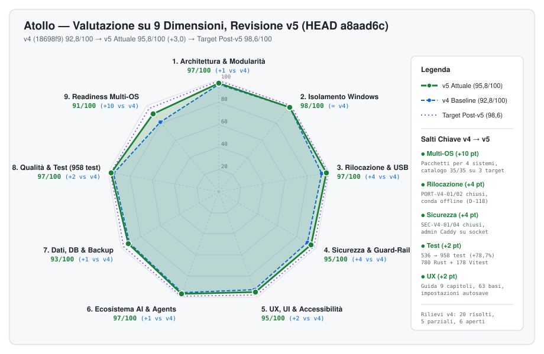

# Atollo — Valutazione Tecnica Integrale (Revisione v5)

> **Data Revisione**: 20 Ottobre 2026 (`HEAD a8aad6c`, rilascio `app-v0.3.0` alpha) · **Baseline Precedente**: `v4` (`18698f9`, 17 Ottobre 2026)  
> **Ambito**: Backend Rust/Tauri v2 ([`tauri/src/`](../../../tauri/src) — 156 file `.rs`, 55.504 righe), Frontend React 19/TypeScript ([`ui/src/`](../../../ui/src) — 128 file `.ts/.tsx`, 36.183 righe + 3 file CSS, 2.158 righe), Suite di Test ([`test/rust/`](../../../test/rust) — 123 file, 28.583 righe; [`test/ui/`](../../../test/ui) — 30 file, 4.716 righe), Runtime ([`runtime/`](../../../runtime) — 11 file, 472 righe), Script di build e sviluppo ([`scripts/`](../../../scripts) — 25 file, 1.798 righe), Sito GitHub Pages ([`site/`](../../../site) — 25 file), Catalogo 35 Componenti su 6 target ([`tauri/catalog/components.json`](../../../tauri/catalog/components.json)), 63 basi del wizard ([`tauri/catalog/frameworks.json`](../../../tauri/catalog/frameworks.json)) e 4 workflow CI ([`.github/workflows/`](../../../.github/workflows)).
>
> **Metodo**: righe contate con `git show <rev>:<file> | wc -l` sullo stesso elenco `git ls-tree -r` per `18698f9` e `a8aad6c`; test eseguiti il 20/10/2026 su Windows 11 x64 (`cargo test`, `npx vitest run`). Il v4 dichiarava 38.161 righe Rust per `18698f9`: lo stesso commit misurato con questo metodo ne dà 40.823, e i confronti del v5 usano il valore rimisurato.

---

## 1. Indice della Documentazione `reports/v5/`

| # | Documento | Contenuto Principale |
|---|---|---|
| **00** | [`00-INDICE-E-SINTESI-ESECUTIVA.md`](./00-INDICE-E-SINTESI-ESECUTIVA.md) | Sintesi esecutiva v4 → v5, scorecard su 9 dimensioni (`95,8/100`), bilancio dei 31 rilievi `v4`, quadro dei nuovi rilievi `v5` e roadmap. |
| **01** | [`01-ARCHITETTURA-E-LOGICA.md`](./01-ARCHITETTURA-E-LOGICA.md) | Architettura dei 156 moduli Rust e 128 moduli TS/TSX: router multi-target (`D-114`), Caddy e pool (`D-111`, `D-120`), `DbEngine` e phpMyAdmin (`D-107`, `D-110`), conda offline (`D-118`), impostazioni con salvataggio automatico (`D-137`). |
| **02** | [`02-UX-UI-INTERAZIONE-FACILITAZIONE.md`](./02-UX-UI-INTERAZIONE-FACILITAZIONE.md) | UX/UI: Guida in 9 capitoli (`D-136`), pannello rapido (`D-130`), wizard a 63 basi (`D-131`), griglia componenti × sistemi (`D-121`), tipi di strumenti (`D-139`), primo avvio e tema; piano di allineamento a VSCodium. |
| **03** | [`03-BUG-SICUREZZA-E-FUNZIONALITA-MANCANTI.md`](./03-BUG-SICUREZZA-E-FUNZIONALITA-MANCANTI.md) | Verifica dei 31 rilievi `v4` (`SEC/BUG/PORT/UX-V4-xx`) con evidenza nel codice e catalogo dei 9 nuovi rilievi `v5`. |
| **04** | [`04-PORTABILITA-100-E-MULTIPIATTAFORMA.md`](./04-PORTABILITA-100-E-MULTIPIATTAFORMA.md) | Portabilità su Windows x64/ARM64, macOS ARM64/x64, Linux x64/ARM64: pacchetti (`D-113`), `prepare --target` (`D-114`), accessi portabili (`D-115`), build del kit di Apache e PHP (`D-116`, `D-133`). |
| **05** | [`05-INDICATORI-METRICHE-E-GRAFICI.md`](./05-INDICATORI-METRICHE-E-GRAFICI.md) | Metriche quantitative v4 → v5, crescita della suite di test (`536 → 958`, `+78,7%`), CI, i18n, catalogo e KPI. |
| **06** | [`06-MATRICE-STRUMENTI-PER-DISTRIBUZIONE-OS.md`](./06-MATRICE-STRUMENTI-PER-DISTRIBUZIONE-OS.md) | Matrice dei 35 componenti sui 6 target del catalogo (35/35 su cinque target, 34/35 su `linux-arm64`). |
| **07** | [`07-PIANO-ESECUTIVO-V5.md`](./07-PIANO-ESECUTIVO-V5.md) | Piano esecutivo: chiusura dei rilievi aperti, fasi 0-5 dell'allineamento a VSCodium, verso il rilascio 0.5.0 alpha. |
| **UI** | [`dashboard-valutazione.html`](./dashboard-valutazione.html) | Dashboard HTML autonoma con grafici, rilievi filtrabili e piano `v5`. |

---

## 2. Sintesi Esecutiva: Cosa è Cambiato tra `v4` (`18698f9`) e `v5` (`a8aad6c`)

In circa 3,5 giorni (17/10/2026 08:24 → 20/10/2026 17:11) sono entrati **364 commit** (277 senza merge, 87 merge; 13 PR GitHub, il resto da branch locali `plat/*`, `swarm2/*`, `feature/*`), per **674 file modificati** (`+85.686 / −17.597`). Sono state registrate **33 nuove decisioni** in [`docs/app/DECISIONS.md`](../../../docs/app/DECISIONS.md#L945-L1340) (`D-107..D-139`) e pubblicati i rilasci `app-v0.2.0` (19/10) e `app-v0.3.0` (20/10, [`CHANGELOG.md:30`](../../../docs/app/CHANGELOG.md#L30)). Le direttrici:

1. **Chiusura dello sciame `v4` (17/10)**:
   - Merge `e0c5651` dei branch `swarm2/sec|db|pools|misc`: alias PHP negati (`SEC-V4-01`, [`projects/apache.rs:273`](../../../tauri/src/projects/apache.rs#L273), [`projects/caddy.rs:509-510`](../../../tauri/src/projects/caddy.rs#L509-L510)), `FCGI_WEB_SERVER_ADDRS` e chiave per avvio (`SEC-V4-04`, [`projects/fastcgi.rs:167-182`](../../../tauri/src/projects/fastcgi.rs#L167-L182)), `SiteMode::Auto` (`BUG-V4-01`, [`projects/run.rs:124-138`](../../../tauri/src/projects/run.rs#L124-L138)), `drop_db` su ogni linea (`BUG-V4-06`).
   - Tutti gli 8 blocchi di portabilità (`PORT-V4-01..08`), fra cui i 4 critici, sono chiusi: symlink in `copy_tree` ([`net/archive.rs:852-887`](../../../tauri/src/net/archive.rs#L852-L887)), `old-root-{darwin,linux}.txt` ([`kit.rs:569-571`](../../../tauri/src/kit.rs#L569-L571)), `bin/agy` e bash 3.2, terminale di VSCodium per sistema.
2. **Atollo su macOS, Linux e Windows ARM64 (`D-108..D-115`, merge `c0a2b60`)**:
   - Disponibilità per target nel catalogo (`D-108`), router multi-target [`tauri/src/router/`](../../../tauri/src/router) e `prepare --target` per preparare da Windows una chiavetta per Mac/Linux (`D-114`).
   - Pacchetti `Atollo.app` e AppImage/tar.gz con glibc 2.35, Linux ARM64 di primo livello (`D-113`); terminale PTY nell'app su macOS e Linux (`D-109`); accessi portabili con Keychain e Secret Service (`D-115`).
   - Catalogo: 35/35 su `win32-x64`, `win32-arm64`, `darwin-arm64`, `darwin-x64`, `linux-x64`; 34/35 su `linux-arm64` (manca solo `android`, [`components.json:19`](../../../tauri/catalog/components.json#L19)). Nel v4: 33/35 su Windows ARM64, 31/35 su Linux x64 e macOS.
3. **Stack web e database semplificati (`D-107`, `D-110`, `D-111`, `D-116`, `D-117`, `D-120`, `D-133`)**:
   - Caddy server web predefinito su tutti i sistemi, Apache solo per `.htaccess` con regole proprie; Nginx eliminato con migrazione dei profili (`servers/migrate.rs`).
   - Solo MySQL (MariaDB rimosso), `DbEngine { MySql, MongoDb }` con `match` esaustivi; phpMyAdmin 5.2.3 al posto di Adminer, su loopback casuale e SHA-256 verificato.
   - Apache e PHP 8.4/8.5 compilati dal kit in CI per macOS e Linux (`httpd.yml`, `php.yml`; tag `httpd-v2.4.69-1`, `php-v8.4.26-1`, `php-v8.5.11-1`).
4. **Offline e rilocazione (`D-112`, `D-118`, `D-122`, `D-123`, `D-125`)**: pacchetti conda conservati per target con lock `@EXPLICIT` per reinstallare offline dopo lo spostamento; lanciatori `kit-bin` per i soli programmi del componente; confronto dei percorsi come il file system del PC (`os::processes::path_key`).
5. **Rilasci e CI (`D-119`, `D-129`, `D-134`)**: da 1 a **4 workflow** (`app.yml` con 9 job, `httpd.yml`, `php.yml`, `site.yml`); job `changes` con filtri per percorso, test Unix su 4 target, Windows ARM64, bundle macOS/Linux e smoke dei rilasci con `.sha256` ([`.github/workflows/app.yml`](../../../.github/workflows/app.yml#L39-L140)); asset `Atollo-<ver>-<target>.<ext>`.
6. **Identità, documentazione e sito (`D-124`, `D-126..D-128`, `D-135`, `D-136`)**: nome Atollo in testi e identificatori (34 variabili `ATOLLO_*`), font Geist inclusi nel bundle, sito GitHub Pages in 4 lingue da [`site/`](../../../site), documentazione «english first» (README in 4 lingue, `docs/app/X.md` + `X.it.md`), Guida dell'app riscritta in 9 capitoli / 36 argomenti dopo 5 inventari dal codice.
7. **UX dell'app (`D-121`, `D-130`, `D-131`, `D-137..D-139`)**: griglia componente × sistema in «Strumenti», pannello rapido come prima scheda di Progetti, wizard da 11 a **63 basi** in 10 gruppi, impostazioni senza «Salva» (autosave 500 ms, `Settings::update` sotto lock, [`settings.rs:247-264`](../../../tauri/src/settings.rs#L247-L264)) con privacy, tema, identità Git e bundle CA ([`net/ca.rs`](../../../tauri/src/net/ca.rs)), strumenti divisi per tipo come nel sito ([`ui/src/components/model.ts`](../../../ui/src/components/model.ts)).

---

## 3. Scorecard Globale su 9 Dimensioni (`v2 → v3 → v4 → v5 → Target Post-v5`)

| # | Dimensione | Peso | v2 | v3 | v4 | **v5 (`a8aad6c`)** | Delta `v4→v5` | Target Post-v5 | Motivazione Tecnica del Punteggio `v5` |
|---|---|:---:|:---:|:---:|:---:|:---:|:---:|:---:|---|
| 1 | **Architettura & Modularità** | 15% | 91 | 94 | 96 | **97/100** | `+1` | 99 | Nuovi sottosistemi ben confinati (`router/`, `db/engine.rs`, `servers/{config,pools,process,migrate}.rs`, `projects/fastcgi.rs`, `net/ca.rs`); `BUG-V4-01` risolto. Restano la cache `WebServers` non invalidata da clone/creazione (`BUG-V4-11`) e i pool che ignorano `conf.d` del progetto (`BUG-V5-05`). |
| 2 | **Isolamento & Zero-Residui (Windows)** | 15% | 96 | 97 | 98 | **98/100** | `0` | 100 | `git config --global` usa l'HOME del kit ([`env.rs:402-433`](../../../tauri/src/env.rs#L402-L433)), chiave Gemini in un file privato del kit ([`settings.rs:266-293`](../../../tauri/src/settings.rs#L266-L293)), bundle CA in `data/app/`. `safe.directory` può però cancellare voci dell'utente per dischi non montati (`BUG-V5-03`). |
| 3 | **Rilocazione & Resilienza USB** | 12% | 85 | 92 | 93 | **97/100** | `+4` | 99 | Chiusi i critici `PORT-V4-01` (symlink) e `PORT-V4-02` (`old-root-<os>.txt`, maiuscola solo con lettera di unità); conda offline dopo lo spostamento (`D-118`); `prepare --target` con `.bootstrap`/`.reinstall` (`D-114`). |
| 4 | **Sicurezza Locale & Guard-Rail** | 12% | 79 | 83 | 91 | **95/100** | `+4` | 98 | `SEC-V4-01` e `SEC-V4-04` risolti; router di progetto dopo i controlli del kit; socket admin di Caddy privati; permessi `pty_*` solo alla finestra `main`; CSP invariata. Aperti `SEC-V4-03` (`*.localhost` in `serve.rs`) e il residuo LAN di `SEC-V4-02` (`BUG-V5-01`). |
| 5 | **UX, Facilitazione & Accessibilità** | 10% | 84 | 89 | 93 | **95/100** | `+2` | 98 | Guida in 9 capitoli con schermate per lingua, pannello rapido, 63 basi, griglia × sistemi, impostazioni autosave, primo avvio, tema. Restano la barra di stato e Attività cieche su pool e linee secondarie (`UX-V5-01`), due conferme incomplete (`UX-V5-02`) e il piano di allineamento a VSCodium (15 differenze). |
| 6 | **Ecosistema AI & Coding Agents** | 8% | 92 | 95 | 96 | **97/100** | `+1` | 99 | Accessi portabili di agy/Claude su macOS e Linux (`D-115`), wrapper `bin/agy` per sistema (`PORT-V4-03`), percorsi senza backslash verificati da test su tutto il crate (`PORT-V4-06`). |
| 7 | **Gestione Dati, DB Multi-Linea & Backup** | 8% | 83 | 87 | 92 | **93/100** | `+1` | 98 | phpMyAdmin per linea (`BUG-V4-07`), `drop_db` su ogni linea (`BUG-V4-06`), `.env` non più troncato (`BUG-V4-10`), solo MySQL. Resta il rilievo più grave della revisione: nessun lock per le operazioni dei DB (`BUG-V5-02`, Alta) e file di login temporanei condivisi (`BUG-V5-04`). |
| 8 | **Qualità Codice & Copertura Test** | 10% | 86 | 91 | 95 | **97/100** | `+2` | 98 | **958 test superati** (780 Rust + 178 Vitest, 7 ignorati, 0 falliti) contro 536 (`+78,7%`); righe di test Rust raddoppiate (`14.031 → 28.583`); CI per percorsi con test su 4 target Unix e Windows ARM64. |
| 9 | **Readiness Multi-OS (macOS / Linux)** | 10% | 48 | 67 | 81 | **91/100** | `+10` | 97 | Pacchetti per 6 sistemi con `.sha256` e smoke in CI, catalogo 35/35 su 5 target, Apache/PHP del kit. Due issue aperte: #5 (rilasci macOS e Linux) e #6 (accessi portabili da provare su un Mac). |
| — | **MEDIA PONDERATA GLOBALE** | **100%** | **82,6** | **88,3** | **92,8** | **95,8 / 100** | **`+3,0`** | **98,6 / 100** | **Maturità: eccellente su Windows x64, avanzata su macOS/Linux con pacchetti e CI completi; mancano le prove su macchina reale (#5, #6) e la chiusura dei lock DB.** |

---

## 4. Bilancio di Verifica dei Rilievi `v4` (31 Rilievi: 25 + 6 UX)

| Esito | Numero | Rilievi |
|---|:---:|---|
| **Risolti** | **20** | `SEC-V4-01`, `SEC-V4-04`; `BUG-V4-01`, `06`, `07`, `09`, `10` (residuo teorico), `12`; `PORT-V4-01..08`; `UX-V4-02`, `03`, `04`, `05` |
| **Parzialmente** | **5** | `SEC-V4-02`, `BUG-V4-03`, `BUG-V4-11`, `BUG-V4-13`, `UX-V4-06` |
| **Aperti** | **6** | `SEC-V4-03`, `BUG-V4-02`, `BUG-V4-04`, `BUG-V4-05`, `BUG-V4-08` (ambito ridotto), `UX-V4-01` |

Tutti i rilievi critici del v4 (`PORT-V4-01..04`) sono chiusi. Evidenze principali:

| ID Rilievo `v4` | Titolo | Stato in `HEAD a8aad6c` | Evidenza nel Codice |
|---|---|:---:|---|
| `SEC-V4-01` | PHP eseguito negli alias | **RISOLTO** | `ALIAS_NO_RUN` in [`projects/apache.rs:273`](../../../tauri/src/projects/apache.rs#L273) e `<FilesMatch> Require all denied` ([`apache.rs:285-301`](../../../tauri/src/projects/apache.rs#L285-L301)); Caddy `@script` → 404 ([`projects/caddy.rs:509-510`](../../../tauri/src/projects/caddy.rs#L509-L510)). |
| `SEC-V4-02` | `php-router`: LAN, Host vuoto, router di progetto | **PARZIALE** | Router di progetto dopo i controlli del kit ([`detect/mod.rs:300-318`](../../../tauri/src/detect/mod.rs#L300-L318)); in LAN il router risponde ancora 421 ([`runtime/php-router.php:28-31`](../../../runtime/php-router.php#L28-L31)) → `BUG-V5-01`. |
| `SEC-V4-03` | `serve.rs` rifiuta `*.localhost` | **APERTO** | [`projects/serve.rs:56-67`](../../../tauri/src/projects/serve.rs#L56-L67) → `SEC-V5-01`. |
| `SEC-V4-04` | `FCGI_WEB_SERVER_ADDRS`, vHost di default dei pool | **RISOLTO** | [`projects/fastcgi.rs:167-182`](../../../tauri/src/projects/fastcgi.rs#L167-L182), [`servers/config.rs:114-128`](../../../tauri/src/servers/config.rs#L114-L128). |
| `BUG-V4-01` | `site_mode` vs `scan` | **RISOLTO** | [`projects/run.rs:124-138`](../../../tauri/src/projects/run.rs#L124-L138), [`commands/runs.rs:37-85`](../../../tauri/src/commands/runs.rs#L37-L85). |
| `BUG-V4-04` / `05` | Race `Services`, scambio porte MySQL | **APERTI** | [`db/services/mod.rs:162-163`](../../../tauri/src/db/services/mod.rs#L162-L163), [`mod.rs:195-230`](../../../tauri/src/db/services/mod.rs#L195-L230) → `BUG-V5-02`. |
| `BUG-V4-10` | `env_apply` tronca `.env` | **RISOLTO** | `env_source` legge `.env` o `.env.example` ([`db/auth.rs:879-883`](../../../tauri/src/db/auth.rs#L879-L883)). |
| `PORT-V4-01..08` | Symlink, rilocazione Unix, `agy`, VSCodium, `.exe`, backslash, ARM64, offline | **RISOLTI** | [`net/archive.rs:852-887`](../../../tauri/src/net/archive.rs#L852-L887), [`agents/relocate.rs:138-160`](../../../tauri/src/agents/relocate.rs#L138-L160), [`setup/kit_files.rs:28-29`](../../../tauri/src/setup/kit_files.rs#L28-L29), [`editor/cfg.rs:274`](../../../tauri/src/editor/cfg.rs#L274), [`setup/catalog.rs:262-292`](../../../tauri/src/setup/catalog.rs#L262-L292), [`setup/runner.rs:141-200`](../../../tauri/src/setup/runner.rs#L141-L200). |
| `UX-V4-01` | Barra di stato e Attività ignorano pool e linee secondarie | **APERTO** | [`ui/src/App.tsx:104`](../../../ui/src/App.tsx#L104), [`ui/src/activity.tsx:49`](../../../ui/src/activity.tsx#L49) → `UX-V5-01`. |

Il dettaglio dei 31 rilievi è in [`03-BUG-SICUREZZA-E-FUNZIONALITA-MANCANTI.md`](./03-BUG-SICUREZZA-E-FUNZIONALITA-MANCANTI.md).

---

## 5. Quadro Sintetico dei Nuovi Rilievi `v5` (9 Rilievi)

L'audit del codice di `a8aad6c` individua **9 rilievi**, quasi tutti residui di rilievi `v4` non chiusi: **1 Alto**, **3 Medi**, **5 Bassi**. Sono comportamenti letti nel codice, non riprodotti a runtime.

| ID | Sev. | Dove | Problema |
|---|:---:|---|---|
| `BUG-V5-02` | **Alta** | [`db/services/mod.rs:162-163, 545-610`](../../../tauri/src/db/services/mod.rs#L545-L610) | Nessun lock per le operazioni dei DB: due avvii della stessa linea MySQL possono lanciare due `mysqld` sulla stessa cartella dati; `keep_port` senza lock; scambio delle porte al cambio della linea predefinita. |
| `BUG-V5-01` | Media | [`runtime/php-router.php:23-32`](../../../runtime/php-router.php#L23-L32) | In modalità LAN `php -S` ascolta su 0.0.0.0 ma il router risponde 421 ai dispositivi della rete. |
| `BUG-V5-05` | Media | [`servers/config.rs:49-72`](../../../tauri/src/servers/config.rs#L49-L72), [`servers/pools.rs:533-566`](../../../tauri/src/servers/pools.rs#L533-L566) | I siti nei pool ignorano `conf.d` del progetto; porte dei pool non controllate contro DB, progetti ed editor. |
| `UX-V5-01` | Media | [`ui/src/activity.tsx:49`](../../../ui/src/activity.tsx#L49) | Pool attivi e linee MySQL secondarie invisibili nel conteggio e nel pannello Attività. |
| `SEC-V5-01` | Bassa | [`projects/serve.rs:56-67`](../../../tauri/src/projects/serve.rs#L56-L67) | Il server statico rifiuta `<progetto>.localhost` con 403. |
| `BUG-V5-03` | Bassa | [`github/mod.rs:217-241`](../../../tauri/src/github/mod.rs#L217-L241) | `kit_safe_value` cancella ogni `safe.directory` `X/*` con `X` inesistente, anche se scritta dall'utente. |
| `BUG-V5-04` | Bassa | [`db/services/tools.rs:175, 196`](../../../tauri/src/db/services/tools.rs#L175) | File di login temporanei `<exe>-<pid>.cnf`/`.yaml` condivisi fra dump e ripristini paralleli. |
| `UX-V5-02` | Bassa | [`ui/src/terminals.tsx:258`](../../../ui/src/terminals.tsx#L258), [`ui/src/servers.tsx:524-528`](../../../ui/src/servers.tsx#L524-L528) | Escape non chiude la conferma del terminale; profilo di pool eliminato senza conferma. |
| `PORT-V5-01` | Bassa (sviluppo) | [`scripts/dev-ui.mjs:103-114`](../../../scripts/dev-ui.mjs#L103-L114) | Su Windows un PID riusato può tenere vivo Vite dopo la chiusura dell'app (raro). |

Punti controllati **senza rilievi**: `settings_set` conserva dal disco `tools_target`, `other` e la chiave Gemini sotto `Settings::update` ([`commands/app.rs:216-261`](../../../tauri/src/commands/app.rs#L216-L261)); PEM relativo al kit risolto al caricamento; permessi `pty_*` solo per `main` ([`tauri/capabilities/main.json:4-6`](../../../tauri/capabilities/main.json#L4-L6)); CSP invariata ([`tauri/tauri.conf.json:22`](../../../tauri/tauri.conf.json#L22)); admin di Caddy su socket privati, mai TCP `:2019` ([`projects/caddy.rs:14-19`](../../../tauri/src/projects/caddy.rs#L14-L19)).

---

## 6. Roadmap `v5`

> [!IMPORTANT]
> **Rilascio 0.4.0 alpha**: pubblicato subito dopo questo report con il codice valutato qui (`a8aad6c`) e la correzione di `BUG-V5-03`.
>
> **Priorità per il rilascio 0.5.0 alpha** (dettaglio, file e criteri di accettazione in [`07-PIANO-ESECUTIVO-V5.md`](./07-PIANO-ESECUTIVO-V5.md)):
> 1. **Lock dei database (`BUG-V5-02`, Alta)**: un `op_lock` per motore attorno a `start_engine`/`stop_engine`, un lock lettura-modifica-scrittura per `services.json` come `Settings::update`, porta salvata anche per la linea principale.
> 2. **Server dei progetti (`BUG-V5-01`, `SEC-V5-01`, `BUG-V5-05`)**: router che legge `ATOLLO_ALLOW_LAN` ([`env.rs:876`](../../../tauri/src/env.rs#L876)), `*.localhost` in `serve.rs`, `conf.d` nei pool e una funzione comune `ports_taken(kit)`.
> 3. **Visibilità e conferme (`UX-V5-01`, `UX-V5-02`)**: linee secondarie e pool nel pannello Attività e nel conteggio; `onCancel` e `InlineConfirm` mancanti.
> 4. **Rifiniture (`BUG-V5-04`, `BUG-V4-11`, `BUG-V4-13`, `PORT-V5-01`)**: contatore nei file di login, invalidazione della cache `WebServers`, segnalazione della linea sostituita nei terminali.
> 5. **Prove su macchina reale**: chiudere le issue #5 (rilasci macOS e Linux) e #6 (accessi portabili su un Mac).

**Allineamento a VSCodium (fasi 0-5, approvate)**: lavoro pianificato, non rilievi aperti. Il confronto con il CSS del workbench di VSCodium 1.135 elenca 15 differenze da correggere in [`ui/src/theme/`](../../../ui/src/theme) e [`ui/src/workbench/`](../../../ui/src/workbench): schede del pannello, barra delle attività (chiavi `modernActivityBar*`), righe di liste e alberi, intestazioni dei pannelli laterali, barre di scorrimento, pulsanti, intestazione delle estensioni, editor delle impostazioni, barra del titolo, schede dell'editor, finestre di dialogo, barra di stato, campi e menu a tendina, icone (64 file importano `react-icons/vsc` contro i codicons) e token di dimensione mancanti. Le fasi sono descritte in [`07-PIANO-ESECUTIVO-V5.md`](./07-PIANO-ESECUTIVO-V5.md).

**Rilascio 0.5.0 alpha**: chiusura delle priorità 1-3, allineamento a VSCodium completato, issue #5 e #6 verificate; target della scorecard `98,6/100`.
