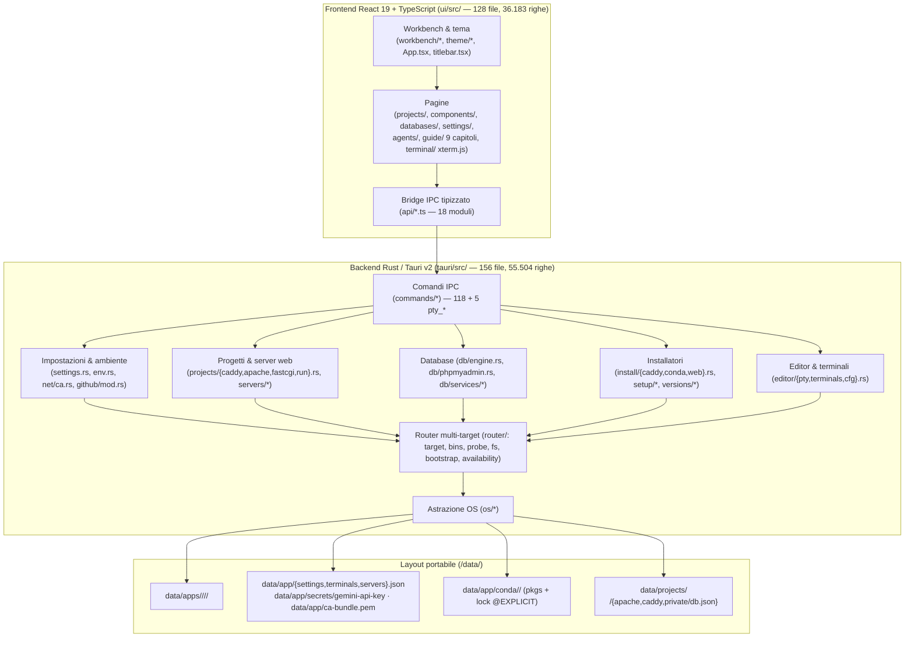
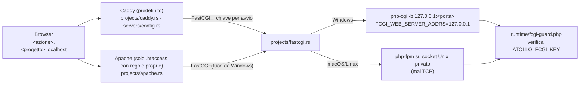
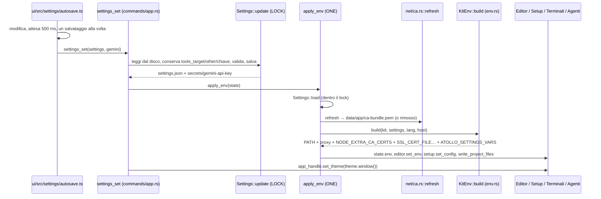

# 01 — Architettura del Sistema e Logica Applicativa (`v5`)

> **Riferimento Codice**: `HEAD a8aad6c` (20/10/2026) · baseline `v4` `18698f9` · **Backend**: [`tauri/src/`](../../../tauri/src) (156 file `.rs`, 55.504 righe) · **Frontend**: [`ui/src/`](../../../ui/src) (128 file `.ts`/`.tsx`, 36.183 righe) · **Runtime**: [`runtime/`](../../../runtime) (11 file) · **Script**: [`scripts/`](../../../scripts) (25 file, nuovo) · **Sito**: [`site/`](../../../site) (nuovo)

Righe contate con `git show <rev>:<file> | wc -l` su `git ls-tree -r`, stesso metodo per `v4` e `v5`. Il `v4` dichiarava 38.161 righe Rust per `18698f9`; misurato così, lo stesso commit ne ha 40.823: i delta qui sotto partono da questo valore.

| Metrica | `v4` (`18698f9`) | `v5` (`a8aad6c`) | Delta |
|---|---:|---:|---:|
| `tauri/src` file `.rs` / righe | 134 / 40.823 | **156 / 55.504** | +22 / +36,0% |
| `ui/src` file `.ts`/`.tsx` / righe | 98 / 23.490 | **128 / 36.183** | +30 / +54,0% |
| Comandi Tauri (`COMMANDS`, [`tauri/build.rs:8-127`](../../../tauri/build.rs#L8-L127)) | 106 | **118** (+5 `pty_*` in [`permissions/pty.toml`](../../../tauri/permissions/pty.toml)) | +12 |
| Decisioni | D-01..D-106 | **D-01..D-139** | +33 |
| Workflow CI | 1 | **4** (`app.yml` 9 job, `httpd.yml`, `php.yml`, `site.yml`) | +3 |
| Versione | 0.1.x | **0.3.0** ([`tauri/Cargo.toml:3`](../../../tauri/Cargo.toml#L3)) | |

---

## 1. Mappa Architetturale Globale (`HEAD a8aad6c`)

I tre livelli del `v4` restano (UI React, backend Rust/Tauri v2, stato su file in `<kit_root>/data/`), ma il backend ha ora un **router multi-target** sotto i sottosistemi e lo stato include il bundle CA, i segreti e i pacchetti conda conservati. Attorno all'app sono nati due prodotti di contorno: il sito (`site/`) e gli script di build/documentazione (`scripts/`).

### 1.1 Inventario dei Sottosistemi Backend (`tauri/src/`)

Conteggio per cartella con `find … -name '*.rs' | wc -l` e `wc -l` su `a8aad6c` (la somma, 156 file e circa 55.500 righe, coincide con la tabella sopra).

| Sottosistema | Cartella / file principali | File `.rs` | Righe | Novità dal `v4` |
|---|---|:---:|:---:|---|
| **Core, kit, ambiente, impostazioni** | [`main.rs`](../../../tauri/src/main.rs), [`kit.rs`](../../../tauri/src/kit.rs), [`env.rs`](../../../tauri/src/env.rs), [`settings.rs`](../../../tauri/src/settings.rs), [`fsx.rs`](../../../tauri/src/fsx.rs), `cli.rs`, `i18n.rs`, `log.rs` | 8 | 3.884 | `Settings::update` sotto lock, tema, segreti in file privato, `ATOLLO_SETTINGS_VARS` (D-137); `write_atomic` con lock per file e contatore. |
| **Router multi-target (`D-114`)** | [`router/`](../../../tauri/src/router/mod.rs) (`target`, `bins`, `probe`, `fs`, `bootstrap`, `availability`) | 7 | 968 | **Nuovo**. Capacità per target, risoluzione dei binari per OS, `prepare --target`. |
| **Comandi IPC** | [`commands/`](../../../tauri/src/commands/mod.rs) | 17 | 4.076 | `settings_set` con autosave, `git_identity_get/set`, `rust_toolchain_set`, `pty_*`. |
| **Progetti, Caddy, FastCGI** | [`projects/`](../../../tauri/src/projects/mod.rs) (`caddy.rs`, `fastcgi.rs`, `apache.rs`, `run.rs`, `serve.rs`, `frameworks/*`) | 17 | 6.262 | Caddy predefinito (D-111), Nginx rimosso (D-120), FastCGI comune, 63 basi del wizard (D-131). |
| **Pool web condivisi** | [`servers/`](../../../tauri/src/servers/mod.rs) (`config`, `pools`, `process`, `migrate`) | 5 | 2.332 | Diviso in 5 file; migrazione `nginx` → `caddy` all'avvio (`servers/migrate.rs`). |
| **Database** | [`db/`](../../../tauri/src/db/mod.rs) (`engine.rs`, `phpmyadmin.rs`, `services/{access,backups,data,mysql,tools}.rs`) | 11 | 4.049 | `DbEngine { MySql, MongoDb }` (D-110), phpMyAdmin al posto di Adminer (D-107), solo MySQL (D-117). |
| **Installatori** | [`install/`](../../../tauri/src/install/mod.rs) (`caddy.rs`, `conda.rs`, `web.rs`, `lang/*`) | 21 | 8.859 | Conda offline (D-118), PHP/Apache del kit per Unix (D-133, D-116), lanciatori `kit-bin` (D-125). |
| **Setup, versioni, rete** | [`setup/`](../../../tauri/src/setup/mod.rs), [`versions/`](../../../tauri/src/versions/mod.rs), [`net/`](../../../tauri/src/net/mod.rs) | 9 + 10 + 5 | 3.445 + 2.416 + 2.382 | `net/ca.rs` (bundle CA, D-137); `RunLock` Unix con `flock`. |
| **Editor e terminali** | [`editor/`](../../../tauri/src/editor/mod.rs) (`pty.rs`, `terminals.rs`, `terminal.rs`, `cfg.rs`, `theme.rs`) | 9 | 4.046 | PTY nell'app su macOS/Linux (D-109); i terminali del kit passano da `terminals.rs` della radice a `editor/terminals.rs`. |
| **Agenti AI** | [`agents/`](../../../tauri/src/agents/mod.rs) | 16 | 6.076 | Accessi portabili su macOS (`/usr/bin/security`) e Linux (Secret Service) (D-115). |
| **GitHub e Git** | [`github/`](../../../tauri/src/github/mod.rs) | 2 | 907 | Identità Git e `safe.directory` limitato al kit (D-137). |
| **Rilevamento** | [`detect/`](../../../tauri/src/detect/mod.rs) | 9 | 2.496 | Router di progetto dopo i controlli del kit (`-d atollo.router=`). |
| **Layer OS** | [`os/`](../../../tauri/src/os/mod.rs) | 10 | 3.306 | `os::processes::path_key` (D-123). |

---

## 2. Sottosistemi Nuovi o Cambiati dal `v4`

### 2.1 Router e target (`D-108`, `D-114`, `D-121`)

- **Codice**: [`tauri/src/router/`](../../../tauri/src/router/mod.rs) — `target` (capacità dei 4 target), `bins` (binari e lanciatori per OS), `probe` (disco e salute multi-target), `fs` (file privati ed eseguibili: `write_private`, `write_executable`), `bootstrap` (`.bootstrap` / `.reinstall`), `availability`.
- **Decisione**: un kit preparato su Windows con `prepare --target` contiene già i componenti di un Mac o di un PC Linux (D-114). Il catalogo dichiara per componente `targets`, `unavailable`, `sha256ByTarget` (D-108).
- **Esito**: catalogo 35/35 su win32-x64, darwin-arm64, linux-x64; 34/35 su linux-arm64 (manca solo `android`, [`components.json:19`](../../../tauri/catalog/components.json#L19)). Nel `v4`: linux-x64 31/35, macOS 31/35.
- **UI**: griglia componente × sistema in «Strumenti» ([`ui/src/components/matrix.tsx`](../../../ui/src/components/matrix.tsx), D-121), sistema mostrato salvato in `Settings::tools_target`, che solo `tools_target_set` scrive.

### 2.2 Terminale PTY nell'app su macOS e Linux (`D-109`)

- **Backend**: [`tauri/src/editor/pty.rs`](../../../tauri/src/editor/pty.rs) — una PTY per sessione; il programma guida una sessione e un gruppo di processi propri (`setsid`), messo in un job di [`os/jobs.rs`](../../../tauri/src/os/jobs.rs); l'output arriva alla finestra a blocchi numerati sull'evento `pty://<id>`, con un backlog per le viste che si agganciano dopo ([`pty.rs:1-15`](../../../tauri/src/editor/pty.rs#L1-L15)).
- **Frontend**: [`ui/src/terminal/`](../../../ui/src/terminal) (5 file, 459 righe: `api`, `state`, `panel`, `view`) con xterm.js.
- **Sicurezza**: i 5 comandi `pty_*` stanno fuori da `COMMANDS` e sono permessi solo alla finestra `main` ([`tauri/permissions/pty.toml`](../../../tauri/permissions/pty.toml), [`capabilities/main.json:4-6`](../../../tauri/capabilities/main.json#L4-L6)).
- **Windows**: nessuna sessione PTY; restano le console classiche (`editor/terminal.rs`, D-57, D-95).

### 2.3 Caddy, FastCGI e Apache come eccezione (`D-111`, `D-116`, `D-120`)

- **Scelta del server**: Caddy è il server predefinito su tutti i sistemi; Apache viene proposto solo quando il `.htaccess` ha regole proprie (`php::apache_offered`, [`detect/mod.rs:571-578`](../../../tauri/src/detect/mod.rs#L571-L578)). Nginx è eliminato da catalogo, motore, rilevamento e UI; i profili `nginx` diventano `caddy` all'avvio ([`servers/migrate.rs`](../../../tauri/src/servers/migrate.rs), D-120).
- **FastCGI comune** ([`projects/fastcgi.rs:1-11`](../../../tauri/src/projects/fastcgi.rs#L1-L11)): `php-cgi` su Windows, `php-fpm` altrove (la build static-php-cli non ha `php-cgi`) su un socket Unix solo per il proprietario, perché `php-fpm` accetta `PHP_VALUE`/`PHP_ADMIN_VALUE` da chi si connette. Ogni richiesta porta una chiave casuale nuova a ogni avvio, controllata da `runtime/fcgi-guard.php` ([`fastcgi.rs:167-182`](../../../tauri/src/projects/fastcgi.rs#L167-L182)).
- **Socket admin di Caddy** privati, mai TCP `:2019` ([`projects/caddy.rs:14-19`](../../../tauri/src/projects/caddy.rs#L14-L19), [`173-215`](../../../tauri/src/projects/caddy.rs#L173-L215)).
- **Alias**: solo statici; in Caddy `@script path_regexp` → 404 ([`caddy.rs:509-510`](../../../tauri/src/projects/caddy.rs#L509-L510)), in Apache `ALIAS_NO_RUN` + `<FilesMatch> Require all denied` ([`apache.rs:273`](../../../tauri/src/projects/apache.rs#L273), [`285-301`](../../../tauri/src/projects/apache.rs#L285-L301)). Chiude `SEC-V4-01`.

### 2.4 phpMyAdmin e solo MySQL (`D-107`, `D-110`, `D-117`)

- [`tauri/src/db/phpmyadmin.rs`](../../../tauri/src/db/phpmyadmin.rs) sostituisce Adminer: `php -S` del PHP predefinito del kit su un loopback proprio `127.x.y.z`, nuovo a ogni avvio, perché i browser condividono i cookie fra le porte dello stesso host e su `127.0.0.1` il cookie di phpMyAdmin raggiungerebbe i siti dei progetti ([`phpmyadmin.rs:1-12`](../../../tauri/src/db/phpmyadmin.rs#L1-L12)). SHA-256 dal `.sha256` pubblicato, `setup/` rimosso.
- [`tauri/src/db/engine.rs`](../../../tauri/src/db/engine.rs): `DbEngine { MySql, MongoDb }` con `match` esaustivi; MariaDB rimosso ovunque, ogni bisogno SQL è `mysql` (`db::services::sql_need`).
- Browser dati e phpMyAdmin per linea: `running_at(engine, line)` / `sql_tool_at(..., line, port)` ([`db/browse.rs:155-181`](../../../tauri/src/db/browse.rs#L155-L181)). Chiude `BUG-V4-07`.

### 2.5 PHP e Apache compilati dal kit per macOS/Linux (`D-116`, `D-133`)

| Componente | Build | Workflow | Tag pubblicati |
|---|---|---|---|
| PHP 8.4.26-1 / 8.5.11-1 | [`scripts/build-php/`](../../../scripts/build-php) (static-php-cli 2.8.5, `extensions.txt`, `sources.txt`, `test.sh`), con `pdo_sqlite`/`pdo_pgsql`; swoole solo su Linux | [`.github/workflows/php.yml`](../../../.github/workflows/php.yml) | `php-v8.4.26-1`, `php-v8.5.11-1` |
| Apache httpd 2.4.69 | [`scripts/build-httpd/`](../../../scripts/build-httpd) (sorgenti con firma GPG) | [`.github/workflows/httpd.yml`](../../../.github/workflows/httpd.yml) | `httpd-v2.4.69-1` |

- Installazione con `install/web.rs::unix_php_release` e `sha256ByLine` ([`components.json:12`](../../../tauri/catalog/components.json#L12)).
- `php.ini` per linea: `data/php/<line>` su Windows, `data/php/<target>/<line>` su Unix, con migrazione ([`install/web.rs:855-878`](../../../tauri/src/install/web.rs#L855-L878), [`919-937`](../../../tauri/src/install/web.rs#L919-L937)).

### 2.6 Conda offline (`D-118`, `D-125`)

- [`tauri/src/install/conda.rs`](../../../tauri/src/install/conda.rs): i pacchetti degli ambienti che non possono seguire il kit restano in `data/app/conda/<target>/`, una cartella per target mai mescolata, con la lista `@EXPLICIT` e `url#sha256` nell'ordine di micromamba ([`conda.rs:6-10`](../../../tauri/src/install/conda.rs#L6-L10), [`126-139`](../../../tauri/src/install/conda.rs#L126-L139)). Dopo uno spostamento del kit la reinstallazione non usa la rete.
- Interruttore `keep_conda_packages` nelle impostazioni ([`settings.rs`](../../../tauri/src/settings.rs#L62-L66)); UI in [`ui/src/settings/conda.tsx`](../../../ui/src/settings/conda.tsx).
- Nel `PATH` vanno solo i programmi del componente, tramite i lanciatori `kit-bin` (`conda::write_launchers`, D-125).

### 2.7 Impostazioni con salvataggio automatico (`D-137`)

**Modello** ([`tauri/src/settings.rs`](../../../tauri/src/settings.rs)):

| Elemento | Dove | Decisione |
|---|---|---|
| Chiavi sconosciute conservate | `#[serde(flatten)] other` in `Network` e `Settings` ([`settings.rs:36-38`](../../../tauri/src/settings.rs#L36-L38), [`72-74`](../../../tauri/src/settings.rs#L72-L74)) | Un file scritto da una versione più nuova non perde chiavi; `pythonVersion`/`phpVersion` di un file vecchio restano in `other`. |
| Un ciclo leggi-modifica-scrivi alla volta | `Settings::update` con `static LOCK: Mutex<()>` ([`settings.rs:252-264`](../../../tauri/src/settings.rs#L252-L264), [`295`](../../../tauri/src/settings.rs#L295)) | La pagina Impostazioni, «Piattaforma» di Strumenti e le installazioni non si sovrascrivono. |
| Chiave Gemini fuori da `settings.json` | `gemini_file` = `data/app/secrets/gemini-api-key`, scritta con `router::fs::write_private`, `#[serde(skip_serializing)]` ([`settings.rs:46-50`](../../../tauri/src/settings.rs#L46-L50), [`229-238`](../../../tauri/src/settings.rs#L229-L238), [`266-293`](../../../tauri/src/settings.rs#L266-L293)) | File solo per il proprietario; `move_secrets` sposta all'avvio una chiave lasciata in `settings.json`. |
| PEM relativo al kit | `load` risolve un percorso relativo, `save` scrive relativo un PEM dentro il kit ([`settings.rs:166-170`](../../../tauri/src/settings.rs#L166-L170), [`239-249`](../../../tauri/src/settings.rs#L239-L249)) | Il file dei certificati segue il kit quando viene spostato. |
| Cartelle dei terminali relative al kit | `load` / `store` in [`editor/terminals.rs:102-126`](../../../tauri/src/editor/terminals.rs#L102-L126) | Come il PEM: `terminals.json` scrive relativa una cartella interna al kit. |
| Tema | `enum Theme { System, Light, Dark }`, valore sconosciuto → `System`, `Theme::window()` → `Option<tauri::Theme>` ([`settings.rs:117-151`](../../../tauri/src/settings.rs#L117-L151)) | Le webview ricevono il tema come `prefers-color-scheme`: CSS dell'interfaccia, terminale nell'app e VSCodium (`window.autoDetectColorScheme`) lo seguono senza un tema proprio. |

**Comando** `settings_set` ([`commands/app.rs:210-282`](../../../tauri/src/commands/app.rs#L210-L282)): ripulisce i campi di testo, risolve il PEM relativo, poi dentro `Settings::update` riprende dal disco la chiave Gemini (se non cambiata), `tools_target`, `other` e `network.other`, valida e salva. Dopo il salvataggio: controllo aggiornamenti immediato se l'utente li ha appena accesi, `apply_env`, e `app_handle.set_theme(...)` su tutte le finestre, editor compreso ([`app.rs:276-279`](../../../tauri/src/commands/app.rs#L276-L279)).

**`apply_env` serializzato** ([`commands/app.rs:77-110`](../../../tauri/src/commands/app.rs#L77-L110)): un `static ONE: Mutex<()>` e la lettura del file *dentro* il lock, così un `apply_env` partito prima di un salvataggio non può rimettere l'ambiente vecchio dopo di esso. Viene chiamato anche da `commands/setup.rs:76, 317`, `commands/versions.rs:200`, `commands/agents.rs:109`.

#### Flusso dei dati: salvataggio → ambiente → editor, terminali, agenti

- **Editor**: `editor.set_env` ([`editor/mod.rs:112-114`](../../../tauri/src/editor/mod.rs#L112-L114)) sostituisce l'ambiente per il prossimo avvio di VSCodium; quello già in esecuzione tiene i valori vecchi, e la pagina lo segnala (`needsRestart`, [`ui/src/settings/autosave.ts:15-29`](../../../ui/src/settings/autosave.ts#L15-L29)).
- **Installazioni**: `setup.set_config(env, settings)` ([`setup/task.rs:131-134`](../../../tauri/src/setup/task.rs#L131-L134)): i download usano già proxy e certificati scelti al primo avvio.
- **Agenti**: i comandi di [`commands/agents.rs`](../../../tauri/src/commands/agents.rs#L14) leggono `state.env()` a ogni chiamata.
- **Terminali**: l'ambiente di ogni terminale si costruisce all'apertura ([`commands/terminals.rs:70`](../../../tauri/src/commands/terminals.rs#L70)); una console già aperta non cambia.

**Bundle CA** ([`tauri/src/net/ca.rs`](../../../tauri/src/net/ca.rs)): i download dell'app si fidano delle radici di sistema più il PEM dell'utente; `data/app/ca-bundle.pem` contiene radici + PEM per i programmi che leggono un solo bundle (`SSL_CERT_FILE`, `REQUESTS_CA_BUNDLE`, `PIP_CERT`, `CURL_CA_BUNDLE`, `GIT_SSL_CAINFO`, `CARGO_HTTP_CAINFO`, [`ca.rs:23-31`](../../../tauri/src/net/ca.rs#L23-L31)); Node riceve solo `NODE_EXTRA_CA_CERTS`, che si aggiunge alle sue radici. Il bundle si riscrive a ogni `apply_env` e si cancella quando il campo viene svuotato o il file non è leggibile ([`ca.rs:86-108`](../../../tauri/src/net/ca.rs#L86-L108)).

**Filtro dell'host con `ATOLLO_SETTINGS_VARS`** ([`env.rs:91-125`](../../../tauri/src/env.rs#L91-L125), [`849-883`](../../../tauri/src/env.rs#L849-L883)): `KitEnv::build` annota in `ATOLLO_SETTINGS_VARS` le variabili prese dalle impostazioni (proxy, `NODE_EXTRA_CA_CERTS`, `GEMINI_API_KEY`, `ATOLLO_LANG`, le 6 variabili del bundle, `ATOLLO_ALLOW_LAN`). `Host::capture` all'avvio toglie queste variabili dall'istantanea e dal processo: un Atollo avviato da una console del kit non scambia la lingua e il proxy del kit per quelli del PC, e un'impostazione svuotata non ritorna da lì.

### 2.8 Identità Git e `safe.directory` (`D-137`, [`tauri/src/github/mod.rs:195-320`](../../../tauri/src/github/mod.rs#L195-L320))

- `git config --global` gira con l'HOME del kit ([`env.rs:402-433`](../../../tauri/src/env.rs#L402-L433)): nessun residuo nel `.gitconfig` del PC.
- `safe_pattern(root)` = `<kit>/*` (Git 2.46+ legge `/*` finale come «tutto dentro»); `sync_safe_directory` riscrive la lista a ogni avvio togliendo i valori del kit (`*` delle versioni precedenti e le cartelle di kit) e conservando quelli dell'utente ([`github/mod.rs:207-241`](../../../tauri/src/github/mod.rs#L207-L241)).
- Identità: `Identity { name, email }`, `clean_identity` (nome ≤ 100 caratteri, e-mail con `@` e dominio con punto), `set_identity` toglie la chiave vuota; `fill_identity` riempie una volta nome e indirizzo `noreply` (`<id>+<login>@users.noreply.github.com`) dall'account GitHub collegato. Comandi `git_identity_get/set` ([`commands/github.rs:241-255`](../../../tauri/src/commands/github.rs#L241-L255)); UI [`ui/src/github/identity.tsx`](../../../ui/src/github/identity.tsx).

### 2.9 Server di sviluppo `scripts/dev-ui.mjs` (`D-138`)

[`scripts/dev-ui.mjs`](../../../scripts/dev-ui.mjs) è il `beforeDevCommand` ([`tauri/tauri.conf.json:7`](../../../tauri/tauri.conf.json#L7)): Vite gira nello stesso processo tramite la sua API, invece che sotto `npm → cmd → node`, che restava vivo alla chiusura dell'app e occupava `127.0.0.1:5173`. Lo script termina su `SIGINT/SIGTERM/SIGHUP` o quando il processo genitore non c'è più (controllo ogni secondo, [`dev-ui.mjs:103-114`](../../../scripts/dev-ui.mjs#L103-L114)); se la porta è occupata indica chi la tiene, senza fermarlo.

### 2.10 Tipi di strumenti condivisi con il sito (`D-139`)

- [`ui/src/components/model.ts:6-36`](../../../ui/src/components/model.ts#L6-L36): `KINDS = ["system", "agents", "languages", "tools", "web", "databases"]`, `KIND_OF` (eccezioni per id), `KIND_OF_GROUP` (dal gruppo del catalogo), `kindOf`.
- [`site/matrix.mjs:20-26`](../../../site/matrix.mjs#L20-L26) definisce gli stessi `KINDS`, `KIND_OF`, `KIND_OF_GROUP`; il test [`test/ui/components/model.test.ts:56-65`](../../../test/ui/components/model.test.ts#L56-L65) importa entrambi e richiede che siano uguali. Una sola classificazione per tabella, albero, matrice, primo avvio e sito.

### 2.11 Guida in 9 capitoli e `GUIDE.md` generato (`D-136`)

- [`ui/src/guide/`](../../../ui/src/guide) (15 file, 13.970 righe): `page`, `sections`, `model`, `sources`, `widgets` + 9 capitoli in [`topics/`](../../../ui/src/guide/topics) (start, projects, services, agents, tools, settings, portable, inside, help), 36 argomenti, scritti dopo 5 inventari dal codice.
- Schermate per lingua in `ui/public/guide/{it,en,fr,de}` (52 `.webp`, 3,4 MB) prodotte da [`scripts/guide-shots/make.mjs`](../../../scripts/guide-shots/make.mjs).
- [`docs/app/GUIDE.md`](../../../docs/app/GUIDE.md) e [`GUIDE.it.md`](../../../docs/app/GUIDE.it.md) sono generati da [`scripts/guide-docs.cjs`](../../../scripts/guide-docs.cjs); la CI verifica che corrispondano alla guida dell'app (commit `3337508`, merge `2cc023f`).

### 2.12 CI per percorsi (`D-134`)

- [`.github/workflows/app.yml:37-140`](../../../.github/workflows/app.yml#L37-L140): job `changes` con `dorny/paths-filter@v3`, che produce i livelli `bundle`, `kit`, `rust`, `ui`; ogni job successivo parte solo per il suo livello. Una modifica di soli documenti non avvia i bundle.
- Job di `app.yml`: `changes`, `check`, `test-unix` ([`app.yml:210-300`](../../../.github/workflows/app.yml#L210-L300)), `bundle-macos` (`:356`), `bundle-linux` (`:459`), `release-smoke` (`:563`), `build` (`:664`), `release` (`:834`). Il job `release` verifica gli asset `Atollo-<ver>-<target>.<ext>` e i `.sha256` contro gli artefatti dei bundle (D-119, D-129).

---

## 3. Rischi Architetturali Ancora Aperti

Stato dei rilievi `v4` di natura architetturale e nuovi rilievi `v5` (letti nel codice, non provati a runtime). Il dettaglio completo è nel file 03.

| ID | Sev. | Area | Problema | Correzione proposta |
|---|---|---|---|---|
| **BUG-V5-02** (da `BUG-V4-04/05`) | Alta | [`db/services/mod.rs:162-163`](../../../tauri/src/db/services/mod.rs#L162-L163), [`545-610`](../../../tauri/src/db/services/mod.rs#L545-L610), [`195-230`](../../../tauri/src/db/services/mod.rs#L195-L230) | `Services` ha solo `running` ed `errors` come Mutex: `start_engine` controlla `running`, rilascia il lock e poi `launch` inserisce il processo, quindi due avvii della stessa linea possono lanciare due `mysqld` sulla stessa cartella dati. `keep_port` legge-modifica-scrive `services.json` senza lock (`write_atomic` serializza solo il rename, [`fsx.rs:79-91`](../../../tauri/src/fsx.rs#L79-L91)). Cambiando linea predefinita, la vecchia principale non ha porta salvata. | Un `op_lock` per motore attorno a `start_engine`/`stop_engine`, un lock RMW per `services.json` sul modello di `Settings::update`; salvare anche la porta della linea principale. |
| **BUG-V5-05** (da `BUG-V4-02/03`) | Media | [`servers/config.rs:49-72`](../../../tauri/src/servers/config.rs#L49-L72), [`166-189`](../../../tauri/src/servers/config.rs#L166-L189); [`servers/pools.rs:533-566`](../../../tauri/src/servers/pools.rs#L533-L566) | I vHost dei pool (Apache e Caddy) non includono `data/projects/
/{apache,caddy}/conf.d`, il server dedicato sì ([`projects/apache.rs:389`](../../../tauri/src/projects/apache.rs#L389)). `save_profile` controlla solo le altre pool e `p < 1024`, non MySQL/MongoDB, porte dei progetti o 7000-7099 dell'editor. | `IncludeOptional`/`import` del `conf.d` del progetto; una funzione comune `ports_taken(kit)` per pool, progetti e servizi. |
| **BUG-V5-01** (da `SEC-V4-02.1`) | Media | [`runtime/php-router.php:23-32`](../../../runtime/php-router.php#L23-L32); [`projects/run.rs:485-487`](../../../tauri/src/projects/run.rs#L485-L487); [`env.rs:876`](../../../tauri/src/env.rs#L876) | Con la rete locale attiva `php -S` ascolta su `0.0.0.0`, ma il router risponde 421 a ogni `Host` non locale e non legge `ATOLLO_ALLOW_LAN`. Caddy e Apache invece saltano il 421 in LAN ([`servers/config.rs:114-133`](../../../tauri/src/servers/config.rs#L114-L133)). | Nel router, nessun controllo dell'Host quando `getenv('ATOLLO_ALLOW_LAN') === '1'`. |
| `BUG-V4-11` (Parziale) | Bassa | [`commands/projects.rs:122,161,227`](../../../tauri/src/commands/projects.rs#L122) | La cache `WebServers` si invalida solo da 3 comandi, non da `project_delete`, `project_clone`, `github_clone`, `frameworks_create`. Ritardo limitato da `LIST_TTL = 15 s` ([`servers/mod.rs:30`](../../../tauri/src/servers/mod.rs#L30)); `pool_of` usa sempre una scansione nuova. | `invalidate()` anche in quei comandi. |
| `BUG-V4-13` (Parziale) | Bassa | [`editor/terminals.rs:14-15`](../../../tauri/src/editor/terminals.rs#L14-L15), [`73`](../../../tauri/src/editor/terminals.rs#L73), [`430-449`](../../../tauri/src/editor/terminals.rs#L430-L449) | Un terminale con una linea disinstallata ricade sulla più recente, ma la segnalazione `missing` copre solo gli strumenti spariti, non la linea sostituita. | Segnalare anche la linea sostituita. |
| **BUG-V5-03** | Bassa | [`github/mod.rs:217-223`](../../../tauri/src/github/mod.rs#L217-L223), [`225-241`](../../../tauri/src/github/mod.rs#L225-L241) | `kit_safe_value` considera del kit ogni `safe.directory` `X/*` con `X` inesistente: una voce dell'utente per un disco esterno non montato sparisce dal `.gitconfig` del kit a ogni avvio. | Togliere solo `*`, la radice attuale e le radici precedenti note (`Kit::old_root_file`), oppure marcare le voci scritte dal kit. |
| **BUG-V5-04** (da `BUG-V4-08`) | Bassa | [`db/services/tools.rs:175`](../../../tauri/src/db/services/tools.rs#L175), [`196`](../../../tauri/src/db/services/tools.rs#L196) | File di login temporanei `<exe>-<pid>.cnf` / `.yaml`: due dump o ripristini in parallelo nello stesso processo si sovrascrivono. | Contatore atomico nel nome, come `TMP_SEQ` di [`fsx.rs:80`](../../../tauri/src/fsx.rs#L80). |
| **SEC-V5-01** (da `SEC-V4-03`) | Bassa | [`projects/serve.rs:56-67`](../../../tauri/src/projects/serve.rs#L56-L67) | Il server statico rifiuta `<progetto>.localhost` con 403, a differenza di router, Caddy e Apache. | `|| name.ends_with(".localhost")`. |
| **PORT-V5-01** | Bassa (solo sviluppo) | [`scripts/dev-ui.mjs:103-114`](../../../scripts/dev-ui.mjs#L103-L114) | Su Windows `process.ppid` non cambia quando il genitore muore e `process.kill(parent, 0)` può colpire un PID riusato: in quel caso Vite resta vivo (raro). | Accettabile; in alternativa controllare la chiusura dello stdin del genitore. |

**Punti verificati senza rilievi**: `settings_set` conserva `tools_target`, `other` e la chiave Gemini dal disco sotto `Settings::update` ([`commands/app.rs:216-261`](../../../tauri/src/commands/app.rs#L216-L261)); PEM relativo risolto al caricamento ([`settings.rs:166-170`](../../../tauri/src/settings.rs#L166-L170)); `git config --global` con l'HOME del kit; `pty_*` solo alla finestra `main`; CSP invariata rispetto al `v4` ([`tauri/tauri.conf.json:22`](../../../tauri/tauri.conf.json#L22)); socket admin di Caddy mai su TCP.
