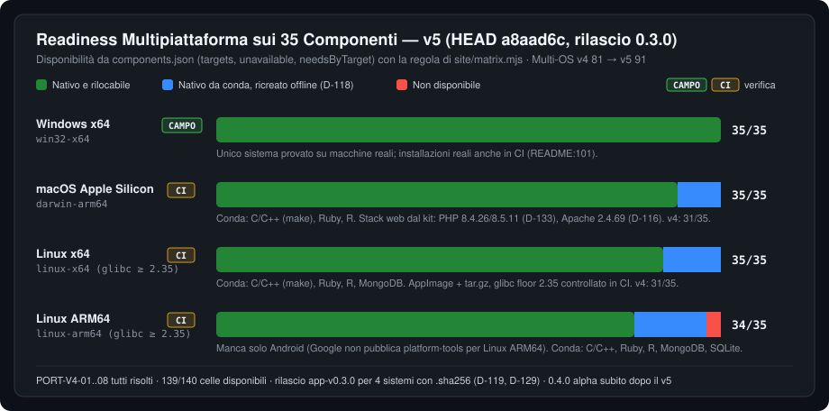

# 04 — Portabilità 100% e Architettura Multipiattaforma (`v5`)

> **Riferimento Codice**: `HEAD a8aad6c` (20/10/2026) · **Baseline precedente**: `v4` `18698f9` · **Decisioni di Riferimento**: `D-108` (disponibilità per target), `D-109` (terminale PTY su Unix), `D-112` (fonti per macOS/Linux), `D-113` (pacchetti macOS e Linux), `D-114` (router multi-target), `D-116` (Apache del kit), `D-118` (conda offline), `D-119` (rilasci Unix), `D-133` (PHP del kit), `D-137` (impostazioni, `safe.directory`, chiave Gemini).

---

## 1. Stato di Avanzamento Multipiattaforma (`v4 → v5`)

La dimensione **Readiness Multi-OS** passa da `81/100` (v4) a **`91/100`** (`+10`). Il v4 fotografava un backend che *compilava* su Unix ma non *funzionava* (8 blocchi `PORT-V4-01..08`); il v5 trova un'app che su quattro sistemi **si costruisce, si testa, si impacchetta e si pubblica in CI**, con il catalogo completo ovunque tranne Android su Linux ARM64. I 9 punti mancanti non sono codice rotto: sono **prove sul campo** che ancora mancano fuori da Windows x64 (§8).

| Target | Pacchetto (`D-113`, `D-119`, `D-129`) | Catalogo disponibile | Test automatici in CI | Provato su macchine reali |
|---|---|:---:|---|:---:|
| `win32-x64` | `Atollo.exe` (non firmato in 0.3.0) | **35/35** | `check` (lint, Vitest, `cargo test`), installazioni reali | **Sì** |
| `darwin-arm64` | `Atollo.app` zip, firma ad hoc | **35/35** | `test-unix`, `bundle-macos`, `release-smoke` | No ([#5](https://github.com/nabre/atollo/issues/5), [#6](https://github.com/nabre/atollo/issues/6)) |
| `linux-x64` | AppImage + `tar.gz` (glibc ≥ 2.35) | **35/35** | `test-unix`, `bundle-linux`, `release-smoke` | No ([#5](https://github.com/nabre/atollo/issues/5)) |
| `linux-arm64` | AppImage + `tar.gz` (glibc ≥ 2.35) | **34/35** | idem su `ubuntu-24.04-arm` | No |

Fonti: disponibilità calcolata da `targets`, `unavailable`, `needsByTarget` di [`tauri/catalog/components.json`](../../../tauri/catalog/components.json) con la stessa regola di [`site/matrix.mjs:42-58`](../../../site/matrix.mjs#L42-L58); l'unico «no» è Android su `linux-arm64` ([`components.json:19`](../../../tauri/catalog/components.json#L19)). Job CI in [`.github/workflows/app.yml`](../../../.github/workflows/app.yml): `test-unix` (righe 210-300), `bundle-macos` (356-457), `bundle-linux` (459-561), `release-smoke` (563-662). Confronto v4: macOS e `linux-x64` 31/35.

---

## 2. Gli 8 Blocchi `PORT-V4-01..08`: tutti Risolti

Tutti i rilievi di portabilità del v4, compresi i 4 critici, sono chiusi.

| ID v4 | Sev. v4 | Stato v5 | Evidenza nel codice |
|---|---|---|---|
| `PORT-V4-01` `copy_tree` perde i symlink | CRITICA | **Risolto** | `copy_entries` raccoglie i link con `read_link` e `finish_links_here` li ricrea su Unix ([`net/archive.rs:852-887`](../../../tauri/src/net/archive.rs#L852-L887)). Su exFAT/FAT i link diventano copie (es. i 142 link interni di Git), come documentato in [`README.md:116`](../../../README.md#L116). |
| `PORT-V4-02` rilocazione Unix | CRITICA | **Risolto** | `Kit::root_files` / `old_root_file` con `old-root-darwin.txt` / `old-root-linux.txt` ([`kit.rs:567-579`](../../../tauri/src/kit.rs#L567-L579)) letti dal rilocatore; `substitute` cambia la maiuscola solo davanti a una lettera di unità (`has_drive_letter`, [`agents/relocate.rs:138-160`](../../../tauri/src/agents/relocate.rs#L138-L160)). |
| `PORT-V4-03` `bin\agy`, `${var,,}` | CRITICA | **Risolto** | `("bin/agy", ...)` scritto con `router::fs::write_executable` ([`setup/kit_files.rs:28-29, 130-137`](../../../tauri/src/setup/kit_files.rs#L28-L29)); [`runtime/bin/agy:6-10`](../../../runtime/bin/agy#L6-L10) sceglie `agy.exe` o `agy`; [`runtime/bashrc:4-5`](../../../runtime/bashrc#L4-L5) vieta i costrutti Bash 4 (`${var,,}`, `declare -A`, `mapfile`) per la Bash 3.2 di macOS. |
| `PORT-V4-04` VSCodium server Windows-only | CRITICA | **Risolto** | Profili terminale per sistema `terminal.integrated.<name>.<os_key>` ([`editor/cfg.rs:274`](../../../tauri/src/editor/cfg.rs#L274)); `node.exe` e `out\server-main.js` restano solo nei commenti ([`editor/mod.rs:15, 87`](../../../tauri/src/editor/mod.rs#L15)). |
| `PORT-V4-05` `.exe` e `php/php.exe` nei DB | ALTA | **Risolto** | `translate_rel` mappa `php/php.exe` → `php/bin/php` e toglie `.exe/.cmd/.bat` fuori da Windows ([`setup/catalog.rs:262-292`](../../../tauri/src/setup/catalog.rs#L262-L292)); i nomi dei programmi DB vengono da `DbEngine` (`D-110`, [`db/engine.rs`](../../../tauri/src/db/engine.rs)). |
| `PORT-V4-06` backslash nei join | ALTA | **Risolto** | Test su tutto il crate «No separator written inside a joined path» ([`fsx.rs:142-145`](../../../tauri/src/fsx.rs#L142-L145) → [`test/rust/paths.rs`](../../../test/rust/paths.rs)), eseguito anche dai 4 job `test-unix`. |
| `PORT-V4-07` Julia/Bun ARM64, `RunLock`, pin tauri | MEDIA | **Risolto** | Bun con asset nativo `aarch64` ([`install/lang/js.rs:18-29`](../../../tauri/src/install/lang/js.rs#L18-L29)); `RunLock` Unix con `flock` su `data/app/prepare.lock` ([`setup/runner.rs:141-200`](../../../tauri/src/setup/runner.rs#L141-L200)); `tauri = "=2.12.1"` ([`tauri/Cargo.toml:24`](../../../tauri/Cargo.toml#L24)). |
| `PORT-V4-08` offline Git/R e stack web Unix | MEDIA | **Risolto** | Git da dugite-native (`D-112`), conda offline (`D-118`), Apache del kit (`D-116`), PHP del kit (`D-133`), Caddy (`D-111`), phpMyAdmin sui 4 target (`D-107`, `D-117`). Dettaglio nei §4-§5. |

---

## 3. Rilocazione: il kit spostato su un altro percorso

La rilocazione è il cuore della «portabilità 100%»: la cartella Atollo copiata su un'altra chiavetta, un altro disco o un altro PC deve ripartire senza riscaricare nulla. Dal v4 il meccanismo si è esteso in quattro direzioni.

### 3.1 Rilocatore: anche i file dell'app

[`agents/relocate.rs:450-460`](../../../tauri/src/agents/relocate.rs#L450-L460) (`fn targets`) elenca ora, prima dei file degli agenti, i file dell'app che possono contenere la radice del kit (`D-137`):

- `kit.settings_file()` (il `settings.json` dell'app, per il PEM salvato da versioni precedenti con percorso assoluto);
- `data/app/terminals.json` (le cartelle dei terminali del kit);
- poi, come nel v4, `settings.json` di Claude, MCP, `config.toml` di Codex, i JSON di Antigravity/Gemini, quelli dell'editor (`data/Machine/settings.json`, `extensions/extensions.json`) e i virtualenv di Python/uv.

### 3.2 Percorsi relativi al kit dove possibile

Invece di riscrivere, il kit ora **salva relativo** ciò che sta dentro di sé:

- **PEM aggiuntivo della rete**: `Settings::save` toglie il prefisso della radice prima di scrivere ([`settings.rs:239-242`](../../../tauri/src/settings.rs#L239-L242)); `Settings::load` lo ricompone con `join_rel(kit.root(), …)` ([`settings.rs:166-170`](../../../tauri/src/settings.rs#L166-L170)).
- **Cartelle dei terminali**: `store` scrive relativo ([`editor/terminals.rs:118-125`](../../../tauri/src/editor/terminals.rs#L118-L125)), `load` ricompone ([`editor/terminals.rs:104-115`](../../../tauri/src/editor/terminals.rs#L104-L115)).

### 3.3 `safe.directory` riscritto a ogni avvio

Git si fida solo dei repository dentro il kit (`<kit>/*`, non più `*`): il valore viene riscritto a ogni avvio seguendo la nuova radice ([`github/mod.rs:21-23`](../../../tauri/src/github/mod.rs#L21-L23), `sync_safe_directory` in [`github/mod.rs:161-166, 207-241`](../../../tauri/src/github/mod.rs#L207-L241)). `git config --global` scrive nell'HOME del kit, nessun residuo sul PC ([`env.rs:402-433`](../../../tauri/src/env.rs#L402-L433)).

> **Residuo (`BUG-V5-03`, Bassa)**: `kit_safe_value` considera «del kit» ogni voce `X/*` con `X` inesistente e la cancella ([`github/mod.rs:217-223`](../../../tauri/src/github/mod.rs#L217-L223)): una voce dell'utente per un disco esterno non montato sparisce dal `.gitconfig` del kit. Correzione: togliere solo `*`, la radice attuale e le radici precedenti note (`Kit::old_root_file`). Prevista nella **0.4.0 alpha**, pubblicata subito dopo questo rapporto.

### 3.4 Chiave Gemini in un file privato

La chiave API di Gemini non è più in `settings.json` ma in `data/app/secrets/gemini-api-key`, scritta con `router::fs::write_private` (solo proprietario) ([`settings.rs:229-233, 266-293`](../../../tauri/src/settings.rs#L266-L293)); una chiave lasciata da una versione precedente viene spostata all'avvio (`move_secrets`, chiamato in [`main.rs:124`](../../../tauri/src/main.rs#L124)). Il file segue il kit come ogni altro file in `data/`.

### 3.5 Confronto della radice per file system

Il percorso del kit si confronta come fa il file system del PC (`os::processes::path_key`, `D-123`): senza distinzione di maiuscole su Windows/macOS, esatto su Linux, dove `/media/u/Kit` → `/media/u/kit` è uno spostamento ([`docs/app/CATALOG.md:91`](../../../docs/app/CATALOG.md#L91)).

---

## 4. Offline dopo lo spostamento: conda (`D-118`) e linee di versione

Gli ambienti conda hanno il percorso scritto dentro e non possono seguire il kit (`D-92`). Nel v4 lo spostamento imponeva di riscaricarli (marcatore `.reinstall`). Ora:

- [`install/conda.rs:1-23`](../../../tauri/src/install/conda.rs#L1-L23): gli archivi conda-forge sono conservati in `data/app/conda/<target>/pkgs/`, con una lista esplicita per **linea di versione** `locks/<id>@<line>.txt` (`@EXPLICIT`, `url#sha256`) e il suo record `.json`.
- Dopo uno spostamento ogni archivio è riverificato contro la lista (SHA-256), poi `micromamba create --offline` ricrea l'ambiente; se manca qualcosa, installazione dalla rete con un avviso.
- Componenti interessati (`Installer::relocatable(target)` falso): R, Ruby fuori da Windows, MongoDB su Linux, SQLite su Linux ARM64, il `make` di C/C++ fuori da Windows ([`CATALOG.md:91`](../../../docs/app/CATALOG.md#L91)). Ogni linea salvata riceve il suo `<id>@<line>.reinstall`.
- Git su macOS/Linux viene da dugite-native, rilocabile: segue il kit senza reinstallazione (`D-112`).
- Le liste delle versioni scaricabili (`version-lines.json`) si aggiornano in background solo se mancano o hanno più di un giorno, e mai con `ATOLLO_NO_UPDATE` ([`CATALOG.md:98`](../../../docs/app/CATALOG.md#L98)).
- Nell'ambiente conda entrano nel `PATH` solo i programmi del componente, tramite lanciatori `kit-bin` (`D-125`, `conda::write_launchers`).

---

## 5. Stack web su macOS e Linux: costruito dal kit

| Componente | Windows | macOS / Linux | Decisione |
|---|---|---|---|
| **PHP** 8.4 / 8.5 | build ufficiale | **build del kit** `php-v8.4.26-1`, `php-v8.5.11-1` (static-php-cli 2.8.5, statica, musl su Linux, macOS 12 minimo) con `pdo_sqlite`/`pdo_pgsql`; swoole solo su Linux; SHA-256 per target in `sha256ByLine` ([`components.json:12`](../../../tauri/catalog/components.json#L12)) | `D-133` ([`DECISIONS.md:1236`](../../../docs/app/DECISIONS.md#L1236)) |
| **Apache** 2.4 | Apache Lounge | **build del kit** `httpd-v2.4.69-1` (`scripts/build-httpd/`, sorgenti con firma GPG, Linux glibc 2.35), `php-fpm`; alias solo statici | `D-116` ([`DECISIONS.md:1061`](../../../docs/app/DECISIONS.md#L1061)) |
| **Caddy** | nativo (anche ARM64) | release ufficiali `caddy_<v>_mac_arm64`, `caddy_<v>_linux_{arm64,amd64}` | `D-111`, `D-120` |
| **phpMyAdmin** 5.2.3 | `php -S` su loopback casuale | idem, sui 4 target | `D-107`, `D-117` |
| **FastCGI** | `php-cgi` | `php-fpm`, con chiave per avvio e `FCGI_WEB_SERVER_ADDRS` | [`projects/fastcgi.rs:167-182`](../../../tauri/src/projects/fastcgi.rs#L167-L182) |

`php.ini` è per linea su Windows (`data/php/<line>`) e per target e linea su Unix (`data/php/<target>/<line>`), con migrazione ([`install/web.rs:855-878, 919-937`](../../../tauri/src/install/web.rs#L855-L878)). Su Linux MySQL richiede `libaio` e `libnuma` del sistema, e l'app indica il comando da eseguire ([`README.md:115`](../../../README.md#L115)).

> **Osservazione di documentazione**: [`docs/app/CATALOG.md:24, 78`](../../../docs/app/CATALOG.md#L24) indica ancora static-php-cli «bulk» come fonte di PHP su macOS/Linux e [`CATALOG.md:50`](../../../docs/app/CATALOG.md#L50) dice che lì «Apache non c'è», mentre `D-116`/`D-133` e `components.json` usano le build del kit. Il codice è corretto; il documento va riallineato.

---

## 6. Terminale dentro l'app su macOS e Linux (`D-109`)

- [`editor/pty.rs:1-22`](../../../tauri/src/editor/pty.rs#L1-L22): una PTY per sessione, mostrata con xterm.js ([`ui/src/terminal/`](../../../ui/src/terminal)); il programma guida una sessione e un gruppo di processi propri (`setsid`), messi in un job di `os/jobs.rs`, così chiudere la sessione termina l'intero albero.
- Shell: il PowerShell del kit se installato, altrimenti `/bin/bash` con il `bashrc` del kit, oppure un agente; solo con l'ambiente del kit.
- Solo la PTY è codice Unix; sessioni, output e scelta del programma sono codice comune testato su tutti i sistemi. Su Windows restano le console classiche (`D-57`, `D-95`).
- Permessi: i comandi `pty_sessions`, `pty_backlog`, `pty_write`, `pty_resize`, `pty_close` sono concessi alla sola finestra `main` ([`tauri/permissions/pty.toml:10`](../../../tauri/permissions/pty.toml#L10), `capabilities/main.json:4-6`).

---

## 7. Il disco del kit: `noexec`, `showexec`, FAT/exFAT, App Translocation

- **`noexec` / `showexec`**: su macOS e Linux [`os/volume.rs`](../../../tauri/src/os/volume.rs) legge le opzioni di montaggio (`ST_NOEXEC` / `MNT_NOEXEC`, righe 301 e 340; `noexec()` e `showexec()` righe 181-188; `kit_noexec` riga 536, `disk_notice` riga 543). Un disco che non esegue programmi **ferma l'app e ogni comando**, `prepare` compreso ([`main.rs:131-137`](../../../tauri/src/main.rs#L131-L137)); FAT32 ed exFAT vengono solo registrati. L'avviso arriva tradotto alla UI (`disk_noexec`, [`commands/app.rs:29-33, 70-71`](../../../tauri/src/commands/app.rs#L29-L33)). Anche la PTY controlla `access(X_OK)`, che rifiuta i file su un montaggio `noexec` ([`editor/pty.rs:659`](../../../tauri/src/editor/pty.rs#L659)).
- **FAT/exFAT senza link**: i link dei programmi diventano copie (§2, `PORT-V4-01`), con più spazio occupato ([`README.md:116`](../../../README.md#L116)).
- **macOS App Translocation**: un `Atollo.app` scaricato e non ancora spostato gira da una copia temporanea in sola lettura; l'app lo riconosce (`translocated_bundle`, [`kit.rs:666-690`](../../../tauri/src/kit.rs#L666-L690)) e si blocca con una spiegazione (`D-113`).

---

## 8. Rilascio 0.3.0 per quattro sistemi, e cosa è solo CI

Il tag `app-v0.3.0` (446aeb1, 20/10/2026) pubblica i file per i quattro sistemi, nominati `Atollo-<ver>-<target>.<ext>` con il loro `.sha256` (`D-119`, `D-129`; [`docs/app/CHANGELOG.md:30-34`](../../../docs/app/CHANGELOG.md#L30-L34)). Il job `release` confronta gli asset con gli artefatti dei job `Bundle *`; `release-smoke` riscarica e avvia i pacchetti macOS e Linux. Il job `bundle-linux` fallisce se il binario richiede un simbolo glibc più recente di `GLIBC_2.35` ([`app.yml:506-512`](../../../.github/workflows/app.yml#L506-L512)): l'app parte su Ubuntu 22.04, Debian 12 e successive.

Il README dichiara apertamente il confine fra verificato e da provare ([`README.md:99-110`](../../../README.md#L99-L110)):

| Area | Stato | Fonte |
|---|---|---|
| Windows x64 | **Provato sul campo**, installazioni reali anche in CI | README:101 |
| macOS ARM64, Linux x64/ARM64 | **Solo CI**: costruiti, testati, avviati (smoke) | README:101, 103 |
| macOS su Mac reali: zip dal browser, quarantena, Gatekeeper, App Translocation, kit su exFAT, accessi degli agenti da un Mac all'altro | Da provare ([#5](https://github.com/nabre/atollo/issues/5), [#6](https://github.com/nabre/atollo/issues/6)) | README:105 |
| Linux su Ubuntu 24.04, Fedora 42, Debian 13: AppImage con e senza FUSE, `tar.gz` con WebKitGTK 4.1, chiavette exFAT o `noexec`, accesso con GNOME, KeePassXC, KWallet | Da provare ([#5](https://github.com/nabre/atollo/issues/5)) | README:106 |
| Aggiornamento dell'app fra versioni su macOS/Linux; Apache 2.4.69 e PHP 8.4.26/8.5.11 del kit | Solo CI | README:107; `D-133` «Su macOS e Linux restano da rifare con un kit vero» |
| Firma: macOS solo ad hoc senza notarizzazione (`xattr -dr com.apple.quarantine`), Windows 0.3.0 non firmato (SignPath da attivare) | Aperto | README:108 |

---

## 9. Residui Multi-OS e Valutazione

| ID | Sev. | Dove | Sintesi |
|---|---|---|---|
| `BUG-V5-03` | Bassa | [`github/mod.rs:217-241`](../../../tauri/src/github/mod.rs#L217-L241) | `safe.directory` dell'utente per dischi non montati cancellato a ogni avvio (§3.3); corretto nella 0.4.0 alpha. |
| `PORT-V5-01` | Bassa (solo sviluppo) | [`scripts/dev-ui.mjs:103-114`](../../../scripts/dev-ui.mjs#L103-L114) | Su Windows `process.ppid` non cambia alla morte del genitore e `process.kill(parent, 0)` può colpire un PID riusato: Vite può restare vivo (raro). |
| Documentazione | — | [`docs/app/CATALOG.md:24, 50, 78`](../../../docs/app/CATALOG.md#L24) | Fonti PHP/Apache Unix non aggiornate a `D-116`/`D-133` (§5). |
| Prove sul campo | — | README:99-110 | Nessun avvio su macchine reali fuori da Windows x64 (§8). |

**Punteggio Multi-OS: 91/100.** Il codice e la CI coprono i quattro target (catalogo 35/35 su tre, 34/35 su Linux ARM64, `PORT-V4-01..08` chiusi, pacchetti pubblicati con il loro `.sha256` e verificati dal job `release`). Il passo verso il **target post-v5 di 97/100** non richiede nuove funzioni ma **evidenza**: le prove su Mac e PC Linux reali richieste dalle issue #5 e #6, la notarizzazione macOS e la firma SignPath su Windows.

### Tappe

| Tappa | Contenuto | Effetto sul Multi-OS |
|---|---|---|
| **0.4.0 alpha** (subito dopo questo rapporto) | Il codice di `a8aad6c` più la correzione di `BUG-V5-03` (`safe.directory` dell'utente non più cancellato) | Stesso catalogo e stessi pacchetti per i quattro sistemi; nuova occasione di prova sul campo |
| **0.5.0 alpha** | Rilievi aperti e parziali del v5 (fra cui `PORT-V5-01`) e allineamento a VSCodium, fasi 0-5 | Da 91 verso 97, insieme alle prove su macchine reali (#5, #6) |
