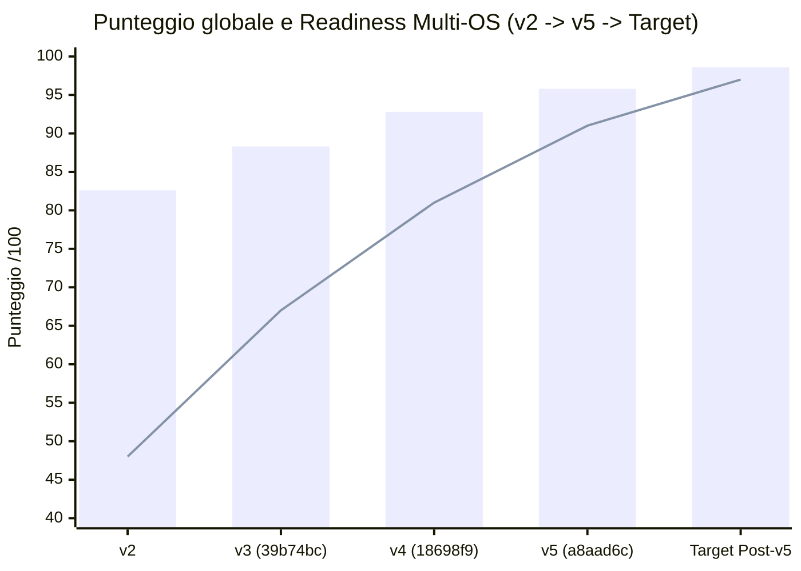

# 05 — Indicatori, Metriche del Codice e Grafici (`v5`)

> **Riferimento Codice**: `HEAD a8aad6c` (20 Ottobre 2026) · **Confronto Storico**: `v2` → `v3` (`39b74bc`) → `v4` (`18698f9`) → `v5` (`a8aad6c`).  
> **Metodo**: righe contate con `git show <rev>:<file> | wc -l` sui file di `git ls-tree -r`, con lo stesso procedimento per `18698f9` e `a8aad6c`. Per questo la colonna `v4` riporta i valori **rimisurati** (es. 40.823 righe Rust invece delle 38.161 dichiarate nel v4).

---

## 1. Intervallo `v4 → v5`

| Misura | Valore | Comando |
|---|---:|---|
| Commit (merge inclusi) | **364** | `git rev-list --count 18698f9..HEAD` |
| Commit senza merge | **277** | `git log --no-merges --format=%h 18698f9..HEAD \| wc -l` |
| Merge | **87** | `git rev-list --merges --count 18698f9..HEAD` |
| PR GitHub chiuse con merge dal 17/10 | **13** | `gh pr list --state merged --search "merged:>=2026-10-17"` (gli altri merge sono branch locali `plat/*`, `swarm2/*`, `feature/*`) |
| Diff | **674 file, +85.686 / −17.597** | `git diff --shortstat 18698f9..HEAD` |
| Arco temporale | 17/10/2026 08:24 → 20/10/2026 17:11 (circa 3,5 giorni) | `git log --reverse --format=%ci` |
| Decisioni nuove | **33** (`D-107..D-139`) | [`docs/app/DECISIONS.md:945-1340`](../../../docs/app/DECISIONS.md#L945-L1340) |
| Tag pubblicati | `app-v0.2.0` (19/10), `app-v0.3.0` (20/10), `php-v8.4.26-1`, `php-v8.5.11-1`, `httpd-v2.4.69-1` (19/10) | `git tag` |
| Issue GitHub | #3, #4, #7, #8 chiuse; #5 e #6 aperte | `gh issue list --state all` |

### 1.1 Diff per area (`git diff --shortstat 18698f9..HEAD -- <area>`)

| Area | File toccati | Righe aggiunte | Righe tolte | Quota dei file (`--dirstat=files`) |
|---|---:|---:|---:|---:|
| [`tauri/src/`](../../../tauri/src) | 129 | +19.456 | −4.775 | 19,2% |
| [`ui/src/`](../../../ui/src) | 124 | +19.442 | −6.302 | 18,5% |
| [`test/rust/`](../../../test/rust) | 105 | +16.242 | −1.690 | 15,6% |
| [`docs/`](../../../docs) | 103 | +18.016 | −2.742 | 14,7% (`docs/reports` 6,4%, `docs/app` 4,3%, `docs` 4,0%) |
| `ui/public/guide/` | 68 (binari) | — | — | 10,1% |
| [`site/`](../../../site) (nuovo) | 25 | +2.008 | 0 | 3,7% |
| [`scripts/`](../../../scripts) (nuovo) | 25 | +1.798 | 0 | 3,7% |
| [`test/ui/`](../../../test/ui) | 23 | +1.915 | −86 | 3,4% |
| [`tauri/catalog/`](../../../tauri/catalog) | 4 | +1.889 | −143 | — |
| [`.github/`](../../../.github) | 4 | +1.039 | −46 | — |
| [`runtime/`](../../../runtime) | 12 | +272 | −160 | — |

Le schermate della Guida (`ui/public/guide/{it,en,fr,de}`) sono oggi 52 file `.webp` per 3,4 MB.

---

## 2. Metriche Quantitative del Repository (`v4` rimisurato → `v5`)

| Metrica | `v4` (`18698f9`) | **`v5` (`a8aad6c`)** | Variazione |
|---|---:|---:|---:|
| **File Rust (`tauri/src/**/*.rs`)** | 134 | **156** | `+22` |
| **Righe Rust (`tauri/src/`)** | 40.823 | **55.504** | **`+14.681` (`+36,0%`)** |
| **File TS/TSX (`ui/src/**/*.{ts,tsx}`)** | 98 | **128** | `+30` |
| **Righe TS/TSX (`ui/src/`)** | 23.490 | **36.183** | **`+12.693` (`+54,0%`)** |
| **CSS (`ui/src/**/*.css`): file / righe** | 3 / 2.157 | 3 / 2.158 | ≈ 0 |
| **File di test Rust (`test/rust/**/*.rs`)** | 105 | **123** | `+18` |
| **Righe di test Rust** | 14.031 | **28.583** | **`+14.552` (`+103,7%`)** |
| **File di test UI (`test/ui/**/*.{ts,tsx}`)** | 17 | **30** | `+13` |
| **Righe di test UI** | 2.887 | **4.716** | **`+1.829` (`+63,4%`)** |
| **Runtime (`runtime/`): file / righe** | 9 / 360 | 11 / 472 | `+2` / `+112` |
| **Script (`scripts/`): file / righe** | 0 | 25 / 1.798 | nuovo |
| **Sito (`site/`): file / righe di testo** | 0 | 25 (6 png, 5 woff2) / 2.007 | nuovo (`D-126`) |
| **Componenti del catalogo** | 35 | **35** | `−adminer`, `−mariadb`, `−nginx`; `+caddy`, `+mysql`, `+phpmyadmin` |
| **Basi del wizard (`frameworks.json`, `kind: base`)** | 11 (+18 addon) | **63** (+18 addon, 81 pezzi) | **`+52`** (`D-131`) |
| **Comandi Tauri (`COMMANDS` in [`tauri/build.rs:8-127`](../../../tauri/build.rs#L8-L127))** | 106 | **118** | `+12` (più 5 `pty_*` in [`tauri/permissions/pty.toml`](../../../tauri/permissions/pty.toml)) |
| **Chiavi i18n UI ([`ui/src/locales/en.json`](../../../ui/src/locales/en.json), piatte)** | 765 | **914** | `+149` (`+19,5%`) — en, de, fr; italiano nel codice |
| **Voci i18n backend ([`tauri/i18n/catalog.json`](../../../tauri/i18n/catalog.json))** | 277 | **390** | `+113` (`+40,8%`) |
| **Decisioni (`DECISIONS.md`)** | D-01..D-106 | **D-01..D-139** | `+33` |
| **Workflow CI** | 1 (`app.yml`, 4 job) | **4** (`app.yml` 9 job, `httpd.yml` 2, `php.yml` 2, `site.yml` 2) | `+3` workflow, `+11` job |
| **Versione** | 0.1.x | **0.3.0** ([`tauri/Cargo.toml:3`](../../../tauri/Cargo.toml#L3), [`ui/package.json:4`](../../../ui/package.json#L4)) | due rilasci |

---

## 3. Suite di Test Automatici (`958` Test Superati)

Eseguiti il 20/10/2026 su Windows 11 x64:

| Suite | Comando | Risultato | `v4` | Variazione |
|---|---|---|---:|---:|
| **Rust** | `cd tauri && cargo test` | `780 passed; 0 failed; 7 ignored` (19,63 s, un solo binario di test) | 429 | **`+351` (`+81,8%`)** |
| **Vitest** | `cd ui && npx vitest run` | `Test Files 29 passed`, `Tests 178 passed` (20,92 s, vitest 5.0.2) | 107 | **`+71` (`+66,4%`)** |
| **Totale** | — | **958 superati**, 7 ignorati, 0 falliti | **536** | **`+422` (`+78,7%`)** |

| Definizioni nel codice | `v4` | `v5` | Variazione |
|---|---:|---:|---:|
| `#[test]` / `#[tokio::test]` in [`test/rust/`](../../../test/rust) | 433 | **822** | `+389` |
| `it(` / `test(` in [`test/ui/`](../../../test/ui) | 102 | **168** | `+66` |

> *Nota metodologica*: gli 822 attributi Rust producono 787 test eseguiti o ignorati su Windows; la differenza sono test condizionati a `cfg(unix)` o ad altre piattaforme, eseguiti dal job `test-unix` sui target Unix ([`.github/workflows/app.yml:211-300`](../../../.github/workflows/app.yml#L211-L300)). I 178 test Vitest superano le 168 definizioni per via di `it.each`.

### 3.1 Densità dei test

| Indicatore | `v4` | **`v5`** |
|---|---:|---:|
| Righe di test / righe di codice (Rust + TS/TSX) | 16.918 / 64.313 = **26,3%** | 33.299 / 91.687 = **36,3%** |
| Righe di test Rust / righe Rust | 34,4% | **51,5%** |
| Test superati ogni 1.000 righe di codice | 8,3 | **10,4** |

Il codice di test è cresciuto più del codice di prodotto: le righe di test Rust sono più che raddoppiate (`+103,7%`) contro `+36,0%` del backend.

---

## 4. Pipeline CI (`v4`: 1 workflow → `v5`: 4 workflow)

| Workflow | Job | Scopo |
|---|---|---|
| [`app.yml`](../../../.github/workflows/app.yml) | `changes`, `check`, `test-unix`, `bundle-macos`, `bundle-linux`, `release-smoke`, `build`, `release` | Filtri per percorso con `dorny/paths-filter` (`app.yml:39-140`, `D-134`), test Unix (`app.yml:211-300`), bundle e smoke dei rilasci con `.sha256` (`app.yml:356-580`, `D-119`). |
| [`httpd.yml`](../../../.github/workflows/httpd.yml) | 2 | Apache per macOS e Linux da sorgenti con firma GPG (`scripts/build-httpd/`, `D-116`). |
| [`php.yml`](../../../.github/workflows/php.yml) | 2 | PHP 8.4.26-1 / 8.5.11-1 per macOS e Linux (`scripts/build-php/`, `D-133`). |
| [`site.yml`](../../../.github/workflows/site.yml) | 2 | Sito GitHub Pages da `site/` con `pages: write` (`D-126`). |

---

## 5. Disponibilità del Catalogo per Target

Calcolata dai campi `targets` e `unavailable` di [`components.json`](../../../tauri/catalog/components.json) (`D-108`):

| Target | `v4` | **`v5`** | Note |
|---|:---:|:---:|---|
| `win32-x64` | 35/35 | **35/35** | — |
| `darwin-arm64` | 31/35 | **35/35** | — |
| `linux-x64` | 31/35 | **35/35** | — |
| `linux-arm64` | — | **34/35** | Manca solo `android`: Google non pubblica platform-tools e build-tools per Linux ARM64 ([`components.json:19`](../../../tauri/catalog/components.json#L19)). |

---

## 6. Documentazione e Localizzazione

| Indicatore | `v5` |
|---|---|
| README | 4 lingue: [`README.md`](../../../README.md) (en, radice), [`docs/README.it.md`](../../../docs/README.it.md), [`docs/README.fr.md`](../../../docs/README.fr.md), [`docs/README.de.md`](../../../docs/README.de.md) |
| Privacy | 4 lingue: [`docs/PRIVACY.md`](../../../docs/PRIVACY.md) + `.it`, `.fr`, `.de` (`D-137`) |
| `docs/app/` | `GUIDE`, `ARCHITECTURE`, `CATALOG`, `TESTING` in en + it (`X.md` + `X.it.md`); `DECISIONS.md` e `CHANGELOG.md` solo in italiano (`D-135`) |
| Guida nell'app | 9 capitoli in [`ui/src/guide/topics/`](../../../ui/src/guide/topics), 36 argomenti, schermate per lingua in `ui/public/guide/{it,en,fr,de}` (`D-136`) |
| Sito | 4 lingue, [`site/`](../../../site) (`D-126`) |

---

## 7. Evoluzione degli Indicatori Chiave (KPI `v2 → v5`)

*Barre: media ponderata delle 9 dimensioni. Linea: dimensione «Readiness Multi-OS».*

| Indicatore KPI | `v3` | `v4` (`18698f9`) | **`v5` (`a8aad6c`)** | Target Post-`v5` |
|---|:---:|:---:|:---:|:---:|
| **Indice Globale Ponderato (9 Dimensioni)** | 88,3 / 100 | 92,8 / 100 | **95,8 / 100** | **98,6 / 100** |
| **Test automatici superati** | 443 | 536 | **958** (780 Rust + 178 Vitest) | in crescita, 0 falliti |
| **Target Unix con test in CI** | 0 | `cargo check` su Linux e macOS | **`test-unix` sui target Unix** | idem + prove su macchina reale (#5, #6) |
| **Sistemi con pacchetto di rilascio** | — | — | **6**, con `.sha256` e smoke in CI (`D-119`) | 6 |
| **Componenti disponibili su macOS (`darwin-*`)** | 29/36 | 31/35 | **35/35** | 35/35 |
| **Componenti disponibili su Linux** | 30/36 (`x64`) | 31/35 (`x64`) | **35/35 `x64`, 34/35 `arm64`** | invariato (`android` assente per scelta di Google) |
| **Rilievi critici aperti** | — | 4 (`PORT-V4-01..04`) | **0** | 0 |
| **Rilievi di severità Alta aperti** | — | — | **1** (`BUG-V5-02`) | 0 |
| **Rilievi `v4` chiusi** | — | — | **20 risolti, 5 parziali, 6 aperti** su 31 | 31/31 |
| **Basi del wizard** | 12 | 11 | **63** in 10 gruppi | — |
| **Chiavi i18n UI (`en.json`)** | — | 765 | **914** | parità en/de/fr ([`test/ui/i18n.test.ts`](../../../test/ui/i18n.test.ts)) |

---

## 8. Grafici

| File | Contenuto |
|---|---|
| [`assets/radar-9-dimensioni.svg`](./assets/radar-9-dimensioni.svg) | Radar delle 9 dimensioni: `v4` (92,8) contro `v5` (95,8) e target post-`v5` (98,6), con i salti principali. Leggibile su sfondo chiaro e scuro. |
