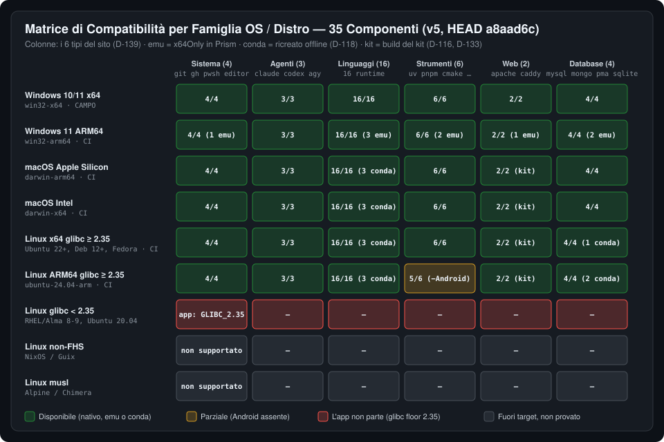

# 06 — Matrice Completa degli Strumenti per Distribuzione OS (`v5`)

> **Riferimento Catalogo**: [`tauri/catalog/components.json`](../../../tauri/catalog/components.json) a `HEAD a8aad6c` — **35 componenti** (rispetto al v4: −`adminer`, −`mariadb`, −`nginx`; +`caddy`, +`mysql`, +`phpmyadmin`), raggruppati nei **6 tipi del sito** (`D-139`: sistema, agenti, linguaggi, strumenti, web, database).
> **Metodo**: la disponibilità è calcolata con la regola di [`site/matrix.mjs:42-58`](../../../site/matrix.mjs#L42-L58), che riproduce `Component::is_available_on` ([`tauri/src/setup/catalog.rs`](../../../tauri/src/setup/catalog.rs)): `targets` → `unavailable`, poi le dipendenze `needs` + `needsByTarget[target]`. Il tipo viene da `KIND_OF` / `KIND_OF_GROUP` ([`site/matrix.mjs:19-26`](../../../site/matrix.mjs#L19-L26)), allineato a `ui/src/components/model.ts` da un test.

---

## 1. Legenda

- **✅ Nativo**: build per l'architettura e il sistema, scaricata, verificata (SHA-256/firma), installata e rilocabile.
- **🔵 Conda (offline)**: nativo, ma da un ambiente conda-forge che non segue il kit: dopo uno spostamento si ricrea **senza rete** dagli archivi in `data/app/conda/<target>/` (`D-92`, `D-118`; [`CATALOG.md:91`](../../../docs/app/CATALOG.md#L91)).
- **❌ Non disponibile**: il catalogo dichiara il target senza build (`unavailable`), mostrato con il motivo e mai con un binario di un'altra architettura.

Nessun componente usa più `targets` ([`docs/app/CATALOG.md:60-64`](../../../docs/app/CATALOG.md#L60-L64)): rispetto al v4 sono spariti tutti i «Win-only» e tutti i «Fix runtime».

### Riepilogo per tipo

| Tipo (sito / UI) | Comp. | `win32-x64` | `darwin-arm64` | `linux-x64` | `linux-arm64` |
|---|:---:|:---:|:---:|:---:|:---:|
| Sistema | 4 | 4 | 4 | 4 | 4 |
| Agenti | 3 | 3 | 3 | 3 | 3 |
| Linguaggi | 16 | 16 | 16 | 16 | 16 |
| Strumenti | 6 | 6 | 6 | 6 | **5** |
| Web | 2 | 2 | 2 | 2 | 2 |
| Database | 4 | 4 | 4 | 4 | 4 |
| **Totale** | **35** | **35** | **35** | **35** | **34** |

v4 per confronto: `darwin-*` 31/35, `linux-x64` 31/35 (4 componenti web solo Windows), `linux-arm64` non era un target del catalogo.

---

## 2. Matrice dei 35 Componenti per Tipo

Riga del catalogo indicata come `components.json:N`.

### 2.1 Sistema (4)

| # | ID | Nome | Win x64 | macOS ARM64 | Linux x64 | Linux ARM64 | Note e riferimenti |
|:---:|---|---|:---:|:---:|:---:|:---:|---|
| 1 | `git` | Git | ✅ | ✅ | ✅ | ✅ | `:7`. Windows: MinGit con Git Bash, la shell degli agenti; macOS/Linux: dugite-native, rilocabile (`D-112`). Arriva con Claude Code o con un clone (`D-81`). |
| 2 | `gh` | GitHub CLI | ✅ | ✅ | ✅ | ✅ | `:11`, gruppo `required`. |
| 3 | `pwsh` | PowerShell 7 | ✅ | ✅ | ✅ | ✅ | `:37`, gruppo `required`; shell preferita anche del terminale PTY su Unix (`D-109`). |
| 4 | `vscodium-server` | Editor | ✅ | ✅ | ✅ | ✅ | `:38`, gruppo `app`, `needs: pwsh`, SHA-256 fissato per target (`sha256ByTarget`). |

### 2.2 Agenti (3)

| # | ID | Nome | Win x64 | macOS ARM64 | Linux x64 | Linux ARM64 | Note e riferimenti |
|:---:|---|---|:---:|:---:|:---:|:---:|---|
| 5 | `claude` | Claude Code | ✅ | ✅ | ✅ | ✅ | `:4`, `needs: git`. Accessi portabili su macOS (`/usr/bin/security`) e Linux (Secret Service) (`D-115`): da provare su un Mac ([#6](https://github.com/nabre/atollo/issues/6)). |
| 6 | `codex` | Codex | ✅ | ✅ | ✅ | ✅ | `:5`. |
| 7 | `antigravity` | Antigravity | ✅ | ✅ | ✅ | ✅ | `:6`. `.tar.gz` dal manifesto di Google su macOS/Linux (SHA-512); [`runtime/bin/agy`](../../../runtime/bin/agy) sceglie `agy.exe` o `agy`. |

### 2.3 Linguaggi (16)

| # | ID | Nome | Win x64 | macOS ARM64 | Linux x64 | Linux ARM64 | Note e riferimenti |
|:---:|---|---|:---:|:---:|:---:|:---:|---|
| 8 | `python` | Python | ✅ | ✅ | ✅ | ✅ | `:8`, `versioned`. |
| 9 | `node` | Node.js | ✅ | ✅ | ✅ | ✅ | `:9`, `versioned`; i link `npm`/`npx` preservati (`PORT-V4-01`). |
| 10 | `php` | PHP | ✅ | ✅ | ✅ | ✅ | `:12`. macOS/Linux: **build del kit** 8.4.26-1 / 8.5.11-1 in `sha256ByLine` (`D-133`), statica (musl su Linux), con `pdo_sqlite`; Composer incluso. |
| 11 | `rust` | Rust | ✅ | ✅ | ✅ | ✅ | `:15`. |
| 12 | `go` | Go | ✅ | ✅ | ✅ | ✅ | `:16`, `versioned`. |
| 13 | `java` | Java (Temurin, Maven, Gradle) | ✅ | ✅ | ✅ | ✅ | `:17`, `versioned`; `keys` Maven e Gradle. |
| 14 | `kotlin` | Kotlin | ✅ | ✅ | ✅ | ✅ | `:18`, `needs: java`. |
| 15 | `dotnet` | .NET | ✅ | ✅ | ✅ | ✅ | `:20`, `versioned`. |
| 16 | `dart` | Dart | ✅ | ✅ | ✅ | ✅ | `:21`, `versioned`. |
| 17 | `zig` | Zig | ✅ | ✅ | ✅ | ✅ | `:22`; base di `cc` su macOS/Linux. |
| 18 | `julia` | Julia | ✅ | ✅ | ✅ | ✅ | `:23`. |
| 19 | `bun` | Bun | ✅ | ✅ | ✅ | ✅ | `:24`; asset nativo `aarch64` ([`js.rs:18-29`](../../../tauri/src/install/lang/js.rs#L18-L29)). |
| 20 | `deno` | Deno | ✅ | ✅ | ✅ | ✅ | `:25`. |
| 21 | `cc` | C, C++ | ✅ | 🔵 | 🔵 | 🔵 | `:30`; Windows llvm-mingw; macOS/Linux shim su `zig cc` (`needsByTarget: zig`) + GNU make da conda-forge (`D-112`); i framework Apple richiedono Xcode CLT. |
| 22 | `ruby` | Ruby | ✅ | 🔵 | 🔵 | 🔵 | `:31`; RubyInstaller su Windows (nativo anche ARM64), conda-forge altrove. |
| 23 | `r` | R | ✅ | 🔵 | 🔵 | 🔵 | `:32`; conda-forge ovunque. |

### 2.4 Strumenti (6)

| # | ID | Nome | Win x64 | macOS ARM64 | Linux x64 | Linux ARM64 | Note e riferimenti |
|:---:|---|---|:---:|:---:|:---:|:---:|---|
| 24 | `uv` | uv, uvx | ✅ | ✅ | ✅ | ✅ | `:10`. |
| 25 | `pnpm` | pnpm, yarn | ✅ | ✅ | ✅ | ✅ | `:28`, `needs: node`; in `data/npm-global`. |
| 26 | `cmake` | CMake, Ninja | ✅ | ✅ | ✅ | ✅ | `:29`; `keys` Ninja. |
| 27 | `android` | Android SDK | ✅ | ✅ | ✅ | ❌ | `:19`, `needs: java`; `unavailable.linux-arm64`: «Google non pubblica platform-tools e build-tools per Linux ARM64». **Unica cella vuota della matrice.** |
| 28 | `typst` | Typst | ✅ | ✅ | ✅ | ✅ | `:26`; su Linux l'asset `musl` statico ([`typeset.rs:29`](../../../tauri/src/install/lang/typeset.rs#L29)). |
| 29 | `tinytex` | TinyTeX | ✅ | ✅ | ✅ | ✅ | `:27`; link di `bin/<arch>` preservati (`PORT-V4-01`). |

### 2.5 Web (2)

| # | ID | Nome | Win x64 | macOS ARM64 | Linux x64 | Linux ARM64 | Note e riferimenti |
|:---:|---|---|:---:|:---:|:---:|:---:|---|
| 30 | `apache` | Apache | ✅ | ✅ | ✅ | ✅ | `:13`, `needs: php`. Windows: Apache Lounge; macOS/Linux: **build del kit** `2.4.69-1` (`sha256ByLine`, Linux glibc 2.35) con `php-fpm` (`D-116`). |
| 31 | `caddy` | Caddy | ✅ | ✅ | ✅ | ✅ | `:14`; server predefinito di pool e siti su tutti i sistemi (`D-111`), sostituisce Nginx con migrazione dei profili (`D-120`). |

### 2.6 Database (4)

| # | ID | Nome | Win x64 | macOS ARM64 | Linux x64 | Linux ARM64 | Note e riferimenti |
|:---:|---|---|:---:|:---:|:---:|:---:|---|
| 32 | `mysql` | MySQL 8.4 / 9.7 | ✅ | ✅ | ✅ | ✅ | `:33`, `sha256ByLine` dopo la firma GPG Oracle. Unico server SQL (`D-117`). Linux: `linux-glibc2.28` e librerie di sistema `libaio`, `libnuma` ([`README.md:115`](../../../README.md#L115)). |
| 33 | `mongodb` | MongoDB, mongosh, Tools | ✅ | ✅ | 🔵 | 🔵 | `:34`; su Linux il server da conda-forge, non rilocabile. |
| 34 | `phpmyadmin` | phpMyAdmin | ✅ | ✅ | ✅ | ✅ | `:35`, `needs: php, mysql`; `php -S` su loopback casuale (`D-107`). |
| 35 | `sqlite` | SQLite | ✅ | ✅ | ✅ | 🔵 | `:36`; su Linux ARM64 da conda-forge. |

---

## 3. Sotto-Strumenti Co-Installati (`keys`)

I componenti dichiarano le loro altre parti nel campo `keys`: il componente è installato solo se esistono tutte.

| Sotto-strumento | Con | Riferimento | Disponibilità |
|---|---|---|---|
| `uvx` | `uv` | `keys: uv/uvx.exe` | come `uv` |
| Composer (`composer.phar`) | `php` | `keys: php/composer.phar` | come `php` |
| Maven, Gradle | `java` | `keys: maven/bin/mvn.cmd, gradle/bin/gradle.bat` | come `java` |
| `adb` (platform-tools) | `android` | `keys: android/platform-tools/adb.exe` | come `android` (no Linux ARM64) |
| yarn | `pnpm` | `keys: @data/npm-global/yarn.cmd` | come `pnpm` |
| Ninja | `cmake` | `keys: tools/ninja.exe` | come `cmake` |
| `mysql`, `mysqldump`, `mysqladmin` | `mysql` | `keys` di `mysql` | come `mysql` |
| `mongosh`, `mongodump` | `mongodb` | `keys` di `mongodb` | come `mongodb` |
| `node` dell'editor | `vscodium-server` | `keys: vscodium-server/node.exe` | come l'editor |

I nomi sono scritti con le convenzioni Windows e tradotti per macOS/Linux da `translate_rel` (es. `git/bin/bash.exe` → `git/bin/git`, `.exe`/`.cmd` tolti; [`setup/catalog.rs:262-292`](../../../tauri/src/setup/catalog.rs#L262-L292)).

---

## 4. Distribuzioni Linux

I target `linux-x64` e `linux-arm64` coprono le distribuzioni **glibc con layout FHS**. Il vincolo di partenza è l'app stessa: il job `bundle-linux` fallisce se il binario richiede un simbolo più recente di `GLIBC_2.35` ([`.github/workflows/app.yml:506-512`](../../../.github/workflows/app.yml#L506-L512)), e i pacchetti sono AppImage e `tar.gz` per WebKitGTK 4.1 (`D-113`).

| Famiglia | Esempi | App Atollo | Componenti | Note |
|---|---|---|---|---|
| **glibc moderna ≥ 2.35 (FHS)** | Ubuntu 22.04+, Debian 12+, Fedora | ✅ parte (CI su Ubuntu 24.04 x64 e ARM64) | 35/35 x64, 34/35 ARM64 | Le prove su macchine reali (Ubuntu 24.04, Fedora 42, Debian 13; AppImage con e senza FUSE) sono ancora da fare ([`README.md:106`](../../../README.md#L106), [#5](https://github.com/nabre/atollo/issues/5)). MySQL richiede `libaio`/`libnuma`. |
| **glibc enterprise < 2.35** | RHEL / Alma / Rocky 8 (2.28) e 9 (2.34), Ubuntu 20.04 | ❌ il binario richiede `GLIBC_2.35` | non raggiungibili dall'app | Nel v4 la matrice ragionava per componente; nel v5 il limite è l'app. Diversi componenti (es. MySQL `linux-glibc2.28`, PHP statico musl) girerebbero, ma senza l'app non si installano. |
| **Non-FHS** | NixOS, Guix | ⚠️ non supportato, non provato | — | Senza `/lib64/ld-linux-*.so` i binari dinamici scaricati non partono senza `nix-ld`/`appimage-run`. Fanno eccezione i binari statici: PHP del kit (musl, `D-133`), Typst `musl` ([`typeset.rs:29`](../../../tauri/src/install/lang/typeset.rs#L29)). |
| **musl** | Alpine, Chimera | ❌ non supportato | — | L'app e la maggior parte dei componenti sono collegati a glibc; nessun target `linux-musl` nel router ([`site/matrix.mjs:9-16`](../../../site/matrix.mjs#L9-L16)). |

**Dischi su Linux e macOS**: un kit su un montaggio `noexec` (o FAT con `showexec` su Linux) ferma l'app con un messaggio ([`os/volume.rs:181-188`](../../../tauri/src/os/volume.rs#L181-L188), [`main.rs:131-137`](../../../tauri/src/main.rs#L131-L137)); su exFAT/FAT i link diventano copie ([`README.md:116`](../../../README.md#L116)).

---

## 5. Sintesi

- **Copertura del catalogo**: 139 celle disponibili su 140 (35 × 4), di cui 12 tramite ambienti conda ricreabili offline (🔵: `cc`, `ruby`, `r` sui 3 target macOS/Linux = 9; `mongodb` sui 2 Linux = 2; `sqlite` su Linux ARM64 = 1).
- **Cosa è cambiato dal v4**: lo stack web (PHP, Apache, Caddy, phpMyAdmin) è passato da «solo Windows» a tutti i quattro target; Linux ARM64 è un target di primo livello (`D-113`).
- **Cosa resta**: Android su Linux ARM64 (dipende da Google), le distribuzioni glibc < 2.35, non-FHS e musl (fuori dagli obiettivi dichiarati), e soprattutto **le prove su macchine reali** di macOS e Linux. La matrice vale anche per la **0.4.0 alpha**, pubblicata subito dopo questo rapporto con il codice di `a8aad6c` più la correzione di `BUG-V5-03`: il catalogo non cambia.
