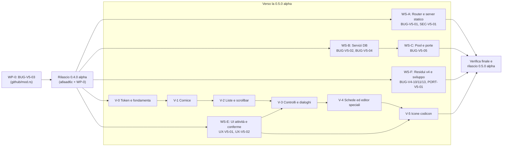

# 07 — Piano Esecutivo `v5`: rilievi aperti, allineamento a VSCodium, 0.4.0 e 0.5.0 alpha

> **Riferimento Codice**: `HEAD a8aad6c` (20/10/2026) · **Rilievi da chiudere**: i 9 rilievi `v5` (`SEC-V5-01`, `BUG-V5-01..05`, `PORT-V5-01`, `UX-V5-01..02`) e i residui `v4` senza nuovo ID (`BUG-V4-10`, `BUG-V4-11`, `BUG-V4-13`), dettagliati in [`03-BUG-SICUREZZA-E-FUNZIONALITA-MANCANTI.md`](03-BUG-SICUREZZA-E-FUNZIONALITA-MANCANTI.md) · **Lavoro pianificato**: allineamento grafico a VSCodium 1.135, fasi 0-5 (approvate dall'utente).
>
> **Tappe**:
> 1. **0.4.0 alpha** — subito dopo questo rapporto, con il codice di `a8aad6c` più la sola correzione di `BUG-V5-03`. Nessun altro rilievo e nessuna fase VSCodium entrano nella 0.4.0.
> 2. **0.5.0 alpha** — prossima tappa di questo piano: tutti i rilievi aperti o parziali e le fasi VSCodium 0-5.
>
> **Obiettivo di punteggio dopo il `v5`**: **98,6 / 100**.

---

## 1. Obiettivi per dimensione

| Dimensione | Peso | Obiettivo dopo il piano | Leve principali |
|---|:---:|:---:|---|
| Architettura | 15% | **99** | Registro comune delle porte (`WP-C2`), lock dei servizi DB (`WP-B1`) |
| Isolamento | 15% | **100** | `safe.directory` solo del kit senza toccare le voci dell'utente (`WP-0`) |
| Rilocazione | 12% | **99** | `BUG-V5-03` usa le radici precedenti note (`Kit::old_root_file`) |
| Sicurezza | 12% | **98** | `SEC-V5-01`, `BUG-V5-01` senza allargare il perimetro fuori LAN |
| UX | 10% | **98** | `UX-V5-01..02`, fasi VSCodium 0-5 |
| AI | 8% | **99** | Nessun rilievo aperto; prova degli accessi su Mac (issue #6) fuori dal codice |
| Dati/DB | 8% | **98** | `BUG-V5-02`, `BUG-V5-04` |
| Qualità/Test | 10% | **98** | Un test di regressione per ogni rilievo chiuso |
| Multi-OS | 10% | **97** | `PORT-V5-01`; prove su macchine pulite (issue #5) fuori dal codice |

---

## 2. Flussi di lavoro paralleli e dipendenze

I flussi sono partizionati per file, così da poter lavorare in rami separati senza conflitti. Dove due flussi toccano lo stesso file, l'ordine è indicato come dipendenza.

| Flusso | Rilievi | File in esclusiva | Dipende da |
|---|---|---|---|
| **WP-0** | `BUG-V5-03` | [`tauri/src/github/mod.rs`](../../../tauri/src/github/mod.rs), [`test/rust/github/mod.rs`](../../../test/rust/github/mod.rs) | — (prima della 0.4.0) |
| **WS-A** Router e server statico | `BUG-V5-01`, `SEC-V5-01` | [`runtime/php-router.php`](../../../runtime/php-router.php), [`tauri/src/projects/serve.rs`](../../../tauri/src/projects/serve.rs), [`test/rust/detect/php.rs`](../../../test/rust/detect/php.rs), [`test/rust/projects/serve.rs`](../../../test/rust/projects/serve.rs) | 0.4.0 |
| **WS-B** Servizi DB | `BUG-V5-02`, `BUG-V5-04` | [`tauri/src/db/services/mod.rs`](../../../tauri/src/db/services/mod.rs), [`tauri/src/db/services/tools.rs`](../../../tauri/src/db/services/tools.rs), [`test/rust/db/services/`](../../../test/rust/db/services/mod.rs) | 0.4.0 |
| **WS-C** Pool e porte | `BUG-V5-05` | [`tauri/src/servers/config.rs`](../../../tauri/src/servers/config.rs), [`tauri/src/servers/pools.rs`](../../../tauri/src/servers/pools.rs), [`tauri/src/projects/run.rs`](../../../tauri/src/projects/run.rs) (solo `set_port`), nuovo modulo delle porte, [`test/rust/servers/`](../../../test/rust/servers/mod.rs) | WS-B (tocca `Services::set` / `set_line_port` in `db/services/mod.rs`) |
| **WS-E** UI attività e conferme | `UX-V5-01`, `UX-V5-02` | [`ui/src/App.tsx`](../../../ui/src/App.tsx), [`ui/src/activity.tsx`](../../../ui/src/activity.tsx), [`ui/src/terminals.tsx`](../../../ui/src/terminals.tsx), [`ui/src/servers.tsx`](../../../ui/src/servers.tsx), `test/ui` | 0.4.0 |
| **WS-F** Residui `v4` e sviluppo | `BUG-V4-10`, `BUG-V4-11`, `BUG-V4-13`, `PORT-V5-01` | [`tauri/src/commands/projects.rs`](../../../tauri/src/commands/projects.rs), [`tauri/src/commands/github.rs`](../../../tauri/src/commands/github.rs), [`tauri/src/commands/frameworks.rs`](../../../tauri/src/commands/frameworks.rs), [`tauri/src/editor/terminals.rs`](../../../tauri/src/editor/terminals.rs), [`scripts/dev-ui.mjs`](../../../scripts/dev-ui.mjs) | 0.4.0 |
| **WS-V** Allineamento VSCodium, fasi 0-5 | lavoro pianificato (15 differenze) | [`ui/src/theme/`](../../../ui/src/theme/theme.css), [`ui/src/workbench/`](../../../ui/src/workbench/index.ts), componenti che importano `react-icons/vsc` (64 file) | V-3 e V-5 dopo WS-E (stessi file `servers.tsx`, `terminals.tsx`) |

**Ordine consigliato**: WP-0 → rilascio 0.4.0 → in parallelo WS-A, WS-B, WS-E, WS-F, V-0..V-2 → WS-C (dopo WS-B) e V-3..V-5 (dopo WS-E) → verifica finale → rilascio 0.5.0.

---

## 3. WP-0 e rilascio 0.4.0 alpha

### WP-0 — `BUG-V5-03`: `safe.directory` dell'utente conservato
- **File**: [`tauri/src/github/mod.rs:214-241`](../../../tauri/src/github/mod.rs#L214-L241), [`test/rust/github/mod.rs:47-55`](../../../test/rust/github/mod.rs#L47-L55).
- **Approccio**: `kit_safe_value` riconosce come «del kit» solo `*`, la radice attuale e le radici precedenti scritte nei file `old-root*` (`Kit::old_root_file`, [`tauri/src/kit.rs:569-571`](../../../tauri/src/kit.rs#L569-L571)), più le cartelle che contengono `data/app`; una cartella che semplicemente non esiste non basta più.
- **Accettazione**: dopo l'avvio con un disco esterno staccato, `safe.directory = E:/repos/*` resta nel `.gitconfig` del kit; `*` e le radici vecchie del kit spariscono.
- **Test**: il caso `"Z:/gone/kit/*"` della riga 48 diventa falso se `Z:/gone/kit` non è una radice nota, vero se lo è; un caso per una radice precedente letta da `old-root*`.

### Rilascio 0.4.0 alpha (subito dopo WP-0)
Stesso schema del rilascio 0.3.0 (commit `446aeb1`, 13 file):
1. Versione `0.4.0` in [`tauri/Cargo.toml:3`](../../../tauri/Cargo.toml#L3) e [`ui/package.json:4`](../../../ui/package.json#L4), con `Cargo.lock` e `package-lock.json`.
2. Voce in [`docs/app/CHANGELOG.md`](../../app/CHANGELOG.md); sezione «Still to do» del [`README.md:99-108`](../../../README.md#L99-L108) e di `docs/README.{it,fr,de}.md`; `site/strings/{en,it,fr,de}.json` (testi `t1Text`, `t5Text`, `t6Text`).
3. Tag `app-v0.4.0`: il job `release` rifiuta un tag diverso dalla versione del manifesto ([`.github/workflows/app.yml:844-853`](../../../.github/workflows/app.yml#L844-L853)) e pubblica `Atollo-<ver>-<target>.<ext>` con `.sha256` per i quattro sistemi, verificati contro gli artefatti dei job `Bundle *` (D-119, D-129).
- **Accettazione**: `cargo test` e `npx vitest run` verdi (oggi 780 + 178 superati); tutti i job di `app.yml` verdi sul tag; release con 4 sistemi e i relativi `.sha256`.

---

## 4. Pacchetti di lavoro verso la 0.5.0 alpha

### WS-A — Router `php -S` e server statico

**WP-A1 · `BUG-V5-01`** (MEDIA)
- **File**: [`runtime/php-router.php:23-32`](../../../runtime/php-router.php#L23-L32).
- **Approccio**: `if ($host !== '' && getenv('ATOLLO_ALLOW_LAN') !== '1') { ... 421 ... }`. La variabile è già nell'ambiente del kit quando la rete locale è permessa ([`tauri/src/env.rs:875-878`](../../../tauri/src/env.rs#L875-L878)); i controlli successivi su dotfile e percorso restano invariati.
- **Accettazione**: in LAN, `Host: 192.168.1.20:8000` riceve la pagina; fuori LAN riceve 421 come oggi; `.env` e dotfile restano rifiutati in entrambi i casi.
- **Test**: [`test/rust/detect/php.rs`](../../../test/rust/detect/php.rs), router eseguito con e senza `ATOLLO_ALLOW_LAN=1`.

**WP-A2 · `SEC-V5-01`** (BASSA)
- **File**: [`tauri/src/projects/serve.rs:55-67`](../../../tauri/src/projects/serve.rs#L55-L67).
- **Approccio**: `matches!(...) || name.ends_with(".localhost")`, dopo aver tolto porta e punto finale come fa il router.
- **Accettazione**: `blog.localhost:<porta>` servito; `localhost.evil.com` e `evil.com` rifiutati con 403.
- **Test**: [`test/rust/projects/serve.rs`](../../../test/rust/projects/serve.rs).

### WS-B — Servizi database

**WP-B1 · `BUG-V5-02`** (ALTA)
- **File**: [`tauri/src/db/services/mod.rs:160-230, 550-675`](../../../tauri/src/db/services/mod.rs#L550-L675).
- **Approccio**:
  1. `op_lock: Mutex<()>` (uno per motore, o una mappa motore → Mutex) preso per tutto `start_engine` e `stop_engine`, così il controllo su `running` e l'inserimento del processo avvengono sotto lo stesso turno.
  2. Un lock per il ciclo lettura-modifica-scrittura di `services.json` (`keep_port`, `set`, `set_line_port`), sul modello di `Settings::update` ([`tauri/src/settings.rs:247-264`](../../../tauri/src/settings.rs#L247-L264)).
  3. `keep_port` anche per la linea principale; `line_ports` dà a ogni linea la porta salvata se c'è, e la porta del server solo alla linea che non ne ha.
- **Accettazione**: due avvii simultanei della stessa linea producono un solo `mysqld` e restituiscono la stessa porta; cambiando la linea del server le porte di tutte le linee già avviate restano invariate.
- **Test**: [`test/rust/db/services/mod.rs`](../../../test/rust/db/services/mod.rs): `line_ports` prima e dopo il cambio di principale; N thread su `keep_port` senza voci perse; avvio concorrente con un finto motore (o `#[ignore]` se serve un MySQL reale).

**WP-B2 · `BUG-V5-04`** (BASSA)
- **File**: [`tauri/src/db/services/tools.rs:175, 197`](../../../tauri/src/db/services/tools.rs#L175).
- **Approccio**: `static LOGIN_SEQ: AtomicU64`; nomi `<exe>-<pid>-<seq>.cnf` / `.yaml`, come `TMP_SEQ` in [`tauri/src/fsx.rs:80-81`](../../../tauri/src/fsx.rs#L80-L81).
- **Accettazione e test**: due chiamate consecutive danno percorsi diversi; il file si cancella comunque a fine comando.

### WS-C — Pool web e porte (dopo WS-B)

**WP-C1 · `BUG-V5-05` parte 1: `conf.d` del progetto nei pool** (MEDIA)
- **File**: [`tauri/src/servers/config.rs:49-72`](../../../tauri/src/servers/config.rs#L49-L72) (vHost Apache), [`config.rs:166-189`](../../../tauri/src/servers/config.rs#L166-L189) (`caddy_site_conf`).
- **Approccio**: `IncludeOptional "<data/projects/
/apache/conf.d>/*.conf"` dentro il `<VirtualHost>` del sito, come fa il server dedicato ([`projects/apache.rs:389`](../../../tauri/src/projects/apache.rs#L389)); nel blocco Caddy del sito un `import` del `conf.d` del progetto, solo se contiene file, come per il `conf.d` del pool ([`projects/caddy.rs:640-643`](../../../tauri/src/projects/caddy.rs#L640-L643)).
- **Accettazione**: una direttiva scritta nel `conf.d` del progetto vale sia con il server dedicato sia nel pool.
- **Test**: [`test/rust/servers/mod.rs`](../../../test/rust/servers/mod.rs), configurazione generata con e senza `conf.d` del progetto.

**WP-C2 · `BUG-V5-05` parte 2: registro comune delle porte** (MEDIA)
- **File**: nuovo modulo (per esempio `tauri/src/ports.rs`), [`servers/pools.rs:533-566`](../../../tauri/src/servers/pools.rs#L533-L566), [`projects/run.rs:416`](../../../tauri/src/projects/run.rs#L416) (`Runner::set_port`), [`db/services/mod.rs:818, 834`](../../../tauri/src/db/services/mod.rs#L818) (`Services::set`, `set_line_port`).
- **Approccio**: `ports_taken(kit) -> BTreeMap<u16, Owner>` con pool (`servers.json`), linee DB (`services.json` e `line_ports`), porte dei progetti, intervallo dell'editor `7000..=7099` ([`editor/mod.rs:47`](../../../tauri/src/editor/mod.rs#L47)); ogni salvataggio di porta lo consulta e l'errore nomina il proprietario (testo nuovo nel catalogo i18n del backend).
- **Accettazione**: salvare un pool su 3307 con una linea MySQL registrata lì, o su 7010, è rifiutato con un messaggio chiaro; il caso inverso (porta DB già di un pool) pure.
- **Test**: `test/rust/servers/`, `test/rust/db/services/`, `test/rust/projects/run.rs`.

### WS-E — UI: attività e conferme

**WP-E1 · `UX-V5-01`** (MEDIA)
- **File**: [`ui/src/App.tsx:104, 175, 505, 532`](../../../ui/src/App.tsx#L104), [`ui/src/activity.tsx:49`](../../../ui/src/activity.tsx#L49).
- **Approccio**: un selettore comune «cose accese» = esecuzioni vive + linee DB con `state !== "stopped"` (principale e `others`, [`ui/src/api/services.ts:26`](../../../ui/src/api/services.ts#L26)) + pool attivi; usato dal badge, dalla barra di stato e da Attività; azione «Ferma tutto» nel pannello con `InlineConfirm`. Testi nuovi in `ui/src/locales/{en,de,fr}.json`.
- **Accettazione**: con la principale ferma e una secondaria attiva, il conteggio è 1 e Attività la elenca; un pool acceso compare; «Ferma tutto» lascia tutto fermo.
- **Test**: [`test/ui/App.test.tsx`](../../../test/ui/App.test.tsx) e un test di `activity`.

**WP-E2 · `UX-V5-02`** (BASSA)
- **File**: [`ui/src/terminals.tsx:257-287`](../../../ui/src/terminals.tsx#L257-L287), [`ui/src/servers.tsx:137, 524-530`](../../../ui/src/servers.tsx#L524-L530).
- **Approccio**: `onCancel={() => setConfirmRemove(false)}`; «Elimina profilo» apre un `InlineConfirm` ([`ui/src/workbench/dialog.tsx:162`](../../../ui/src/workbench/dialog.tsx#L162)) prima di `serverRemove`.
- **Accettazione e test**: Esc chiude la conferma del terminale; il primo clic su «Elimina profilo» non chiama `serverRemove` ([`test/ui/servers.test.tsx`](../../../test/ui/servers.test.tsx)).

### WS-F — Residui `v4` e sviluppo

**WP-F1 · `BUG-V4-11`** (residuo, cache `WebServers`)
- **File**: [`tauri/src/commands/projects.rs:59, 83`](../../../tauri/src/commands/projects.rs#L59) (`project_delete`, `project_clone`), [`commands/github.rs`](../../../tauri/src/commands/github.rs) (`github_clone`), [`commands/frameworks.rs`](../../../tauri/src/commands/frameworks.rs) (`frameworks_create`).
- **Approccio**: `state.servers.invalidate()` a fine comando, come in `project_action_save` ([`projects.rs:122`](../../../tauri/src/commands/projects.rs#L122)).
- **Accettazione**: la pagina «Server web» mostra il progetto nuovo o tolto senza attendere `LIST_TTL` (15 s).

**WP-F2 · `BUG-V4-10`** (residuo teorico)
- **File**: [`commands/frameworks.rs:332, 355`](../../../tauri/src/commands/frameworks.rs#L332).
- **Approccio**: `env_set` delle variabili della base prima di `env_apply`, così le credenziali del DB generate vincono sempre, anche per una base dell'utente con chiavi `DB_*`.
- **Test**: base di prova con `DB_PASSWORD=` vuota: il `.env` finale ha la password generata.

**WP-F3 · `BUG-V4-13`** (residuo)
- **File**: [`tauri/src/editor/terminals.rs:73, 200, 430-449`](../../../tauri/src/editor/terminals.rs#L430-L449).
- **Approccio**: oltre a `missing`, segnalare la linea salvata non più presente e quella usata al suo posto (stesso canale degli strumenti spariti).
- **Test**: profilo con `php = 8.2` e solo 8.4 sul disco → segnalazione «8.2 → 8.4».

**WP-F4 · `PORT-V5-01`** (BASSA, solo sviluppo)
- **File**: [`scripts/dev-ui.mjs:103-114`](../../../scripts/dev-ui.mjs#L103-L114).
- **Approccio**: aggiungere l'uscita alla chiusura dello stdin ereditato dal genitore, accanto al controllo del PID. Facoltativo.

---

## 5. WS-V — Allineamento a VSCodium 1.135, fasi 0-5

Base: confronto già fatto fra il CSS del workbench di VSCodium 1.135 e [`ui/src/theme/`](../../../ui/src/theme/theme.css) / [`ui/src/workbench/`](../../../ui/src/workbench/index.ts). Le 15 differenze sono numerate come nell'analisi; le fasi 0-5 sono approvate, la ripartizione delle differenze fra le fasi è quella di questo piano.

| Fase | Contenuto | Differenze | File principali | Accettazione |
|---|---|---|---|---|
| **V-0** Fondamenta | Token di misura (altezze di righe, schede, intestazioni) accanto ai token di colore; sostituzione delle chiavi `modernActivityBar*`, che VSCodium 1.135 non conosce ([`theme-colors.css:54-56`](../../../ui/src/theme/theme-colors.css#L54-L56), [`theme-vscode.css:465-466`](../../../ui/src/theme/theme-vscode.css#L465-L466)) | 15, 2 (colori) | `ui/src/theme/*.css`, [`docs/brand/themes.py`](../../brand/themes.py) | Nessuna chiave `--vscode-*` assente in VSCodium 1.135; misure lette solo dai token |
| **V-1** Cornice | Barra del titolo (44 → 46 px dei pulsanti finestra, sovrapposizione 35 → 30 px); barra delle attività (forma, bordo, spaziatura); barra di stato (padding) | 9, 2, 12 | [`ui/src/workbench/layout.tsx`](../../../ui/src/workbench/layout.tsx), `theme.css` | Misure uguali a VSCodium alla stessa scala |
| **V-2** Liste e scorrimento | Righe di liste e alberi a tutta larghezza e squadrate; intestazioni dei pannelli laterali (hover, raggio); barre di scorrimento del workbench al posto di quelle native (oggi ci sono solo i colori, [`theme-colors.css:117-119`](../../../ui/src/theme/theme-colors.css#L117-L119)) | 3, 4, 5 | [`ui/src/workbench/list.tsx`](../../../ui/src/workbench/list.tsx), [`table.tsx`](../../../ui/src/workbench/table.tsx), `theme.css` | Selezione e hover come VSCodium; scrollbar sottili con i colori del tema |
| **V-3** Controlli e dialoghi | Dimensioni dei pulsanti; campi e menu a tendina; finestre di dialogo (raggio, ombra) | 6, 13, 11 | [`ui/src/workbench/controls.tsx`](../../../ui/src/workbench/controls.tsx), [`dialog.tsx`](../../../ui/src/workbench/dialog.tsx) | Dopo WS-E; altezze e bordi come VSCodium, focus visibile invariato |
| **V-4** Schede ed editor speciali | Schede del pannello (testo con sottolineatura al posto della pillola); schede dell'editor (colore dell'inattiva, posizione della chiusura); intestazione delle estensioni (64 → 128 px con barra di navigazione); editor delle impostazioni (indice, titoli, barra del valore modificato) | 1, 10, 7, 8 | [`ui/src/workbench/layout.tsx`](../../../ui/src/workbench/layout.tsx), [`settings.tsx`](../../../ui/src/workbench/settings.tsx), `ui/src/settings/` | Schede e pagine come le corrispondenti di VSCodium |
| **V-5** Icone | Font codicon al posto di `react-icons/vsc` (64 file in `ui/src`) | 14 | Tutti gli import di `react-icons/vsc`, `ui/src/theme` | Dopo WS-E; nessun import di `react-icons/vsc` rimasto |

**Per ogni fase**:
- **Test**: [`test/ui/theme/theme.test.ts`](../../../test/ui/theme/theme.test.ts) e `test/ui/workbench/{controls,dialog,elements,layout}.test.tsx` aggiornati; un test che i token di misura esistono in tutti i temi.
- **Guida**: le schermate cambiano; a fine WS-V rigenerare le 52 schermate con `node scripts/guide-shots/make.mjs` e i documenti con `node scripts/guide-docs.cjs` (il controllo `--check` in CI fallisce altrimenti).
- **Tema**: chiaro, scuro e «come il sistema» (D-137) controllati a ogni fase.

---

## 6. Verifica finale e rilascio 0.5.0 alpha

1. **Test**: `cd tauri && cargo test` e `cd ui && npx vitest run` verdi, con almeno un test nuovo per ognuno dei 9 rilievi `v5` chiusi e per i residui `BUG-V4-10/11/13` (oggi 780 + 178).
2. **CI**: tutti i job di [`app.yml`](../../../.github/workflows/app.yml) verdi, compresi `test-unix`, `bundle-macos`, `bundle-linux` e `release-smoke`.
3. **Documenti**: decisioni nuove in [`docs/app/DECISIONS.md`](../../app/DECISIONS.md) (registro delle porte, lock dei servizi DB, allineamento a VSCodium); [`CHANGELOG.md`](../../app/CHANGELOG.md); Guida e schermate rigenerate.
4. **Rilascio**: come la 0.4.0 (sez. 3): versione `0.5.0` in `tauri/Cargo.toml` e `ui/package.json`, «Still to do» in README ×4 e `site/strings` ×4, tag `app-v0.5.0`.
5. **Fuori dal codice** (non bloccanti per la 0.5.0, da riportare nel README): prova su macchine pulite (issue #5), accessi su un Mac (issue #6), aggiornamento automatico su macOS e Linux, notarizzazione Apple e firma SignPath.
