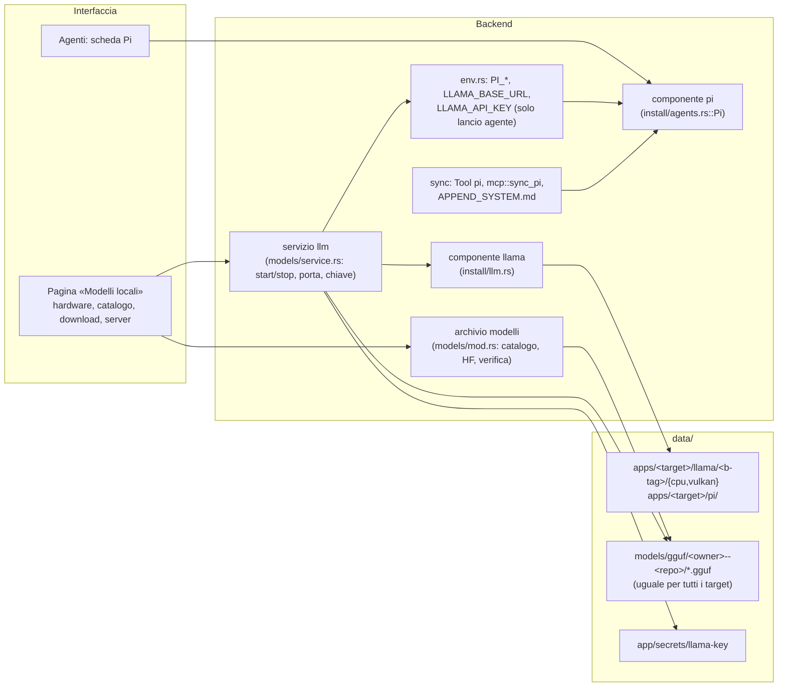

# 03 — Modelli GGUF Locali e Pi come Quarto Agente (`v6`)

> **Richiesta**: gestire nel kit modelli linguistici locali in formato GGUF e usarli dal harness **Pi**.
> **Fonti esterne** (verificate il 21/10/2026): [earendil-works/pi](https://github.com/earendil-works/pi) (release v1.3.0, docs in `packages/coding-agent/docs/`), registro npm `@earendil-works/pi-coding-agent`, [ggml-org/llama.cpp](https://github.com/ggml-org/llama.cpp/releases) (v0.7.0 → `b11669`; ultima rolling `b11792`), [`tools/server/README.md`](https://github.com/ggml-org/llama.cpp/blob/master/tools/server/README.md), API di Hugging Face `api/models/<repo>/tree/main`.
> **Codice del kit letto**: `install/agents.rs`, `install/mod.rs`, `env.rs`, `agents/mod.rs`, `agents/sync/{mod,mcp,links,project}.rs`, `router/bins.rs`, `ports.rs`, `os/volume.rs`, `catalog/components.json`, `ui/src/api/agents.ts`.

---

## 1. Cosa è Pi oggi

Pi è l'agente di programmazione da terminale di Mario Zechner. **Attenzione al cambio di nome**: il repository `badlogic/pi-mono` rimanda a `earendil-works/pi`; il pacchetto `@mariozechner/pi-coding-agent` è fermo a 0.73.1 (deprecato), quello attuale è **`@earendil-works/pi-coding-agent` 1.3.0** (15/10/2026, 1.0.0 il 01/10).

| Aspetto | Pi 1.3 | Impatto per Atollo |
|---|---|---|
| Distribuzione | **binari autonomi** (Bun) per i quattro target: `pi-windows-x64.zip` (43 MB), `pi-darwin-arm64.tar.gz`, `pi-linux-{x64,arm64}.tar.gz`, con **`SHA256SUMS`** | installatore come Antigravity, senza Node. La cartella intera serve (`pi.exe` + `theme/`, `export-html/`, `photon_rs_bg.wasm`) |
| Cartella di configurazione | `~/.pi/agent`, spostabile con **`PI_CODING_AGENT_DIR`** | già dentro `data/home` grazie a `HOME`; la variabile va messa esplicita |
| Variabili utili | `PI_SKIP_VERSION_CHECK`, `PI_TELEMETRY=0`, `PI_OFFLINE`, `PI_CODING_AGENT_SESSION_DIR`, proxy | come `DISABLE_UPDATES` di Claude |
| Istruzioni | `AGENTS.md`/`CLAUDE.md` nella cartella dell'agente, nella cartella di lavoro e nei genitori; `APPEND_SYSTEM.md` | la convenzione del kit (`AGENTS.md` nei progetti) funziona senza modifiche |
| Skill | `<agentDir>/skills/`, `.pi/skills/`, `~/.agents/skills/`, `.agents/skills/` (spec Agent Skills, `SKILL.md`) | le skill di progetto `.agents/skills` del kit sono lette nativamente |
| MCP | **integrato**: `<agentDir>/mcp.json` e `.pi/mcp.json`, formato `{"mcpServers":{…}}` come Claude; `stdio`, `http`, `streamable-http`; **SSE rifiutato** | nuovo `mcp::sync_pi`, quasi identico a quello di Claude |
| Modelli | `models.json` (provider `openai-completions`, `anthropic-messages`, …) e **provider llama.cpp integrato** che parla con `llama-server` in modalità router (`LLAMA_BASE_URL`, `LLAMA_API_KEY`, comando `/llama`) | il collegamento ai modelli locali è una variabile d'ambiente |
| Fiducia | `.pi/settings.json` e `.pi/mcp.json` caricati solo dopo la fiducia; `defaultProjectTrust: ask` | coerente con la correzione proposta in `SEC-V6-02` |
| Su Windows | il tool `bash` richiede Git Bash (`shellPath`) | `needs: ["git"]`, come Claude |

## 2. Runtime per i GGUF: scelta

| Opzione | Portabile senza amministratore | Dimensione | Modelli come file `.gguf` | Integrazione Pi | Verdetto |
|---|---|---|---|---|---|
| **llama.cpp** (`llama-server`) | sì: zip/tar, nessun servizio | 11-35 MB (CPU/Vulkan/Metal); CUDA 150-260 MB + cudart ~400 MB | sì, cartella scelta (`--models-dir`) | **provider integrato** | **scelto** |
| Ollama | sì (archivi con `sha256sum.txt`) | 1,4-1,5 GB su Windows/Linux x64 (CUDA incluso) | no: blob con indirizzo di contenuto + manifesti | via `models.json` | opzionale, dopo |
| LM Studio / `lms` | no: installer, stato in `~/.lmstudio`, licenza proprietaria | — | parziale | via `models.json` | escluso |

Motivi della scelta: MIT, piccolo, una build per ogni target, i modelli restano file normali condivisi da **tutti i target** (una sola copia sulla chiavetta per Windows, macOS e Linux), modalità router integrata (più modelli, carica e scarica a richiesta, `POST /models` per scaricare), API OpenAI (`/v1/chat/completions`, `/v1/models`) e anche Anthropic (`/v1/messages`), tool calling con template Jinja (ora attivi per default).

**Versioni**: le release `bNNNNN` sono rolling (più al giorno, marcate *prerelease*); le release semver (`v0.7.0`) contengono solo `nightly-tag.txt` con il b-tag. Il catalogo del kit deve **fissare un b-tag** letto da `releases/latest` → `nightly-tag.txt`. Non c'è `SHA256SUMS`, ma l'API GitHub dà `digest: "sha256:…"` per ogni asset (lo stesso meccanismo che l'aggiornamento di Atollo usa già) e le release hanno attestazioni di build.

**Backend per target**:

| Target | Build | Nota |
|---|---|---|
| `win32-x64` | `win-vulkan-x64` + `win-cpu-x64` | Vulkan copre NVIDIA, AMD e Intel senza CUDA; CUDA come scelta esplicita in Strumenti |
| `darwin-arm64` | `macos-arm64` | Metal incluso |
| `linux-x64` / `linux-arm64` | `ubuntu-vulkan-*` + `ubuntu-*` (CPU) | Vulkan richiede `libvulkan1` del sistema: se manca, CPU, con il comando da lanciare (come per `libaio` di MySQL) |

Proposta semplice: installare **entrambe** le build CPU e Vulkan (circa 60 MB in tutto) e scegliere all'avvio con `llama-server --list-devices`: se non elenca GPU si usa la CPU. Nessuna domanda all'utente.

## 3. Architettura proposta



### 3.1 Componente `llama`

- **Catalogo** ([`tauri/catalog/components.json`](../../../tauri/catalog/components.json)): `{ "id": "llama", "name": "llama.cpp", "group": "ai", "def": false, "mb": 60, "key": "llama/cpu/llama-server.exe", "folder": "llama", "minorFolder": true, "check": ["llama/cpu/llama-server.exe", "--version"] }`. Il gruppo nuovo `ai` («IA locale») va aggiunto ai tipi di strumenti di [`ui/src/components/model.ts`](../../../ui/src/components/model.ts) (D-139) e al sito.
- **Installatore** `install/llm.rs`: `latest()` legge il b-tag fissato nel catalogo (aggiornabile con «Aggiorna»), sceglie gli asset per target, `Expect::Sha256` dal `digest` dell'API GitHub, `Inner::Root` in `llama/cpu` e `llama/vulkan`. Registrazione in `install::installer()`.
- **Router**: lanciatore `llama-server` in [`router/bins.rs`](../../../tauri/src/router/bins.rs), così i terminali del kit hanno `llama-server`, `llama-cli`, `llama-bench`.

### 3.2 Archivio dei modelli

- **Posizione**: `data/models/gguf/<owner>--<repo>/<file>.gguf` (+ `mmproj-*.gguf` per i multimodali, + tutte le parti `-0000N-of-0000M` nella stessa cartella). La modalità router vuole proprio un modello per sottocartella. **Fuori da `data/apps/<target>`**: un modello vale per tutti i target.
- **Catalogo curato** nuovo `tauri/catalog/models.json`, con commit fissato e hash:

```json
{ "id": "qwen3-coder-30b-a3b-q4km",
  "name": "Qwen3-Coder 30B-A3B", "repo": "unsloth/Qwen3-Coder-30B-A3B-Instruct-GGUF",
  "commit": "<sha del commit HF>", "files": [{ "name": "Qwen3-Coder-30B-A3B-Instruct-Q4_K_M.gguf", "sha256": "fadc3e5f…088ad", "bytes": 18560000000 }],
  "ctx": 32768, "ramGb": 22, "tools": true, "moe": true, "license": "apache-2.0", "tier": "large" }
```

- **Prima scelta proposta** (dimensioni Q4 misurate dall'API HF; la qualità del tool calling con Pi va provata in F0):

| Fascia | Modello | File | Dimensione |
|---|---|---|---|
| ~8 GB RAM/VRAM | Qwen2.5-Coder-7B-Instruct | `q4_k_m` | 4,7 GB |
| ~8 GB | Qwen3.5-9B | `Q4_K_M` | 5,7 GB |
| 16-24 GB | gpt-oss-20b | MXFP4 | 12,1 GB |
| 16-24 GB | Devstral-Small-2-24B | `Q4_K_M` | 14,3 GB |
| 24 GB+ o molta RAM | Qwen3-Coder-30B-A3B (MoE, usabile anche su CPU) | `Q4_K_M` | 18,6 GB |

- **«Aggiungi da Hugging Face»**: l'utente scrive `owner/repo`; l'app legge `api/models/<repo>/tree/main` (campo `lfs.oid` = SHA-256, `size`), mostra i `.gguf` per quantizzazione, scarica da `resolve/<commit>/<file>` (commit preso da `X-Repo-Commit`), verifica l'hash in streaming. Token HF opzionale per i modelli con accesso controllato, in `data/app/secrets/hf-token` (stesso trattamento della chiave Gemini).
- **Download grandi**: oggi [`net/mod.rs`](../../../tauri/src/net/mod.rs) non riprende un download interrotto. Per file da 5-20 GB serve **ripresa con `Range`** su `*.part` + controllo dell'hash alla fine, e il timeout d'inattività di `BUG-V6-13`. È il lavoro tecnico più importante di questa parte.
- **Controlli prima di scaricare**: spazio libero; **limite di 4 GB per file su FAT32** con [`os::volume::max_file_size`](../../../tauri/src/os/volume.rs#L53) (già esistente) → messaggio «questo disco è FAT32, il modello non ci sta; exFAT o NTFS sì»; stima «entra / al limite / troppo grande» per la RAM della macchina.

### 3.3 Servizio `llm`

Modellato sui servizi dei database (`db/services`), con le stesse garanzie di D-140/D-141:

- **Avvio**: `llama-server --models-dir data/models/gguf --host 127.0.0.1 --port <porta> --api-key-file data/app/secrets/llama-key --models-max 1 -ngl auto --sleep-idle-seconds 600`. `--models-max 1` evita di esaurire la RAM; `--sleep-idle-seconds` la libera quando non si usa. **Sempre `--port` esplicito** (la porta predefinita è passata da 8080 a 9931 in v0.7.0).
- **Porta**: nuovo `Owner::Llm` in [`ports.rs:24`](../../../tauri/src/ports.rs#L24), intervallo proprio, controllato contro pool, DB, progetti ed editor.
- **Chiave**: casuale, generata al primo avvio, in `data/app/secrets/`. Mai esposta in LAN, anche con la rete locale permessa, salvo un'opzione separata.
- **Ciclo di vita**: un'operazione alla volta (lock come D-140), Job/process group, conteggio in Attività e barra di stato, «Ferma tutto», chiusura in «Rimuovi unità».
- **Chat gratuita**: `llama-server` serve un'interfaccia web sulla stessa porta: un pulsante «Apri chat» dà subito valore anche a chi non usa agenti.

### 3.4 Pi come quarto agente

Mappa dei punti da toccare (dall'analisi dell'architettura degli agenti):

| File | Modifica |
|---|---|
| [`catalog/components.json`](../../../tauri/catalog/components.json) | `{ "id": "pi", "name": "Pi", "group": "agents", "def": false, "mb": 120, "needs": ["git"], "home": "https://pi.dev", "key": "pi/pi.exe", "folder": "pi", "minorFolder": true, "check": ["pi/pi.exe", "--version"] }` |
| [`install/agents.rs`](../../../tauri/src/install/agents.rs) | `struct Pi`: `releases/latest` di `earendil-works/pi`, `SHA256SUMS`, asset per target, `Expect::Sha256`, destinazione cartella (non `Dest::File`) |
| [`agents/mod.rs:42`](../../../tauri/src/agents/mod.rs#L42) | `IDS: [&str; 4]`, `exe_of("pi")`, `sign_in`: «locale» se il servizio llm ha un modello, oppure `auth.json` per i provider cloud; uscita = togliere `auth.json` |
| [`env.rs`](../../../tauri/src/env.rs) | `PI_CODING_AGENT_DIR=data/home/.pi/agent`, `PI_SKIP_VERSION_CHECK=1`, `PI_TELEMETRY=0`, `pi` nel `PATH`, cartella in `create_dirs`; `LLAMA_BASE_URL`/`LLAMA_API_KEY` **solo nell'ambiente di lancio** degli agenti, non in `KitEnv` (vedi `SEC-V6-02`) |
| [`router/bins.rs`](../../../tauri/src/router/bins.rs), [`editor/cfg.rs`](../../../tauri/src/editor/cfg.rs), [`setup/needs.rs`](../../../tauri/src/setup/needs.rs) | lanciatore, profilo di terminale di VSCodium, bisogni dell'agente |
| [`agents/sync/mod.rs:366`](../../../tauri/src/agents/sync/mod.rs#L366) | `Tool { id: "pi", instructions: .pi/agent/AGENTS.md, skills: .pi/agent/skills, skills_key: "skills-pi" }`; **non** collegare anche `~/.agents/skills` (Pi vedrebbe skill doppie) |
| [`agents/sync/mod.rs:418`](../../../tauri/src/agents/sync/mod.rs#L418) | `tools.iter().take(2)` presuppone tre agenti: generalizzare a `tools.len() - 1`, e il ciclo della modalità copia |
| `sync_rules` | `KIT_RULE_TEXT` in `.pi/agent/APPEND_SYSTEM.md` dentro un blocco marcato (l'utente può avere testo suo); testo «tre agenti» → «gli agenti» |
| `agents/sync/mcp.rs` | `sync_pi` sul modello di `sync_antigravity`: `mcp.json` con `mcpServers`, `http` → `http`, server SSE **saltati con un avviso**, stato in `mcp-pi.json` |
| `.pi/agent/settings.json` | blocco gestito: `shellPath` (Git Bash del kit), `defaultProjectTrust: "ask"`, `defaultProvider: "llama.cpp"` + `defaultModel` quando l'utente sceglie «Usa con Pi» |
| [`agents/relocate.rs`](../../../tauri/src/agents/relocate.rs) | aggiungere `settings.json`, `models.json` di Pi all'elenco dei file da rilocare (`shellPath` è assoluto), dopo aver corretto `BUG-V6-03` |
| `agents/stats/pi.rs` | opzionale: token dai JSONL di `sessions/`; per i modelli locali niente limiti, ma token/s dalle `timings` di llama-server |
| UI | `AgentId` in [`ui/src/api/agents.ts:7`](../../../ui/src/api/agents.ts#L7), [`ui/src/logos.tsx`](../../../ui/src/logos.tsx), [`ui/src/agents/page.tsx`](../../../ui/src/agents/page.tsx), locali, Guida (capitolo Agenti), README «Three AI agents» → «Four» |

### 3.5 Gli altri agenti sui modelli locali (fase opzionale)

`llama-server` espone anche `/v1/messages` (Anthropic) e `/v1/chat/completions` (OpenAI). Si può quindi provare a puntare **Claude Code** (`ANTHROPIC_BASE_URL`) e **Codex** (`model_providers` in `config.toml`, già scritto dal kit in [`agents/sync/codex.rs`](../../../tauri/src/agents/sync/codex.rs)) sul server locale. Non verificato: la qualità con modelli da 7-30 B è lontana da quella dei modelli in cloud e i due agenti contano su funzioni dei loro provider. Da trattare come esperimento, dopo Pi.

### 3.6 Riga di comando

```
Atollo.exe models                      elenca i modelli del catalogo e quelli scaricati
Atollo.exe models pull <id|owner/repo:quant>
Atollo.exe models rm <id>
Atollo.exe llm start|stop|status       il server dei modelli locali
```

Il blocco va aggiunto a `HELP` e generato nei README (vedi documento 02, §4).

---

## 4. Fasi

| Fase | Contenuto | Criterio di fine | Stima |
|---|---|---|---|
| **F0 — Prova a mano** | in un terminale del kit: `pi.exe` scompattato, `llama-server` router con 2 modelli del catalogo; verificare nome dei modelli in `/v1/models`, tool calling di Pi (lettura/scrittura file, bash), `pi.exe` da exFAT, schema di `auth.json` e `trust.json`, se `pi update --self` va bloccato | tabella «modello × compiti riusciti»; risposte alle 6 domande aperte | 1-2 giorni |
| **F1 — Componente e archivio** | `llama` nel catalogo e installatore; `models.json`; download con ripresa `Range` e verifica; controlli FAT32/spazio/RAM; CLI `models` | prove: hash sbagliato rifiutato, ripresa dopo interruzione, FAT32 rifiutato | 4-5 giorni |
| **F2 — Servizio** | `models/service.rs`, `Owner::Llm`, chiave, Attività, barra di stato, «Ferma tutto», «Rimuovi unità», CLI `llm` | prove come quelle dei DB (lock, porta che resta, chiusura) | 3 giorni |
| **F3 — Pi** | installatore, env, sync (istruzioni, skill, MCP, regola), impostazioni gestite, rilocazione, accesso | `atollo sync` allinea quattro agenti; Pi parte da un progetto e usa il modello locale senza configurazione a mano | 4-5 giorni |
| **F4 — Interfaccia e documenti** | pagina «Modelli locali», scheda Pi, Guida (nuovo argomento), README ×4, CATALOG, PRIVACY (Hugging Face, GitHub di llama.cpp e Pi), sito, decisioni | revisione della Guida nelle 4 lingue; `guide-docs.cjs --check` | 3-4 giorni |
| **F5 — Opzionale** | Claude Code e Codex sul server locale; Ollama come alternativa; build CUDA | esperimento documentato | — |

Decisioni da registrare in [`DECISIONS.md`](../../app/DECISIONS.md): llama.cpp come runtime e b-tag fissato; modelli fuori da `data/apps` e condivisi tra target; Pi da binario e non da npm; segreti dei modelli solo nell'ambiente di lancio; fiducia `ask` per Pi.

## 5. Rischi

| Rischio | Misura |
|---|---|
| Spazio: un modello pesa quanto tutto il kit | scelta esplicita, dimensione in evidenza, `data/models` escluso dal backup consigliato (si riscarica) |
| FAT32 e file > 4 GB | controllo con `max_file_size` prima del download |
| Antivirus che segnalano binari di llama.cpp/Pi | verifica hash + messaggio chiaro; come per gli altri componenti |
| Pi 1.x cambia in fretta (nome già cambiato una volta) | versione fissata nel catalogo, aggiornamento come gli altri agenti; prove sul formato dei file che il kit scrive |
| Release rolling di llama.cpp | b-tag fissato, aggiornato a mano dopo F0 |
| Tool calling debole dei modelli piccoli | catalogo con `tools: true` solo per i modelli provati in F0; indicazione «adatto a chat» per gli altri |
| RAM/batteria/calore su portatili | `--models-max 1`, `--sleep-idle-seconds`, stato visibile in Attività |
| Licenze dei modelli | campo `license` nel catalogo, mostrato prima del download |

## 6. Domande aperte (da decidere prima di F1)

1. Backend predefinito: **CPU + Vulkan con scelta automatica** (proposta) oppure anche CUDA tra le opzioni fin da subito?
2. Elenco iniziale dei modelli del catalogo: i cinque della tabella o meno?
3. Pi dal binario GitHub (proposta) o da npm con Node del kit?
4. I modelli locali anche per Claude Code e Codex (F5) o solo per Pi?
5. Pi installato di default al primo avvio o solo su richiesta (proposta: su richiesta, `def: false`)?

---

## 7. Esito (22/10/2026)

Sviluppato sul ramo `feature/local-llm-pi` (decisioni [D-151](../../app/DECISIONS.md) e [D-152](../../app/DECISIONS.md)). Domande del §6 risolte con le proposte: CPU e GPU con scelta automatica, i cinque modelli, Pi dal binario GitHub, modelli locali solo per Pi, Pi su richiesta.

### 7.1 F0 — Prova a mano (Windows 11 x64, RTX 2070, llama.cpp `b11669`, Pi 1.3.0 e 1.4.0)

| Domanda | Risposta |
|---|---|
| CPU e Vulkan affiancate? | **No**: la build Vulkan contiene già tutti i backend CPU e carica Vulkan solo con un driver (`--list-devices` vede la GPU; quella CPU dice `(none)`). Una build per target. |
| Nome dei modelli in `/v1/models` | con `--models-dir` il nome della sottocartella; con `--models-preset` il nome della sezione. Il kit usa i preset: id scelti dal kit, contesto per modello, nessun file in più da indovinare. |
| `/health` | senza chiave (pronto per il controllo di avvio); `/models` e `/v1/*` rispondono 401 senza chiave. |
| Provider llama.cpp integrato di Pi | **non adatto**: legge i modelli solo da una credenziale salvata con `/login` e li aggiorna solo in una sessione interattiva; `--print` e `--list-models` non vedono nulla con `LLAMA_BASE_URL`. Il kit scrive invece il provider `atollo` in `models.json` (API `openai-completions`): funziona in ogni modalità. |
| Bash di Pi su Windows | cerca `shellPath`, poi Git in Program Files, poi `bash.exe` nel PATH: nel kit nessuno dei due ultimi; `shellPath` = Git Bash del kit. |
| `trust.json` | `{ "<percorso reale>": true }`; serve solo con `.pi/` o `.agents/skills` nel progetto. |
| Tool calling (modello × compito) | Qwen3.5 9B: `bash` (`cat`, `uname`) riuscito, risposta esatta. Qwen2.5-Coder 7B: scrive la chiamata come testo JSON → «solo chat». Qwen2.5 0.5B: chiama `read` ma sbaglia il percorso. gpt-oss 20B, Devstral 24B, Qwen3-Coder 30B non provati (troppo grandi per la GPU di prova): `tools: true` dal modello, da confermare. |
| Download da Hugging Face | `resolve/<commit>/<file>` rimanda alla CDN (`X-Repo-Commit`, `Accept-Ranges: bytes`); la ripresa con `Range` funziona attraverso il redirect (provata con 0,5 GB e 4,7 GB). |
| `pi update` | resta possibile a mano; `PI_SKIP_VERSION_CHECK=1` toglie solo il controllo. Un Pi aggiornato da sé mostra la sua versione nella verifica del kit. |
| Pi da exFAT | non provato. |

### 7.2 Fatto

| Fase | Commit | Note |
|---|---|---|
| F1 | `c75c0eb`, `a3fb382` | gruppo `ai`, llama.cpp a build fissata; archivio `data\models`, catalogo, Hugging Face, ripresa `Range` con SHA-256 durante il download, FAT32 e spazio, CLI `models` |
| F2 | `a7f7f6a`, `b1e3805` | servizio con preset, porta `Owner::Llm`, chiave, Attività, «Ferma tutto», «Rimuovi l'unità», CLI `llm`; `llm status` senza chiave verso porte altrui |
| F3 | `7308ca3` | Pi: installatore, ambiente, allineamento (istruzioni, skill, MCP, regola, `models.json`, `settings.json`, fiducia), accesso, consumi |
| F4 | `7955f98` e i documenti | pagina «Modelli locali», Pi negli agenti, Guida, README, PRIVACY, CATALOG, ARCHITECTURE |

**Differenze dalla proposta**: una build per target invece di CPU + Vulkan; router su preset invece di `--models-dir`; Pi collegato con `models.json` invece del provider integrato; nessuna voce in `relocate.rs` (le chiavi del kit in `settings.json` si riscrivono a ogni allineamento); la chat del browser chiede la chiave nelle sue impostazioni («Copia la chiave»).

**Restano**: F5 (Claude Code e Codex sul server locale, Ollama, CUDA); prova a mano su macOS, Linux e su exFAT; prova del tool calling con i tre modelli grandi.
