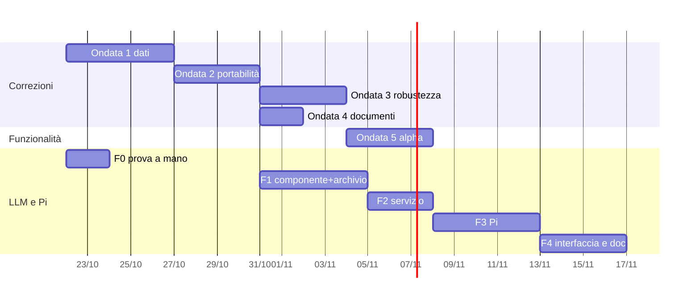

# 05 — Piano Esecutivo `v6`

> Obiettivo: chiudere i rilievi del documento [01](./01-BUG-SICUREZZA-PORTABILITA.md) e [02](./02-INCONGRUENZE-DOCUMENTAZIONE.md) in ondate piccole e indipendenti, aggiungere regole che impediscano di ricadere negli stessi errori, poi costruire LLM locali e Pi ([03](./03-LLM-LOCALI-GGUF-E-PI.md)) e le funzionalità ([04](./04-NUOVE-FUNZIONALITA.md)).
> Ogni ondata è un ramo `fix/…` o `feature/…` con merge in `main`, come nella storia del repository; ogni correzione porta una prova che fallisce prima e passa dopo.

---

## 1. Strategia: correggere lo schema, non solo il caso

I rilievi gravi ripetono cinque schemi (documento 00, §3). Conviene introdurre **un aiuto per schema** e poi usarlo in tutti i punti, invece di correggere ogni punto a modo suo.

| Schema | Aiuto da introdurre | Dove sostituisce | Rilievi chiusi |
|---|---|---|---|
| Cancellare prima di avere il nuovo | `fsx::set_aside(path) -> Guard` che sposta da parte e rimette a posto nel `Drop` se non si chiama `commit()` | `micromamba_create`, `cc.rs`, copia dei dati MySQL | `BUG-V6-02`, `BUG-V6-09` |
| Scrivere un file parziale nel posto finale | `fsx::write_staged(path, \|tmp\| …)` → `*.part`, `sync_all`, `rename`; su errore cancella il parziale | dump DB, archivio MongoDB, `write_atomic` | `BUG-V6-06`, `BUG-V6-27`, `BUG-V6-04` |
| Leggere «vuoto» un file illeggibile | `fsx::load_state<T>(path) -> Result<Option<T>>`: `Ok(None)` solo se il file **non esiste**; errore se esiste ma non si legge | `secrets.json`, `servers.json`, `services.json`, chiave Gemini | `SEC-V6-01`, parte di `PORT-V6-01` |
| Avviare fuori dal Job | solo `jobs::spawn_in(&mut cmd, &job)`; regola clippy `disallowed-methods` su `Command::spawn` fuori da `os/jobs.rs` | DB, PTY, estensioni | `BUG-V6-25` |
| Valori esterni in nomi di file e configurazioni | `fsx::safe_file_name()` e `host_label()` obbligatori; escape XML/properties in un modulo | installatori, Caddy dedicato, Maven, Gradle | `SEC-V6-04`, `BUG-V6-08`, `BUG-V6-12`, `PORT-V6-04` |

Più due regole di prova:

- **Prove di guasto**: per ogni operazione che cancella o sostituisce, una prova che fa fallire il passo centrale (installatore finto che dà errore, processo che esce subito, file bloccato) e controlla che lo stato precedente sia intatto.
- **Percorsi difficili come dati fissi**: una tabella di radici di prova riusata da rilocazione, Caddy, Maven, Gradle, PowerShell: `E:\`, `E:\kit`, `D:\R&D\kit`, `D:\O’Brien\Atollo`, `C:\Users\Müller\kit`, `/Volumes/KIT`, `/home/Me/Kit`, un nome di progetto con spazi e unicode.

---

## 2. Ondate

### Ondata 1 — Dati che non si perdono (priorità massima)

| Ramo | Rilievi | Note |
|---|---|---|
| `fix/db-restore` | `BUG-V6-01`, `BUG-V6-04`, `BUG-V6-05`, `BUG-V6-06` + **N-4** | filtro `DEFINER` in streaming, `--hex-blob`, stdin in un thread, `*.part`, backup automatico prima del ripristino |
| `fix/conda-update` | `BUG-V6-02` | `set_aside` + prova con installatore che fallisce |
| `fix/relocate-root` | `BUG-V6-03`, `BUG-V6-19` | tabella delle radici difficili; segnale residuo con i file falliti |
| `fix/state-files` | `SEC-V6-01`, `BUG-V6-27`, `BUG-V6-26`, `BUG-V6-09` | `load_state`, `write_staged`, lock unico di `secrets.json` |
| `fix/agents-sync-safety` | `BUG-V6-16`, `BUG-V6-15`, `BUG-V6-18` | copia prima di cancellare, flag «in chiusura», battito del lock |

### Ondata 2 — Portabilità tra PC e sicurezza

| Ramo | Rilievi | Note |
|---|---|---|
| `fix/owner-acl` | `PORT-V6-01`, `BUG-V6-33` (token) | **prima** la prova manuale con due account Windows su NTFS; poi ricreare i segreti di sessione e ripristinare la DACL; base per N-3 |
| `fix/agent-secrets-trust` | `SEC-V6-02`, `PORT-V6-02`, `BUG-V6-32` | richiede una decisione (§4); token solo nel lancio degli agenti |
| `fix/odd-paths` | `BUG-V6-08`, `BUG-V6-12`, `BUG-V6-31`, `PORT-V6-04`, `PORT-V6-05`, `BUG-V6-07` | tutti con la tabella dei percorsi difficili |
| `fix/install-hardening` | `SEC-V6-03`, `SEC-V6-04`, `BUG-V6-13`, `BUG-V6-14`, `BUG-V6-22` | timeout d'inattività serve anche ai GGUF |

### Ondata 3 — Robustezza

| Ramo | Rilievi |
|---|---|
| `fix/runner-pools` | `BUG-V6-10`, `BUG-V6-11`, `BUG-V6-25`, `BUG-V6-28` |
| `fix/setup-robustness` | `BUG-V6-20`, `BUG-V6-21`, `BUG-V6-23`, `BUG-V6-24`, `PORT-V6-03` |
| `fix/agents-misc` | `BUG-V6-17` (+ rotazione del log), `BUG-V6-29`, `BUG-V6-30`, `PORT-V6-06` |
| `fix/ui-autosave` | `UX-V6-01`, `UX-V6-02`, `UX-V6-03` |
| `fix/tests` | `TEST-V6-01`, `TEST-V6-02`, `TEST-V6-03` |

### Ondata 4 — Documentazione

Un ramo `docs/v6` per `DOC-V6-01..16`, più i due generatori di §4 del documento 02 (blocco CLI dei README da `HELP`, host di rete per PRIVACY) così le incongruenze non tornano. `DOC-V6-02` (testo di `HELP`) e `DOC-V6-03` (italiano nella Guida) toccano il codice e vanno nello stesso ramo.

### Ondata 5 — Funzionalità per l'alpha

`feature/diagnostics` (N-1 + N-2), `feature/kit-health` (N-3), poi N-7, N-11, N-6.

### Ondata 6 — LLM locali e Pi

Le fasi F0-F4 del documento 03. **F0 può partire subito, in parallelo alle ondate 1-2**: è una prova a mano che non tocca il codice e risponde alle domande che decidono F1. F1 dipende da `BUG-V6-13` (ondata 2) per i download grandi; F3 dipende da `BUG-V6-03` (ondata 1) per la rilocazione dei file di Pi e dalla decisione su `SEC-V6-02`.

Le date sono indicative e presuppongono una persona a tempo pieno con l'aiuto di agenti; le ondate 3-4 e F1 possono sovrapporsi con più persone.

---

## 3. Come verificare ogni ondata

- `npm run lint` e `npm test` verdi (oggi: 794/802 in Rust con 1 prova instabile, 219/219 nell'interfaccia).
- Le prove nuove di guasto e dei percorsi difficili.
- Per l'ondata 2: la prova manuale con due account Windows e lo stesso SSD NTFS, annotata in [`TESTING.md`](../../app/TESTING.md).
- Per l'ondata 6: la tabella «modello × compiti» di F0 conservata in `docs/app/` come base per il catalogo dei modelli.
- Alla fine: un report `v7` che verifichi la chiusura dei rilievi `v6`, come il `v5` ha fatto per il `v4`.

---

## 4. Decisioni da prendere

| # | Domanda | Proposta | Rilievi o fasi |
|---|---|---|---|
| 1 | I token degli agenti (`CLAUDE_CODE_OAUTH_TOKEN`, `GEMINI_API_KEY`) restano in tutto l'ambiente del kit? | **No**: solo nel lancio degli agenti; le azioni dei progetti e i terminali generici non li vedono | `SEC-V6-02` |
| 2 | Le cartelle di `projects/` sono fidate in anticipo per Claude e Codex? | **No**: fiducia al primo avvio di un agente nel progetto, con una riga in Attività; interruttore nella pagina del progetto | `SEC-V6-02`, Pi `defaultProjectTrust` |
| 3 | Il ripristino MySQL toglie i `DEFINER` o gira come root dopo un controllo? | **Toglie i `DEFINER`** e resta come utente del progetto (D-78) | `BUG-V6-01` |
| 4 | Backend di llama.cpp | CPU + Vulkan con scelta automatica; CUDA facoltativo dopo | F1 |
| 5 | Pi da binario o da npm | binario GitHub con `SHA256SUMS` | F3 |
| 6 | Modelli locali anche per Claude Code e Codex | solo come esperimento dopo Pi | F5 |
| 7 | Accesso con API key per Claude e Codex | campo in Impostazioni come per Gemini, oppure togliere i rami morti | `BUG-V6-32` |
