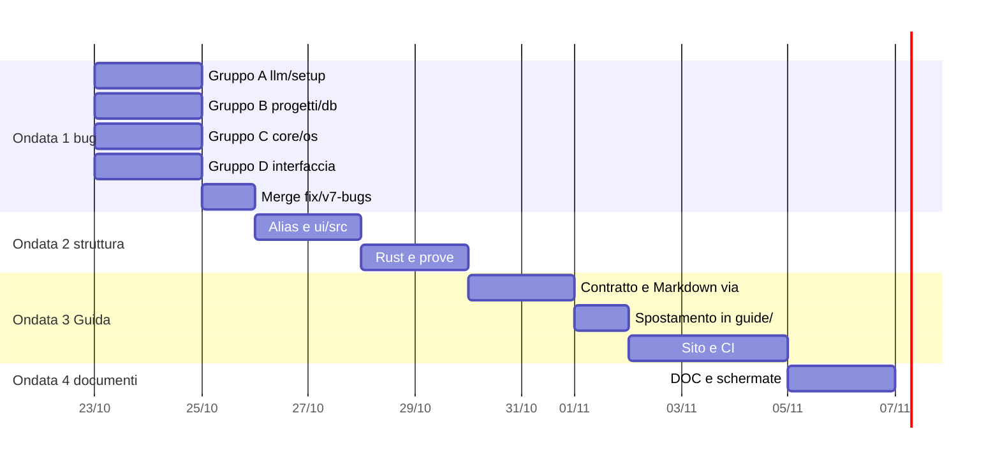

# 05 — Piano Esecutivo `v7`

> Obiettivo: chiudere i rilievi dei documenti [01](./01-BUG-SICUREZZA-PORTABILITA.md), [02](./02-INCONGRUENZE-DOCUMENTAZIONE.md) e [03](./03-STRUTTURA-DUPLICATI-ALIAS.md), poi rendere neutra la Guida e pubblicarla sul sito ([04](./04-GUIDA-NEUTRA-E-SITO.md)), infine riallineare tutta la documentazione.
> **Regole comuni a ogni ondata**: un ramo per ondata; **un commit per rilievo** (il messaggio cita l'id, per esempio `fix(llm): resume from the entry's commit (BUG-V7-01)`); merge in `main` solo con `cargo test`, `npm -w ui test` e `npm run lint` verdi. Ogni correzione di un bug porta una prova che fallisce prima e passa dopo, dove il comportamento si può provare.
> **Punto di partenza**: `HEAD 1f84370`; `main` ha già in più `eb3cb57` (D-153) e `c256fb6` (D-154). Prima di ogni ondata, rileggere le righe citate sopra l'`HEAD` del momento.

---

## 1. Strategia: correggere lo schema, non solo il caso

I rilievi di questa revisione sono quasi tutti di gravità BASSA ma ripetono cinque schemi. Conviene un aiuto o una regola per schema.

| Schema | Aiuto o regola | Rilievi |
|---|---|---|
| Letture concorrenti senza sequenza, errori inghiottiti nell'interfaccia | ogni lettura di pagina passa da `useLoad` (sequenza, `onError: "keep" \| "show"`), ogni azione da `useAction` con `ErrorLine`; regola ESLint `no-restricted-syntax` contro `.then(…, () => undefined)` e `void` su promesse di comandi in `ui/src` | `BUG-V7-22`, `-24`, `-25`, `-27`, `-28`, `-30`, `-31`, `-32` |
| Processi uccisi e mai raccolti | `os::jobs::kill_and_reap(&mut Child)` (e un thread che aspetta in `spawn_detached`); `clippy::disallowed-methods` su `Child::kill` fuori da `os/jobs.rs` | `BUG-V7-14`, `BUG-V7-20` |
| Percorsi confrontati senza le regole del sistema (D-123) | solo `processes::path_key`/`prefix_of` per confrontare percorsi; niente `to_lowercase()` su un percorso (ricerca nel codice in `test/rust`) | `BUG-V7-02`, `-18`, `-19` |
| Valori esterni in file di configurazione | `apache::quoted_path` gemello di `caddy::quoted_path`; tabella comune di nomi difficili nelle prove (`"`, `\`, a capo, `${`, `{}`) | `BUG-V7-09` |
| Manifest dei modelli creduto senza ricontrollo | la ripresa parte dalla voce del manifest (commit, file, SHA), mai da una nuova lettura del repository; un file esistente si accetta solo con lo SHA giusto | `BUG-V7-01`, `-04`, `-05` |
| Testi rivolti all'utente fuori dal catalogo | la prova i18n Rust vede ogni forma di chiamata (`BUG-V7-36`), poi si correggono i testi | `BUG-V7-12`, `-35`, `-37`, `-38` |

---

## 2. Ondate

### Ondata 1 — `fix/v7-bugs`: i 39 rilievi del codice

I quattro gruppi del documento 01 toccano file diversi e girano **in parallelo, ognuno nel suo worktree** (`.claude/worktrees/v7-a` … `v7-d`) su un sotto-ramo (`fix/v7-bugs-a` … `-d`); ogni sotto-ramo entra in `fix/v7-bugs` quando le sue prove sono verdi, e `fix/v7-bugs` entra in `main` dopo un giro completo di prove.

| Gruppo | Sotto-ramo | Rilievi | Note |
|---|---|---|---|
| **A** llm/setup | `fix/v7-bugs-a` | `BUG-V7-01..08`, `BUG-V7-35` | ordine: `03` (lock atomico) e `02` (chiave canonica) prima di `01`, `04`, `05` (ripresa dal manifest); `35` aggiunge voci a `tauri/i18n/catalog.json` |
| **B** progetti/db/server | `fix/v7-bugs-b` | `BUG-V7-09..14`, `BUG-V7-38` | `09` con la tabella dei nomi difficili; `11` riusa le funzioni dei socket di `caddy.rs` (attenzione: l'ondata 2 sposta `caddy.rs`, quindi l'ondata 1 va prima); rileggere `db/services/` dopo `c256fb6` |
| **C** core/editor/os | `fix/v7-bugs-c` | `BUG-V7-15..21`, `BUG-V7-36` | `36` per primo: allargare la prova i18n prima che A e B aggiungano testi; `20` introduce `kill_and_reap`, che B usa per `14` (se B arriva prima, `14` usa `wait()` diretto e `20` lo sostituisce) |
| **D** interfaccia | `fix/v7-bugs-d` | `BUG-V7-22..34`, `BUG-V7-37`, `BUG-V7-39` | la regola ESLint del §1 come ultimo commit, quando le pagine sono già corrette; `39` tocca le 4 `site/strings` |

Conflitti possibili tra gruppi: solo `tauri/i18n/catalog.json` (A, B, C) e `ui/src/locales/*.json` (D): voci nuove in coda, risolte al merge.

Codice solo Unix (`BUG-V7-11`, `-14`, `-17`..`-21`): provato dalla CI di macOS e Linux; `BUG-V7-17` anche a mano avviando l'app da Finder.

### Ondata 2 — `refactor/v7-structure`: struttura, duplicati, alias

Nessun cambiamento di comportamento: le prove esistenti sono la rete, e non se ne scrivono di nuove salvo `test/rust/support.rs`. Un commit per rilievo, nell'ordine che riduce i conflitti:

1. **Alias** (`STR-V7-20`): `@/`, `@guide` (ancora su `ui/src/guide`), `@test` in `ui/tsconfig.json` e `ui/vite.config.ts`; `test/ui/support/tauri.ts` al posto dei 21 `vi.mock`; conversione dei relativi profondi in `ui/src` e `test/ui`, **esclusa `ui/src/guide`** (lo script Markdown non capirebbe `@/`; la Guida si sposta nell'ondata 3).
2. **Struttura di `ui/src`** (`STR-V7-19`): `shared/`, `shell/`, `servers/`, `terminal/page.tsx`, `components/{relations,byhand,setup}.tsx`, `projects/extensions.tsx`; le prove seguono. Prima `STR-V7-13` (`scripts/lib/shots.mjs`), perché gli script delle schermate leggono `ui/src/locales`.
3. **Duplicati dell'interfaccia** (`STR-V7-14`, `-15`, `-16`) e `STR-V7-17` (`workbench/{buttons,inputs,indicators}.tsx`).
4. **Rust, riesportazioni** (`STR-V7-08`, `-09`, `-10`, `-11`) e sonde in `crate::ports` (`STR-V7-01`).
5. **Rust, file grandi** (`STR-V7-02..07`), un file per commit, ognuno con `pub use` che tiene i percorsi.
6. **Prove Rust** (`STR-V7-21`, `-22`).
7. **Script** (`STR-V7-12`): `gen_matrix.mjs` su `site/matrix.mjs`; `TOOLS-MATRIX.html` rigenerato identico.

`STR-V7-18` (modello della Guida) si chiude nell'ondata 3.

### Ondata 3 — `feature/v7-guide-site`: Guida neutra e sito

I passi 1-9 del documento [04](./04-GUIDA-NEUTRA-E-SITO.md) §10, un commit per passo (e un commit per i rilievi `GUI-V7-xx` che un passo chiude):

| Passo | Contenuto | Rilievi |
|---|---|---|
| 1 | contratto dei widget dentro `ui/src/guide`, Markdown identico byte per byte (ultimo uso dello script) | `GUI-V7-01` (lingua) |
| 2 | **tolti** `scripts/guide-docs.cjs`, `docs/app/GUIDE.md`, `GUIDE.it.md`, `test/ui/guide/docs.test.ts`, il passo `--check` e la riga di livello in `app.yml`; link dei README (×4) e dei documenti al sito | `GUI-V7-04`, `GUI-V7-05` (superati) |
| 3 | contenuto pulito: icone come nomi, navigazione dichiarativa, widget solo-app con ripiego, nessuna classe | `GUI-V7-01` (icone), `-02`, `-03`, `-06`, `-07` |
| 4 | spostamento in `guide/`, `@guide` → `../guide`, chunk, lint, glob delle prove | `GUI-V7-08`, `-09`, `-10`, `STR-V7-18` |
| 5 | modello del sito diviso in partial | `GUI-V7-12` |
| 6 | renderer del sito, ricerca, sitemap, hreflang | |
| 7 | CI: `site.yml`, livello `site` con `build.mjs --check` | `GUI-V7-11` |
| 8 | ARCHITECTURE*.md e TESTING*.md per la nuova struttura | |
| 9 | facoltativo: schermate in `guide/shots` (§5, decisione 2) | |

Dopo il merge: pubblicazione del sito da `site.yml`, poi in Search Console il reinvio di `sitemap.xml` (148 URL nuovi).

### Ondata 4 — `docs/v7-consistency`: documentazione

Un commit per rilievo `DOC-V7-xx`, poi i commit d'aggiornamento:

| Commit | Contenuto |
|---|---|
| `DOC-V7-01` | `agentCount` calcolato in `site/build.mjs` |
| `DOC-V7-02` | nota «in arrivo nel prossimo rilascio» per Pi, modelli locali e diagnostica nei README (×4) e nel sito, voce «Non ancora rilasciato» nel CHANGELOG (**secondo la decisione 1**) |
| `DOC-V7-03` | Git nella Guida (4 lingue, ora in `guide/content/agents.tsx`) e nel suggerimento di `ui/src/components/model.ts:47` con i locali en/fr/de |
| `DOC-V7-04`, `-10` | «Modelli locali» nell'elenco delle pagine: Guida §1.3 e `a2Text` del sito |
| `DOC-V7-05` | pagina `models` e dati d'anteprima con Pi in `scripts/guide-shots/make.mjs`; **schermate rigenerate** con `scripts/guide-shots/make.mjs` (Guida) e `site/shots/make.mjs` (sito) nelle 4 lingue, se l'anteprima e il browser sono disponibili; altrimenti il commit aggiorna solo `make.mjs` e la rigenerazione resta annotata come da fare |
| `DOC-V7-06`, `-08`, `-13` | CATALOG.md/.it.md (tipi, `targets`, MB del primo avvio), README (×4), TESTING.md/.it.md |
| `DOC-V7-07` | ARCHITECTURE.md/.it.md: `diagnostics.rs`, `tray.rs`, `app\diagnostics\`, niente conteggi esatti di righe |
| `DOC-V7-09`, `-11` | README (×4): la chiave dei modelli locali nel `models.json` di Pi; «Il kit» con Esporta diagnostica e Segnala un problema |
| `DOC-V7-12` | MARKETING.md: 4 agenti |
| Guida | aggiornamento del contenuto: Pi come quarto agente, modelli locali (catalogo, Hugging Face, server, token), Git che arriva con Claude Code e Pi, diagnostica; correzioni di testo nate dalle ondate 1-3 |
| Documenti tecnici | ARCHITECTURE, TESTING, CATALOG in en e it: moduli e cartelle nuove delle ondate 2-3, prove nuove, alias |
| README ×4, PRIVACY | link alla Guida sul sito (verifica), funzioni nuove, host di rete nuovi se ci sono (`nabre.github.io` per la Guida) |
| CHANGELOG | voce «Rilievi del report v7» con i rami e i rilievi chiusi |
| DECISIONS | **D-164** «Guida neutra, pubblicata sul sito; niente più GUIDE.md» (testo nel documento 04, §10.1). La richiesta indicava D-153, ma D-153 e D-154 sono già usati (diagnostica, copie di sicurezza dei database) |

Le date sono indicative (una persona con l'aiuto di agenti). Le ondate 2 e 3 sono in sequenza perché la 3 sposta file che la 2 riorganizza e usa gli alias della 2; l'ondata 4 viene per ultima perché aggiorna la Guida nella sua sede nuova e documenta la struttura finale.

---

## 3. Come verificare ogni ondata

- Prima del merge: `cargo test` (base: **938 superati, 0 falliti, 7 ignorati**), `npm -w ui test` (base: **42 file, 272 superati**), `npm run lint` pulito. Se Vitest dà errori «Failed to start forks worker» con la macchina carica (`TEST-V7-01`), ripetere il giro prima di considerarli fallimenti.
- **Ondata 1**: ogni bug corretto ha la sua prova; la CI di macOS e Linux verde per il codice solo Unix.
- **Ondata 2**: stesso numero di prove superate di prima (più quelle di `support.rs`, se ne nascono); uscita di `vite build` con gli stessi chunk; `TOOLS-MATRIX.html` identico.
- **Ondata 3**: `node site/build.mjs --check`; `site-render.test`, `contract.test`, `lang.test`, `search.test`; 148 pagine in `_site`; la pagina principale identica a prima; Guida dell'app controllata a vista nelle 4 lingue.
- **Ondata 4**: controllo dei link relativi verde; i quattro README con le stesse sezioni; chiavi del sito uguali nelle 4 lingue.
- Alla fine: un report `v8` che verifichi la chiusura dei rilievi `v7`.

---

## 4. Rischi

| Rischio | Dove | Mitigazione |
|---|---|---|
| Conflitti tra i worktree dell'ondata 1 | cataloghi i18n | voci nuove in coda; merge dei sotto-rami uno alla volta |
| Spostamenti dell'ondata 2 che rompono import dinamici o chunk | `ui/src`, `test/ui` | alias prima degli spostamenti; confronto dei chunk di `vite build` |
| Regressioni silenziose dopo lo spostamento della Guida | chunk, prove vuote, Tailwind | controllo esplicito per ognuno (documento 04, `GUI-V7-08..10`) |
| Guida non leggibile senza rete dopo la fine di GUIDE.md | utenti su GitHub | la Guida resta nell'app; il sito è statico e leggero |
| Schermate non rigenerabili sulla macchina che fa l'ondata 4 | `make.mjs` | il commit aggiorna gli script; la rigenerazione si annota come da fare |

---

## 5. Decisioni da prendere

| # | Domanda | Proposta | Rilievi |
|---|---|---|---|
| 1 | Pi, modelli locali e diagnostica sono in `main` ma non nel rilascio 0.5.1, che README e sito fanno scaricare | **nota «in arrivo nel prossimo rilascio»** nei README (×4), nel sito e nel CHANGELOG finché non esce un rilascio; in alternativa tagliare il prossimo rilascio prima di pubblicare il sito (documento 02, §3) | `DOC-V7-02` |
| 2 | Spostare le schermate della Guida da `ui/public/guide/<lang>/` a `guide/shots/<lang>/` | **facoltativo, dopo**: la fase 1 le lascia dove sono e il sito le copia; spostarle completa la neutralità ma tocca Vite, `make.mjs`, ARCHITECTURE, TESTING e D-136 | documento 04, §6.4 |
| 3 | Numero della decisione sulla Guida | **D-164** (D-153 e D-154 sono già in `main`; D-155..D-163 sono andati alle funzioni entrate prima della Guida) | documento 04, §10.1 |
| 4 | `TMPDIR` su macOS/Linux: aggiungerlo all'avvio o toglierlo dall'ambiente del kit | **aggiungerlo**, con cartella `0700` e controllo del proprietario; D-90 vale così anche fuori da Windows | `BUG-V7-17` |
| 5 | Pagina di benvenuto di Apache | **neutra** (`<h1>Apache</h1>` e il percorso): si scrive una volta e non seguirebbe un cambio di lingua | `BUG-V7-38` |
| 6 | Ricerca nel testo sul sito | prima solo titoli e parole chiave (come l'app); il testo (~25 kB per lingua) dopo, se serve | documento 04, §6.3 |
| 7 | Pool di Vitest | nessun cambiamento finché la CI non mostra i timeout; poi `pool: "vmThreads"` | `TEST-V7-01` |
