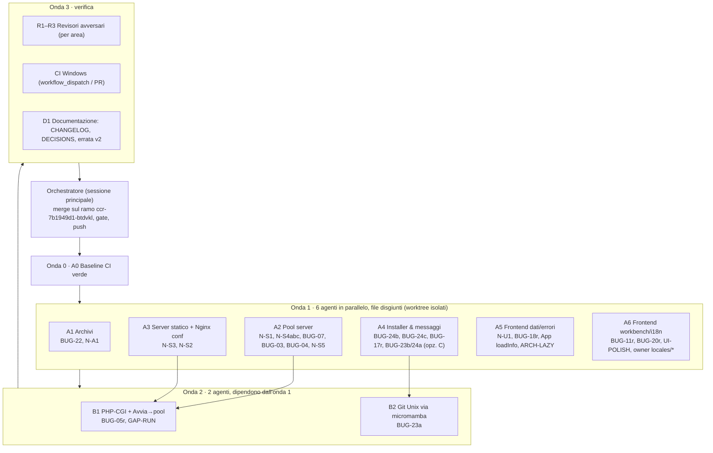

# 07 — Piano di Risoluzione dei Bug con uno Sciame di Agenti (`v2`)

> Base verificata: `HEAD b4fb751` (= codice di `fa8a34d`; `b4fb751` aggiunge solo `reports/v2/`).
> Metodo: prima di pianificare, 4 agenti in parallelo hanno riletto **il codice reale** per ogni voce dei documenti 00–06
> (server/sicurezza backend, installer multi-OS, frontend, fattibilità di build/test). Questo piano si basa sul loro
> riscontro, **non** sulle affermazioni dei rapporti `v2`, che in buona parte risultano superate.

---

## 1. Esito della verifica: cosa è davvero aperto

### 1.1 Errata ai rapporti `v2` (voci già risolte nel codice o false)

| ID | Verdetto | Evidenza nel codice |
| :-- | :-: | :-- |
| BUG-01 | ✅ già risolto | `projects/serve.rs`: `os::safe_path` ovunque, nessun `canonicalize`, `set_read_timeout(5s)`, `take(8192)`, `MAX_CONNS = 64` |
| BUG-06 | ❌ falso | `ProjectMcpBox` montato in `ui/src/projects/page.tsx:278-283` |
| BUG-08 | ✅ già risolto | `default_server=false` sui vhost del pool; test `nginx_pool_conf_and_vhosts_have_no_duplicate_localhost` |
| BUG-09 | ✅ già risolto | `useLoad` con `seq` (`hooks.ts:81-103`) + test; `useRuns` unisce lista ed eventi |
| BUG-10 | ✅ già risolto | `useAction`: `if (id === seq.current) setBusy(null)` + test |
| BUG-12 | ✅ già risolto | 464/464 chiamate `tr()` con 4 lingue |
| BUG-13 | ✅ già risolto | `db/adminer.rs:137` usa `jobs::spawn_in` |
| BUG-14 | ✅ già risolto | `detect/mod.rs:392-396, 617-620` aggiunge `mariadb` per WordPress |
| BUG-15, 16, 19, 21 | ✅ già risolti | path `data\projects`, Guida aggiornata, errori azzerati, nessun `capitalize` |
| BUG-17 | ✅ quasi | `cli.rs:353-363` sostituisce la cartella; resta il testo «del kit» e la nota obsoleta in `DECISIONS.md:683` |
| Doc 06 §3.1 | ❌ falso | `install/scientific.rs`, `extract_conda_package`, `resolve_conda_forge` **non esistono** |

### 1.2 Backlog reale (confermato) — 27 voci

Legenda severità: **H** alta · **M** media · **L** bassa. `N-*` = bug nuovi trovati dalla verifica.

| # | ID | Sev. | Oggetto | File principali |
| :-: | :-- | :-: | :-- | :-- |
| 1 | **CI-0** | H | CI `main` rossa: `cargo fmt` (29 diff), `clippy -D warnings` (14 err), ESLint (4 err), Prettier (5 file); lo step frontend in pwsh nasconde i fallimenti (conta solo l'ultimo comando) | `.github/workflows/app.yml`, file vari |
| 2 | **N-S1** | H 🔒 | Pool: `DocumentRoot` ricade sulla radice del progetto se `public/` manca o è una giunzione → espone `.env`, `.git/config`, `wp-config.php` (anche in LAN) | `servers/mod.rs:642-643, 666-667` |
| 3 | **N-S2** | M-H 🔒 | Nginx senza FastCGI serve i `.php` come download (sorgente) | `projects/nginx.rs:129-135` |
| 4 | **N-S3** | M 🔒 | Nomi brevi 8.3 (`ENV~1`, `GIT~1`) aggirano il blocco dei file nascosti | `projects/serve.rs:100-105` |
| 5 | **BUG-22** | M 🔒 | `extract_tar_xz` usa `tar -xJf` senza `safe_join`, link assoluti, mtime, `0o755` | `net/archive.rs:175-190` |
| 6 | **N-S4a** | M | Scritture perse su `servers.json`: `list()` (ogni 3 s, senza lock) sovrascrive `save_profile`/`remove_profile` | `servers/mod.rs:381, 534-535` |
| 7 | **N-S4b** | M | `server_remove`/`server_save` sincroni bloccano il thread fino a ~10 s su `op_lock` | `commands/servers.rs:31-38` |
| 8 | **N-S4c** | L | Porte orfane mai potate in `store.ports` | `servers/mod.rs` |
| 9 | **BUG-03** | M | stderr di httpd/nginx → `null`: l'errore di sintassi config non arriva all'utente | `servers/mod.rs:771-773, 308-327` |
| 10 | **BUG-04** | M | Reload: attesa porta euristica (`sleep 100ms` + connect 30 ms), falso «porta già usata» su Windows | `servers/mod.rs:872-881` |
| 11 | **BUG-05r** | M | php-cgi: morte non rilevata (502 permanente con pool «avviato»), php-cgi avviato anche su pool Nginx senza progetti PHP | `projects/nginx.rs`, `servers/mod.rs:391, 512, 754` |
| 12 | **BUG-07** | M | `WebServers::list()` esegue `detect::detect` su tutti i progetti ogni 3 s (la scrittura di `servers.json` invece è già condizionata) | `servers/mod.rs:377-417` |
| 13 | **N-S5** | L 🔒 | Pool Apache senza vhost di default: il primo progetto risponde a ogni `Host` (anche IP in LAN) | `servers/mod.rs:242-257` |
| 14 | **GAP-RUN** | M | «Avvia» del progetto ignora `action.server` e lancia sempre un httpd/nginx dedicato | `projects/run.rs:464-499` |
| 15 | **BUG-23a** | M | Git Unix: `.tar.bz2`/`.conda` passato come `Kind::Zip`; nome file forzato `.tar.bz2`; servono dipendenze e prefix conda | `install/core.rs:26-75` |
| 16 | **BUG-23b** | M | Nginx Unix scarica il tarball **sorgente** | `install/web.rs:706-753` |
| 17 | **BUG-24a** | L | Php/Apache Unix cablati su `windows.php.net`/`apachelounge`; `php.ini`/`httpd.conf` solo Windows | `install/web.rs` |
| 18 | **BUG-24b** | L | Python: `python_minor(ctx)` (default `3.13`) invece della linea scaricata in `before_swap`/`finish` (anche Windows, riga 306) | `install/core.rs:155-167, 306, 342` |
| 19 | **BUG-24c** | L | Messaggio «non disponibile sui PC ARM64» anche per indisponibilità per OS; stessa radice nelle etichette UI (`no_arm64`) | `commands/mod.rs:140`, `commands/setup.rs:85`, `ui/src/components/{rows,table,tool}.tsx` |
| 20 | **BUG-17r** | L | Testo CLI «cartella … del kit» + nota obsoleta D-90 | `cli.rs`, `tauri/i18n/catalog.json`, `docs/app/DECISIONS.md:683` |
| 21 | **N-A1** | L | Test `tar_gz_extract` non portabile (`r"server\bin\run.cmd"`); doc di `archive.rs` dice «skips links» | `test/rust/net/archive.rs:93`, `net/archive.rs:1-8` |
| 22 | **N-U1** | M | `databases.tsx`: errori delle azioni cancellati subito da `refresh()`/polling; risposte fuori ordine | `ui/src/databases.tsx:313-345` |
| 23 | **BUG-18r** | L | Nessun «Riprova» (editorsettings, extensions); `ProjectMcpBox` sparisce in silenzio (`onError:"keep"`) | `ui/src/{editorsettings,extensions,projectmcp}.tsx` |
| 24 | **BUG-11r** | L | `useStoredSize`: `localStorage.setItem` dentro l'updater a ogni pixel | `ui/src/workbench/layout.tsx:57-73` |
| 25 | **BUG-20r** | L | Menu `versions/kit.tsx` senza frecce/Home/End/focus; `aria-haspopup` mancante; dialog: selettore FOCUSABLE include bottoni nascosti, focus non restituito | `ui/src/versions/kit.tsx`, `ui/src/workbench/dialog.tsx` |
| 26 | **UI-POLISH** | L | Badge sorgente inglese «latest»/«locked» visibili in italiano; `text-[10px]` in `stats.tsx:180`; `loadInfo` senza riprova (`App.tsx:102-115`); Guida «Eject drive» vs «Remove drive»; `tr()` con parametri opzionali | `ui/src/versions/kit.tsx`, `locales/*.json`, `stats.tsx`, `App.tsx`, `guide/*` |
| 27 | **ARCH-LAZY** | L | `GuidePage` importata staticamente (~5000 righe) | `ui/src/App.tsx:49` |

Da **indagare** (non confermato, solo con macchina Windows): `Options FollowSymLinks` nei vhost Apache + giunzione verso `\\server` → possibile leak NTLM (spirito di D-77).

---

## 2. Vincoli operativi dello sciame (misurati, non ipotizzati)

| Controllo | In questo container Linux | Uso nel piano |
| :-- | :-: | :-- |
| `npm ci`, `npm -w ui test` (69/69), `npm -w ui run build` | ✅ | gate locale frontend |
| `npm -w ui run lint` / `format:check` | ✅ eseguibili, base rossa (4 / 5) | gate «nessun errore nuovo» finché CI-0 non chiude |
| `cargo check --all-targets --target x86_64-pc-windows-msvc` | ✅ (~3 s incrementale) | **gate Rust principale** (compila anche i test) |
| `cargo clippy … --target x86_64-pc-windows-msvc -- -D warnings` | ✅ eseguibile, base rossa (14) | gate dopo CI-0 |
| `cargo fmt --check` | ✅ eseguibile, base rossa (29) | gate dopo CI-0 |
| `cargo test` | ❌ (Linux: crate Windows-only + GTK; msvc: niente `link.exe`) | **solo GitHub Actions `windows-latest`** |

Conseguenze:
1. La CI parte solo su `pull_request`, `push` a `main` e `workflow_dispatch`: un push sul ramo di lavoro **non** esegue i test. Serve una PR (da chiedere esplicitamente) o `workflow_dispatch` sul ramo.
2. Finché `cargo fmt`/`clippy` sono rossi, `cargo test` in CI **non parte mai** → CI-0 è il prerequisito di tutto.
3. Ogni agente Rust deve aggiungere test **offline** che compilano con `cargo check --all-targets`; l'esecuzione arriva dalla CI Windows.

---

## 3. Topologia dello sciame

Totale: **1 + 6 + 2 + 4 = 13 agenti** in 4 onde; in nessun momento più di 6 agenti concorrenti.

### 3.1 Regole comuni a ogni agente

1. **Proprietà dei file**: ogni agente modifica solo i file della sua colonna «Possiede» (tabella §4). Serve un file altrui → lo scrive in `HANDOFF` nel rapporto finale, non lo tocca.
2. **Isolamento**: ogni agente lavora in un `worktree` proprio partendo dal commit di chiusura dell'onda precedente; un commit per bug (`fix(<area>): <ID> …`), messaggi in stile del repo.
3. **Test prima del fix** dove possibile: il test nuovo va in `test/rust/<percorso>.rs` o `test/ui/<percorso>.test.ts(x)` (convenzione `docs/app/TESTING.md`), offline, senza rete.
4. **Gate locali obbligatori** prima di consegnare:
   - Rust: `cargo check --all-targets --target x86_64-pc-windows-msvc`, `cargo fmt -- <file toccati>`, `cargo clippy … -D warnings` senza errori nuovi;
   - UI: `npm -w ui test`, `npm -w ui run build`, `npm -w ui run lint`, `npm -w ui run format:check`;
   - ogni nuova stringa `t()` deve stare in `en/fr/de.json` (`test/ui/i18n.test.ts`), ogni nuova chiave Rust in `tauri/i18n/catalog.json` (4 lingue).
5. **Rispetto delle decisioni** in `docs/app/DECISIONS.md` (D-77 link/giunzioni, D-89 dati progetto, D-90 download in TEMP) e del divieto `unwrap`/`expect`.
6. **Rapporto finale** strutturato: commit, file toccati, test aggiunti, esito dei gate, rischi residui, `HANDOFF`.

---

## 4. Assegnazione dettagliata

### Onda 0 — prerequisito (1 agente, seriale)

| Agente | Possiede | Lavoro | Uscita |
| :-- | :-- | :-- | :-- |
| **A0 Baseline** | tutti i file con diff `fmt`; i 14 punti clippy (`install/db.rs`, `setup/catalog.rs:221`, `versions/side_by_side.rs:97,105`, `install/lang/julia.rs:18,40`, `ruby.rs:79`); `test/ui/hooks.test.ts`, `ui/src/editorsettings.tsx:26`, `ui/src/projects/runs.ts:43`; i 5 file Prettier; `.github/workflows/app.yml` | 1) commit `style: cargo fmt` puramente meccanico; 2) commit clippy; 3) commit ESLint + Prettier; 4) step frontend della CI resi fail-fast (uno step per comando, oppure `$ErrorActionPreference='Stop'` + controllo di `$LASTEXITCODE`) | Tutti i gate locali verdi → da qui ogni agente usa il gate **pieno**, non più «nessun errore nuovo». Un `workflow_dispatch` sul ramo conferma `cargo test` su Windows (prima volta dopo mesi) e stabilisce la **base dei test** |

> Se `cargo test` su Windows rivela fallimenti preesistenti, l'orchestratore li registra come voce `CI-1` prima dell'onda 1 (non si avvia lo sciame su una base rossa).

### Onda 1 — 6 agenti in parallelo

| Agente | Bug (ordine interno) | Possiede | Fix progettato | Test da aggiungere |
| :-- | :-- | :-- | :-- | :-- |
| **A1 Archivi** | BUG-22 → N-A1 | `tauri/Cargo.toml`, `Cargo.lock`, `tauri/src/net/archive.rs`, `test/rust/net/archive.rs` | Dipendenza diretta `lzma-rust2 = { version = "0.21", default-features = false, features = ["std","optimization","xz","encoder"] }` (già nel lock via `sevenz-rust2`, nessun crate nuovo); `extract_tar_xz` = `XzReader::new(BufReader::new(File::open(archive)?), true)` → `extract_tar_stream` (eredita `safe_join`, link sicuri, no mtime, `0o755`); commento e doc di modulo corretti | `tar_xz_extract` (+ `#[cfg(unix)]` bit x in `bin/`), `tar_xz_slip_is_refused` (header `../evil.txt` scritto a mano), `#[cfg(unix)] tar_xz_absolute_symlink_skipped`; `tar_gz_extract` reso portabile (`Path::new("server").join("bin")…`) |
| **A2 Pool server** | N-S1 → N-S4a → BUG-07 → BUG-03 → BUG-04 → N-S4b → N-S4c → N-S5 | `tauri/src/servers/mod.rs`, `tauri/src/commands/servers.rs`, `test/rust/servers/mod.rs`, `ui/src/servers.tsx`, binding API servers in `ui/src/api/` | **N-S1**: niente ripiego su `proj_root`; `continue` + avviso nel log (come per gli alias saltati). **N-S4a**: `store_lock: Mutex<()>` attorno a ogni load+save. **BUG-07**: `cache: Mutex<Option<(Instant, WebServersView)>>`, `list(lang, fresh)`; TTL 15 s (come D-71); invalidazione in `save_profile`/`remove_profile`/`assign_project`/`start_locked`/`reload_locked`; «Aggiorna» → `fresh=true`. **BUG-03**: stdout/stderr su `pool_dir/stderr.log` (schema `db/adminer.rs:115-136`), letto da `pool_error_tail`, rimosso con `error.log`. **BUG-04**: `fn wait_port_released(port, within) -> bool` su `is_port_free` ogni 100 ms (max 5 s); in `stop_locked` `kill()+wait()` prima del drop del `Job`. **N-S4b**: `server_remove`/`server_save` `async` + `spawn_blocking`. **N-S4c**: potatura porte in `list(fresh=true)`. **N-S5**: vhost di default `ServerName localhost` → `${SRVROOT}/htdocs` prima di `IncludeOptional` | `pool_skips_site_with_missing_or_linked_docroot` (giunzione da `safe_path::tests`), `concurrent_list_and_save_profile_keep_profile`, `list_uses_cache_until_invalidated`, `pool_error_tail_reads_stderr_log`, `wait_port_released_true_after_listener_dropped`, `apache_pool_conf_has_default_vhost_first`; con `ATOLLO_TEST_KIT`: `start_reports_syntax_error`, `apache_pool_reload_twice` |
| **A3 Server statico + conf Nginx** | N-S3 → N-S2 | `tauri/src/projects/serve.rs`, `test/rust/projects/serve.rs`; in `tauri/src/projects/nginx.rs` **solo** la funzione di generazione conf (ramo senza FastCGI) + `test/rust/projects/nginx.rs` | **N-S3**: 403 su ogni segmento che contiene `~` seguito da cifra (regola semplice, nessuna API Win32); **N-S2**: nel ramo `fcgi_port == None` aggiungere `location ~ \.php$ { return 503; }` | in `paths()`: `/ENV~1`, `/GIT~1/config` → 403; `slowloris_does_not_block` (70 connessioni mute, GET risponde dopo 5 s); `no_fcgi_blocks_php_source` |
| **A4 Installer & messaggi** | BUG-24c → BUG-24b → BUG-17r → BUG-23b/BUG-24a (**opzione C**) | `tauri/src/commands/mod.rs`, `tauri/src/commands/setup.rs`, `tauri/src/install/core.rs` (**solo Python**), `tauri/src/install/web.rs`, `tauri/catalog/components.json`, `tauri/src/cli.rs`, `tauri/i18n/catalog.json`, `docs/app/DECISIONS.md:683`, `ui/src/components/{rows,table,tool}.tsx`, test corrispondenti (`test/rust/setup/catalog.rs`, `test/rust/install/core.rs`, `test/rust/cli.rs`, `test/rust/commands/…`) | **24c**: funzione pura `unavailable_msg(target)` → ARM64 se `WIN32_ARM64`, altrimenti «{0} non è disponibile per {1}.»; il campo `no_arm64` diventa `unavailable_reason` (o `unavailable_on`) e le 3 viste UI mostrano il testo giusto. **24b**: `fn python_minor_in(tree, windows) -> Option<String>` (Unix `lib/python3.N`, Windows `python3NN.dll`) usata in `before_swap`/`finish`, ripiego `python_minor(ctx)`. **17r**: stringa con `{1}` per la cartella al posto di `replace`; aggiornata la nota D-90. **23b/24a, opzione C**: `targets: ["win32-x64","win32-arm64"]` per `php`, `apache`, `nginx` in `components.json` (quindi `adminer` si spegne con messaggio coerente); `nginx_asset_for` su Unix → `bail!` esplicito. **Git resta disponibile** (serve a `claude`). | `multi_platform_availability…`: php/apache/nginx/adminer non disponibili su `DARWIN_ARM64`/`LINUX_X64`, disponibili su `WIN32_X64`; git e claude disponibili ovunque; `wanted_with_needs(["adminer"], LINUX_X64)` → messaggio con `linux-x64`, non «ARM64»; `python_minor_in_tree` (3.14 Unix e Windows); `unavailable_msg_*`; `failed_by_hand_shows_downloads_dir` |
| **A5 Frontend dati/errori** | N-U1 → BUG-18r → App `loadInfo` → ARCH-LAZY | `ui/src/databases.tsx`, `ui/src/editorsettings.tsx`, `ui/src/extensions.tsx`, `ui/src/projectmcp.tsx`, `ui/src/App.tsx`, `test/ui/App.test.tsx`, nuovi `test/ui/databases.test.tsx`, `test/ui/projects/projectmcp.test.tsx` | **N-U1**: `useLoad(servicesList, null, { onError:"show", every:3000 })` + `useAction(reload)` → errori separati e protezione dalle risposte fuori ordine. **18r**: `onError:"show"` + `<Notice tone="error">` con `ActionButton` «Riprova» (`VscRefresh`) che chiama `reload`; `EditorSettingsBox` portato su `useLoad`. **loadInfo**: pulsante Riprova sul banner. **LAZY**: `lazy(() => import("./guide").then(m => ({ default: m.GuidePage })))` + `<Suspense>`, `import type` per `GuideTopicId`; `App.test.tsx:735` → `findBy*` | errore d'azione resta visibile dopo `advanceTimersByTime(3000)`; projectmcp: rifiuto → errore → Riprova → lista; App: banner → Riprova → stato |
| **A6 Frontend workbench/i18n** | BUG-11r → BUG-20r → UI-POLISH | `ui/src/workbench/layout.tsx`, `ui/src/workbench/dialog.tsx`, `ui/src/versions/kit.tsx`, `ui/src/stats.tsx`, `ui/src/guide/{model,sections}.ts(x)`, **`ui/src/locales/{en,fr,de}.json` (unico proprietario)**, `test/ui/workbench/*`, nuovo `test/ui/workbench/layout.test.tsx` | **11r**: updater puro (solo clamp), persistenza in `useEffect` con debounce 150 ms e `try/catch`. **20r**: `onKeyDown` su `ul[role=menu]` (frecce/Home/End, schema `App.tsx:262-271`), focus sulla prima voce all'apertura, Esc restituisce il focus al trigger, `aria-haspopup` su `Locked`; dialog: FOCUSABLE con `:not([hidden]):not([tabindex="-1"])`, focus restituito alla chiusura. **POLISH**: chiavi italiane `t("più recente")`/`t("bloccata")` (vecchie chiavi rimosse), `text-[11px]` in `stats.tsx:180`, firma `tr(it, en, fr, de)` obbligatoria, «Rimuovi l'unità»/«Remove drive» uniformi nella Guida. **Chiavi per A5** («Riprova», ecc.): A6 le aggiunge su richiesta (vedi §5) | `layout.test.tsx` (3 set ravvicinati → 1 `setItem`, clamp min/max); menu: ArrowDown sposta il focus, Esc torna a «+»; dialog: Tab/Shift+Tab ciclano e il focus torna all'apertura |

### Onda 2 — 2 agenti (dopo il merge dell'onda 1)

| Agente | Dipende da | Possiede | Fix progettato | Test |
| :-- | :-- | :-- | :-- | :-- |
| **B1 PHP-CGI + Avvia→pool** | A2 (cache `list`, lock), A3 (conf Nginx) | `tauri/src/projects/nginx.rs` (spawn php-cgi), `tauri/src/projects/run.rs`, `tauri/src/servers/mod.rs` (`RunningPool`, `pool_of`), comando di avvio in `tauri/src/commands/`, test relativi | **BUG-05r**: `spawn_php_cgi_if_present -> Option<(u16, Child)>`, `RunningPool { php: Option<Child>, … }`, `list`/`running_count` segnalano «PHP fermo» se `try_wait()` ≠ `Ok(None)`; `php_line` solo se scelta esplicitamente (profili manuali e pool di default). **GAP-RUN**: funzione pura `site_mode(&Action) -> SiteMode { Dedicated, Pool(id) }`; con `action.server` → `WebServers::start(pool)` e `RunInfo.url` del sito del pool; `WebServers::pool_of(project, action_id)` | `default_nginx_pool_has_no_php_without_php_projects`, `pool_of_finds_assigned_project`, `site_mode_*` |
| **B2 Git Unix (micromamba)** | A4 (`core.rs` Python, catalogo) | `tauri/src/install/native.rs`, `tauri/src/install/mod.rs` (firma `custom`), `tauri/src/install/android.rs`, `tauri/src/install/core.rs` (**solo Git**), `test/rust/install/native.rs`, `test/rust/install/core.rs` | Estrarre da R funzioni condivise: `conda_info(ctx, pkg)`, `conda_versions(info, subdir)` (ex `r_versions_for`), `micromamba_release(ctx, version)`, `micromamba_create(ctx, …, prefix, specs, progress)`, pura `micromamba_create_args(prefix, specs)`. `Installer::custom(&self, target: Target) -> bool` (3 chiamanti in `mod.rs`, impl. in `native.rs`/`android.rs`). `Git::custom = !target.os.is_windows()`; R migrato sulle nuove funzioni senza cambi di comportamento. Rischio accettato e documentato: ambiente conda non rilocabile (come R, `native.rs:599-601`) | `conda_versions_per_subdir` (fixture JSON con pre-release scartata), `micromamba_create_args_git`, `r_versions_of_windows_only` adattato |

### Onda 3 — verifica e chiusura (4 agenti + CI)

| Agente | Compito |
| :-- | :-- |
| **R1 Revisore sicurezza** | Rilegge in modo avversario i diff di A1, A2 (N-S1, N-S5), A3, B1: percorso realistico per ogni regressione (link, giunzioni, 8.3, LAN), rispetto di D-77 |
| **R2 Revisore concorrenza/server** | Diff di A2 e B1: lock order (`op_lock` vs `store_lock` vs `cache`), deadlock, durata dei lock, comportamento del polling 3 s, firme cambiate |
| **R3 Revisore frontend/i18n** | Diff di A5 e A6: accessibilità, cataloghi completi, stringhe sorgente italiane, regressioni in `App.test.tsx` |
| **D1 Documentazione** | `docs/app/CHANGELOG.md`, `DECISIONS.md` (nota D-90, eventuale decisione su php/apache/nginx Unix), `CATALOG.md` (disponibilità per target), errata `reports/v2/03` → rimando a questo documento |

Ogni finding confermato dai revisori torna all'agente proprietario del file (stesso worktree) per un giro di correzione; nessun limite di giri, ma un finding ripetuto impone di risalire alla causa.

---

## 5. Protocollo dell'orchestratore

1. **Preparazione**: worktree per agente dal commit di chiusura dell'onda precedente; prompt = riga della tabella §4 + regole §3.1 + estratto pertinente di §1.
2. **Lancio** dell'onda in parallelo (agenti in background).
3. **Integrazione** in ordine fisso per ridurre i conflitti: A1 → A3 → A2 → A4 → A6 → A5 (A5 dopo A6 per le chiavi di `locales/*.json`; le chiavi richieste da A5 vengono passate ad A6 *prima* del lancio, così A6 le aggiunge nel suo commit).
4. **Dopo ogni merge**: gate pieni (§2). Un gate rosso → il commit torna al suo agente, l'integrazione si ferma.
5. **Fine onda**: push su `ccr-7b1949d1-btdvkl`, poi `workflow_dispatch` dell'workflow `App` sul ramo (o PR, se richiesta) per `cargo test` e le prove `real_` su `windows-latest`. Si passa all'onda successiva solo con CI verde.
6. **Registro**: ogni voce del backlog §1.2 ha stato (`aperto → in corso → in revisione → chiuso`) e il commit che la chiude.

### 5.1 Matrice dei conflitti di file (perché le onde sono fatte così)

| File | Voci che lo toccano | Gestione |
| :-- | :-- | :-- |
| `servers/mod.rs` | N-S1, N-S4, BUG-07, BUG-03, BUG-04, N-S5, BUG-05r, GAP-RUN | A2 (onda 1) poi B1 (onda 2): mai in parallelo |
| `projects/nginx.rs` | N-S2, BUG-05r | A3 solo la conf, B1 lo spawn: onde diverse |
| `install/core.rs` | BUG-24b (Python), BUG-23a (Git) | A4 poi B2 |
| `install/web.rs`, `components.json` | BUG-23b, BUG-24a | solo A4 |
| `locales/*.json` | BUG-18r, UI-POLISH, N-U1 | unico proprietario A6 |
| `App.tsx` | ARCH-LAZY, loadInfo | solo A5 |
| `tauri/i18n/catalog.json` | BUG-24c, BUG-17r | solo A4 |
| `Cargo.toml`/`Cargo.lock` | BUG-22 | solo A1 |

---

## 6. Decisioni (prese il 2026-10-16)

| # | Domanda | Raccomandazione |
| :-: | :-- | :-- |
| 1 | PHP/Apache/Nginx su macOS/Linux: **non disponibili** ora (opzione C) o porting completo via micromamba (php.ini, httpd.conf, mod_php da rifare)? | ✅ **Deciso: opzione C** ora (onda 1, A4); porting in un ciclo separato |
| 2 | Git su Unix via micromamba, accettando che l'ambiente non sia rilocabile (stesso limite di R)? | ✅ **Deciso: sì, con reinstallazione automatica** quando cambia il percorso del kit: B2 aggiunge a `check_moved` (`kit.rs`, `root-<os>.txt`) la marcatura «da reinstallare» dei componenti conda (Git, R) su Unix |
| 3 | A0 può riformattare tutto il repo (`cargo fmt`, Prettier) in commit dedicati? | ✅ **Deciso: sì**, in commit dedicati e meccanici |
| 4 | Cache di `WebServers::list()` con dati della pagina Server fino a 15 s in ritardo? | Sì, con «Aggiorna» che forza `fresh` |
| 5 | Esecuzione della CI: `workflow_dispatch` sul ramo o PR verso `main`? | ✅ **Deciso: `workflow_dispatch`** sul ramo, automatico a fine onda |
| 6 | `FollowSymLinks` nei vhost Apache: indagine su Windows reale prima di toccarlo? | Sì, fuori dallo sciame |

---

## 7. Stima

| Onda | Agenti | Voci chiuse | Dipendenze |
| :-: | :-: | :-: | :-- |
| 0 | 1 | CI-0 | — |
| 1 | 6 | 23 | onda 0 verde |
| 2 | 2 | 3 | A2, A3, A4 integrati |
| 3 | 4 + CI | verifica di tutte le 27 | onde 1–2 integrate |
